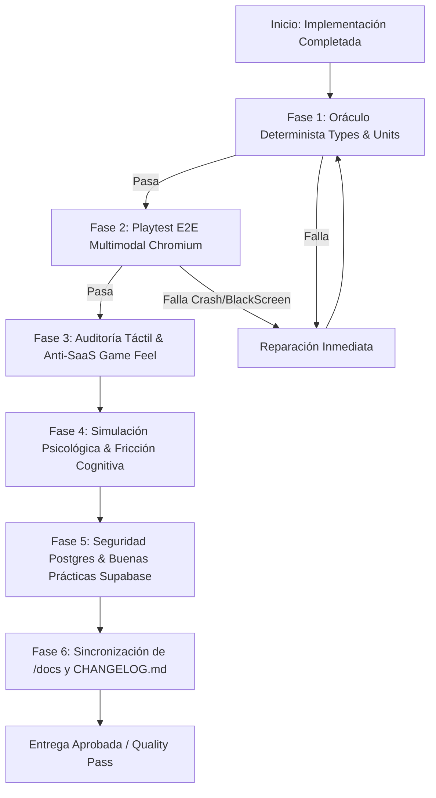

# GAME DEV QUALITY GATE & AUDIT SENTINEL
*Algoritmo Integral de Validación de Software, Psicología Lúdica, Integridad de Datos y Gobernanza de Documentación.*

Usa esta skill obligatoriamente siempre que:
- Se complete una implementación, refactorización o corrección en el juego.
- El usuario pida: *"Verifica la calidad"*, *"Audita la implementación"*, *"Corre el quality gate"*, *"Alinea los docs y el changelog"*, *"Simula la experiencia de usuario y errores prematuros"*.
- Se prepare un pull request, merge o release a producción.

---

## 1. PRINCIPIOS Y FILOSOFÍA DE CALIDAD

1. **Cero Tolerancia a Parches a Ciegas**: Ningún cambio se da por finalizado si no pasa por un oráculo determinista (compilador + tests) y una validación en navegador real.
2. **Cero "Documentation Drift"**: El código y la documentación técnica en `docs/` son gemelos simbióticos. Si el código muta, las especificaciones maestras se actualizan en el mismo commit.
3. **Registro Verídico (Verifiable Changelog)**: `CHANGELOG.md` no contiene promesas ni alucinaciones; solo hechos respaldados por telemetría y pruebas superadas.
4. **Game Feel y Psicología como Requisito Técnico**: Un botón que no rebota, una respuesta de clic que tarda más de 16ms o una regla opaca que induce frustración injusta son tratados como **bugs de severidad alta**, no simples preferencias cosméticas.

---

## 2. EL ALGORITMO DE AUDITORÍA EN 6 FASES (EXECUTION PIPELINE)

Cada vez que se aplica un cambio en el codebase, ejecuta secuencialmente este algoritmo:



---

### FASE 1: ORÁCULO DETERMINISTA DE MOTOR Y TIPOS
*Verifica la solidez matemática y contractual del código sin efectos colaterales.*

1. **Tipado Estricto**:
   ```powershell
   npx tsc --noEmit
   ```
   - Cero errores de TypeScript.
   - Prohibido el uso de `any` no justificado o tipos huérfanos.
2. **Suite de Motores Tácticos**:
   ```powershell
   npm run test:all
   ```
   - Valida la integridad del motor determinista de 1-100 HP, la economía de combustible, niebla de guerra, IA de asedio y cálculo de daño.

---

### FASE 2: PLAYTEST E2E MULTIMODAL (`/game-qa-playtester`)
*Experimenta el juego en un runtime real para detectar cuelgues o bloqueos de interacción.*

1. **Lanzar la Suite Playwright**:
   ```powershell
   npm run test:qa
   ```
2. **Inspección de Telemetría**:
   - Revisa `test-results/qa-run-latest.json`.
   - Verifica que `fatalErrorsCount == 0`, `pageErrors == []` y `networkFailures == []`.
3. **Auditoría Visual de Capturas (`test-results/screenshots/`)**:
   - `01_war_lobby_boot.png`: Montaje limpio de `#root`, cero pantallas blancas/negras.
   - `02_combat_theater.png`: Renderizado completo de la cuadrícula táctica, shaders y sprites (sin texturas rotas ni 404).
   - `03_tile_interaction.png`: Reactividad de selección de casilla y despliegue del menú contextual sin desbordamiento de viewport.

---

### FASE 3: AUDITORÍA TÁCTIL Y "GAME FEEL" (`/indie-game-ui-architect`)
*Garantiza que la interfaz se sienta como un juego indie de autor y no como un dashboard empresarial.*

Evalúa los componentes afectados frente a los 5 Invariantes de Juego Táctil:

| Invariante | Requisito Técnico Obligatorio | Verificación |
| :--- | :--- | :--- |
| **1. Anti-SaaS Silhouette** | Siluetas poligonales (`clip-path`), bordes biselados o estética cómic C4ISR. Prohibidas tarjetas planas con `border-radius: 8px` y tipografía corporativa. | Inspección CSS / JSX de componentes nuevos. |
| **2. Respuesta en 1 Frame (<16ms)** | Micro-interacción inmediata al `pointerdown` (sin esperar a `pointerup` o transiciones lentas). | Comprobar ausencia de `transition: all 0.3s ease` genérico. |
| **3. Física de Resortes** | Uso de curvas con rebote `cubic-bezier(0.34, 1.56, 0.64, 1)` y desaceleración `cubic-bezier(0.22, 1, 0.36, 1)`. | Revisar animaciones y transiciones de Framer Motion / CSS. |
| **4. Squash & Stretch** | Los botones y tokens interactivos deben comprimirse en `:active` (`scale(1.12, 0.88)`) antes de expandirse. | Comprobar micro-física en botones y cartas. |
| **5. Barras de Doble Capa** | Toda barra de HP, progreso de asedio o recursos debe tener *Ghost Trail* amortiguado tras la barra frontal. | Comprobar que no haya saltos de barra de una sola capa. |
| **6. Audio Procedural Web Audio** | Cada clic, hover de tecla o confirmación debe emitir sonido procedural con variación de pitch (`AudioContext`), evitando el juego sordo. | Verificar integración con `@src/engine/audioManager.ts` o síntesis procedural. |

---

### FASE 4: SIMULACIÓN DE EFECTOS PSICOLÓGICOS Y HEURÍSTICAS COGNITIVAS
*Auditoría pre-mortem para detectar frustración, fatiga o desinterés del jugador antes de que ocurran.*

Analiza la mecánica o interfaz bajo el modelo de 4 filtros psicológicos:

1. **Carga Cognitiva y Ancho de Banda de Trabajo**:
   - *Filtro*: ¿La pantalla exige recordar más de 4 variables simultáneas para tomar una decisión táctica?
   - *Acción*: Telegrafiar información en el propio mapa (capa espacial) en vez de obligar a consultar múltiples submenús.
2. **Claridad Causal y Duelo Justo (Anti-Frustración)**:
   - *Filtro*: Si el jugador sufre una emboscada en niebla (`TRAP`) o pierde un edificio, ¿comprende exactamente por qué ocurrió?
   - *Acción*: Confirmar que existan onomatopeyas visuales Pop-Art (`¡ALERT!`, `¡TRAP!`, `¡BOOM!`) y líneas de diálogo del Bark Engine que expliquen la causa.
3. **Efecto Zeigarnik y Tensión de Retención (Metagame Loop)**:
   - *Filtro*: ¿La sesión deja al jugador con un objetivo inconcluso apetecible (un territorio al 80% de asedio, un chasis a punto de construirse, una racha activa)?
   - *Acción*: Asegurar que el cierre de partida o HUD muestre la barra de progreso persistente en estado "casi completado".
4. **Fatiga de Clics y Ergonomía (Fitts's Law)**:
   - *Filtro*: ¿Una acción recurrente (como terminar turno o reabastecer tropas) requiere desplazamientos excesivos de cursor?
   - *Acción*: Integrar atajos de teclado primarios (`[SPACE]`, `[E]`, `[Q]`, `[ESC]`) y botones de radio de acción amplio.

---

### FASE 5: SEGURIDAD POSTGRES Y BUENAS PRÁCTICAS SUPABASE (`/supabase-postgres-best-practices`)
*Audita la capa de persistencia, migraciones y seguridad en base de datos.*

Aplica los estándares de Supabase si la tarea involucra tablas, esquemas, APIs o funciones RPC:

1. **Seguridad y RLS (Prioridad Crítica)**:
   - Toda tabla nueva DEBE tener Row Level Security activado: `ALTER TABLE ... ENABLE ROW LEVEL SECURITY;`.
   - Las políticas deben usar índices en las columnas de condición (ej. `auth.uid() = user_id`).
   - Prohibido el uso de claves de servicio (`service_role`) en el cliente web React.
2. **Diseño de Esquema y Migraciones**:
   - Claves foráneas con índices explícitos para evitar escaneos secuenciales en JOINs:
     ```sql
     CREATE INDEX IF NOT EXISTS idx_tabla_foreign_id ON tabla(foreign_id);
     ```
   - Tipos de datos óptimos: `timestamptz` en lugar de `timestamp`, `text` en lugar de `varchar(255)` innecesario, `uuid` como PK canónica.
   - Migraciones aditivas y seguras: añadir columnas con valores por defecto sin bloquear la tabla.
3. **Optimización de Consultas**:
   - Evitar `SELECT *` en suscripciones de Realtime o tablas con campos JSONB grandes.
   - Paginación determinista basada en cursor (`WHERE created_at < $cursor LIMIT 20`) en lugar de `OFFSET` masivo.

---

### FASE 6: PACK DE SINCRONIZACIÓN DE `/docs` Y `CHANGELOG.md`
*Garantiza que la verdad del código quede inmortalizada en los registros técnicos.*

1. **Auditoría de Documentación Maestra (`docs/`)**:
   - Comprueba qué documentos de arquitectura fueron tocados conceptualmente:
     - Cambios en reglas de combate/unidades -> Actualizar `docs/00_ARBOL_CANONICO_DE_SISTEMAS_Y_DESARROLLO.md` y `docs/05_MASTER_GAME_ENGINE_AND_NETWORKING.md`.
     - Cambios en economía/territorios/asedio -> Actualizar `docs/02_MASTER_METAGAME_INDUSTRY_ECONOMY.md` o `docs/00_GEOTACTICS_ONLINE_MASTER_SPEC.md`.
     - Cambios en base de datos/RLS -> Actualizar `docs/04_MASTER_DATABASE_AND_SECURITY_SPEC.md`.
     - Cambios en interfaz/HUD -> Actualizar `docs/UI_UX_RESTRUCTURE_BLUEPRINT.md`.
   - **Regla**: Elimina cualquier discrepancia donde la documentación diga algo contradictorio con la implementación real.
2. **Actualización Estricta de `CHANGELOG.md`**:
   - Añade o actualiza la sección bajo la versión correspondiente siguiendo *Keep a Changelog*:
     - `### Added`: Nuevos subsistemas, componentes visuales, poderes o rutas.
     - `### Changed`: Modificaciones en balance, animaciones o firmas de tipos.
     - `### Fixed`: Bugs reparados, eliminando la causa raíz verificada.
     - `### Security`: Mejoras de RLS, sanitización o aislamiento de claves.
   - Cada entrada debe ser concisa, técnica y reflejar la realidad del código.

---

## 3. REPORTE DE CALIDAD (AUDIT RELEASE CARD)

Al finalizar el algoritmo de pruebas, el agente debe generar un resumen estructurado en el chat o en un artefacto con este formato:

```markdown
### 🛡️ Quality Gate Audit Summary

- **Motor & Tipos (Hard Oracles)**:
  - `tsc --noEmit`: [PASÓ / N errores]
  - `test:all`: [PASÓ / X de Y suites exitosas]
- **Playtesting E2E (Chromium)**:
  - Telemetría: 0 Errores fatales, 0 fallos de red.
  - Capturas validadas: Boot, Canvas y Teatro de Operaciones interactivos.
- **Game Feel & Anti-SaaS**:
  - Silueta / Estilo: [Kinetic Rebel Cutout / C4ISR Táctico]
  - Micro-física: [Squash & Stretch verificado, Resortes reactivos]
  - Audio: [Feedback procedural verificado]
- **Psicología & UX**:
  - Carga cognitiva: [Baja / Aceptable - Telegrafiado espacial activo]
  - Bucle de retención: [Progreso persistente telegrafiado]
- **Base de Datos & Seguridad (Supabase)**:
  - RLS: [Activo y validado con índices / N/A]
- **Gobernanza & Documentación**:
  - `docs/` actualizados: [Lista de specs actualizadas]
  - `CHANGELOG.md`: [Registrado en versión X.Y.Z]
```

---

## 4. GOTCHAS Y ANTIPATRONES PROHIBIDOS

- **PROHIBIDO marcar una tarea como "lista" sin ejecutar el linter y los tests**: Si no se corre `npx tsc --noEmit` y `npm run test:all`, la tarea se considera no probada.
- **PROHIBIDO omitir el Playtest visual en cambios de UI**: Si modificas `App.tsx` o componentes visuales, es obligatorio correr `npm run test:qa` y verificar que el renderizado de Playwright no esté roto.
- **PROHIBIDO el "Changelog Fantasma"**: Nunca redactes en `CHANGELOG.md` funcionalidades que estén a medias, comentadas o que dependan de un TODO futuro.
- **PROHIBIDO crear tablas de Postgres sin políticas RLS**: En Tactical Command, cualquier tabla expuesta a Supabase debe tener RLS habilitado y políticas declarativas explícitas.
