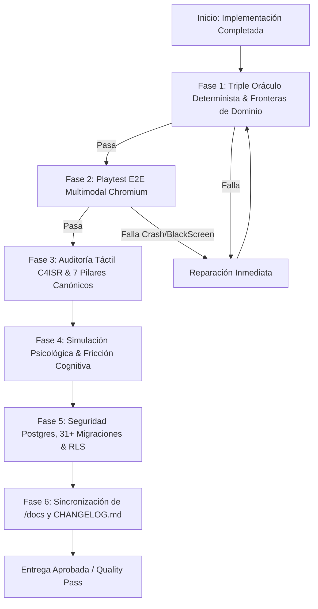

# GAME DEV QUALITY GATE & AUDIT SENTINEL (v2.0 Modular Architecture)
*Algoritmo Integral de Validación de Software, Invariantes de los 7 Pilares, Psicología Lúdica, Integridad de Datos y Gobernanza Documental.*

Usa esta skill obligatoriamente siempre que:
- Se complete una implementación, refactorización o corrección en cualquiera de los 4 dominios (`src/domains/world`, `src/domains/tactics`, `src/domains/economy`, `src/domains/game-feel`) o `src/shared`.
- El usuario pida: *"Verifica la calidad"*, *"Audita la implementación"*, *"Corre el quality gate"*, *"Alinea los docs y el changelog"*, *"Certifica el cierre"*.
- Se prepare un pull request, merge o release a producción.

---

## 1. PRINCIPIOS Y FILOSOFÍA DE CALIDAD

1. **Cero Tolerancia a Parches a Ciegas**: Ningún cambio se da por finalizado sin superar los 3 oráculos deterministas (`npm run build`, `npm run test:all`, `npm run test:geotactics`).
2. **Inmutabilidad de los 7 Pilares Canónicos**:
   - **Pilar 1**: CERO CARTAS (Almacén Físico de 16 tropas máx: 4 activas + 12 reserva).
   - **Pilar 2**: Escala balística continua de 1 a 100 HP enteros.
   - **Pilar 3**: Derrota inapelable al quedar con 0 tropas supervivientes en el tablero.
   - **Pilar 4**: Tiers T1 a T5 con bono horizontal estricto de +2% por tier (máx. +8% en T5).
   - **Pilar 5**: Conquista de Capitales (`15,000 TCP`) con Buff Regional (+5% recursos/logística en la región + bonos hegemónicos).
   - **Pilar 6**: Pérdida física real de chasis destruidos con recuperación del 35% en `tech_scrap`.
   - **Pilar 7**: Human Handshake de 120 segundos en asedios antes de activar la IA de Guarnición (Niveles 1 a 5).
   - **Regla Financiera P2P**: Impuesto total del 2% (1% quemado en Sink + 1% regalía al Clan dueño del Hub regional) y bandas dinámicas VWAP Collar ±25%.
3. **Aislamiento de los 4 Dominios Modulares**: Todo código nuevo vive en `src/domains/{world,tactics,economy,game-feel}/` o `src/shared/` y se expone a través del `index.ts` de su dominio (`@domains/*`, `@shared/*`).
4. **Cero "Documentation Drift"**: Si el código muta, las especificaciones maestras en `docs/` y `docs/AUDITORIA_DISCREPANCIAS_V0.0.2_ALFA.md` se actualizan en la misma sesión.

---

## 2. EL ALGORITMO DE AUDITORÍA EN 6 FASES (EXECUTION PIPELINE)



---

### FASE 1: TRIPLE ORÁCULO DETERMINISTA Y FRONTERAS DE DOMINIO
*Verifica la solidez matemática, contractual y de empaquetado del código.*

1. **Tipado Estricto y Compilación de Producción**:
   ```powershell
   npm run lint
   npm run build
   ```
   - `npm run lint` (`tsc --noEmit`) y `npm run build` (`vite build`) deben finalizar con código de salida `0`.
   - Verifica que los barriles `src/domains/{world,tactics,economy,game-feel}/index.ts` y `src/shared/index.ts` exporten limpiamente cualquier símbolo nuevo.
2. **Suite Global de Motores Deterministas (13/13 Suites)**:
   ```powershell
   npm run test:all
   ```
3. **Suite del Metajuego Geopolítico e Industrial (93/93 Pruebas)**:
   ```powershell
   npm run test:geotactics
   ```

---

### FASE 2: PLAYTEST E2E MULTIMODAL (`/game-qa-playtester`)
*Experimenta el juego en un navegador Chromium real cuando se tocan componentes visuales o de mapa.*

1. **Lanzar la Suite Playwright**:
   ```powershell
   npm run test:qa
   ```
2. **Inspección de Telemetría y Puente QA (`src/shared/utils/qaHarness.ts`)**:
   - Revisa `test-results/qa-run-latest.json`.
   - Verifica que `fatalErrorsCount == 0`, `pageErrors == []` y `networkFailures == []` (incluyendo los GeoJSON locales `/map/world_land.json`, `/map/theatre_regions.json`, `/map/theatre_roads.json`, `/map/theatre_urban_roads.json` y `/map/theatre_cities.json`).
3. **Auditoría Visual de Capturas (`test-results/screenshots/`)**:
   - Arranque limpio en `WarLobbyHub.tsx` y renderizado WebGL de `TacticalWorldMap.tsx`.

---

### FASE 3: AUDITORÍA TÁCTIL Y "GAME FEEL" (`/tactical-command-intel` & `/indie-game-ui-architect`)
*Garantiza que la interfaz respete la estética C4ISR Comic War-Room y los 7 Pilares.*

| Invariante | Requisito Técnico Obligatorio | Verificación |
| :--- | :--- | :--- |
| **1. Cero Cartas / Hangar Físico** | Prohibido hablar de cartas/mazos. Uso de Bahías de Chasis (16 tropas máx, 1–100 HP, Tiers T1–T5 +2%/tier). | Inspección de textos y props en `src/domains/economy/components/`. |
| **2. Anti-SaaS Silhouette** | Siluetas `rounded-[14px_4px_14px_4px]`, chaflanes a 45° (`clip-path`) y sombras duras `4px 4px 0px #0A0B08`. | Inspección CSS / JSX de componentes nuevos. |
| **3. Física de Resortes y Squash** | Uso de `--ease-spring: cubic-bezier(0.34, 1.56, 0.64, 1)` y `.tactical-btn-heavy`. | Revisar transiciones de `motion/react` y clases CSS. |
| **4. Barras de Doble Capa** | Toda barra de HP (1–100), progreso de forja o TCP (`10,000`/`15,000`) usa `TacticalGhostBar` (`src/shared/ui/TacticalGhostBar.tsx`). | Comprobar que no haya barras simples sin *Ghost Trail*. |
| **5. Audio Procedural + Háptica** | Integración con `audioManager` (`src/domains/game-feel/core/audioManager.ts`) y `triggerHaptic` (`src/domains/game-feel/core/hapticFeedback.ts`). | Verificar llamadas desde `@domains/game-feel`. |

---

### FASE 4: SIMULACIÓN DE EFECTOS PSICOLÓGICOS Y HEURÍSTICAS COGNITIVAS
1. **Carga Cognitiva y Semantic Zoom**: Respetar los 3 estratos de zoom (`ZOOM_GLOBAL = 3.5`, `ZOOM_OPERACIONAL = 10.0`, `ZOOM_TACTICO = 15.0` en `src/domains/world/core/coordinates.ts`) sin saturar el mapa macro con detalles micro.
2. **Claridad Causal (Anti-Frustración)**: Toda emboscada (`¡TRAP!`), bloqueo de zona buffer o alerta de sobre-expansión debe disparar su contexto en `barkEngine.ts` (`src/domains/game-feel/core/barkEngine.ts`) con sello pop-art.
3. **Efecto Zeigarnik**: Visibilidad de colas de ensamblaje en tiempo real, barras TCP y temporizador de 120s en asedios.
4. **Ergonomía y Hotkeys**: Insignias de atajos de teclado alineadas con los listeners reales de `WarLobbyHub.tsx` y `CombatTheaterView.tsx`.

---

### FASE 5: SEGURIDAD POSTGRES, MIGRACIONES Y RLS (`/supabase-postgres-best-practices`)
Si la tarea involucra base de datos (`supabase/migrations/` o `src/shared/types/database.types.ts`):
1. **RLS Obligatorio**: `ALTER TABLE ... ENABLE ROW LEVEL SECURITY;` con políticas multi-tenant indexadas.
2. **Sincronización de Esquema**:
   - Toda nueva migración en `supabase/migrations/` debe reflejarse en `supabase/CONSOLIDATED_FULL_DATABASE_DEPLOY.sql` y en `src/shared/types/database.types.ts`.
   - Respetar las invariantes SQL: `hp_max = 100`, `tier BETWEEN 1 AND 5`, `tech_scrap` al 35% y split P2P del 2% (1% burn + 1% clan).

---

### FASE 6: PACK DE SINCRONIZACIÓN DE `/docs` Y `CHANGELOG.md`
1. **Sincronización Canónica en `docs/` (Usando siempre rutas `src/domains/*` y `src/shared/*`)**:
   - Arquitectura general / Estado de ramas -> `docs/00_ARBOL_CANONICO_DE_SISTEMAS_Y_DESARROLLO.md` y `docs/00_GEOTACTICS_ONLINE_MASTER_SPEC.md`.
   - Cartografía WebGL / Coordenadas / Carreteras -> `docs/01_MASTER_CARTOGRAPHY_WEBGL_ZERO_RASTER.md`.
   - Economía / 10 Parcelas / Hangar 16 Tropas / P2P 2% -> `docs/02_MASTER_METAGAME_INDUSTRY_ECONOMY.md`.
   - 29 Comandantes / Bark Engine / Clanes -> `docs/03_MASTER_COMMANDERS_BARK_AND_SOCIAL.md`.
   - Base de Datos / Migraciones / RLS -> `docs/04_MASTER_DATABASE_AND_SECURITY_SPEC.md` y `docs/DATABASE_ARCHITECTURE_AUDIT.md`.
   - Motor Balístico 1-100 HP / Red / Guarnición IA 1-5 -> `docs/05_MASTER_GAME_ENGINE_AND_NETWORKING.md` y `docs/03_TACTICAL_STRATEGY_SYSTEM_DESIGN.md`.
   - QA / Telemetría / Web Audio / Háptica -> `docs/06_MASTER_DEVOPS_QA_AND_TELEMETRY.md`.
   - UI/UX War Room / C4ISR -> `docs/07_MASTER_UI_UX_WAR_ROOM.md`.
   - Matriz de Discrepancias -> `docs/AUDITORIA_DISCREPANCIAS_V0.0.2_ALFA.md` (mantener en **0 Discrepancias Pendientes**).
2. **Actualización Verídica de `CHANGELOG.md`**: Registrar únicamente cambios reales verificados por las suites.

---

## 3. REPORTE DE CALIDAD (AUDIT RELEASE CARD)

```markdown
### 🛡️ Quality Gate Audit Summary

- **Triple Oráculo Determinista**:
  - `npm run build`: [EXIT 0]
  - `npm run test:all`: [13/13 suites PASS]
  - `npm run test:geotactics`: [93/93 tests PASS]
- **Fronteras Modulares & 7 Pilares**:
  - Dominios actualizados: [`@domains/world` | `@domains/tactics` | `@domains/economy` | `@domains/game-feel` | `@shared`]
  - Invariantes: [0 Cartas / 16 Tropas, 1-100 HP, Tiers T1-T5 +2%, 35% Scrap, P2P 2% / VWAP ±25%, Handshake 120s]
- **Game Feel, Audio & UI C4ISR**:
  - Estética y Física: [Silueta C4ISR, TacticalGhostBar, audioManager + triggerHaptic]
- **Gobernanza & Documentación**:
  - `docs/` sincronizados: [Lista de archivos actualizados con 0 discrepancias]
  - `CHANGELOG.md`: [Actualizado]
```
