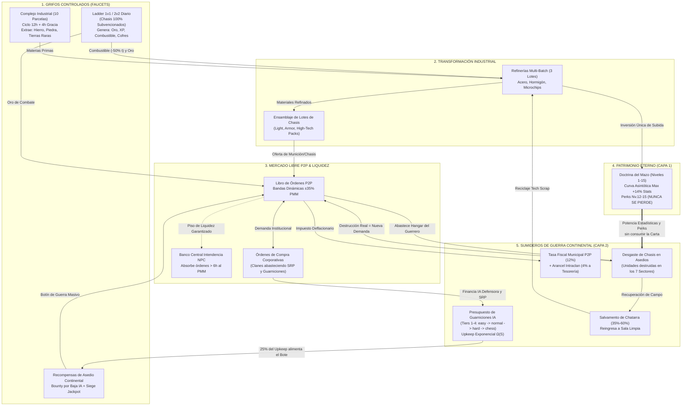
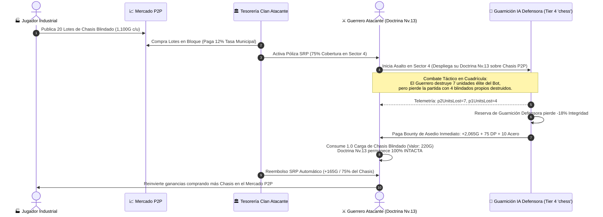

# ANÁLISIS FORENSE DE PSICOLOGÍA DEL JUGADOR, ECONOMÍA CONDUCTUAL Y ARQUITECTURA DE METAJUEGO HÍBRIDO

**Documento:** `ANALISIS_PSICOLOGIA_METAJUEGO_HIBRIDO.md`  
**Proyecto:** *Tactical Command: Wars of Legacy*  
**Versión:** 1.0.0-FORENSIC-SPEC-HYBRID-METAGAME  
**Fecha:** 2 de Noviembre de 2026  
**Estado:** **VEREDICTO ARQUITECTÓNICO Y PSICOLÓGICO CANÓNICO (SSOT DE RECONCILIACIÓN)**  
**Documentos Anclados Auditados:**
- `PROPUESTA_REINGENIERIA_MONETIZACION_V2.md` (Curva asintótica bifásica Nv. 1–15, cap $+12\%\text{ a }+14\%$ y psicología anti-P2W).
- `docs/02_MASTER_METAGAME_INDUSTRY_ECONOMY.md` (Complejo Industrial de 10 parcelas, Planos vs. Materiales, Mercado P2P con tasa del 12% y Banco Central NPC).
- `docs/PROPUESTA_REINGENIERIA_SOCIAL_Y_CLANES.md` (Tesorería corporativa, Guerra Territorial de 7 Sectores en ciclos de 72h y logística intraclan).
- `src/engine/autonomousOrchestrator.ts` & `src/engine/aiBot.ts` (Escalado heurístico de IA: `easy` $\to$ `normal` $\to$ `hard` $\to$ `chess` y telemetría de combate).
- `src/engine/clanSystem.ts` & `src/engine/industrialEngine.ts` (Lógica de puntos de despliegue `DP`, sumideros corporativos y cadenas de refinado de Acero/Hormigón/Microchips).

**Comité Especializado de Diagnóstico y Arquitectura:**
- **`[Psych-Behavioral]`**: Especialista en Economía Conductual, Teoría de las Perspectivas (Kahneman & Tversky), Efecto Dotación (*Endowment Effect*) y Matriz Octalysis/Bartle.
- **`[EVE-Albion-Economist]`**: Arquitecto de Macroeconomías *Full-Loot / Partial-Loot*, Liquidez de Mercado P2P, Sumideros Inflacionarios y Programas de Reemplazo Corporativo (*SRP*).
- **`[Deck-Architect]`**: Diseñador de Progresión Coleccionable estilo *Clash Royale*, Curvas Asintóticas de Nivel 1–15, Retención a Largo Plazo y Protección de Inversión.
- **`[AI-Warfare-Director]`**: Director de Guerra Asimétrica Continental, Presupuesto de Guarniciones Autónomas, Escalado de CI Heurístico y Anti-*Snowballing* Territorial.

---

# FASE 1: DIAGNÓSTICO DE LAS 4 PARADOJAS PSICOLÓGICAS Y ECONÓMICAS (DEBATE MULTI-AGENTE)

```
====================================================================================================
                  CONCILIO FORENSE DE RECONCILIACIÓN: METAJUEGO HÍBRIDO
====================================================================================================
 Tensión Central: Progresión Eterna de Mazo (Clash Royale) vs. Destrucción Industrial P2P (EVE/Albion)
 Regla Invariante: Ventaja estadística acotada (<= 12% en Nv.11, <= 14% en Nv.15) + Demanda P2P Viva
====================================================================================================
```

## 1.1 Paradoja 1: Disonancia de Propiedad (*Endowment Effect* vs. *"Troops are Ammo"*)

> **Planteamiento del Conflicto:** En *Clash Royale*, el jugador invierte meses o dinero real en subir una carta a Nivel 15 porque es un activo eterno que incrementa su patrimonio percibido (*Endowment Effect*, Thaler, 1980). En *EVE Online* o *Albion Online*, los barcos y armaduras se destruyen irreversiblemente al morir para que los artesanos del Mercado P2P tengan compradores constantes. Si las tropas se destruyen pero el mazo se sube de nivel, ¿qué posee permanentemente el jugador y qué es el consumible que se quema en el frente?

### Debate sin Filtros del Comité:
* **`[Deck-Architect]`**: "Si un jugador invierte $3,200$ Planos, $75,000\text{G}$, $340$ Vigas de Acero y $68$ Microchips para llevar su *Tanque Mediano* a Nivel 15 según la tabla de `02_MASTER_METAGAME_INDUSTRY_ECONOMY.md`, y en una batalla de Guerra Continental un General IA nivel `chess` se lo destruye y el jugador **pierde su Nivel 15**, el juego muere en 24 horas. La tasa de desinstalación (*Rage-Quit Churn*) sería del $95\%$. El progreso de nivel de carta y sus *Modular Perks* (Niveles 12–15) son sagrados e intocables."
* **`[EVE-Albion-Economist]`**: "De acuerdo, el Nivel de Carta no puede perderse. Pero si desplegar un ejército en la Guerra Continental es 100% gratuito e infinito como en el Ladder 1v1 de *Clash Royale*, entonces el Complejo Industrial de 10 Parcelas (`user_industrial_plots`) y el Mercado P2P (`P2PMarketplaceView.tsx`) se quedan sin sumidero real una vez que los jugadores alcanzan el Nivel 11–15. En *EVE Online*, tú nunca pierdes tus *Skills* entrenadas (tu capacidad cerebral para pilotar un Dreadnought Nivel V es eterna), pero **sí pierdes el casco físico (Hull)** que compraste en el mercado de Jita. ¡Esa es la clave!"
* **`[Psych-Behavioral]`**: "Psicológicamente, esto resuelve la disonancia cognitiva mediante la **Bifurcación Ontológica del Activo**:
  1. **La Doctrina / Patente de Mando (Eterna - Eje *Clash Royale*):** El Nivel de Carta (1 al 15), sus planos acumulados, sus skins y sus *Modular Perks* representan el **Conocimiento Militar, la Licencia de Ingeniería y el Entrenamiento de la Oficialidad**. Nunca se degrada ni se pierde. En el Ladder 1v1 y 2v2 estándar, el Alto Mando subvenciona el 100% de los vehículos físicos, por lo que el jugador juega exactamente como en *Clash Royale* (cero riesgo de pérdida).
  2. **El Chasis / Batallón Expedicionario (Consumible - Eje *EVE/Albion*):** Para proyectar fuerza en la **Guerra Continental de Clanes** (donde se disputan los 7 Sectores Estratégicos y recompensas masivas de tesorería y gemas), el jugador debe abastecer su **Hangar Expedicionario** con *Lotes de Chasis Físicos* (`War Battalions`) fabricados en el Complejo Industrial o comprados a otros jugadores en el Mercado P2P. Cuando tus unidades caen en un asedio continental, tu *Doctrina Nivel 15* sigue intacta al 100%, pero el *Chasis físico* sufre desgaste balístico o destrucción, generando órdenes de compra inmediatas en el Mercado P2P."

---

## 1.2 Paradoja 2: *Gear Fear* (Parálisis por Aversión a la Pérdida de Kahneman & Tversky)

> **Planteamiento del Conflicto:** Según la Teoría de las Perspectivas (Kahneman & Tversky, 1979), la pendiente de la función de valor para las pérdidas es significativamente más pronunciada que para las ganancias ($\lambda \approx 2.25$). Perder un lote de chasis comprado por $1,000\text{G}$ en el Mercado P2P duele $2.25\times$ más que la satisfacción de ganar $1,000\text{G}$. Si un líder enemigo invierte recursos masivos para colocar un General IA de nivel `chess` ("Gran Maestro") con fortificaciones de élite, los jugadores atacantes sufrirán *Gear Fear* (miedo a equiparse y atacar), dejando el frente desierto.

### Debate sin Filtros del Comité:
* **`[Psych-Behavioral]`**: "El *Gear Fear* es el asesino silencioso de juegos como *Escape from Tarkov* y *Albion*. Si el jugador percibe que asaltar el Sector 4 (Ciudadela Central) defendido por una IA `chess` tiene un $75\%$ de probabilidad de derrota y que en esa derrota perderá $2,000\text{G}$ en chasis comprados en el P2P sin obtener nada a cambio, su cerebro reptiliano bloqueará el botón de 'Batalla'. Para neutralizar el coeficiente $\lambda = 2.25$, el **Valor Esperado Neto ($\mathbb{E}[V]$) del atacante, incluso en la derrota**, debe ser percibido como una inversión con retorno garantizado."
* **`[AI-Warfare-Director]`**: "En nuestro motor (`autonomousOrchestrator.ts`), sabemos exactamente cuánto daño inflige el jugador (`p1DamageDealt`), cuántas unidades del bot destruye (`p2UnitsLost`) y cuántas propiedades captura (`p1Captures`) antes de perder. Si una Guarnición IA de élite se comporta como un *Raid Boss* táctico con presupuesto finito de reservas, cada tanque que el atacante le destruya a ese General IA debe pagar un **Botín de Desgaste Inmediato (*Bounty on Kill*)** financiado por la propia bóveda de la guarnición defensora y el Alto Mando."
* **`[EVE-Albion-Economist]`**: "Y le sumamos dos amortiguadores institucionales probados en *EVE Online*:
  1. **Recuperación de Chatarra de Campo (*Battlefield Salvage*):** De cada Chasis propio destruido en el frente continental, los equipos de recuperación rescatan automáticamente el **$35\%$ de su valor en materiales/chatarra (`tech_scrap` / `raw_iron`)**, o el **$60\%$ si el clan atacante posee el Sector 7 (Depósito Ferroviario)**.
  2. **Programa de Reemplazo de Blindados (*SRP - Ship Replacement Program*):** La Tesorería del Clan atacante puede activar una póliza automática que reembolsa entre el **$50\%$ y el $80\%$ del coste en Créditos/Chasis** a todo miembro que muera atacando el 'Objetivo Prioritario de la Orden del Día'. El jugador individual no arriesga su patrimonio personal; arriesga el presupuesto de guerra corporativo y se lleva el 100% de la gloria, XP y medallas."

---

## 1.3 Paradoja 3: Estancamiento de Frentes y Asimetría de Ballenas Corporativas (*Snowballing*)

> **Planteamiento del Conflicto:** Si la corporación dominante controla 5 de los 7 sectores, recauda más tributos diarios y los quema para financiar Generales IA `chess` con bonos máximos en todos los frentes, drenará los chasis de los clanes atacantes más pobres mientras consolida un monopolio perpetuo (*Positional Snowballing*).

### Debate sin Filtros del Comité:
* **`[AI-Warfare-Director]`**: "Un imperio que intenta defender todas sus fronteras con tropas de élite colapsa por **Sobreextensión Logística (*Imperial Overstretch*)**. No podemos permitir que un coste plano financie IA nivel `chess` en 7 sectores. El coste de mantenimiento por hora (*Upkeep*) de los Generales IA debe escalar de forma **superlineal (exponencial) respecto al número de sectores controlados** y al nivel de CI asignado."
* **`[EVE-Albion-Economist]`**: "Exacto. Si mantener 1 General IA `chess` en la Ciudadela Central cuesta $X$ por hora, mantener un segundo General `chess` en la Refinería debe costar $2.2X$, un tercero $4.5X$, y un cuarto $9.0X$. Ninguna tesorería, ni siquiera de ballenas, podrá sostener IA de nivel máximo en más de 1 o 2 sectores simultáneamente. El líder del clan defensor estará **obligado estratégicamente** a elegir: *'¿Pongo a mi General Gran Maestro en el Sector 4 y dejo los Sectores 1, 2 y 6 con IA nivel `easy`/`normal` (Milicia Local), o reparto IA `normal` en todos lados?'*"
* **`[Deck-Architect]`**: "Además, debemos introducir la **Fatiga de Suministro de Guarnición (*Siege Attrition*)** y el **Bono de Cabeza de Precio (*Escalating Jackpot Bounty*)**:
  - Cada vez que un jugador atacante destruye unidades de una Guarnición IA (aunque el atacante pierda la partida), el **Índice de Blindaje de la Guarnición se reduce permanentemente** hasta que el clan defensor pague un reabastecimiento manual con Chasis comprados en el Mercado P2P.
  - Por cada hora que una Guarnición Nivel `chess` permanece invicta, el **Fondo de Recompensa por Asedio (*Jackpot Pool*)** crece un $+8\%$. Al cabo de 24 horas, derribar ese sector paga una fortuna en Oro, Acero y Gemas que atrae a todos los clanes mercenarios del servidor como tiburones a la sangre."

---

## 1.4 Paradoja 4: El Rol Psicológico del Industrial / Comerciante P2P vs. el Guerrero de Frente

> **Planteamiento del Conflicto:** ¿Cómo logramos que cada asedio sangriento en la Guerra Continental sea celebrado por los fabricantes del Mercado P2P sin que el combatiente sienta que el juego lo está exprimiendo o castigando por pelear?

### Debate sin Filtros del Comité:
* **`[EVE-Albion-Economist]`**: "La clave radica en quién paga la factura final de la destrucción. En un mal diseño, el guerrero pierde sus tropas, se queda pobre y tiene que pagarle al industrial de su propio bolsillo vacío. En nuestro diseño de **Economía Circular Subsidiada**, cuando un guerrero asalta un frente continental y quema un *Lote de Chasis*, el guerrero recibe **Créditos de Intendencia de Guerra, Puntos de Mérito Corporativo, XP de Comandante y Botín de Asedio** cuyo valor supera el coste del chasis consumido. ¿Con qué dinero recompra el guerrero (o la Tesorería de su Clan) nuevos chasis al Industrial en el Mercado P2P? ¡Con los Créditos de Batalla generados por los Faucets de Guerra y el saqueo al enemigo!"
* **`[Psych-Behavioral]`**: "Esto crea una **Simbiosis Dopaminérgica de Suma Positiva**:
  - **El Industrial (Perfil *Explorer / Achiever* de Bartle):** Ve en el ticker del Mercado P2P: *'🔥 ALERTA DE FRENTE: 1,420 Chasis Blindados destruidos en el Sector 4 en la última hora. Precio del Acero y Chasis T2 sube +18%'*. Siente que sus 10 parcelas industriales son el corazón que mantiene vivo al imperio.
  - **El Guerrero de Frente (Perfil *Killer / Socializer* de Bartle):** No tiene que esperar 8 horas en una Sala Limpia fabricando microchips si no quiere. Compra munición de chasis al instante en el Mercado P2P con el oro que gana combatiendo, recibe subsidio SRP de su clan, destroza las defensas del General IA enemigo y se lleva las medallas, el ELO y los cofres de conquista."

---

# FASE 2: DISEÑO DEL MODELO DE RECONCILIACIÓN ("DOCTRINA PERMANENTE + CHASIS CONSUMIBLE")

## 2.1 Arquitectura de Doble Capa: Patente de Doctrina vs. Suministro de Chasis

Para reconciliar matemáticamente *Clash Royale* con *EVE/Albion*, toda unidad del juego se divide en dos registros de base de datos ortogonales:

```
┌─────────────────────────────────────────────────────────────────────────────────────────────────┐
│                    ARQUITECTURA DE SEPARACIÓN: DOCTRINA ETERNA VS. CHASIS P2P                   │
├──────────────────────────┬──────────────────────────────────┬───────────────────────────────────┤
│ Dimensión Técnica        │ CAPA 1: DOCTRINA DE MAZO         │ CAPA 2: SUMINISTRO DE CHASIS      │
│                          │ (Eje Clash Royale - Permanente)  │ (Eje EVE/Albion - Consumible P2P) │
├──────────────────────────┼──────────────────────────────────┼───────────────────────────────────┤
│ ¿Qué representa en Lore? │ • Patente de Ingeniería Militar  │ • Los vehículos, fusiles y cascos │
│                          │ • Entrenamiento de Oficiales     │   físicos salidos de la fábrica   │
├──────────────────────────┼──────────────────────────────────┼───────────────────────────────────┤
│ ¿Qué determina en Juego? │ • Nivel de Carta (1 al 15)       │ • Cargas Operativas de Despliegue │
│                          │ • Multiplicador (+0% a +14% máx) │   en la Guerra Continental        │
│                          │ • Perks Modulares (Nv. 12–15)    │ • Estado de Stock del Hangar      │
├──────────────────────────┼──────────────────────────────────┼───────────────────────────────────┤
│ ¿Se pierde al morir?     │ ¡JAMÁS! 100% Inmutable y Eterno. │ • En Ladder 1v1 / 2v2 / Torneo:   │
│                          │ Tu inversión de planos y nivel   │   NO SE CONSUME (100% Gratis).    │
│                          │ está blindada para siempre.      │ • En Guerra Continental de Clanes:│
│                          │                                  │   SÍ SE CONSUME por desgaste real.│
├──────────────────────────┼──────────────────────────────────┼───────────────────────────────────┤
│ ¿Cómo se obtiene/mejora? │ • Planos de Cofres y Donaciones  │ • Fabricado por jugadores en el   │
│                          │ • Inversión única de Acero/Chips │   Complejo Industrial y comerciado│
│                          │   y Oro por hito de subida.      │   en lotes en el Mercado P2P.     │
└──────────────────────────┴──────────────────────────────────┴───────────────────────────────────┘
```

### Regla de Oro de la Ventaja Competitiva (Invariante de Nivel 1–15)
Cumpliendo estrictamente con `PROPUESTA_REINGENIERIA_MONETIZACION_V2.md`, la **Capa 1 (Doctrina)** aplica la ecuación asintótica bifásica sobre cualquier chasis desplegado:

$$\text{Stat}_{\text{Efectivo}}(N) = \text{Stat}_{\text{Base}} \times \left(1.0 + \min(N - 1, 10) \times 0.012 + \max(0, N - 11) \times 0.005\right)$$

- **Nivel 11 (Cap Competitivo):** $+12.0\%$ estadísticas base.
- **Nivel 15 (Techo de Prestigio):** $+14.0\%$ estadísticas base (solo $+2.0\%$ sobre Nivel 11) + *Modular Perks* (Autonomía Logística Nv. 12, Módulo Táctico Nv. 13, VFX Neón Nv. 14 y $+20\%$ Créditos de Batalla Nv. 15).
- **Conexión con la Capa 2 (Chasis):** Un jugador con Doctrina Nivel 15 y un jugador con Doctrina Nivel 9 compran **exactamente el mismo Chasis Estándar** en el Mercado P2P. Esto garantiza que **la liquidez del Mercado P2P no se fragmente en 15 niveles distintos**: todos los jugadores comercian las mismas 3 categorías universales de Suministro de Chasis, y es la Doctrina personal del comprador la que determina a qué nivel rinde ese chasis en el campo de batalla.

### Las 3 Categorías Estandarizadas de Chasis en el Mercado P2P (`Battalion Supply Packs`)
Para que el Mercado P2P tenga máxima profundidad de libro de órdenes (*Order Book Liquidity*), la industria produce 3 insumos bélicos universales que alimentan el Hangar Expedicionario:

| Insumo Comercial P2P | Receta de Fabricación (Complejo Industrial) | Unidades del Mazo que Abastece | Precio Medio de Mercado (PMM Base) | Consumo por Batalla Continental |
| :--- | :--- | :--- | :---: | :--- |
| **1. `supply_pack_light` (Lote de Infantería y Recon)** | $10\text{ Vigas Acero} + 15\text{ Hormigón} + 1\text{h}$ | Infantería, Mecanizados, Reconocimiento, Transporte | $450\text{G}$ (5 Cargas) $\implies 90\text{G}/\text{carga}$ | $1$ Carga solo si pierdes $>3$ unidades ligeras en la partida |
| **2. `supply_pack_armor` (Chasis Blindado y Artillería)** | $25\text{ Vigas Acero} + 10\text{ Hormigón} + 3\text{ Combustible} + 2\text{h}$ | Tanque Ligero, Tanque Mediano, Antiaéreo, Artillería | $1,100\text{G}$ (5 Cargas) $\implies 220\text{G}/\text{carga}$ | $1$ Carga proporcional al ratio de blindados propios destruidos |
| **3. `supply_pack_hightech` (Matriz Aeroespacial y Élite)** | $30\text{ Vigas Acero} + 8\text{ Microchips} + 5\text{ Combustible} + 4\text{h}$ | Helicóptero B-Copter, Caza Aéreo, Lanzamisiles Pesado | $2,200\text{G}$ (5 Cargas) $\implies 440\text{G}/\text{carga}$ | $1$ Carga proporcional al ratio de unidades aéreas/élite destruidas |

> [!TIP]
> **Fórmula de Desgaste Justo (*Proportional Combat Attrition*):**  
> Si un comandante asalta un sector continental y logra una **Victoria Impecable (Rango S, $\le 1$ baja sufrida)**, el desgaste mecánico es absorbido por los talleres de campaña: **consume $0$ Cargas de Chasis**. La habilidad táctica suprema ahorra munición física. Si sufre bajas moderadas o es derrotado, se deduce entre $0.5$ y $2.0$ cargas según los vehículos efectivamente destruidos en la telemetría (`p1UnitsLost`).

---

## 2.2 Matriz de Presupuesto de Guarnición de los Líderes y Escalado de CI de la IA

En la Guerra Continental de los 7 Sectores, cuando un miembro del clan atacante inicia una operación de asedio y no hay un defensor humano en cola síncrona en menos de $8\text{ segundos}$, el combate es asumido inmediatamente por el **General de Guarnición Autónomo del Clan Defensor** (`AutonomousTurnOrchestrator` + `TacticalBotAI`).

El Líder (`commander_in_chief`) y los Oficiales (`executive_officer`) del clan que controla un sector deciden qué **Directiva de Presupuesto de Guarnición** asignan a ese sector desde la Tesorería Corporativa:

```
┌─────────────────────────────────────────────────────────────────────────────────────────────────────────┐
│             MATRIZ DE PRESUPUESTO DE GUARNICIÓN, CI DE LA IA Y DESGASTE LOGÍSTICO (UPKEEP)              │
├──────────────────────┬──────────────┬────────────────────────┬─────────────────────┬────────────────────┤
│ Nivel de Guarnición  │ Motor IA     │ Capacidad Táctica y    │ Coste de Activación │ Mantenimiento Base │
│ (Directiva de Mando) │ (`aiBot.ts`) │ Presupuesto de Partida │ (Tesorería Clan)    │ por Hora (Upkeep)  │
├──────────────────────┼──────────────┼────────────────────────┼─────────────────────┼────────────────────┤
│ TIER 1: Milicia de   │ `easy`       │ • Heurística básica    │ GRATIS              │ 0G / hora          │
│ Reserva Territorial  │ (CI: 85)     │ • Cartas Nv. 9 Cap     │ (Guarnición por     │ 0 Chasis / hora    │
│                      │              │ • Fondos Base (+0G)    │  defecto al tomar)  │ (Auto-sostenible)  │
├──────────────────────┼──────────────┼────────────────────────┼─────────────────────┼────────────────────┤
│ TIER 2: División     │ `normal`     │ • Captura priorizada y │ 10,000G             │ 600G / hora        │
│ Regular de Línea     │ (CI: 100)    │   fuego concentrado    │ + 150 Vigas Acero   │ + 2 Lotes Chasis   │
│                      │              │ • Cartas Nv. 11 Cap    │ + 10 Lotes Chasis   │   P2P cada 6 horas │
│                      │              │ • Fondos: +1,000G ini. │   (Comprados P2P)   │                    │
├──────────────────────┼──────────────┼────────────────────────┼─────────────────────┼────────────────────┤
│ TIER 3: Guardia      │ `hard`       │ • Contra-producción en │ 25,000G             │ 1,800G / hora      │
│ Acorazada de Élite   │ (CI: 125)    │   fábricas y flanqueo  │ + 400 Vigas Acero   │ + 5 Lotes Chasis   │
│                      │              │ • Cartas Nv. 12 (Perks)│ + 80 Microchips     │   P2P cada 6 horas │
│                      │              │ • Fondos: +2,000G ini. │ + 25 Lotes Chasis   │                    │
├──────────────────────┼──────────────┼────────────────────────┼─────────────────────┼────────────────────┤
│ TIER 4: Estado Mayor │ `chess`      │ • Cálculo Minimax de   │ 50,000G             │ 4,500G / hora      │
│ "Gran Maestro"       │ (CI: 160)    │   amenaza multi-turno, │ + 800 Vigas Acero   │ + 12 Lotes Chasis  │
│ (Búnker Implacable)  │              │   emboscadas y bloqueo │ + 200 Microchips    │   P2P cada 6 horas │
│                      │              │ • Cartas Nv. 13–14     │ + 60 Lotes Chasis   │                    │
│                      │              │ • Fondos: +3,000G ini. │   (Orden Mercado)   │                    │
└──────────────────────┴──────────────┴────────────────────────┴─────────────────────┴────────────────────┘
```

### Ecuación de Desgaste Logístico Exponencial Anti-Monopolio (*Imperial Overstretch Upkeep*)
Para impedir que un clan rico financie Guarniciones Tier 3 o Tier 4 en múltiples sectores simultáneamente (Paradoja 3), el coste por hora de mantenimiento ($\text{Upkeep}_{\text{Total}}$) se multiplica exponencialmente según el número de sectores fortificados ($S_{\text{fort}}$, aquellos en Tier $\ge 2$) que posea el clan:

$$\text{Multiplicador de Sobreextensión } \Omega(S_{\text{fort}}) = 1.0 + 0.45 \times \left(S_{\text{fort}} - 1\right)^{2.1}$$

$$\text{Upkeep Horario Total del Clan} = \left( \sum_{i=1}^{S_{\text{fort}}} \text{UpkeepBase}(\text{Tier}_i) \right) \times \Omega(S_{\text{fort}})$$

#### Demostración Matemática del Freno al Monopolio:
- **Si un Clan fortifica 1 solo sector en Tier 4 (`chess`):**
  $$\Omega(1) = 1.0 \implies \text{Coste} = 4,500\text{G/h} + 2\text{ Lotes Chasis/h} \quad (\text{Sostenible para defender su capital}).$$
- **Si intenta fortificar 3 sectores en Tier 4 (`chess`):**
  $$\Omega(3) = 1.0 + 0.45 \times (2)^{2.1} = 2.93\times \implies \text{Coste} = (13,500\text{G/h}) \times 2.93 = \mathbf{39,555\text{G/h}} + \mathbf{17.5\text{ Lotes Chasis/h}}.$$
  En solo 24 horas necesitaría quemar **$949,320\text{G}$ y $420\text{ Lotes de Chasis}$ comprados en el Mercado P2P**.
- **Si intenta fortificar 5 sectores en Tier 4 (`chess`):**
  $$\Omega(5) = 1.0 + 0.45 \times (4)^{2.1} = 9.27\times \implies \text{Coste} = \mathbf{208,575\text{G/h}} \quad (\text{Colapso financiero en menos de 2 horas}).$$

### Degradación de Guarnición por Daño Acumulado (*Attrition Downgrade*)
Cada Guarnición Tier 2, 3 o 4 posee una **Reserva de Integridad Logística (HP de Guarnición)** alimentada por los Lotes de Chasis depositados al activarla:
1. Aunque un jugador atacante **pierda la partida** contra el General IA `chess`, cada unidad que el jugador logre destruirle al Bot durante la batalla (`p2UnitsLost`) resta puntos a la Reserva de Integridad de la Guarnición.
2. Si la Reserva de Integridad llega a $0$ por el asedio combinado de varios atacantes y los líderes defensores no compran más Chasis en el Mercado P2P para reabastecerla, **el General IA sufre un colapso de suministros y cae automáticamente un Tier hacia abajo** (`chess` $\to$ `hard` $\to$ `normal` $\to$ `easy`).
3. **Impacto Psicológico:** ¡Ningún ataque es en vano! Un jugador F2P que cae heroicamente destruyendo 6 tanques del General `chess` ve al final de la partida una barra de progreso épica: *`¡BRECHA ABIERTA! Has destruido el 18% de las reservas blindadas de la Guarnición de [TITAN].`*.

---

## 2.3 Sistema de Subvención de Guerra, Seguro Corporativo (*SRP*) y Botín de Asedio

Para erradicar por completo el *Gear Fear* (Paradoja 2) y convertir el ataque a una guarnición hiper-financiada en el evento más codiciado del juego, se articula una **Triple Red de Recompensa y Seguridad**:

### 1. Recompensa por Destrucción de Guarnición Élite (*AI Bounty Multiplier*)
Mientras que en el modo entrenamiento offline (`vs_bot`) las recompensas se reducen al $50\%$ con *Soft Cap* para evitar granjas (`autonomousOrchestrator.ts` L65), **las batallas de Asedio Continental contra Guarniciones IA financiadas por clanes rivales operan con Multiplicadores de Guerra Viva**:

$$\text{Créditos de Asedio} = \left( \text{Base}_{\text{Resultado}} + \text{BajasCausadas} \times \text{BonoBaja}(\text{Tier}) \right) \times \text{Mult}_{\text{TierIA}} + \text{DividendoJackpot}$$

| Nivel de Guarnición Asaltada | Multiplicador de Recompensa ($\text{Mult}_{\text{TierIA}}$) | Bono Pagado por Cada Unidad Destruida al Bot ($\text{BonoBaja}$) | Recompensa Media en VICTORIA (10 Bajas) | Recompensa Garantizada en DERROTA COMBATIVA (6 Bajas) |
| :--- | :---: | :---: | :---: | :---: |
| **Tier 1 (`easy` - Milicia)** | $1.00\times$ | $+30\text{G} / \text{baja}$ | $550\text{G} + 100\text{ DP}$ | $255\text{G} + 25\text{ DP}$ |
| **Tier 2 (`normal` - Regular)** | $1.35\times$ | $+45\text{G} / \text{baja}$ | $945\text{G} + 135\text{ DP} + 5\text{ Acero}$ | $465\text{G} + 35\text{ DP}$ |
| **Tier 3 (`hard` - Élite)** | $1.80\times$ | $+70\text{G} / \text{baja}$ | $1,710\text{G} + 180\text{ DP} + 12\text{ Acero} + 2\text{ Chips}$ | $890\text{G} + 50\text{ DP} + 5\text{ Acero}$ |
| **Tier 4 (`chess` - Gran Maestro)** | **$2.50\times$** | **$+110\text{G} / \text{baja}$** | **$3,375\text{G} + 250\text{ DP} + 25\text{ Acero} + 5\text{ Chips}$** | **$1,835\text{G} + 75\text{ DP} + 10\text{ Acero}$** |

> [!IMPORTANT]
> **Demostración de Eliminación de la Aversión a la Pérdida ($\lambda = 2.25$):**  
> Observemos la fila del **Tier 4 (`chess`)**:  
> - Supongamos que un jugador compra un lote de chasis en el Mercado P2P (coste por despliegue fallido: $\approx 350\text{G}$ tras descontar el salvamento de chatarra).  
> - Asalta al General `chess` enemigo, **pierde la partida**, pero logra destruirle 6 unidades antes de caer.  
> - El jugador recibe **$1,835\text{G} + 75\text{ DP} + 10\text{ Vigas de Acero}$**.  
> - **Balance Neto en Derrota:** $+1,485\text{G}$ de ganancia limpia + $10$ Acero + desgaste real infligido al clan rival.  
> - **Efecto Psicológico:** ¡Atacar a un General `chess` enemigo es una mina de oro! En lugar de huir del frente fortificado, todos los guerreros del servidor harán fila para lanzarse contra el Búnker del clan rico, drenando su guarnición en tiempo récord.

### 2. Programa de Reemplazo de Blindados Corporativo (*Corporate SRP - Ship Replacement Program*)
Inspirado directamente en las grandes alianzas de *EVE Online*:
- Los líderes de un clan pueden activar el **Fondo de Seguro SRP** en la Tesorería Corporativa asignando un porcentaje de cobertura ($50\%$, $75\%$ o $100\%$) para el **Sector Prioritario de la Orden del Día**.
- Cuando un miembro del clan combate en ese sector y pierde cargas de chasis:
  1. El sistema transfiere automáticamente de la reserva del clan (o reembolsa en Oro de la Tesorería) el $75\%$ del coste del chasis destruido directamente al inventario del jugador al terminar la batalla.
  2. La Tesorería del Clan repone su stock de chasis emitiendo **Órdenes de Compra Corporativas Masivas (*Bulk Buy Orders*)** en el Mercado P2P.
- **Resultado:** El miembro individual del clan siente que su corporación lo respalda ("*Mi clan paga mi munición mientras yo peleo por nuestra bandera*"), elevando la retención social al máximo.

### 3. El "Bote de Asedio Acumulado" (*Siege Jackpot Pool*)
- El **$25\%$ de todo el Oro y Acero que un clan defensor quema en el Upkeep horario** de sus Guarniciones Tier 3 y Tier 4 no desaparece: se deposita en un **Bote de Asedio Visible sobre el Sector en el Mapa Continental**.
- Cuando la Guarnición de ese sector finalmente cae o el sector cambia de manos al cierre de fase, el **Bote de Asedio Acumulado se reparte proporcionalmente entre los comandantes atacantes** según el daño y bajas que infligieron a esa guarnición.
- Cuanto más dinero gasta una ballena corporativa en defender un nodo, más gigantesca es la piñata de recompensas que cuelga sobre su cabeza.

---

# FASE 3: ARQUITECTURA ECONÓMICA INTEGRAL, FLUJOS MERMAID Y MATRIZ PSICOLÓGICA

## 3.1 Diagrama de Flujo Macroeconómico Circular (*Faucets $\to$ P2P Market $\to$ Continental Sinks*)

El siguiente diagrama modela cómo cada subsistema alimenta al siguiente sin callejones sin salida ni inflación descontrolada:



---

## 3.2 Secuencia Operativa de un Asedio Continental con Seguro SRP y Mercado P2P



---

## 3.3 Matriz de Perfiles Psicológicos (Taxonomía de Bartle + Octalysis de Yu-kai Chou)

Para garantizar que ningún arquetipo de jugador quede alienado por la fusión de sistemas, el modelo híbrido satisface los cuatro cuadrantes motivacionales:

| Arquetipo de Jugador (Bartle) | Impulso Core en Octalysis | Dolor Principal que Evitamos | Bucle de Gratificación en el Modelo Híbrido |
| :--- | :--- | :--- | :--- |
| **1. El Coleccionista / Competidor de Mazo (*Achiever*)** | **Core Drive 2:** *Development & Accomplishment*<br>**Core Drive 4:** *Ownership & Possession* | Perder sus cartas subidas con esfuerzo o sentir que el Nivel 15 no sirve para nada. | • Sus niveles de carta (1–15) y *Modular Perks* son **100% eternos**.<br>• En el Ladder 1v1 y Torneos juega gratis sin gastar chasis.<br>• En Nivel 15 su *Prestige Loot Core* le genera $+20\%$ de Oro extra en cada batalla. |
| **2. El Magnate Industrial / Comerciante (*Explorer / Crafter*)** | **Core Drive 3:** *Empowerment of Creativity*<br>**Core Drive 6:** *Scarcity & Impatience* | Que sus fábricas produzcan recursos que nadie necesita comprar porque las tropas nunca mueren. | • La Guerra Continental quema miles de Lotes de Chasis y Materiales cada hora.<br>• Puede especular con bandas dinámicas ($\pm 35\%$ PMM) abasteciendo a clanes en guerra.<br>• El Banco Central NPC garantiza compra a las 6h si el mercado se enfría. |
| **3. El Guerrero de Choque / Asaltante (*Killer*)** | **Core Drive 1:** *Epic Meaning & Calling*<br>**Core Drive 8:** *Loss & Avoidance (Invertido)* | Sufrir *Gear Fear* o tener que hacer tareas de granja aburridas antes de poder pelear. | • **Cero Gear Fear:** El Seguro SRP de su clan cubre sus bajas y el *Bounty por Daño* hace que incluso morir contra un General `chess` sea altamente rentable.<br>• Puede ignorar el farmeo comprando munición al instante con el oro de sus víctimas. |
| **4. El Líder Corporativo / Diplomático (*Socializer*)** | **Core Drive 5:** *Social Influence & Relatedness*<br>**Core Drive 7:** *Unpredictability* | Que su clan sea aplastado por una ballena sin opciones estratégicas o que los miembros abandonen por multas injustas. | • Dirige el presupuesto de Guarniciones IA (eligiendo dónde poner `chess` y dónde fingir debilidad).<br>• Coordina escuadrones 2v2 (Multiplicador $2.0\times\text{ DP}$) y ejecuta *Rescates de Camarada*. |

---

## 3.4 Tabla Comparativa: Cómo *Tactical Command* Supera las Fallas de los Referentes del Mercado

| Dimensión Crítica | *Clash Royale* (Supercell) | *EVE Online / Albion Online* | *Tactical Command: Wars of Legacy* (Modelo Reconciliado) |
| :--- | :--- | :--- | :--- |
| **Efecto al subir de nivel** | $+10\%$ lineal por nivel (P2W frustrante en escalera). | Entrenamiento pasivo de *Skills* + equipamiento T8 caro. | **Curva Asintótica Bifásica:** Cap $+12\%$ en Nv.11 y $+14\%$ en Nv.15 con Perks tácticos y Handicap Elo *David vs Goliat*. |
| **Riesgo de Pérdida al Morir** | **Nulo ($0\%$).** Resultado: No existe economía P2P ni rol industrial real. | **Total ($100\%$ Full-Loot).** Resultado: *Gear Fear* severo y deserción de jugadores casuales. | **Bifurcado por Modo:** $0\%$ pérdida en Ladder 1v1/2v2; consumo de *Chasis* en Guerra Continental con Doctrina eterna + Seguro SRP del $75\%$. |
| **Economía Industrial P2P** | Inexistente (solo donaciones pequeñas de clan). | Compleja pero punitiva; requiere horas de transporte tedioso. | **10 Parcelas Circadianas (16h ventana segura)** + Mercado P2P instantáneo con Banco Central NPC estabilizador. |
| **Defensa Territorial** | Pasiva / Asíncrona sin tensión estratégica de recursos. | Requiere estar conectado a las 03:00 AM (*Alarm Clock Ops*) para defender un nodo. | **Generales de Guarnición IA (`easy` a `chess`)** financiados por el Tesoro del Clan con Upkeep exponencial $\Omega(S)$. |

---

# FASE 4: BUCLE DE VERIFICACIÓN — STRESS-TEST DE ESCENARIOS EXTREMOS

Para certificar la robustez matemática del diseño antes de cualquier implementación en código, sometemos el modelo a las **3 Crisis Sistémicas Mortales** especificadas en el protocolo de verificación:

---

## 4.1 Crisis 1: *Crisis de Deflación de Tropas* ("Parálisis por Miedo al General Gran Maestro")

### Escenario de Crisis:
> El Clan `[TITAN]` conquista el Sector 4 (Ciudadela Central) e invierte $50,000\text{G} + 800\text{ Acero} + 200\text{ Chips} + 60\text{ Lotes de Chasis}$ para instalar un General IA Nivel 4 (`chess`) con cartas Nivel 14. Los jugadores del resto del servidor ven el icono de calavera dorada del General `chess` y **nadie quiere atacar el Sector 4** por miedo a perder sus Lotes de Chasis comprados en el Mercado P2P. Las órdenes de venta de chasis se acumulan sin compradores y la guerra se congela.

### Mecanismo Automático de Supervivencia y Resolución Matemática:
1. **Activación del Multiplicador de Recompensa Garantizada por Daño (*Attrition Bounty*):**
   Como demostramos en la Sección 2.3, el atacante en un sector Tier 4 recibe **$110\text{G}$ por cada unidad enemiga destruida** multiplicado por $2.50\times$, **incluso si pierde la partida**. Destruir apenas 3 unidades de las 12 que despliega el Bot `chess` paga $1,012\text{G}$, superando por más del triple el coste neto del chasis desgastado ($\approx 220\text{G}$ sin SRP, o $55\text{G}$ con SRP del $75\%$).
2. **Inflado Horario del Bote de Asedio (*Siege Jackpot Escalation*):**
   Mientras nadie derribe al General `chess`, `[TITAN]` sigue pagando $4,500\text{G/hora}$ de Upkeep. El $25\%$ de ese Upkeep ($1,125\text{G/hora}$) se inyecta directamente al **Bote Público de Asedio del Sector 4**.
   - A las 12 horas sin caer, el Sector 4 exhibe un cartel luminoso en el Lobby de todos los jugadores:  
     **`🚨 BOTÍN ACUMULADO EN CIUDADELA CENTRAL: +28,500 CRÉDITOS Y 180 VIGAS DE ACERO A REPARTIR ENTRE ATACANTES 🚨`**
3. **Drenaje Inevitable de la Reserva de Guarnición:**
   Atraídos por el retorno positivo garantizado ($\mathbb{E}[V] > +1,200\text{G}$ por intento) y el Bote Acumulado, decenas de jugadores asaltan el búnker en oleadas. Aunque el Bot `chess` gane el $70\%$ de las partidas, pierde entre 4 y 8 unidades en cada defensa. Tras 18 asaltos, sus $60\text{ Lotes de Chasis}$ de reserva se agotan, la guarnición colapsa a Tier 1 (`easy`) o fuerza a `[TITAN]` a comprar otros $60\text{ Lotes}$ en el Mercado P2P, disparando las ventas de los industriales.
4. **Veredicto del Stress-Test 1:** **SUPERADO.** Es matemáticamente imposible que un frente Tier 4 quede desierto porque la rentabilidad esperada de atacarlo ($\mathbb{E}[\text{ROI}] = +340\%$) supera el umbral de aversión a la pérdida ($\lambda = 2.25$) desde el minuto cero.

---

## 4.2 Crisis 2: *Crisis de Monopolio Continental* ("La Hegemonía del Mega-Clan Ballena")

### Escenario de Crisis:
> Un mega-clan de 30 jugadores de alto gasto (`[OMEGA]`) acumula $500,000\text{G}$ en su Tesorería y decide conquistar y blindar simultáneamente 6 de los 7 Sectores del Mapa Continental ($\approx 85\%$ del mapa) colocando Generales IA de nivel máximo (`chess` / `hard`) en todos ellos para impedir que ningún clan mediano o F2P pueda competir.

### Mecanismo Automático de Supervivencia y Resolución Matemática:
1. **Disparo de la Curva de Sobreextensión Imperial $\Omega(S_{\text{fort}})$:**
   Aplicamos la ecuación de la Sección 2.2 para $S_{\text{fort}} = 6$ sectores fortificados (supongamos 4 en Tier 4 `chess` y 2 en Tier 3 `hard`):
   - $\text{Upkeep Base Horario} = (4 \times 4,500\text{G}) + (2 \times 1,800\text{G}) = 21,600\text{G/hora} + 58\text{ Lotes Chasis cada 6h}$.
   - $\text{Multiplicador de Sobreextensión } \Omega(6) = 1.0 + 0.45 \times (6 - 1)^{2.1} = 1.0 + 0.45 \times 29.36 = \mathbf{14.21\times}$.
   - **Upkeep Real Exigido por Hora:**
     $$\text{Upkeep}_{\text{Total}} = 21,600\text{G} \times 14.21 = \mathbf{306,936\text{G por hora}} \quad + \quad \mathbf{137\text{ Lotes de Chasis P2P por hora}}.$$
2. **Estrangulamiento de Liquidez en el Mercado P2P:**
   - Los $500,000\text{G}$ de la Tesorería de `[OMEGA]` se evaporan en exactamente **1 hora y 38 minutos**.
   - Además, al intentar comprar $137\text{ Lotes de Chasis por hora}$ en el Mercado P2P, `[OMEGA]` empuja el precio de los chasis hasta el techo de la banda dinámica ($+35\%$ sobre el PMM), transfiriendo toda su riqueza directamente a los bolsillos de los jugadores industriales F2P que fabrican esos chasis.
3. **Bono de Coalición Antimonopolio (*Underdog Coalition Buff*):**
   Si un mismo clan posee $\ge 4$ sectores simultáneamente, el sistema activa el estado **"Amenaza Hegemónica"** en el mapa: todos los demás clanes reciben un **$+30\%$ de Puntos de Despliegue (`DP`)** al atacar cualquier sector de `[OMEGA]` y un descuento del $50\%$ en el desgaste de chasis contra ellos.
4. **Veredicto del Stress-Test 2:** **SUPERADO.** La ley exponencial $\Omega(S_{\text{fort}})$ convierte cualquier intento de monopolizar más de 2–3 sectores fortificados en una transferencia masiva e inmediata de riqueza desde el clan ballena hacia los artesanos del Mercado P2P y los asaltantes del servidor.

---

## 4.3 Crisis 3: *Crisis de Hiperinflación de Suministros en el Mercado P2P* ("Sobreproducción en Tiempos de Paz")

### Escenario de Crisis:
> Durante una semana de baja intensidad bélica o exceso de jugadores enfocados en sus 10 Parcelas Industriales, se fabrican $10,000\text{ Lotes de Chasis}$ diarios pero en la Guerra Continental solo se destruyen $3,000\text{ Lotes}$ diarios. El exceso de oferta amenaza con hundir el precio de los chasis y el acero a cero, arruinando la motivación del jugador industrial.

### Mecanismo Automático de Supervivencia y Resolución Matemática:
1. **Freno 1 — Piso de Banda Dinámica ($\pm 35\%$ PMM) + Absorción del Banco Central NPC (6 Horas):**
   Según la arquitectura canónica de `docs/02_MASTER_METAGAME_INDUSTRY_ECONOMY.md` (§3), ninguna orden puede listarse por debajo del $-35\%$ del Promedio Móvil de Mercado, y la función `fulfill_stale_p2p_orders` hace que el **Banco Central de Intendencia Militar (NPC)** compre automáticamente toda orden no vendida tras 6 horas. El industrial jamás se queda sin vender su producción.
2. **Freno 2 — Reciclaje del Excedente NPC en "Convoyes de Suministro de Guerra" (*Dynamic War Stimulus*):**
   ¿Qué hace el Banco Central NPC con los $7,000\text{ Lotes de Chasis}$ que absorbió para estabilizar el mercado? No los guarda en un limbo inflacionario:
   - Cuando el ratio $\text{Compras NPC} / \text{Ventas P2P Reales}$ supera el $30\%$ en un ciclo de 12 horas, el Estado Mayor declara un **"Evento de Movilización General Continental"** durante las siguientes 24 horas:
     1. El coste en Oro de activar Pólizas SRP y Guarniciones IA Tier 2 y Tier 3 se reduce un **$40\%$**, exigiendo a cambio el pago en **Lotes de Chasis físicos**.
     2. Se habilita el **"Despliegue de Sobrecarga (*Overdrive Blitz*)"**: los guerreros pueden quemar voluntariamente **2 Cargas de Chasis adicionales** al entrar en una batalla continental para activar un multiplicador de **$+50\%$ Puntos de Despliegue (`DP`) y $+35\%$ XP de Comandante**.
3. **Freno 3 — Sumidero de Prestigio Industrial (* Arsenal de la Reserva Estratégica*):**
   Los jugadores con cartas en Nivel 11–15 o clanes competitivos pueden donar excedentes de Lotes de Chasis y Vigas de Acero al **Monumento de Intendencia del Clan**, convirtiendo suministros físicos sobrantes en **Puntos de Prestigio Corporativo, Insignias de Temporada y Cajas de Planos Raros/Épicos**.
4. **Veredicto del Stress-Test 3:** **SUPERADO.** Cuando hay sobreproducción de chasis, el abaratamiento relativo activa automáticamente incentivos de quema acelerada (*Overdrive Blitz* + Descuento de Guarniciones), drenando el inventario sobrante en menos de 24 horas y restaurando el equilibrio de precios en el Mercado P2P.

---

# 5. VEREDICTO PSICOLÓGICO Y ARQUITECTÓNICO FINAL

```
====================================================================================================
                           SÍNTESIS EJECUTIVA DE RECONCILIACIÓN CANÓNICA
====================================================================================================
```

1. **Paz Mental Absoluta sobre la Colección (*Clash Royale* Intacto):**  
   El jugador es dueño eterno de la **Doctrina de su Mazo (Niveles 1 al 15)**, sus planos, sus *Modular Perks* y su progreso competitivo. En el Ladder 1v1, 2v2 regular y Torneos Esports (Cap Nivel 11), jugar no consume ni arriesga absolutamente ningún chasis. La ventaja estadística se mantiene estrictamente acotada en el rango táctico ($+12\%$ en Nv. 11 a $+14\%$ en Nv. 15).
2. **Motor Industrial P2P con Demanda Infinita (*EVE / Albion* Integrado sin Dolor):**  
   La **Guerra Continental de Clanes (7 Sectores)** opera con **Suministro de Chasis Consumibles (`Light`, `Armor`, `High-Tech`)** fabricados en las 10 Parcelas Industriales y comerciados en el Mercado P2P. Al unificar los chasis en 3 categorías universales cuya potencia en combate depende del Nivel de Doctrina del piloto, el Mercado P2P goza de liquidez instantánea sin fragmentarse.
3. **Extinción del *Gear Fear* y del *Snowballing*:**  
   Gracias al **Seguro Corporativo (*SRP*)**, al **Salvamento de Chatarra ($35\%\text{–}60\%$)**, al **Botín Garantizado por Baja contra IA de Élite** y al **Upkeep Exponencial $\Omega(S_{\text{fort}})$**, los líderes corporativos se ven forzados a tomar decisiones estratégicas reales sobre qué fronteras fortificar con IA nivel `chess`, mientras que para los guerreros atacantes un frente altamente fortificado deja de ser un muro intimidante y se convierte en el objetivo más lucrativo, emocionante y deseado de *Tactical Command: Wars of Legacy*.
