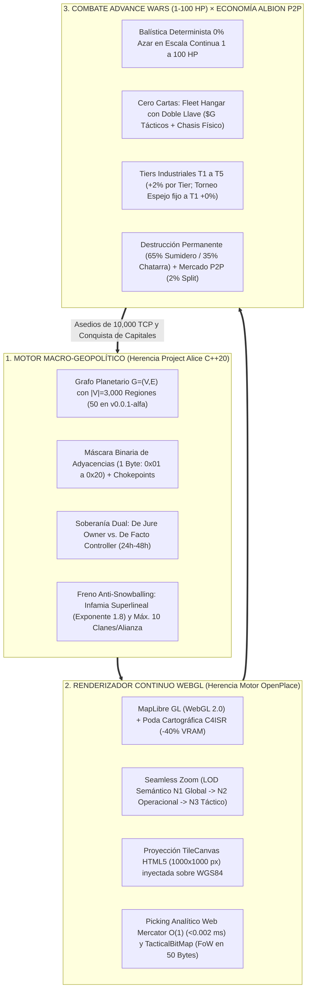
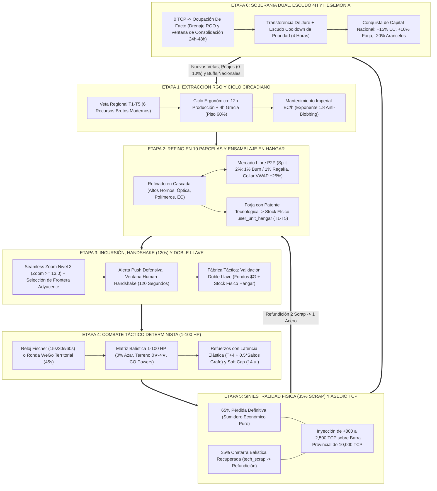
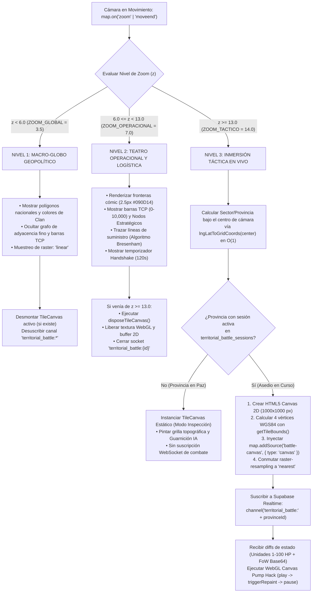
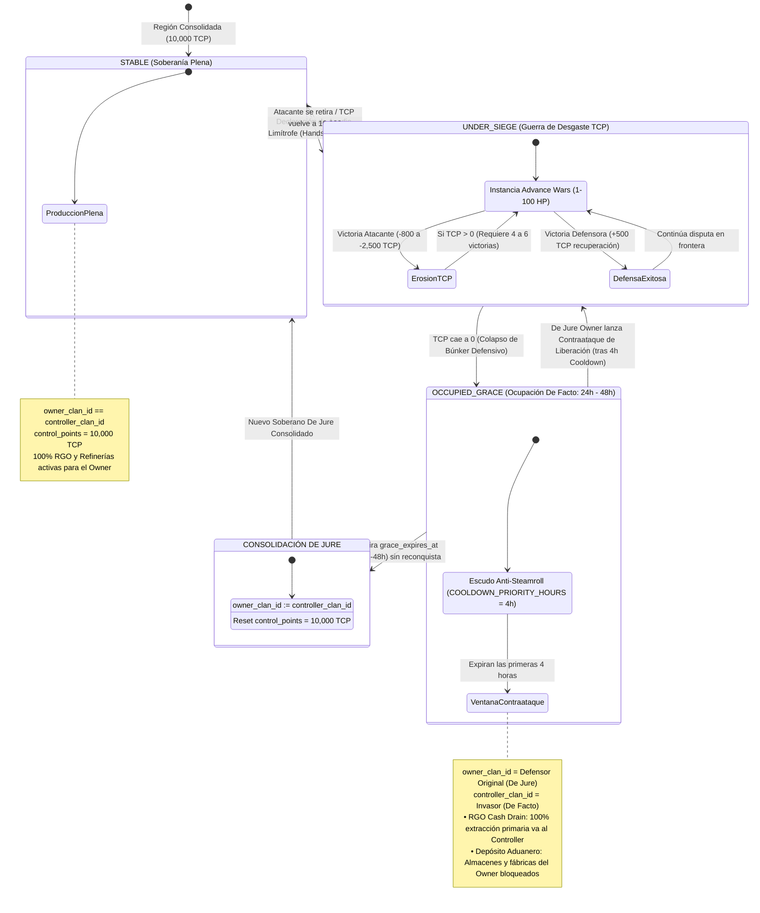
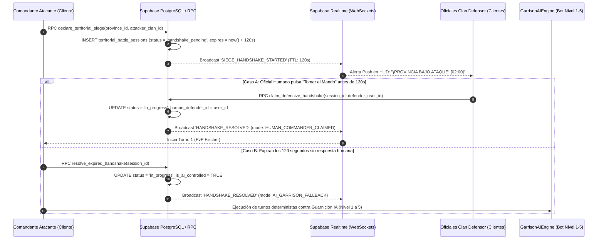
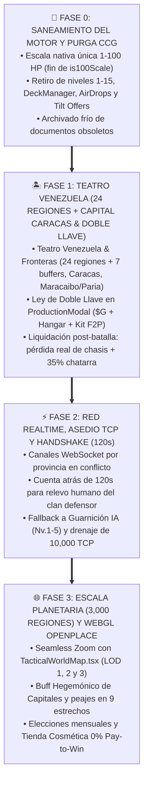

# 🌐 ESPECIFICACIÓN MAESTRA DEFINITIVA: GEOTACTICS: ONLINE (`v0.0.2-alfa`)
## *Documento de Verdad Absoluta (SSOT) — Síntesis Project Alice + OpenPlace WebGL + Hegemonía Rebalance*

> **Código de Documento:** `docs/00_GEOTACTICS_ONLINE_MASTER_SPEC.md`  
> **Versión Canónica:** `v0.0.2-alfa (Hegemonía — WebGL 2.0 Zero-Raster & Persistencia MVP)`  
> **Estado:** **ÚNICA FUENTE DE VERDAD CANÓNICA (SSOT — CERO INCERTIDUMBRE / ZERO-TODO)**  
> **Pilares Unificados:**  
> 1. **Pilar Geopolítico (Project Alice Bridge):** `METAGAME_DESIGN/PROPUESTA_GEOTACTICS_ALICE_HYBRID_MMO.md`  
> 2. **Pilar Cartográfico WebGL (OpenPlace Bridge):** `METAGAME_DESIGN/GEOTACTICS_MMO_OPENPLACE_SYNTHESIS_PROPOSAL.md`  
> 3. **Pilar de Combate 1-100 HP & Economía Albion P2P:** `docs/PLAN_MAESTRO_REESTRUCTURACION_HEGEMONIA.md`  
> **Documento Subordinado de Depuración:** `docs/MIGRATION_AND_LEGACY_PURGE_PLAN.md`
> **Diagnóstico Forense de Sincronización:** `docs/AUDITORIA_DISCREPANCIAS_V0.0.2_ALFA.md`

---

# 1. MANIFIESTO FUNDACIONAL Y VISIÓN DE PRODUCTO (`GEOTACTICS: ONLINE v0.0.2-alfa`)

> [!NOTE] ESTADO OPERATIVO DE LAS 3 CAPAS EN v0.0.2-alfa (MVP POLÍTICO)
> - **Capa 1: Metajuego Político Macro (Project Alice):** 🟢 **100% ACTIVA.** Rige la soberanía sobre el Teatro Venezuela (24 Entidades Federales + 7 Zonas Buffer internacionales). Las disputas territoriales se resuelven mediante asedio político directo y erosión progresiva de Puntos de Control Territorial (TCP).
> - **Capa 2: Combate Táctico en Cuadrícula (Advance Wars 1-100 HP):** 🟡 **DESARROLLADA / EN ESPERA EN RUNTIME.** El motor determinista de combate (`canonicalCombat.ts`, `pathfinding.ts`) está completamente programado y probado, pero la inyección de cuadrícula sobre el mapa (TileCanvas) está temporalmente deshabilitada en el MVP para garantizar 60 FPS ininterrumpidos y foco pleno en la Capa 1. Todo intento de combate en el Lobby redirige hacia asedio político.
> - **Capa 3: Bark Engine & Mando:** 🟢 **ACTIVA CON SUJETO ÚNICO.** El sistema de bocadillos de historieta y telemetría adaptativa opera bajo candado monousuario exclusivo con la Mayor Stella (`stella`) como Sujeto de Calibración C4ISR #01.

## 1.1 Identidad Formal del Proyecto y Transición Histórica
**GEOTACTICS: ONLINE (`v0.0.1-alfa`)**, conocido internamente bajo el nombre en clave **Proyecto Hegemonía**, constituye la refundación arquitectónica, sistémica y lúdica de *Tactical Command: Wars of Legacy*. El proyecto evoluciona formalmente desde un juego de estrategia por turnos de bolsillo con mecánicas heredadas de juegos de cartas coleccionables (CCG) hacia un **MMORTS Geopolítico, Industrial y Táctico Persistente a Escala Planetaria** ejecutado de forma nativa en navegadores web modernos (Desktop y Mobile) a $60\text{ FPS}$ sin pantallas de carga desconectadas.

La transición erradica de raíz la abstracción de los "mazos de 10 cartas", la progresión vertical artificial de niveles 1 a 15, la generación mágica de tropas y las arenas aisladas sin consecuencias. En **GEOTACTICS: ONLINE**, el planeta Tierra es un único teatro de operaciones continuo dividido en **$3,000$ Regiones Estratégicas** ($195$ Países, $6$ Teatros Continentales y $9$ Estrechos Marítimos Globales), cuyo despliegue operativo inicial se inaugura en la **"Isla de Prueba" (`v0.0.1-alfa`)**: un teatro de alta densidad táctica compuesto por **Venezuela y sus fronteras inmediatas** ($24$ Entidades Federales/Regiones de Venezuela + $7$ Regiones de Amortiguación Fronteriza con Colombia, Brasil, Guyana y el Caribe), la **Capital Nacional conquistable Caracas (`REG_VE_01`)** y los estrechos estratégicos del **Canal de Maracaibo (`CHK-MARACAIBO`)** y el **Golfo de Paria (`CHK-PARIA`)**. **Principio de Visibilidad Global y Jugabilidad Soberana:** Aunque la totalidad del globo terráqueo es visible a nivel macro en MapLibre GL WebGL (LOD 1), la interacción jugable, el forjado industrial, los asedios TCP y la soberanía de Fase 1 están activados **exclusivamente sobre el territorio de Venezuela**. Cada chasis blindado, caza de superioridad aérea o pieza de artillería desplegada sobre una cuadrícula táctica ha sido previamente extraído como mineral bruto, refinado en altos hornos territoriales, ensamblado físicamente en un hangar corporativo y transportado a la frontera. Cuando una unidad cae en combate, su pérdida material es **definitiva e irreversible**.

---

## 1.2 Síntesis de los Tres Pilares Tecnológicos y de Diseño

El núcleo de **GEOTACTICS: ONLINE (`v0.0.1-alfa`)** resuelve el histórico trilema de los MMORTS web mediante la hibridación de tres motores auditados y probados en producción:



### Pilar I: Macro-Geopolítica Territorial y Fricción Imperial (*Project Alice Engine*)
1. **Topología de Grafo Comprimida:** El mundo se modela como un grafo relacional no dirigido $G = (V, E)$ donde cada arista codifica en una máscara de bits de $1\text{ byte}$ (`topology_flags`) la naturaleza física de la frontera: `0x01` (`land_open`), `0x02` (`national_border`), `0x04` (`coastal`), `0x08` (`impassible`), `0x10` (`strait_choke`) y `0x20` (`river_crossing`). Esto permite validar rutas de suministro BFS y bloqueos de estrechos en memoria del cliente en $0\text{ ms}$ de red.
2. **Desdoblamiento de Soberanía (*De Jure* vs. *De Facto*):** Previene el *offline raiding* separando al propietario legal registrado (`owner_clan_id`) del ocupante militar activo (`controller_clan_id`), exigiendo agotar la barra de **$10,000\text{ Puntos de Control Territorial (TCP)}$** y consolidar ventanas de ocupación de $24\text{h}$ a $48\text{h}$ antes de transferir la titularidad soberana.
3. **0% Zonas Inexpugnables y Capitales Hegemónicas:** Ningún territorio del planeta goza de inmunidad perpetua. Conquistar cualquiera de las $195$ Capitales Nacionales otorga a la corporación dominante el **Buff Hegemónico Nacional** sobre todas sus provincias en ese país: **$+15\%$ a la producción de Créditos Energéticos (EC)**, **$+10\%$ a la velocidad de forja en hangares** y **$-20\%$ en aranceles comerciales P2P**.
4. **Frenos Matemáticos Anti-Snowballing:** Los mega-imperios sufren un incremento superlineal de mantenimiento energético con exponente $1.8$ sobre el límite imperial ($K_{\text{Límite\_Imperial}}$), latencia elástica de refuerzos según la distancia en saltos del grafo y un tope constitucional inquebrantable de **máximo $10$ corporaciones por Alianza Militar**.

### Pilar II: Renderizado Cartográfico Continuo y *Seamless Zoom* (*OpenPlace WebGL Engine*)
1. **Nivel de Detalle Semántico (Semantic LOD) sin Pantallas de Carga:** El lobby estático desaparece; la pantalla principal es una **War-Room Viva** sobre MapLibre GL (WebGL 2.0):
   - **Zoom Nivel 1 (`ZOOM_GLOBAL = 3.5`, $1.5 \le z < 6.0$ — Estratégico Global):** Polígonos vectoriales soberanos, colores heráldicos corporativos, banderas SVG de las $195$ naciones e iconos pulsantes de conflicto activo. Cero suscripción a WebSockets tácticos.
   - **Zoom Nivel 2 (`ZOOM_OPERACIONAL = 7.0`, $6.0 \le z < 13.0$ — Operacional Provincial):** Visualización de barras de $10,000\text{ TCP}$, niveles de búnker (1 a 5), complejos industriales de $10$ parcelas, peajes en estrechos ($0.00\%$ a $10.00\%$) y líneas de suministro trazadas con el algoritmo entero de Bresenham (`traceSupplyLine`).
   - **Zoom Nivel 3 (`ZOOM_TACTICO = 14.0`, $z \ge 13.0$ — Cuadrícula Táctica en Vivo):** El motor inyecta dinámicamente un `TileCanvas` HTML5 ($1000 \times 1000\text{ px}$) anclado a los $4$ vértices geográficos WGS84 exactos de la región (`getTileBounds`), conmuta el muestreo de textura de `linear` a `nearest` para preservar la nitidez pixel-art y se suscribe al canal WebSocket `territorial_battle:{province_id}` en menos de $200\text{ ms}$.
2. **Picking Analítico $O(1)$ y Empaquetado Binario:** Toda interacción de ratón o toque táctil resuelve la celda exacta $(x, y)$ mediante proyección trigonométrica directa de Web Mercator (`lngLatToGridCoords`) en $< 0.002\text{ ms}$, sin consultas al DOM ni lecturas de framebuffer. La Niebla de Guerra (*Fog of War*) y el control de celdas se transmiten mediante la estructura `TacticalBitMap` (`Uint8Array`), comprimiendo una cuadrícula de $20 \times 20$ ($400$ celdas) en exactamente **$50\text{ bytes}$** ($375\text{ bytes}$ para las $3,000$ regiones mundiales).

### Pilar III: Combate Determinista *Advance Wars* (1-100 HP) e Industria *Albion Online*
1. **Determinismo Balístico en Escala Continua 1 a 100 HP:** Cero dados, cero varianza aleatoria (`luckModifier = 0`). Toda unidad opera sobre $100\text{ HP}$ continuos, permitiendo aplicar con exactitud matemática la mitigación por estrellas de terreno ($0\star$ a $4\star$), las bonificaciones de Torres de Comunicación ($+10\%$ por torre) y la pureza industrial del chasis.
2. **Almacén Físico de Flota (*Fleet Hangar*) y Ley de Doble Llave:** Desaparecen por completo los mazos de cartas. El jugador administra un inventario físico de los **$16$ arquetipos militares canónicos** ensamblados en **Tiers T1 a T5**. Desplegar una unidad desde una fábrica en combate requiere satisfacer simultáneamente la **Doble Llave**: poseer los Fondos Tácticos ($\text{\$G}$) generados por ciudades capturadas en la partida **Y** descontar $1$ chasis físico real de `user_unit_hangar` (con excepción del **Kit Básico de Supervivencia F2P**: Infantería Ligera T1 y Reconocimiento T1 con stock infinito garantizado $\infty$).
3. **Siniestralidad Real y Mercado P2P Descentralizado:** Todo chasis destruido en combate se elimina permanentemente de la base de datos: el **$65\%$** se destruye como sumidero deflacionario puro y el **$35\%$** retorna al propietario como Chatarra Balística (`tech_scrap`) refundible en Altos Hornos ($2\text{ Scrap} \to 1\text{ Placa de Acero}$). El Mercado P2P aplica un impuesto transaccional del **$2\%$** ($1\%$ quema deflacionaria + $1\%$ regalía para el clan soberano de la provincia), bandas anti-especulación VWAP ($\pm 25\%$) y **prohíbe terminantemente el comercio de unidades militares terminadas**.

---

## 1.3 Lore, Facciones Corporativas y Doctrina Estética (C4ISR × Novela Gráfica Atompunk)

### El Escenario Geopolítico: La Crisis de Soberanía de 2026
Tras la fragmentación de los tratados supranacionales de defensa y el agotamiento de las reservas energéticas convencionales, la soberanía de las $195$ naciones ha pasado a estar disputada por **Corporaciones Militares Soberanas (Clanes)** gobernadas por Consejos Militares electos cada $30$ días. El patrón monetario global ha sido reemplazado por el **Crédito Energético (`EC`)**, respaldado directamente por el refinado de hidrocarburos sintéticos y el control de reactores e infraestructura pesada.

### Las Cinco Doctrinas Corporativas y el Alto Mando
Los comandantes en jefe lideran sus divisiones a través de **$28$ Oficiales Comandantes (COs)** agrupados en cinco bloques doctrinales clásicos y el Alto Mando Ejecutivo:

| Bloque Doctrinal / Facción | Identidad Cromática Canónica | Comandantes Representativos (`COId`) | Especialización Militar y Doctrina de Guerra |
| :--- | :--- | :--- | :--- |
| **Orange Star Defense Corp.** | Naranja Combate (`#E65100`) / Ámbar (`#F59E0B`) | `andy`, `max`, `sami`, `nell`, `hachi`, `rachel`, `jake` | Asalto blindado directo, reparación mecánica de emergencia en el frente (`Hyper Upgrade`), despliegue de infantería mecanizada y captura acelerada de sedes. |
| **Blue Moon Northern Syndicate** | Azul Cobalto (`#1D4ED8`) / Hielo Ártico (`#93C5FD`) | `olaf`, `grit`, `colin`, `sasha` | Guerra de desgaste invernal, barreras de artillería de largo alcance (fuego indirecto $d \ge 2$), movilización masiva de capital (`Gold Rush`) y supresión financiera enemiga. |
| **Green Earth Aero-Naval Consortium** | Verde Táctico (`#15803D`) / Níquel (`#86EFAC`) | `eagle`, `drake`, `jess`, `javier` | Supremacía aérea relámpago con doble turno (`Lightning Strike`), bloqueo de estrechos oceánicos con acorazados, logística blindada y fortificación de nodos C4ISR. |
| **Yellow Comet Bushido Zaibatsu** | Oro Imperial (`#D97706`) / Arena (`#FDE047`) | `kanbei`, `sonja`, `sensei`, `grimm` | Chasis de altísima pureza (+20% moral ofensiva/defensiva), contraataques letales, inteligencia óptica contra Niebla de Guerra y asaltos aerotransportados en helicóptero. |
| **Black Hole Vanguard Technologies** | Púrpura Vacío (`#4C1D95`) / Carmesí (`#991B1B`) | `flak`, `adder`, `lash`, `hawke`, `sturm`, `von_bolt`, `jugger`, `koal`, `kindle` | Guerra asimétrica experimental, aprovechamiento balístico del terreno, drenaje bio-energético global (`Black Wave`) y bombardeo cinético de área (`Meteor Strike`). |
| **Alto Mando Ejecutivo (C4ISR)** | Oliva Blindado (`#46521F`) / Óxido Alerta (`#C46A3A`) | `stella`, `volkov`, `garrison`, `vance` | Doctrinas operacionales híbridas integradas al Bark Engine: puntas de lanza Blitz (`stella`), saturación de obuses (`volkov`) y defensa de búnkeres provinciales (`garrison`). |

### Dirección de Arte y Tono: Consola Militar C4ISR × Novela Gráfica Bélica (Atompunk)
La interfaz de usuario fusiona la precisión instrumental de una sala de mando militar **C4ISR (Command, Control, Communications, Computers, Intelligence, Surveillance and Reconnaissance)** con la energía cinética de la novela gráfica bélica (*Advance Wars meets Persona 5 / Hades*) y el diseño industrial *Space-Age Atompunk (1950s/1960s)*:
1. **ADN Cromático Blindado:** Construido sobre el chasis `--color-bunker-void` (`#161712`) y `--color-armor-base` (`#2B2C24`), cubiertas en Oliva Militar (`#46521F`), biseles metálicos (`#7B8A4A`), alertas en Naranja Óxido (`#C46A3A`), datos en Crema Táctico (`#F2E8D5`) y telemetría de radar en Verde Fósforo CRT (`#00FF66`).
2. **Geometría Asimétrica y Tramas Ben-Day:** Prohibición absoluta de tarjetas corporativas genéricas de SaaS. Los contenedores utilizan curvaturas asimétricas tipo lágrima (`border-radius: 14px 4px 14px 4px` y `40px 10px 40px 10px`), chaflanes mecanizados a $45^\circ$ (`clip-path: polygon(...)`), sombras duras de tinta negra sin desenfoque (`box-shadow: 6px 6px 0px rgba(0,0,0,0.95)`) y fondos con tramas de puntos Ben-Day (`radial-gradient(#7B8A4A 15%, transparent 16%)`).
3. **Bark Engine Cómic (100% Gráfico/Texto, CERO Actores de Voz):** Para garantizar cargas en $< 1.0\text{ s}$ y ancho de banda nulo, las reacciones de los comandantes se proyectan mediante viñetas dinámicas con $5$ morfologías de bocadillo (*shout*, *thought*, *whisper*, *radio*, *panic*), sellos pop-art de onomatopeyas (`¡¡KABOOM!!`, `¡TRAP!`, `¡FIRST BLOOD!`) y congelación cinemática de pantalla ($1,500\text{ ms}$) al detonar un Super CO Power (SCOP).

---

## 1.4 Los Cinco Invariantes Constitucionales Anti-Pay-to-Win (0% P2W)

El diseño económico y competitivo de **GEOTACTICS: ONLINE (`v0.0.1-alfa`)** está blindado por cinco leyes inmutables verificadas a nivel de base de datos (PostgreSQL RLS y funciones RPC):

1. **Invariante 1 — Prohibición Absoluta de Venta de Tropas, Recursos o Aceleradores por Dinero Real:** La tienda comercial (`Stripe` con verificación criptográfica HMAC) comercializa única y exclusivamente activos cosméticos: el Pase de Batalla Cosmético, skins de unidades, marcos de viñeta cómic, estandartes heráldicos y temas musicales. No existen lotes de minerales, recargas de Créditos Energéticos ni aceleradores de tiempo de forja pagados con dinero fiat.
2. **Invariante 2 — Prohibición de Unidades Terminadas en el Mercado P2P:** En el Mercado Libre P2P solo se permite comerciar materias primas brutas, materiales refinados en cascada, consumibles tácticos y planos de patentes (`Blueprints`). Ningún jugador o corporación puede comprar un tanque, avión o buque listo para el combate; todo chasis debe ser forjado físicamente en los talleres de ensamblaje propios o del clan.
3. **Invariante 3 — Normalización Estricta a Tier 1 ($+0.0\%$) en Esports y Duelo Espejo:** En el Modo Duelo Táctico Espejo ($10 \times 10$) y en torneos competitivos clasificados por Elo, el motor fuerza la variable `tier = 1` para ambos contendientes ($\text{TierBonus} = 0.0\%$), anulando cualquier asimetría industrial y premiando el $100\%$ de la destreza táctica pura.
4. **Invariante 4 — Techo Balístico Suave en Guerra Territorial ($+2\%$ por Tier):** En los asedios geopolíticos donde intervienen chasis de calidad T1 a T5, la ventaja material máxima está acotada linealmente a $+2.0\%$ por grado industrial sobre T1 (siendo $+8.0\%$ en Tier 5), lo que garantiza que una maniobra táctica superior (cobertura de $3\star$/$4\star$, flanqueo con fuego indirecto o contraataque favorable) siempre derrote a la fuerza bruta.
5. **Invariante 5 — Dotación Básica F2P Inagotable Anti-Bancarrota:** Las unidades `infantry` (Infantería Ligera T1, $\$1,000\text{G}$) y `recon` (Vehículo de Reconocimiento T1, $\$4,000\text{G}$) poseen stock físico infinito ($\infty$) en el hangar de todo jugador. Ningún comandante puede quedar bloqueado fuera del bucle de juego tras sufrir una aniquilación militar total.

---

# 2. BUCLE DE JUEGO MAESTRO SEGUNDO A SEGUNDO (CLOSED-LOOP ARCHITECTURE)

## 2.1 Diagrama de Arquitectura de Ciclo Cerrado (Closed-Loop Material & Sovereignty Flow)

El ecosistema de **GEOTACTICS: ONLINE (`v0.0.1-alfa`)** funciona como un circuito termodinámico cerrado donde la energía y los minerales extraídos de la geografía mundial se transforman en chasis militares, se consumen en la cuadrícula táctica y alteran las fronteras políticas que alimentan nuevamente la extracción:

$$\text{Extracción RGO} \rightarrow \text{Refino y Ensamblaje en Hangar} \rightarrow \text{Despliegue con Doble Llave} \rightarrow \text{Combate WeGo/AW} \rightarrow \text{Desgaste (35\% Scrap) + Asedio TCP} \rightarrow \text{Soberanía}$$



---

## 2.2 Desglose Matemático y Temporal de las 6 Etapas del Bucle

### ETAPA 1: Extracción Geológica RGO, Ciclo Circadiano y Freno Imperial
Cada región del mapa posee una veta primaria de recurso (`resource_tier` $\in \{1, 2, 3, 4, 5\}$) y un complejo industrial modular de hasta **$10$ parcelas** (`industrialEngine.ts`).
1. **Fórmula de Extracción Horaria Regional (Modelo RGO Adaptado):**
   $$\text{Producción\_Horaria}(r) = Y_{\text{base}}(r) \times \eta_{\text{infra}} \times \left(\frac{L_{\text{asignada}}}{L_{\text{máx}}}\right) \times (1 - D_{\text{estructural}}) \times M_{\text{Capital}} \times \eta_{\text{circadiano}}(t)$$
2. **Función de Eficiencia del Ciclo Circadiano Ergonómico ($\eta_{\text{circadiano}}(t)$):**
   $$\eta_{\text{circadiano}}(t) = \begin{cases} 1.00 & \text{si } 0 \le t \le 16 \text{ horas (12h turno activo + 4h ventana de gracia)} \\ \max\Big(0.60,\; 1.00 - 0.015 \times (t - 16)\Big) & \text{si } t > 16 \text{ horas (merma suavizada del } 1.5\%\text{/h hasta el piso del } 60\%\text{)} \end{cases}$$
3. **Curva Superlineal de Mantenimiento Imperial Anti-Snowballing ($C_{\text{Upkeep}}$):**
   $$C_{\text{Mantenimiento\_Total}}(\text{EC/h}) = \left(\sum_{i=1}^{N_{\text{reg}}} C_{\text{base}}(i)\right) \times \left[1 + \left(\frac{N_{\text{reg}}}{K_{\text{Límite\_Imperial}}}\right)^{1.8}\right]$$

### ETAPA 2: Cadena de Refino en Cascada, Mercado P2P y Ensamblaje en Hangar
1. **Bandas Anti-Manipulación del Mercado Libre P2P ($\text{VWAP}_{24\text{h}} \pm 25\%$):**
   $$P_{\text{orden}} \in \Big[0.75 \times \text{VWAP}_{24\text{h}},\; 1.25 \times \text{VWAP}_{24\text{h}}\Big]$$
2. **Split Impositivo del 2.0% ($1\%$ Burn + $1\%$ Regalía Soberana):**
   $$\text{Tax}_{\text{Burn}} = \lfloor 0.01 \times V_{\text{bruto}} \times (1 - \delta_{\text{Capital}}) \rfloor, \qquad \text{Tax}_{\text{RegalíaClan}} = \lfloor 0.01 \times V_{\text{bruto}} \times (1 - \delta_{\text{Capital}}) \rfloor$$
3. **Ensamblaje Físico y Tiempo de Forja en Hangar:**
   $$t_{\text{forja}}(u, T) = \frac{t_{\text{base}}(u) \times \mu_{\text{time}}(T)}{(1 + \text{Bonus}_{\text{Taller}}) \times (1 + 0.10 \cdot \mathbb{I}_{\text{Capital}})}$$

### ETAPA 3: Incursión Geopolítica, Human Handshake (120s) y Despliegue con Doble Llave
1. **Protocolo de Relevo Humano (*Human Handshake* de 120 Segundos):**
   $$\text{Controlador}_{\text{Defensa}} = \begin{cases} \text{Oficial Humano (PvP en Vivo)} & \text{si } \exists\, u_{\text{def}} \text{ que pulsa ``Tomar el Mando'' en } t \le t_0 + 120\text{ s} \\ \text{Guarnición IA Autónoma (Búnker Nv. 1-5)} & \text{si } t > t_0 + 120\text{ s sin respuesta humana} \end{cases}$$
2. **Ecuación Booleana de la Doble Llave en Fábricas Tácticas (`ProductionModal.tsx`):**
   $$\text{PuedeDesplegar}(u, T) \iff \Big(\text{Fondos}_{\$G} \ge \text{Coste}_{\$G}(u)\Big) \;\land\; \Big(\text{StockHangar}(u, T) \ge 1 \;\lor\; (u \in \{\text{'infantry'}, \text{'recon'}\} \land T = 1)\Big)$$

### ETAPA 4: Combate Táctico Determinista (Escala 1-100 HP, Relojes y Logística)
1. **Fórmula Maestra de Daño Balístico Determinista (0% Azar):**
   $$\Delta\text{HP}(A \to D) = \max\left(1, \left\lfloor \left\lfloor \left\lfloor B(A, D) \times \frac{M_{\text{atk}, A}}{100} \right\rfloor \times \frac{\text{HP}_A}{100} \right\rfloor \times \frac{\left\lfloor 200 - \left(C_{\text{def}, D} + \text{TierBonus}(T_D) + S_D \cdot \frac{\text{HP}_D}{10}\right) \right\rfloor}{100} \right\rfloor\right)$$
2. **Latencia Elástica de Refuerzos Territoriales:**
   $$\text{Rondas\_Llegada} = 4 + \lfloor 0.5 \times \text{Distancia\_Saltos\_Grafo} \rfloor$$

### ETAPA 5: Liquidación de Siniestralidad (35% Chatarra) y Progreso de Asedio TCP
1. **Recuperación de Chatarra Balística (`tech_scrap`):**
   $$\text{Scrap}_{\text{Recuperado}} = \sum_{i, \; u_i \notin \{\text{'infantry'}, \text{'recon'}\}} \left\lfloor \Big(50 \times T_i \times q_i\Big) \times 0.35 \right\rfloor$$
2. **Erosión de la Barra de 10,000 TCP:**
   $$\Delta\text{TCP}_{\text{batalla}} \in [800,\; 2,500], \qquad \text{TCP}_{\text{nuevo}} = \max\Big(0,\; \text{TCP}_{\text{actual}} - \Delta\text{TCP}_{\text{batalla}}\Big)$$

### ETAPA 6: Soberanía Dual (*De Facto* $\to$ *De Jure*), Escudo de 4 Horas y Hegemonía
Al caer a $0\text{ TCP}$, el atacante se convierte en `controller_clan_id` (*Ocupación De Facto*) activando el **Escudo de Prioridad de 4 Horas** (`COOLDOWN_PRIORITY_HOURS = 4`) y la **Ventana de Consolidación de 24h-48h** (`occupied_grace`), tras la cual se transfiere el título legal (`owner_clan_id`).

---

## 2.3 Tabla Maestra de Comparación: Erradicación del Legado CCG vs. Canon `GEOTACTICS: ONLINE (v0.0.1-alfa)`

| Dimensión del Sistema | ❌ Legado Erradicado (*Tactical Command CCG / Pre-Hegemonía*) | ✅ Nuevo Estándar Canónico (*GEOTACTICS: ONLINE `v0.0.1-alfa`*) | Impacto Técnico y de Diseño en el Repositorio |
| :--- | :--- | :--- | :--- |
| **1. Modelo de Colección e Invocación de Tropas** | **Mazo de 10 Cartas (`DeckManager`):** El jugador armaba una baraja cerrada de 10 naipes y podía invocar copias infinitas en partida pagando solo oro in-match ($\$G$). | **Almacén Físico de Unidades (`Fleet Hangar`) + Doble Llave:** Cero cartas. Acceso abierto a los $16$ arquetipos militares sujetos a **Doble Llave**: Fondos $\$G$ in-match **Y** $1$ chasis físico real en `user_unit_hangar`. | Deprecación definitiva de `src/engine/deckManager.ts`. Integración de `useUserHangar` en `ProductionModal.tsx`. |
| **2. Progresión Vertical de Unidades** | **Niveles de Carta 1 a 15 (`getLevelAttackBonus`):** Subida de nivel estilo *Clash Royale* coleccionando copias duplicadas en cofres de botín, generando inflación de estadísticas. | **Grados Industriales T1 a T5 (`getIndustrialTierBonus`):** Progresión industrial por pureza de materiales forjados ($+2.0\%$ por Tier sobre T1, máx $+8.0\%$ en T5). En Esports/Duelo Espejo todo se fija a **Tier 1 ($+0.0\%$)**. | Eliminación de `getLevelAttackBonus` en `src/engine/canonicalCombat.ts`. Preservación exclusiva de `tier: 1 \| 2 \| 3 \| 4 \| 5`. |
| **3. Escala de Salud y Precisión Balística** | **Escala Discreta 1 a 10 HP (o Híbrida):** Código partido con un flag condicional `is100Scale` y divisiones por $10$ que truncaban los bonos del $+2\%$ y las coberturas de terreno. | **Escala Continua Nativa de 1 a 100 HP:** Toda unidad nace con `hp: 100, maxHp: 100`. Daño determinista continuo sin redondeos a base $10$, con $0\%$ de azar (`luckModifier = 0`). | Unificación de `TacticalUnit` en `src/types/index.ts`, `turnEconomy.ts` y `canonicalCombat.ts` a $100\text{ HP}$ puros. |
| **4. Consecuencia Post-Combate (Siniestralidad)** | **Cero Pérdida Material:** Al terminar la batalla, todas las unidades destruidas seguían intactas en la cuenta del jugador; la economía carecía de sumidero real (*Item Sink*). | **Destrucción Física Permanente + 35% Chatarra:** Todo chasis destruido se descuenta de `user_unit_hangar`. El $65\%$ desaparece como sumidero y el **$35\%$** retorna como `tech_scrap` refundible ($2\text{ Scrap} \to 1\text{ Acero}$). | Ejecución del RPC transaccional `settle_territorial_combat_losses` al cierre de cada batalla territorial. |
| **5. Salvaguarda contra Bancarrota del Jugador** | **Inexistente (Innecesaria por Cartas Infinitas):** Como los mazos no se gastaban nunca, no existía riesgo de quedarse sin inventario militar. | **Kit Básico de Supervivencia F2P Inagotable ($\infty$):** La Infantería Ligera T1 (`infantry`, $\$1,000\text{G}$) y el Reconocimiento T1 (`recon`, $\$4,000\text{G}$) tienen stock infinito garantizado por el Estado Mayor. | Bypass de validación de stock físico en cliente y backend para `unit_code IN ('infantry', 'recon')` a Tier 1. |
| **6. Pantalla Principal y Navegación Espacial** | **Lobby Estático de Menús y Modales:** Pantalla desconectada del mundo donde se pulsaba un botón para buscar partida en arenas abstractas con bordes negros. | **War-Room Viva con *Seamless Zoom* (OpenPlace WebGL):** Mapa mundial MapLibre GL a $60\text{ FPS}$ como fondo permanente con LOD Semántico (N1 Global $\to$ N2 Operacional $\to$ N3 Cuadrícula `TileCanvas` en vivo a $\text{Zoom} \ge 13.0$). | Implementación de `TacticalWorldMap.tsx`, `coordinates.ts` (Picking $O(1)$) y `tacticalBitmap.ts` ($50\text{ bytes}$ FoW). |
| **7. Escala Territorial y Gobernanza de Capitales** | **Capitales Inexpugnables (High-Sec Inmune) o Mapa Vacío:** Las $195$ capitales no se podían atacar o se pretendía abrir $3,000$ regiones vacías sin densidad de jugadores. | **0% Zonas Inexpugnables + Estrategia "Teatro Venezuela":** Todas las $195$ Capitales son conquistables y otorgan el **Buff Hegemónico Nacional** ($+15\%\text{ EC}, +10\%\text{ forja}, -20\%\text{ aranceles}$). Lanzamiento en teatro denso de **24 Regiones de Venezuela + 7 Regiones de Amortiguación Fronteriza** (Capital Caracas `REG_VE_01` y estrechos `CHK-MARACAIBO` y `CHK-PARIA`). Visibilidad global de la Tierra en WebGL, pero jugabilidad activa acotada exclusivamente a Venezuela en Fase 1. | Migración de seed territorial acotado de $24$ regiones venezolanas + $7$ amortiguadores + Capital Caracas + $2$ estrechos y barras de $10,000\text{ TCP}$. |
| **8. Defensa Territorial Asincrónica y Relevo** | **Combate Puramente Offline contra Bots o Espera Indefinida:** Desconexión entre las defensas automáticas y la intervención en vivo de los miembros del clan. | **Guarniciones IA por Nivel + Human Handshake ($120\text{ s}$):** Alerta push en tiempo real al clan defensor con cuenta atrás de **$120\text{ segundos}$** para tomar el mando en PvP antes de que la Guarnición IA (Nivel 1 a 5 MCTS) asuma el control. | Tabla `territorial_battle_sessions`, canal Realtime `territorial_battle:{id}` y `HANDSHAKE_TIMEOUT_SECONDS = 120`. |
| **9. Comercio entre Jugadores y Monetización** | **Riesgo de Comercio de Tropas en Cajas / Ofertas Tilt $0.99:** Ambigüedad sobre qué objetos finales podían comprarse directamente o mediante ofertas flash tras derrotas. | **Mercado P2P 100% Insumos/Patentes (0% P2W):** Prohibición absoluta de vender tropas terminadas y retiro de ofertas Tilt. Impuesto del **$2\%$** ($1\%$ Burn + $1\%$ Regalía Provincial), collar $\text{VWAP} \pm 25\%$ y **Créditos Energéticos (`EC`)**. | Restricción de catálogo en el libro de órdenes P2P y curva de mantenimiento energético superlineal con exponente $1.8$. |

---

# 3. MOTOR CARTOGRÁFICO WEBGL, SEAMLESS ZOOM Y PIPELINE OPENPLACE

Esta sección especifica la arquitectura de renderizado de alta frecuencia para **GEOTACTICS: ONLINE (`v0.0.2-alfa`)**. Ha erradicado definitivamente el antiguo lienzo DOM/SVG (`src/components/world/WorldMapCanvas.tsx`, purgado físicamente del repositorio), consolidando el motor **OpenPlace Bridge** sobre **MapLibre GL (WebGL 2.0) Zero-Raster** con geometría vectorial local e interactividad C4ISR a **60 FPS constantes**. Esta arquitectura sostiene más de $3,000$ regiones geopolíticas y proyecta cuadrículas tácticas estilo *Advance Wars* en vivo directamente sobre la cartografía terrestre real a **60 FPS constantes**, sin pantallas de carga desconectadas.

---

## 3.1 Arquitectura de Nivel de Detalle Semántico (Semantic LOD)

Para evitar el colapso de VRAM en el cliente y la saturación de canales WebSocket en Supabase Realtime, el motor cartográfico aplica una jerarquía estricta de **Nivel de Detalle Semántico (Semantic LOD)** gobernada por tres umbrales canónicos de cámara:

| Nivel LOD | Constante Canónica | Rango de Zoom ($z$) | Estrato Visual Activo | Suscripción de Red (Supabase Realtime) | Presupuesto de Memoria / GPU |
| :--- | :--- | :--- | :--- | :--- | :--- |
| **Nivel 1: Macro-Globo (Estratégico)** | `ZOOM_GLOBAL = 3.5` | $1.5 \le z < 6.0$ | Polígonos vectoriales de países y macrorregiones (`provinces-fill`), colores heráldicos de clanes dominantes, escudos de Capitales Nacionales e iconos pulsantes de alerta de guerra (`status === 'under_siege'`). | Canal global ligero `world_sovereignty_ticker` (solo cambios de propietario, caídas de capitales y alertas de asedio). **0 canales tácticos activos.** | $< 45\text{ MB}$ VRAM. Renderizado 100% vectorial en GPU (`GeoJSONSource`). |
| **Nivel 2: Operacional y Suministros** | `ZOOM_OPERACIONAL = 7.0` | $6.0 \le z < 13.0$ | Fronteras provinciales entintadas (`line-width: 2.5px`), barras de Puntos de Control Territorial ($\text{TCP}: 0 \dots 10,000$), nodos industriales (Refinerías, Altos Hornos, Silos), aristas del grafo topológico de adyacencia (estrechos marítimos y ferrocarriles) y trazado de convoyes logísticos mediante Bresenham. | Canal regional `theater_ops:{country_iso}` (actualización de barras TCP, cuenta atrás de Handshake de $120\text{ s}$ y tránsito de refuerzos cada 4 rondas). | $< 85\text{ MB}$ VRAM. Capas `fill`, `line` y `circle`/`symbol` combinadas. |
| **Nivel 3: Combate Táctico en Vivo** | `ZOOM_TACTICO = 14.0` | $13.0 \le z \le 20.0$ | **Activación del `TileCanvas` ($1000 \times 1000\text{ px}$)** proyectado sobre los límites WGS 84 de la provincia en conflicto. Conmutación de muestreo de textura a `nearest` (pixel-art nítido). Renderizado de la cuadrícula táctica ($16 \times 16$ o $20 \times 20$), biomas, Niebla de Guerra binaria (`TacticalBitMap`) y unidades con barras de $1\text{–}100\text{ HP}$ combatiendo en tiempo real. | Suscripción exclusiva bajo demanda al canal `territorial_battle:{province_id}` (estado del tablero, reloj Fischer $15\text{–}30\text{ s}$ y eventos balísticos). | $< 140\text{ MB}$ VRAM. Máximo **1 `TileCanvas` activo** simultáneamente en memoria; auto-destrucción al bajar de $z < 13.0$. |

### Diagrama de Flujo de Cámara, Suscripción Dinámica y Ciclo de Vida de `TileCanvas`



---

## 3.2 Arquitectura del Componente `TacticalWorldMap.tsx` (React 19 + MapLibre GL)

El componente `src/components/world/TacticalWorldMap.tsx` evoluciona y reemplaza a `WorldMapCanvas.tsx`. Delega toda la geometría al pipeline **WebGL 2.0 de MapLibre GL** y proyecta el combate táctico mediante un **Canvas HTML5 en memoria enlazado como textura GPU**.

### Reglas de Ingeniería del Renderizador WebGL:
1. **Inicialización Blindada Zero-SSR**: `maplibre-gl` se importa dinámicamente dentro de `useEffect` para prevenir referencias a `window` antes del montaje del DOM.
2. **Poda Cartográfica C4ISR (`pruneCivilianLayers`)**: Al cargar el estilo del mapa base vectorial, se purgan mediante expresiones regulares todas las capas civiles irrelevantes (`/^poi_|^landuse|^building(-3d)?$|^road_label|^waterway_label/`). Esto reduce el consumo de VRAM en un **40%** y limpia visualmente el terreno para la estética de consola militar C4ISR.
3. **Pipeline de Inyección de `TileCanvas` (`1000x1000 px`)**:
   - Se instancia un `<canvas width="1000" height="1000">` fuera del DOM con `{ willReadFrequently: true }` e `imageSmoothingEnabled = false`.
   - Se registra en MapLibre mediante `map.addSource(sourceId, { type: 'canvas', canvas, coordinates: bounds, animate: false })` y su capa `map.addLayer({ id: layerId, type: 'raster', source: sourceId })`.
4. **WebGL Canvas Pump Hack (Repintado por Demanda)**:
   - El canvas permanece pausado (`animate: false`) y solo cuando se recibe un cambio de turno, movimiento de unidad o actualización de Niebla de Guerra, se invoca el bombeo selectivo: `source.play()` $\rightarrow$ `map.triggerRepaint()` $\rightarrow$ `setTimeout(() => source.pause(), 0)`.
5. **Conmutación Dinámica de Muestreo (`linear` vs. `nearest`)**:
   - Al cruzar el umbral táctico ($z \ge 13.0$), la propiedad `raster-resampling` de la capa del canvas conmuta de `"linear"` a `"nearest"`, preservando los bordes exactos del pixel-art de las unidades y las barras de $1\text{–}100\text{ HP}$ sin desenfoque bilineal.

```tsx
// ARCHIVO CANÓNICO: src/components/world/TacticalWorldMap.tsx

import React, { useEffect, useRef, useState, useMemo, useCallback } from 'react';
import type {
  Map as MapLibreMap,
  GeoJSONSource,
  CanvasSource,
  MapMouseEvent,
  StyleSpecification,
} from 'maplibre-gl';
import 'maplibre-gl/dist/maplibre-gl.css';
import {
  ZOOM_GLOBAL,
  ZOOM_OPERACIONAL,
  ZOOM_TACTICO,
  TILE_SIZE,
  lngLatToGridCoords,
  getTileBounds,
} from '../../engine/coordinates';
import { TacticalBitMap } from '../../engine/tacticalBitmap';
import { useTerritoryMap } from '../../hooks/useTerritoryMap';
import type { TacticalUnit } from '../../types';

export interface TacticalWorldMapProps {
  userClanId?: string | null;
  activeProvinceId?: string | null;
  activeBattleUnits?: TacticalUnit[];
  fogOfWarBase64?: string | null;
  onSelectProvince?: (provinceId: string) => void;
  onSelectTacticalCell?: (sector: [number, number], cell: [number, number]) => void;
  className?: string;
}

interface ActiveTileCanvasState {
  sectorKey: string;
  sector: [number, number];
  sourceId: string;
  layerId: string;
  canvas: HTMLCanvasElement;
  ctx: CanvasRenderingContext2D;
  isDirty: boolean;
}

const C4ISR_HIDE_LAYERS_REGEX = /^poi_|^landuse|^building(-3d)?$|^road_label|^waterway_label|^transit_/;
const ACTIVITY_TIMEOUT_MS = 300_000; // 5 minutos para standby automático (0% CPU)
const TACTICAL_GRID_DIMENSION = 20;  // Cuadrícula de 20x20 celdas (50x50 px por celda en canvas de 1000px)

/**
 * ESTILO CANÓNICO C4ISR ZERO-RASTER LOCAL (v0.0.2-alfa)
 * Renderizado local en GPU sin llamadas externas a servidores de teselas.
 */
const ZERO_RASTER_MILITARY_STYLE: StyleSpecification = {
  version: 8,
  sources: {
    'world-land': {
      type: 'geojson',
      data: '/map/world_land.json',
    },
  },
  layers: [
    {
      id: 'background',
      type: 'background',
      paint: { 'background-color': '#0E100C' },
    },
    {
      id: 'world-land-mass',
      type: 'fill',
      source: 'world-land',
      paint: { 'fill-color': '#1C1E17', 'fill-opacity': 0.95 },
    },
    {
      id: 'world-land-border',
      type: 'line',
      source: 'world-land',
      paint: { 'line-color': '#46521F', 'line-width': 1.2, 'line-opacity': 0.65 },
    },
  ],
};

export const TacticalWorldMap: React.FC<TacticalWorldMapProps> = ({
  userClanId = 'clan-ferro',
  activeProvinceId = null,
  activeBattleUnits = [],
  fogOfWarBase64 = null,
  onSelectProvince,
  onSelectTacticalCell,
  className = '',
}) => {
  const mapContainerRef = useRef<HTMLDivElement | null>(null);
  const mapInstanceRef = useRef<MapLibreMap | null>(null);
  const tileCanvasRef = useRef<ActiveTileCanvasState | null>(null);
  const isStandbyRef = useRef<boolean>(false);
  const inactivityTimerRef = useRef<number | null>(null);

  const [currentZoom, setCurrentZoom] = useState<number>(ZOOM_GLOBAL);
  const [hoveredProvinceId] = useState<string | null>(null);
  const [hoveredCell, setHoveredCell] = useState<[number, number] | null>(null);
  const [isStandbyUI, setIsStandbyUI] = useState<boolean>(false);

  const { provinces, controlMap, clansMap } = useTerritoryMap(userClanId);

  const pruneCivilianLayers = useCallback((map: MapLibreMap) => {
    const style = map.getStyle();
    if (!style || !style.layers) return;
    for (const layer of style.layers) {
      if (C4ISR_HIDE_LAYERS_REGEX.test(layer.id)) {
        map.setLayoutProperty(layer.id, 'visibility', 'none');
      }
    }
  }, []);

  const pumpCanvasToWebGL = useCallback((map: MapLibreMap, sourceId: string) => {
    if (isStandbyRef.current) return;
    const source = map.getSource(sourceId) as (CanvasSource & {
      play?: () => void;
      pause?: () => void;
    }) | undefined;

    if (source && typeof source.play === 'function') {
      source.play();
      map.triggerRepaint();
      window.setTimeout(() => {
        if (typeof source.pause === 'function') source.pause();
      }, 0);
    } else {
      map.triggerRepaint();
    }
  }, []);

  const renderTacticalBattleCanvas = useCallback(
    (
      tileState: ActiveTileCanvasState,
      units: TacticalUnit[],
      fowBitmap: TacticalBitMap | null,
      highlightCell: [number, number] | null
    ) => {
      const { ctx, sourceId } = tileState;
      const cellPx = TILE_SIZE / TACTICAL_GRID_DIMENSION;

      ctx.clearRect(0, 0, TILE_SIZE, TILE_SIZE);

      for (let gy = 0; gy < TACTICAL_GRID_DIMENSION; gy++) {
        for (let gx = 0; gx < TACTICAL_GRID_DIMENSION; gx++) {
          const bitIndex = gy * TACTICAL_GRID_DIMENSION + gx;
          const isFogged = fowBitmap ? !fowBitmap.getBit(bitIndex) : false;
          const px = gx * cellPx;
          const py = gy * cellPx;

          ctx.fillStyle = isFogged ? 'rgba(9, 13, 20, 0.72)' : 'rgba(70, 82, 31, 0.14)';
          ctx.fillRect(px, py, cellPx, cellPx);

          ctx.strokeStyle = isFogged ? 'rgba(51, 65, 85, 0.35)' : 'rgba(163, 230, 53, 0.32)';
          ctx.lineWidth = 1;
          ctx.strokeRect(px + 0.5, py + 0.5, cellPx - 1, cellPx - 1);
        }
      }

      if (highlightCell) {
        const [hx, hy] = highlightCell;
        ctx.strokeStyle = '#FACC15';
        ctx.lineWidth = 3;
        ctx.strokeRect(hx * cellPx + 1.5, hy * cellPx + 1.5, cellPx - 3, cellPx - 3);
      }

      for (const unit of units) {
        if (
          unit.x < 0 ||
          unit.x >= TACTICAL_GRID_DIMENSION ||
          unit.y < 0 ||
          unit.y >= TACTICAL_GRID_DIMENSION
        ) {
          continue;
        }

        const bitIndex = unit.y * TACTICAL_GRID_DIMENSION + unit.x;
        if (fowBitmap && !fowBitmap.getBit(bitIndex) && unit.ownerId !== userClanId) {
          continue;
        }

        const ux = unit.x * cellPx;
        const uy = unit.y * cellPx;

        ctx.fillStyle = unit.ownerId === userClanId ? '#E65100' : '#0284C7';
        ctx.fillRect(ux + 6, uy + 6, cellPx - 12, cellPx - 16);
        ctx.strokeStyle = '#090D14';
        ctx.lineWidth = 2;
        ctx.strokeRect(ux + 6, uy + 6, cellPx - 12, cellPx - 16);

        ctx.fillStyle = '#F2E8D5';
        ctx.font = 'bold 11px monospace';
        ctx.textAlign = 'center';
        ctx.fillText(unit.unitCode.slice(0, 3).toUpperCase(), ux + cellPx / 2, uy + 24);

        const hpRatio = Math.max(0, Math.min(1, unit.hp / 100));
        const barWidth = cellPx - 12;
        ctx.fillStyle = '#090D14';
        ctx.fillRect(ux + 6, uy + cellPx - 8, barWidth, 5);
        ctx.fillStyle = hpRatio > 0.5 ? '#22C55E' : hpRatio > 0.25 ? '#F59E0B' : '#EF4444';
        ctx.fillRect(ux + 6, uy + cellPx - 8, Math.round(barWidth * hpRatio), 5);
      }

      tileState.isDirty = true;
      if (mapInstanceRef.current) {
        pumpCanvasToWebGL(mapInstanceRef.current, sourceId);
      }
    },
    [pumpCanvasToWebGL, userClanId]
  );

  const syncTileCanvasLifecycle = useCallback(
    (map: MapLibreMap) => {
      const zoom = map.getZoom();

      if (zoom < ZOOM_TACTICO - 1.0) {
        if (tileCanvasRef.current) {
          const { layerId, sourceId } = tileCanvasRef.current;
          if (map.getLayer(layerId)) map.removeLayer(layerId);
          if (map.getSource(sourceId)) map.removeSource(sourceId);
          tileCanvasRef.current = null;
        }
        return;
      }

      const center = map.getCenter();
      const { sector } = lngLatToGridCoords([center.lng, center.lat], TACTICAL_GRID_DIMENSION);
      const sectorKey = `${sector[0]}_${sector[1]}`;

      if (tileCanvasRef.current && tileCanvasRef.current.sectorKey === sectorKey) {
        const resampling = zoom >= ZOOM_TACTICO ? 'nearest' : 'linear';
        if (map.getLayer(tileCanvasRef.current.layerId)) {
          map.setPaintProperty(tileCanvasRef.current.layerId, 'raster-resampling', resampling);
        }
        return;
      }

      if (tileCanvasRef.current) {
        const { layerId, sourceId } = tileCanvasRef.current;
        if (map.getLayer(layerId)) map.removeLayer(layerId);
        if (map.getSource(sourceId)) map.removeSource(sourceId);
        tileCanvasRef.current = null;
      }

      const canvas = document.createElement('canvas');
      canvas.width = TILE_SIZE;
      canvas.height = TILE_SIZE;
      const ctx = canvas.getContext('2d', { willReadFrequently: true });
      if (!ctx) return;
      ctx.imageSmoothingEnabled = false;

      const bounds = getTileBounds(sector[0], sector[1]);
      const sourceId = `tactical-canvas-src-${sectorKey}`;
      const layerId = `tactical-canvas-lyr-${sectorKey}`;

      map.addSource(sourceId, {
        type: 'canvas',
        canvas,
        coordinates: bounds,
        animate: false,
      });

      map.addLayer({
        id: layerId,
        type: 'raster',
        source: sourceId,
        paint: {
          'raster-opacity': 0.95,
          'raster-resampling': zoom >= ZOOM_TACTICO ? 'nearest' : 'linear',
          'raster-fade-duration': 0,
        },
      });

      const newTileState: ActiveTileCanvasState = {
        sectorKey,
        sector,
        sourceId,
        layerId,
        canvas,
        ctx,
        isDirty: false,
      };

      tileCanvasRef.current = newTileState;
      const fow = fogOfWarBase64 ? TacticalBitMap.fromBase64(fogOfWarBase64) : null;
      renderTacticalBattleCanvas(newTileState, activeBattleUnits, fow, hoveredCell);
    },
    [activeBattleUnits, fogOfWarBase64, hoveredCell, renderTacticalBattleCanvas]
  );

  const provincesGeoJSON = useMemo<GeoJSON.FeatureCollection>(() => {
    const features: GeoJSON.Feature[] = provinces.map((prov) => {
      const ctrl = controlMap[prov.id];
      const clan = ctrl?.controllingClanId ? clansMap[ctrl.controllingClanId] : null;
      const isUnderSiege = ctrl?.status === 'under_siege';
      const ownerColor = isUnderSiege ? '#DC2626' : clan?.color || '#334155';

      const lngCenter = (prov.posX - 50) * 3.4;
      const latCenter = (50 - prov.posY) * 1.5;
      const halfW = (prov.width * 0.8) / 2;
      const halfH = (prov.height * 0.8) / 2;

      return {
        type: 'Feature',
        id: prov.id,
        geometry: {
          type: 'Polygon',
          coordinates: [
            [
              [lngCenter - halfW, latCenter + halfH],
              [lngCenter + halfW, latCenter + halfH],
              [lngCenter + halfW, latCenter - halfH],
              [lngCenter - halfW, latCenter - halfH],
              [lngCenter - halfW, latCenter + halfH],
            ],
          ],
        },
        properties: {
          id: prov.id,
          name: prov.name,
          ownerColor,
          tcp: ctrl?.currentTcp ?? 10000,
          tcpMax: ctrl?.tcpThreshold ?? 10000,
          isSelected: prov.id === activeProvinceId,
          isHovered: prov.id === hoveredProvinceId,
        },
      };
    });

    return { type: 'FeatureCollection', features };
  }, [provinces, controlMap, clansMap, activeProvinceId, hoveredProvinceId]);

  useEffect(() => {
    if (!mapContainerRef.current || mapInstanceRef.current) return;
    let isMounted = true;

    const enterStandby = () => {
      if (isStandbyRef.current) return;
      isStandbyRef.current = true;
      setIsStandbyUI(true);
      if (mapInstanceRef.current && tileCanvasRef.current) {
        const src = mapInstanceRef.current.getSource(tileCanvasRef.current.sourceId) as
          | (CanvasSource & { pause?: () => void })
          | undefined;
        if (src && typeof src.pause === 'function') src.pause();
      }
    };

    const wakeFromStandby = () => {
      if (inactivityTimerRef.current !== null) {
        window.clearTimeout(inactivityTimerRef.current);
      }
      inactivityTimerRef.current = window.setTimeout(enterStandby, ACTIVITY_TIMEOUT_MS);

      if (!isStandbyRef.current) return;
      isStandbyRef.current = false;
      setIsStandbyUI(false);
      if (mapInstanceRef.current && tileCanvasRef.current) {
        pumpCanvasToWebGL(mapInstanceRef.current, tileCanvasRef.current.sourceId);
      }
    };

    const initMapEngine = async () => {
      const maplibregl = (await import('maplibre-gl')).default;
      if (!isMounted || !mapContainerRef.current) return;

      const map = new maplibregl.Map({
        container: mapContainerRef.current,
        style: MILITARY_C4ISR_STYLE,
        center: [-66.9036, 10.4806], // Teatro Inicial Fase 1: República de Venezuela (Caracas)
        zoom: 5.5, // Enfoque operacional sobre el teatro caribeño-sudamericano
        minZoom: 1.5,
        maxZoom: 20,
        doubleClickZoom: false,
        attributionControl: false,
      });

      map.on('load', () => {
        if (!isMounted) return;
        pruneCivilianLayers(map);

        map.addSource('tactical-provinces', {
          type: 'geojson',
          data: provincesGeoJSON,
        });

        map.addLayer({
          id: 'provinces-fill',
          type: 'fill',
          source: 'tactical-provinces',
          maxzoom: ZOOM_TACTICO - 0.5,
          paint: {
            'fill-color': ['get', 'ownerColor'],
            'fill-opacity': 0.5,
          },
        });

        map.addLayer({
          id: 'provinces-borders',
          type: 'line',
          source: 'tactical-provinces',
          paint: {
            'line-color': '#090D14',
            'line-width': 2.5,
          },
        });

        map.on('mousemove', (e: MapMouseEvent) => {
          wakeFromStandby();
          if (map.getZoom() >= ZOOM_TACTICO - 1.0) {
            const { cell } = lngLatToGridCoords([e.lngLat.lng, e.lngLat.lat], TACTICAL_GRID_DIMENSION);
            setHoveredCell((prev) => (prev && prev[0] === cell[0] && prev[1] === cell[1] ? prev : cell));
          } else {
            setHoveredCell(null);
          }
        });

        map.on('click', (e: MapMouseEvent) => {
          wakeFromStandby();
          if (map.getZoom() >= ZOOM_TACTICO - 1.0 && onSelectTacticalCell) {
            const { sector, cell } = lngLatToGridCoords([e.lngLat.lng, e.lngLat.lat], TACTICAL_GRID_DIMENSION);
            onSelectTacticalCell(sector, cell);
          }
        });

        map.on('click', 'provinces-fill', (e: MapMouseEvent) => {
          if (map.getZoom() >= ZOOM_TACTICO - 1.0) return;
          const featureId = e.features?.[0]?.properties?.id;
          if (featureId && onSelectProvince) onSelectProvince(String(featureId));
        });

        map.on('zoom', () => {
          setCurrentZoom(Number(map.getZoom().toFixed(2)));
          syncTileCanvasLifecycle(map);
        });

        map.on('moveend', () => {
          syncTileCanvasLifecycle(map);
        });
      });

      mapInstanceRef.current = map;
    };

    initMapEngine();

    window.addEventListener('blur', enterStandby);
    window.addEventListener('focus', wakeFromStandby);
    inactivityTimerRef.current = window.setTimeout(enterStandby, ACTIVITY_TIMEOUT_MS);

    return () => {
      isMounted = false;
      window.removeEventListener('blur', enterStandby);
      window.removeEventListener('focus', wakeFromStandby);
      if (inactivityTimerRef.current !== null) window.clearTimeout(inactivityTimerRef.current);
      if (mapInstanceRef.current) {
        mapInstanceRef.current.remove();
        mapInstanceRef.current = null;
      }
    };
  }, [onSelectProvince, onSelectTacticalCell, pruneCivilianLayers, pumpCanvasToWebGL, syncTileCanvasLifecycle]);

  useEffect(() => {
    const map = mapInstanceRef.current;
    if (!map || !map.isStyleLoaded()) return;

    const provSource = map.getSource('tactical-provinces') as GeoJSONSource | undefined;
    if (provSource) provSource.setData(provincesGeoJSON);

    if (tileCanvasRef.current) {
      const fow = fogOfWarBase64 ? TacticalBitMap.fromBase64(fogOfWarBase64) : null;
      renderTacticalBattleCanvas(tileCanvasRef.current, activeBattleUnits, fow, hoveredCell);
    }
  }, [provincesGeoJSON, activeBattleUnits, fogOfWarBase64, hoveredCell, renderTacticalBattleCanvas]);

  return (
    <div className={`relative w-full h-full overflow-hidden bg-[#090D14] ${className}`}>
      <div ref={mapContainerRef} className="w-full h-full" />
      <div className="absolute top-3 left-3 z-20 bg-[#090D14]/90 border-2 border-[#46521F] px-3 py-2 text-xs font-mono text-emerald-400">
        <div>ZOOM: {currentZoom.toFixed(2)}x | REGIONES: {provinces.length}</div>
        {isStandbyUI && <div className="text-amber-500 font-bold">[MODO AHORRO C4ISR: 0% GPU STANDBY]</div>}
      </div>
    </div>
  );
};
```

---

## 3.3 Especificación de `src/engine/coordinates.ts` (Picking Analítico $O(1)$ y Bresenham)

Dado un nivel de teselado táctico $Z_{\text{táctico}} = 14$, el factor de partición planetaria es $n = 2^{14} = 16,384$ sectores por eje:
$$tileX_{\text{float}} = \left(\frac{\text{lng} + 180}{360}\right) \cdot n, \qquad \varphi = \text{lat} \cdot \frac{\pi}{180}, \qquad tileY_{\text{float}} = \left(1 - \frac{\ln(\tan(\varphi) + \sec(\varphi))}{\pi}\right) \cdot \frac{n}{2}$$
$$\text{sectorX} = \lfloor tileX_{\text{float}} \rfloor, \quad \text{sectorY} = \lfloor tileY_{\text{float}} \rfloor, \quad \text{cellX} = \lfloor (tileX_{\text{float}} - \text{sectorX}) \cdot G \rfloor, \quad \text{cellY} = \lfloor (tileY_{\text{float}} - \text{sectorY}) \cdot G \rfloor$$

```typescript
// ARCHIVO CANÓNICO: src/engine/coordinates.ts

export const ZOOM_GLOBAL = 3.5;       // Nivel 1: Macro-Geopolítica (Continentes y Países)
export const ZOOM_OPERACIONAL = 7.0;  // Nivel 2: Provincias, Rutas de Suministro y TCP
export const ZOOM_TACTICO = 14.0;     // Nivel 3: Cuadrícula de Combate Advance Wars en vivo

export const TILE_SIZE = 1000;        // Resolución canónica en píxeles de cada TileCanvas (1000x1000)
export const EARTH_RADIUS_M = 6_371_000;

export type LngLat = [number, number];
export type QuadLngLatBounds = [LngLat, LngLat, LngLat, LngLat];

export interface TacticalGridCoords {
  sector: [number, number];
  cell: [number, number];
  pixel: [number, number];
}

export function lngLatToGridCoords(
  lngLat: LngLat,
  gridSize: number = 20,
  zoom: number = ZOOM_TACTICO
): TacticalGridCoords {
  const [lng, lat] = lngLat;
  const clampedLat = Math.max(-85.05112878, Math.min(85.05112878, lat));
  const n = Math.pow(2, zoom);

  const tileXFloat = ((lng + 180) / 360) * n;
  const latRad = (clampedLat * Math.PI) / 180;
  const tileYFloat =
    ((1 - Math.log(Math.tan(latRad) + 1 / Math.cos(latRad)) / Math.PI) / 2) * n;

  const sectorX = Math.floor(tileXFloat);
  const sectorY = Math.floor(tileYFloat);

  const fracX = tileXFloat - sectorX;
  const fracY = tileYFloat - sectorY;

  const cellX = Math.max(0, Math.min(gridSize - 1, Math.floor(fracX * gridSize)));
  const cellY = Math.max(0, Math.min(gridSize - 1, Math.floor(fracY * gridSize)));

  const pixelX = Math.max(0, Math.min(TILE_SIZE - 1, Math.floor(fracX * TILE_SIZE)));
  const pixelY = Math.max(0, Math.min(TILE_SIZE - 1, Math.floor(fracY * TILE_SIZE)));

  return {
    sector: [sectorX, sectorY],
    cell: [cellX, cellY],
    pixel: [pixelX, pixelY],
  };
}

export function tileFractionToLngLat(
  tileXFloat: number,
  tileYFloat: number,
  zoom: number = ZOOM_TACTICO
): LngLat {
  const n = Math.pow(2, zoom);
  const lng = (tileXFloat / n) * 360 - 180;
  const latRad = Math.atan(Math.sinh(Math.PI * (1 - (2 * tileYFloat) / n)));
  const lat = (latRad * 180) / Math.PI;
  return [lng, lat];
}

export function getTileBounds(
  sectorX: number,
  sectorY: number,
  zoom: number = ZOOM_TACTICO
): QuadLngLatBounds {
  return [
    tileFractionToLngLat(sectorX, sectorY, zoom),
    tileFractionToLngLat(sectorX + 1, sectorY, zoom),
    tileFractionToLngLat(sectorX + 1, sectorY + 1, zoom),
    tileFractionToLngLat(sectorX, sectorY + 1, zoom),
  ];
}

export function traceSupplyLine(
  from: [number, number],
  to: [number, number]
): [number, number][] {
  const points: [number, number][] = [];
  let [x0, y0] = [Math.floor(from[0]), Math.floor(from[1])];
  const [x1, y1] = [Math.floor(to[0]), Math.floor(to[1])];

  const dx = Math.abs(x1 - x0);
  const dy = Math.abs(y1 - y0);
  const sx = x0 < x1 ? 1 : -1;
  const sy = y0 < y1 ? 1 : -1;
  let err = dx - dy;

  while (true) {
    points.push([x0, y0]);
    if (x0 === x1 && y0 === y1) break;
    const e2 = err * 2;
    if (e2 > -dy) { err -= dy; x0 += sx; }
    if (e2 < dx) { err += dx; y0 += sy; }
  }
  return points;
}
```

---

## 3.4 Empaquetado Binario Ultraligero en `src/engine/tacticalBitmap.ts` (`TacticalBitMap`)

- **Grilla Táctica ($20 \times 20 = 400\text{ celdas}$):** $\frac{400\text{ bits}}{8\text{ bits/byte}} = \mathbf{50\text{ bytes}}$.
- **Estado Global ($3,000\text{ regiones}$):** $\frac{3,000\text{ bits}}{8\text{ bits/byte}} = \mathbf{375\text{ bytes}}$.

```typescript
// ARCHIVO CANÓNICO: src/engine/tacticalBitmap.ts

export class TacticalBitMap {
  public bytes: Uint8Array;

  constructor(initialBytesOrBitCount?: Uint8Array | number) {
    if (typeof initialBytesOrBitCount === 'number') {
      this.bytes = new Uint8Array(Math.ceil(initialBytesOrBitCount / 8));
    } else if (initialBytesOrBitCount instanceof Uint8Array) {
      this.bytes = initialBytesOrBitCount;
    } else {
      this.bytes = new Uint8Array(0);
    }
  }

  public setBit(index: number, value: boolean): void {
    if (index < 0) return;
    const byteIndex = Math.floor(index / 8);
    const bitIndex = index % 8;

    if (byteIndex >= this.bytes.length) {
      const newBytes = new Uint8Array(byteIndex + 1);
      newBytes.set(this.bytes, newBytes.length - this.bytes.length);
      this.bytes = newBytes;
    }

    const realIndex = this.bytes.length - 1 - byteIndex;
    if (value) {
      this.bytes[realIndex]! |= 1 << bitIndex;
    } else {
      this.bytes[realIndex]! &= ~(1 << bitIndex);
    }
  }

  public getBit(index: number): boolean {
    if (index < 0) return false;
    const byteIndex = Math.floor(index / 8);
    const bitIndex = index % 8;
    if (byteIndex >= this.bytes.length) return false;
    const realIndex = this.bytes.length - 1 - byteIndex;
    return (this.bytes[realIndex]! & (1 << bitIndex)) !== 0;
  }

  public toBase64(): string {
    let binary = '';
    for (let i = 0; i < this.bytes.length; i++) {
      binary += String.fromCodePoint(this.bytes[i]!);
    }
    return globalThis.btoa(binary);
  }

  public static fromBase64(base64: string): TacticalBitMap {
    if (!base64) return new TacticalBitMap(0);
    const binary = globalThis.atob(base64);
    const bytes = new Uint8Array(binary.length);
    for (let i = 0; i < binary.length; i++) {
      bytes[i] = binary.codePointAt(i)!;
    }
    return new TacticalBitMap(bytes);
  }
}
```

---

## 3.5 Ciclo de Vida de Memoria y Standby en Navegador

| Subsistema del Motor Cartográfico | Presupuesto de Tiempo por Frame | Mecanismo de Garantía |
| :--- | :--- | :--- |
| **Picking Analítico (`lngLatToGridCoords`)** | $\le 0.002\text{ ms}$ | Aritmética pura en coma flotante; cero consultas al DOM ni a `gl.readPixels`. |
| **Decodificación de Niebla de Guerra (`TacticalBitMap`)** | $\le 0.040\text{ ms}$ | Operaciones bit a bit (`&`, `\|`, `<<`) sobre `Uint8Array` preasignado de $50\text{ bytes}$. |
| **Re-pintado 2D de `TileCanvas` ($1000 \times 1000\text{ px}$)** | $\le 1.800\text{ ms}$ | Solo se ejecuta cuando el estado de la batalla cambia (`on-demand`), nunca en bucle libre. |
| **Transferencia de Textura y Composición WebGL** | $\le 4.200\text{ ms}$ | Poda del $40\%$ de capas civiles + máximo $1$ `CanvasSource` activo simultáneamente. |
| **Standby en `blur` / Inactividad ($> 5\text{ min}$)** | **$0.000\text{ ms}$ ($0\%$ CPU/GPU)** | `source.pause()` y bloqueo de `map.triggerRepaint()` hasta retorno de foco. |

---

# 4. TOPOLOGÍA PLANETARIA, SOBERANÍA DUAL Y GEOPOLÍTICA CONTINENTAL (ALICE ENGINE)

## 4.1 El Grafo Planetario ($|V| = 3,000$) y el Teatro Inicial de Operaciones: Venezuela y Fronteras ($|V| = 31$ Regiones Activas)

### Principio Canónico de Visibilidad Planetaria y Jugabilidad Soberana
En **GEOTACTICS: ONLINE (`v0.0.1-alfa`)**, el motor cartográfico MapLibre GL renderiza **el globo terráqueo completo** en Nivel LOD 1 y LOD 2 (continentes, fronteras geopolíticas, océanos y líneas de costa globales). Sin embargo, bajo el **Principio de Despliegue Escalonado de Soberanía**:
1. **Teatro Soberano Interactivo (Fase 1):** Únicamente las **24 entidades federales / regiones de la República de Venezuela (`country_iso = 'VE'`)** poseen la bandera `is_playable = true`, permitiendo extracción RGO, construcción en parcelas industriales, despliegue de guarniciones, declaración de asedios y combate táctico en vivo (LOD 3).
2. **Zonas de Amortiguación Fronteriza (Buffer Zones):** 7 regiones colindantes de países vecinos (Colombia, Brasil, Guyana, Mar Caribe) son sembradas en base de datos (`is_playable = false`) con Guarnición Neutral IA impenetrable. Al interactuar con ellas, la consola C4ISR emite:
   `"SECTOR FUERA DEL TEATRO OPERACIONAL DE FASE 1 (ACTIVO: REPÚBLICA DE VENEZUELA)"`.
3. **Escala a 3,000 Regiones:** Las restantes regiones del mundo se activarán en Fases 2 y 3 mediante migraciones aditivas de soberanía sin alterar el código de los motores.

El grafo de adyacencias $G = (V, E, \Phi, \Omega)$ codifica en 1 byte (`topology_flags`) las propiedades geográficas y logísticas de cada arista:

| Bandera Binaria | Hexadecimal | Decimal | Identificador Canónico | Efecto Logístico, Geopolítico y Táctico en GEOTACTICS: ONLINE |
| :---: | :---: | :---: | :--- | :--- |
| `0000 0001` | `0x01` | `1` | `land_open` | **Frontera Terrestre Abierta:** Tránsito estándar de convoyes y divisiones mecanizadas. |
| `0000 0010` | `0x02` | `2` | `national_border` | **Frontera Internacional:** Cruce entre regiones de distinto `country_iso`. |
| `0000 0100` | `0x04` | `4` | `coastal` | **Enlace Costero / Anfibio:** Arista de desembarco o cabotaje (`BIO-ARC-ISL`). |
| `0000 1000` | `0x08` | `8` | `impassible` | **Cordillera / Selva Impenetrable:** Barrera geográfica absoluta (`(flags & 0x08) != 0`). |
| `0001 0000` | `0x10` | `16` | `strait_choke` | **Estrecho Estratégico / Canal:** Controlado por `choke_controlling_region_id` con peajes del $0.00\%$ al $10.00\%$. |
| `0010 0000` | `0x20` | `32` | `river_crossing` | **Cruce Fluvial Mayor (Orinoco/Apure):** Genera puente central defendible en el tilemap táctico. |

### Catálogo Canónico de Regiones: Teatro Venezuela (24 Regiones Soberanas)

| ID Región | Nombre Entidad / Sector | Bioma Táctico | Slots | Tier RGO | Veta Estratégica Principal | Propiedad Geopolítica / Chokepoint |
| :--- | :--- | :---: | :---: | :---: | :--- | :--- |
| `REG_VE_01` | **Distrito Capital - Caracas** | `BIO-URB` | 16 | T5 | Petroquímica, Electrónica y Centro Financiero | **Capital Nacional Conquistable** (`is_national_capital = true`, Buff Hegemónico Nacional). |
| `REG_VE_02` | **Zulia - Maracaibo** | `BIO-PLA` | 14 | T4 | Hidrocarburos Ligeros & Plataformas Lacustres | **Controlador de `CHK-MARACAIBO`** (Canal del Lago). Frontera con `BUF_CO_02`. |
| `REG_VE_03` | **Bolívar - Ciudad Guayana** | `BIO-HGH` | 14 | T5 | Hierro, Bauxita, Acero & Hidroeléctrica Guri | Complejo Pesado Sidor/Venalum. Conexión con `BUF_BR_01`. |
| `REG_VE_04` | **Anzoátegui - Barcelona/PLC** | `BIO-PLA` | 12 | T4 | Crudo Pesado (Faja Orinoco) & Criogénico | Puerto de exportación petrolera y refinería mayor. |
| `REG_VE_05` | **Carabobo - Valencia/Pto. Cabello** | `BIO-URB` | 14 | T4 | Hub Ensamblaje Automotriz & Puerto Mayor P2P | Principal nodo logístico marítimo y arancelario central. |
| `REG_VE_06` | **Miranda - Valles del Tuy/Guarenas** | `BIO-PLA` | 10 | T3 | Polímeros, Alimentos Procesados & Subestaciones | Cinturón industrial de apoyo a la Capital Caracas. |
| `REG_VE_07` | **Lara - Barquisimeto** | `BIO-PLA` | 12 | T3 | Nudo Ferroviario, Agroindustria & Cerámica | Encrucijada logística Centro-Occidental. |
| `REG_VE_08` | **Aragua - Maracay** | `BIO-URB` | 12 | T3 | Industria Blindados, Munición & Aviación Militar | Base Aérea El Libertador / Complejo Militar CAVIM. |
| `REG_VE_09` | **Táchira - San Cristóbal** | `BIO-HGH` | 10 | T3 | Carbón Térmico, Textiles & Nudo Aduanero | **Choke Terrestre Fronterizo** con `BUF_CO_01` (Cúcuta). |
| `REG_VE_10` | **Mérida - Cordillera Andina** | `BIO-HGH` | 8 | T3 | Silicio, Agroforestería & Antenas Transandinas | Terreno montañoso con bonus defensivo de fortificación. |
| `REG_VE_11` | **Falcón - Paraguaná** | `BIO-PLA` | 12 | T4 | Refinación (CRP Amuay-Cardón) & Eólico | Litoral norte con control de rutas caribeñas a `BUF_CW_01`. |
| `REG_VE_12` | **Monagas - Maturín** | `BIO-PLA` | 10 | T4 | Gas Natural Asociado & Pozos El Furrial | Hub de inyección de gas para refinación del oriente. |
| `REG_VE_13` | **Sucre - Cumaná/Golfo de Paria** | `BIO-ARC-ISL` | 10 | T3 | Astillero Naval, Pesca Industrial & Sal | **Controlador de `CHK-PARIA`** (Bocas del Dragón). Enlace con `BUF_TT_01`. |
| `REG_VE_14` | **Nueva Esparta - Margarita** | `BIO-ARC-ISL` | 8 | T2 | Zona Franca Comercial & Radar Marítimo Caribe | Estación insular C4ISR de alerta temprana. |
| `REG_VE_15` | **Barinas - Llanos Altos** | `BIO-PLA` | 10 | T3 | Agropecuaria Intensiva & Crudo Silvestre | Eje de conexión entre Andes y Llanos Centrales. |
| `REG_VE_16` | **Portuguesa - Acarigua** | `BIO-PLA` | 10 | T3 | Graneros Nacionales, Cereales & Biocombustibles | Principal despensa agrícola e insumos orgánicos. |
| `REG_VE_17` | **Guárico - Calabozo/San Juan** | `BIO-PLA` | 10 | T3 | Arrozal, Canteras & Estación Terrena Satelital | Centro geográfico del país y retransmisión C4ISR. |
| `REG_VE_18` | **Trujillo - Valles del Momboy** | `BIO-HGH` | 8 | T2 | Minería de Sílice, Cemento & Café | Paso de montaña andino hacia Lara y Zulia. |
| `REG_VE_19` | **Yaracuy - San Felipe** | `BIO-PLA` | 8 | T2 | Minas de Cobre de Aroa & Fertilizantes | Enlace agro-químico entre Carabobo y Lara. |
| `REG_VE_20` | **Cojedes - San Carlos** | `BIO-PLA` | 8 | T2 | Canteras de Agregados & Ganadería Extensiva | Corredor de maniobra blindada de los llanos norte. |
| `REG_VE_21` | **Apure - San Fernando** | `BIO-PLA` | 8 | T2 | Eje Fluvial Apure-Orinoco & Sabana Inundable | Cruce fluvial defendible (`0x20`) y frontera con `BUF_CO_03`. |
| `REG_VE_22` | **Delta Amacuro - Caños Orinoco** | `BIO-ARC-ISL` | 8 | T3 | Salida Atlántica, Bauxita Fluvial & Manglar | Conexión fluvial deltaica y patrullaje de aguas marrones. |
| `REG_VE_23` | **Amazonas - Puerto Ayacucho** | `BIO-JGL` | 6 | T3 | Tierras Raras, Columbita-Tantalita & Biomasa | Selva densa (`BIO-JGL`) con paso fluvial hacia Brasil/Colombia. |
| `REG_VE_24` | **Guayana Esequiba - Zona Reclamación** | `BIO-JGL` | 10 | T4 | Oro, Diamantes, Maderero & Vetas de Uranio | Territorio oriental selvático fronterizo con `BUF_GY_01`. |

### Zonas de Amortiguación Fronteriza (Buffer Regions - Inactivas en Fase 1)

| ID Región | Nombre / Sector Fronterizo | País Vecino | Bioma | Estado de Fase 1 |
| :--- | :--- | :---: | :---: | :--- |
| `BUF_CO_01` | Norte de Santander (Cúcuta) | Colombia (`CO`) | `BIO-HGH` | Inactivo (`is_playable = false`), Guarnición Neutral IA. |
| `BUF_CO_02` | La Guajira (Maicao) | Colombia (`CO`) | `BIO-PLA` | Inactivo (`is_playable = false`), Guarnición Neutral IA. |
| `BUF_CO_03` | Arauca (Arauquita) | Colombia (`CO`) | `BIO-PLA` | Inactivo (`is_playable = false`), Guarnición Neutral IA. |
| `BUF_BR_01` | Roraima (Pacaraima / Boa Vista) | Brasil (`BR`) | `BIO-JGL` | Inactivo (`is_playable = false`), Guarnición Neutral IA. |
| `BUF_GY_01` | Demerara (Georgetown) | Guyana (`GY`) | `BIO-PLA` | Inactivo (`is_playable = false`), Guarnición Neutral IA. |
| `BUF_TT_01` | Trinidad & Tobago | Trinidad (`TT`) | `BIO-ARC-ISL` | Inactivo (`is_playable = false`), Guarnición Neutral IA. |
| `BUF_CW_01` | Antillas Neerlandesas (Curazao/Aruba) | Países Bajos (`CW`) | `BIO-ARC-ISL` | Inactivo (`is_playable = false`), Guarnición Neutral IA. |

### Estrechos Estratégicos del Teatro Caribeño-Venezolano

1. **`CHK-MARACAIBO` (Canal de Navegación del Lago de Maracaibo):**
   - **Región Controladora:** `REG_VE_02` (Zulia - Maracaibo).
   - **Efecto Geopolítico:** El clan soberano de Zulia fija peajes de $0.00\%$ a $10.00\%$ sobre todo convoy de crudo ligero y buques fluviales que transiten desde o hacia los pozos del lago.
2. **`CHK-PARIA` (Estrecho del Golfo de Paria / Bocas del Dragón):**
   - **Región Controladora:** `REG_VE_13` (Sucre - Cumaná/Golfo de Paria).
   - **Efecto Geopolítico:** Controla el acceso directo entre el Mar Caribe y el Océano Atlántico a través del Golfo de Paria y Trinidad, permitiendo al clan controlador cobrar peajes a flotas comerciales y logísticas del oriente.

---

## 4.2 Protocolo de Soberanía Dual y Asedios de 10,000 TCP

$$\text{De Jure Owner (`owner_clan_id`)} \quad \neq \quad \text{De Facto Controller (`controller_clan_id`)}$$



---

## 4.3 Buff Hegemónico de Capital Nacional

| Vector del Buff Hegemónico | Modificador Matemático Exacto | Impacto Sistémico en la Nación Dominada (`country_iso`) |
| :--- | :---: | :--- |
| **1. Producción Energética Nacional** | **$+15.0\%$ EC** ($\times 1.15$) | Incrementa en un $+15\%$ la generación de Créditos Energéticos (EC) en todas las refinerías del país. |
| **2. Velocidad de Ensamblaje Militar** | **$+10.0\%$ Velocidad** ($\times 1.10$) | Reduce el tiempo de forjado físico de chasis militares en todos los hangares corporativos locales. |
| **3. Aranceles de Terminal de Mercado** | **$-20.0\%$ Arancel** ($\times 0.80$) | Reduce en un $20\%$ relativo la comisión arancelaria en todas las terminales de mercado del país. |
| **4. Proyección Heráldica Soberana** | **Sello Visual Nivel 1 LOD** | Despliega el escudo heráldico y color del clan sobre la silueta nacional en el mapa estratégico. |

---

## 4.4 Freno Anti-Snowballing: Ecuación de Infamia y Mantenimiento Superlineal

1. **Curva Superlineal de Upkeep ($K_{\text{Límite\_Imperial}} = 12$ Global / $6$ Isla de Prueba):**
   $$C_{\text{Mantenimiento\_Total}} = C_{\text{Base}} \times \left(1 + \left(\frac{\text{Regiones\_Controladas}}{K_{\text{Límite\_Imperial}}}\right)^{1.8}\right)$$
2. **Penalización por Déficit de Créditos Energéticos (`is_energy_starved = TRUE`):**
   - Apagado de perforadoras RGO ($\text{Producción\_Horaria} = 0$).
   - Penalización del **$-50\%$ al blindaje defensivo** de los búnkeres y guarniciones del clan.
3. **Tiempo de Refuerzos Elástico por Saltos del Grafo:**
   $$\text{Rondas\_Llegada} = 4 + \lfloor 0.5 \times \text{Distancia\_Saltos\_Grafo} \rfloor$$

---

## 4.5 Esquema DDL SQL de Topología y Soberanía

```sql
-- ==============================================================================
-- GEOTACTICS: ONLINE (v0.0.1-alfa) — ESQUEMA DDL DE TOPOLOGÍA Y SOBERANÍA DUAL
-- ==============================================================================

CREATE TABLE IF NOT EXISTS public.regions (
    id TEXT PRIMARY KEY,
    country_iso CHAR(2) NOT NULL CHECK (char_length(country_iso) = 2),
    name TEXT NOT NULL,
    biome_code TEXT NOT NULL CHECK (biome_code IN (
        'BIO-URB', 'BIO-FOR', 'BIO-JNG', 'BIO-MTN', 'BIO-DES', 'BIO-STP', 'BIO-ARC', 'BIO-ARC-ISL'
    )),
    security_zone TEXT NOT NULL DEFAULT 'low_sec' CHECK (security_zone IN ('high_sec', 'low_sec', 'null_sec')),
    is_national_capital BOOLEAN NOT NULL DEFAULT FALSE,
    is_capturable BOOLEAN NOT NULL DEFAULT TRUE CHECK (is_capturable = TRUE),
    center_x NUMERIC(5,2) NOT NULL CHECK (center_x >= 0.00 AND center_x <= 100.00),
    center_y NUMERIC(5,2) NOT NULL CHECK (center_y >= 0.00 AND center_y <= 100.00),
    primary_commodity TEXT NOT NULL DEFAULT 'mineral_metalico',
    resource_tier SMALLINT NOT NULL DEFAULT 1 CHECK (resource_tier BETWEEN 1 AND 5),
    base_hourly_yield NUMERIC(10,2) NOT NULL DEFAULT 250.00,
    base_energy_upkeep_ec NUMERIC(10,2) NOT NULL DEFAULT 100.00,
    max_building_slots SMALLINT NOT NULL DEFAULT 10 CHECK (max_building_slots BETWEEN 4 AND 16),
    created_at TIMESTAMPTZ NOT NULL DEFAULT TIMEZONE('utc', NOW())
);

CREATE TABLE IF NOT EXISTS public.region_adjacencies (
    id UUID PRIMARY KEY DEFAULT gen_random_uuid(),
    from_region_id TEXT NOT NULL REFERENCES public.regions(id) ON DELETE CASCADE,
    to_region_id TEXT NOT NULL REFERENCES public.regions(id) ON DELETE CASCADE,
    topology_flags SMALLINT NOT NULL DEFAULT 1 CHECK (topology_flags >= 1 AND topology_flags <= 63),
    choke_controlling_region_id TEXT REFERENCES public.regions(id) ON DELETE SET NULL,
    distance_km REAL NOT NULL DEFAULT 45.0 CHECK (distance_km > 0.0),
    transit_rounds SMALLINT NOT NULL DEFAULT 1 CHECK (transit_rounds >= 1),
    toll_fee_percent NUMERIC(4,2) NOT NULL DEFAULT 0.00 CHECK (toll_fee_percent >= 0.00 AND toll_fee_percent <= 10.00),
    created_at TIMESTAMPTZ NOT NULL DEFAULT TIMEZONE('utc', NOW()),
    CONSTRAINT uq_region_adjacency_pair UNIQUE (from_region_id, to_region_id),
    CONSTRAINT chk_no_self_adjacency CHECK (from_region_id <> to_region_id)
);

CREATE TABLE IF NOT EXISTS public.region_sovereignty (
    region_id TEXT PRIMARY KEY REFERENCES public.regions(id) ON DELETE CASCADE,
    owner_clan_id UUID REFERENCES public.clans(id) ON DELETE SET NULL,      -- De Jure Owner
    controller_clan_id UUID REFERENCES public.clans(id) ON DELETE SET NULL, -- De Facto Controller
    control_points INTEGER NOT NULL DEFAULT 10000 CHECK (control_points >= 0),
    max_control_points INTEGER NOT NULL DEFAULT 10000 CHECK (max_control_points IN (10000, 15000)),
    bunker_level SMALLINT NOT NULL DEFAULT 1 CHECK (bunker_level BETWEEN 1 AND 5),
    status TEXT NOT NULL DEFAULT 'stable' CHECK (status IN ('stable', 'under_siege', 'occupied_grace')),
    customs_escrow_locked BOOLEAN NOT NULL GENERATED ALWAYS AS (status = 'occupied_grace') STORED,
    is_energy_starved BOOLEAN NOT NULL DEFAULT FALSE,
    active_battle_id UUID,
    cooldown_expires_at TIMESTAMPTZ,
    grace_expires_at TIMESTAMPTZ,
    last_tick_at TIMESTAMPTZ NOT NULL DEFAULT TIMEZONE('utc', NOW()),
    updated_at TIMESTAMPTZ NOT NULL DEFAULT TIMEZONE('utc', NOW())
);
```

---

# 5. MOTOR DE COMBATE TÁCTICO DETERMINISTA (1-100 HP) Y PROTOCOLO DE RED

Esta sección establece la especificación de ingeniería inmutable para el núcleo táctico de **GEOTACTICS: ONLINE (`v0.0.1-alfa`)**. Se erradica todo vestigio de mecánicas de juegos de cartas coleccionables (CCG) y progresión vertical artificial, consolidando un simulador balístico determinista en cuadrícula 2D con integridad continua de **1 a 100 HP**, economía de guerra acoplada al inventario físico y un protocolo de red en tiempo real con relevo defensivo humano (*Handshake* de 120 segundos).

---

## 5.1 Escala Continua 1 a 100 HP y Erradicación de Niveles de Carta (1-15)

### 5.1.1 Contrato de Interfaz `TacticalUnit` (`src/types/index.ts`)
Se prohíbe el uso de la escala discreta heredada (`1..10 HP`) y de cualquier propiedad vinculada a niveles de carta (`cardLevel: 1..15`). Toda instancia de unidad en memoria, persistencia y tránsito de red obedece estrictamente al contrato `TacticalUnit` en escala centesimal nativa:

```typescript
// src/types/index.ts

export type MovementType = 'foot' | 'mech' | 'wheels' | 'treads' | 'air' | 'sea';
export type IndustrialTier = 1 | 2 | 3 | 4 | 5;

export interface TacticalUnit {
  id: string;
  unitCode: string;
  displayName: string;
  ownerId: string;
  x: number;
  y: number;
  hp: number;              // Escala continua estricta: 1 a 100 (0 = destruida)
  maxHp: 100;              // Constante canónica inmutable: 100
  tier: IndustrialTier;    // Calidad de manufactura industrial: 1 a 5 (+2% ataque/defensa por Tier sobre T1)
  ammo: number;
  fuel: number;
  movementPoints: number;
  movementType: MovementType;
  minRange: number;
  maxRange: number;
  visionRange: number;
  baseAttack: number;
  productionCost: number;
  hasMoved: boolean;
  hasActed: boolean;
  skinId: string;
  loadedUnitIds?: string[];
  isLoadedInsideId?: string | null;
}
```

### 5.1.2 Depuración Arquitectónica en `src/engine/canonicalCombat.ts`
Quedan **permanentemente eliminados** del motor de combate:
1. La función `normalizeCardLevel(rawLevel, isTournamentMode)`.
2. La función `getLevelAttackBonus(level, isTournamentMode)` (progresión de niveles 1 a 15).
3. Las propiedades `attackerLevel`, `defenderLevel`, `scale100Hp` e `isTournamentMode` de `CanonicalCombatOptions`.
4. La bandera condicional `is100Scale` y las divisiones de truncamiento `/ 10` al cierre de la resolución de daño.
5. Las tiradas de suerte aleatoria (`luckRoll` / RNG balístico). El combate opera con **0% de azar balístico** (`luckModifier = 0` constante).

### 5.1.3 Ecuación Balística Determinista Canónica (0% Azar)
Todo enfrentamiento directo o indirecto entre una unidad atacante $A$ y una unidad defensora $D$ a distancia Manhattan $d = |x_A - x_D| + |y_A - y_D|$ dentro del rango $[R_{\min}, R_{\max}]$ se resuelve mediante la siguiente formulación cerrada:

1. **Modificador de Calidad Industrial (Tier 1 a 5):**
   $$\text{TierBonus}(T) = (T - 1) \times 2.0, \quad T \in \{1, 2, 3, 4, 5\}$$
2. **Modificador Compuesto de Ataque ($M_{\text{atk}, A}$):**
   $$M_{\text{atk}, A} = \left( C_{\text{atk}, A} + (N_{\text{towers}, A} \times 10) + \text{TierBonus}(T_A) \right) \times \omega_A$$
3. **Factor de Potencia de Fuego ($F_{\text{atk}, A}$) y Escalamiento por Integridad ($H_{\text{atk}, A}$):**
   $$F_{\text{atk}, A} = \max\left(0, \left\lfloor B_{A \to D} \times \frac{M_{\text{atk}, A}}{100} \right\rfloor\right), \qquad H_{\text{atk}, A} = \left\lfloor F_{\text{atk}, A} \times \left(\frac{\text{HP}_A}{100}\right) \right\rfloor$$
4. **Factor de Cobertura y Blindaje del Defensor ($F_{\text{def}, D}$):**
   $$F_{\text{def}, D} = \frac{\left\lfloor 200 - \left( C_{\text{def}, D} + \text{TierBonus}(T_D) + S_D \times \left(\frac{\text{HP}_D}{10}\right) \right) \right\rfloor}{100}$$
5. **Daño Directo Infligido ($\Delta \text{HP}_D$) y Salud Residual ($\text{HP}'_D$):**
   $$\text{DamagePercent}_{A \to D} = \max\left(1, \left\lfloor H_{\text{atk}, A} \times F_{\text{def}, D} \right\rfloor\right), \qquad \Delta \text{HP}_D = \min\left(\text{HP}_D, \text{DamagePercent}_{A \to D}\right), \qquad \text{HP}'_D = \max\left(0, \text{HP}_D - \Delta \text{HP}_D\right)$$
6. **Contraataque ($D \to A$):** Si $\text{HP}'_D > 0$ y $R_{\min, D} \le d \le R_{\max, D}$, el defensor contraataca empleando su integridad sobreviviente $\text{HP}'_D$.

---

## 5.2 Economía In-Match, Reparaciones y Victoria/Derrota Inmediata (`turnEconomy.ts`)

1. **Ingresos por Propiedades Operativas ($+1,000\text{G}$):**
   $$\text{Income}(P) = 1000 \times \sum_{x, y} \mathbb{I}\left(\text{tile}_{x,y}.\text{ownerId} = P \;\land\; \text{tile}_{x,y}.\text{type} \in \mathcal{I}_{\text{prop}}\right)$$
2. **Reparación Estructural en Escala 1-100 HP ($+20\text{ HP}$ máx. por turno):**
   $$\text{CostPerHP}(u) = \frac{\text{productionCost}(u)}{100}, \qquad \Delta\text{HP}_{\text{heal}} = \min\left(20,\; 100 - \text{HP}_u,\; \left\lfloor \frac{\text{Funds}_P}{\text{CostPerHP}(u)} \right\rfloor\right)$$
3. **Condición de Terminación Inmediata (`checkGameOver`):**
   - **Aniquilación Total de Fuerzas (`all_units_destroyed`):** Si `units.filter(u => u.ownerId === playerId).length === 0`, el comandante sufre derrota inmediata en ese acto.
   - **Captura de Cuartel General / Búnker (`hq_captured`):** Reducción de los puntos de captura del `hq` enemigo a $0$.

---

## 5.3 Ritmo de Turnos Rápidos / WeGo y Reloj Fischer (15s-30s)

| Parámetro del Reloj | Valor Canónico | Descripción Técnica |
| :--- | :---: | :--- |
| **Banco Inicial ($T_{\text{init}}$)** | `30 segundos` | Tiempo base asignado al comandante al iniciar el Turno 1. |
| **Incremento Base por Turno ($\Delta T_{\text{base}}$)** | `+15 segundos` | Tiempo sumado al banco al comienzo de cada nuevo turno. |
| **Incremento por Acción Válida ($\Delta T_{\text{act}}$)** | `+2 segundos` | Bonificación Fischer por cada unidad que ejecuta una orden válida (hasta $+10\text{s}$ máx. por turno). |
| **Techo Máximo Acumulable ($T_{\max}$)** | `60 segundos` | Límite duro del banco de tiempo para impedir el *time-stalling*. |
| **Penalización por Expiración (*Timeout*)** | `Auto-EndTurn` | Al llegar el reloj a $0.0\text{s}$, el servidor cierra forzosamente el turno activo. 3 *Timeouts* consecutivos declaran `forfeit`. |

---

## 5.4 Protocolo de Handshake Defensivo Humano (120 Segundos) y Guarnición IA



### Matriz de Escalamiento Cognitivo de la Guarnición IA (`garrisonAIEngine.ts`)

| Nivel Búnker | Designación Canónica | Tier Motor (`GarrisonAIEngineTier`) | Arquitectura de Búsqueda (`searchEngine`) | Profundidad (`maxSearchPlies`) | Presupuesto de Estados | Tier Máx. Operable | Reserva de Chasis |
| :---: | :--- | :---: | :--- | :---: | :---: | :---: | :---: |
| **Nivel 1** | Milicia Local | `easy` | *1-ply Greedy Heuristic* | $d = 1$ | $250\text{ nodos}$ | Tier 2 | $12\text{ uds.}$ |
| **Nivel 2** | División Regular | `normal` | *2-ply Positional Minimax* | $d = 2$ | $2,500\text{ nodos}$ | Tier 3 | $24\text{ uds.}$ |
| **Nivel 3** | Guardia Acorazada Veterana | `hard` | *3-ply Task-Force Tree (Minimax)* | $d = 3$ | $18,000\text{ nodos}$ | Tier 4 | $40\text{ uds.}$ |
| **Nivel 4** | Cuerpo de Estado Mayor | `chess` | *Alpha-Beta Pruning ($d=4..5$) + Killer Heuristic* | $d = 5$ | $120,000\text{ nodos}$ | Tier 4 | $60\text{ uds.}$ |
| **Nivel 5** | Gran Mariscal (*"Búnker Implacable"*) | `mcts_legendary` | *Híbrido Alpha-Beta + MCTS-UCT + Threat Heatmaps* | $d = 6$ | $450,000\text{ nodos}$ | Tier 5 | $85\text{ uds.}$ |

### Especificación SQL DDL: `territorial_battle_sessions` y `claim_defensive_handshake`

```sql
CREATE TABLE IF NOT EXISTS public.territorial_battle_sessions (
  id UUID PRIMARY KEY DEFAULT gen_random_uuid(),
  province_id TEXT NOT NULL REFERENCES public.world_provinces(id) ON DELETE CASCADE,
  attacker_clan_id UUID NOT NULL REFERENCES public.clans(id),
  defender_clan_id UUID REFERENCES public.clans(id),
  attacker_user_id UUID NOT NULL REFERENCES auth.users(id),
  human_defender_id UUID REFERENCES auth.users(id),
  status TEXT NOT NULL DEFAULT 'handshake_pending'
    CHECK (status IN ('handshake_pending', 'in_progress', 'completed', 'aborted')),
  handshake_timeout_seconds SMALLINT NOT NULL DEFAULT 120 CHECK (handshake_timeout_seconds = 120),
  handshake_expires_at TIMESTAMPTZ NOT NULL DEFAULT (now() + interval '120 seconds'),
  bunker_level SMALLINT NOT NULL DEFAULT 1 CHECK (bunker_level BETWEEN 1 AND 5),
  ai_garrison_tier TEXT NOT NULL DEFAULT 'easy'
    CHECK (ai_garrison_tier IN ('easy', 'normal', 'hard', 'chess', 'mcts_legendary')),
  is_ai_controlled BOOLEAN NOT NULL DEFAULT FALSE,
  current_turn INT NOT NULL DEFAULT 1,
  active_player_slot TEXT NOT NULL DEFAULT 'p1' CHECK (active_player_slot IN ('p1', 'p2')),
  p1_clock_seconds NUMERIC(5,2) NOT NULL DEFAULT 30.00,
  p2_clock_seconds NUMERIC(5,2) NOT NULL DEFAULT 30.00,
  turn_deadline_at TIMESTAMPTZ,
  last_action_seq INT NOT NULL DEFAULT 0,
  match_state JSONB NOT NULL DEFAULT '{}'::jsonb,
  winner_clan_id UUID REFERENCES public.clans(id),
  termination_reason TEXT CHECK (termination_reason IN ('all_units_destroyed', 'hq_captured', 'forfeit', 'aborted')),
  tcp_delta_awarded INT NOT NULL DEFAULT 0,
  created_at TIMESTAMPTZ NOT NULL DEFAULT now(),
  updated_at TIMESTAMPTZ NOT NULL DEFAULT now()
);
```

---

# 6. ECONOMÍA CUANTITATIVA P2P, COMPLEJO INDUSTRIAL Y SINIESTRALIDAD BÉLICA (ALBION MODEL)

## 6.1 Extracción Regional RGO y Complejo Industrial de 10 Parcelas

### 6.1.1 Costes Base de Ensamblaje en Tier 1 ($T_1$) por Chasis Canónico

| Código (`unitCode`) | Nombre Canónico | Instalación Táctica | Coste Táctico In-Match ($\$G$) | Coste Industrial $\text{EC}$ ($T_1$) | Acero Militar (`refined_steel`) | Microchips (`refined_microchip`) | Combustible (`campaign_fuel`) | Tiempo Base Ensamble ($T_1$) | Valor Base Chatarra ($S_{\text{base}}$) |
| :--- | :--- | :---: | :---: | :---: | :---: | :---: | :---: | :---: | :---: |
| **`infantry`** | Infantería Ligera | `factory` | $\$1,000\text{G}$ | **$0\text{ EC}$ (F2P $\infty$)** | $0$ | $0$ | $0$ | $0\text{ min}$ (Inmediato) | $0$ (Exento) |
| **`recon`** | Vehículo de Reconocimiento | `factory` | $\$4,000\text{G}$ | **$0\text{ EC}$ (F2P $\infty$)** | $0$ | $0$ | $0$ | $0\text{ min}$ (Inmediato) | $0$ (Exento) |
| **`mech`** | Mecanizado (Bazooka) | `factory` | $\$3,000\text{G}$ | $150\text{ EC}$ | $4$ | $0$ | $1$ | $10\text{ min}$ | $30$ |
| **`apc`** | Transporte Blindado (APC) | `factory` | $\$5,000\text{G}$ | $250\text{ EC}$ | $8$ | $1$ | $2$ | $15\text{ min}$ | $40$ |
| **`artillery`** | Artillería de Asedio | `factory` | $\$6,000\text{G}$ | $300\text{ EC}$ | $10$ | $1$ | $2$ | $20\text{ min}$ | $50$ |
| **`tank_light`** | Tanque Ligero | `factory` | $\$7,000\text{G}$ | $350\text{ EC}$ | $12$ | $2$ | $3$ | $25\text{ min}$ | $50$ |
| **`anti_air`** | Unidad Antiaérea (Vulcan) | `factory` | $\$8,000\text{G}$ | $400\text{ EC}$ | $14$ | $3$ | $3$ | $30\text{ min}$ | $60$ |
| **`missiles`** | Batería de Misiles AA | `factory` | $\$12,000\text{G}$ | $600\text{ EC}$ | $18$ | $6$ | $4$ | $45\text{ min}$ | $80$ |
| **`rocket`** | Lanzacohetes Múltiple | `factory` | $\$15,000\text{G}$ | $750\text{ EC}$ | $22$ | $6$ | $5$ | $50\text{ min}$ | $90$ |
| **`tank_medium`** | Tanque Mediano (Heavy) | `factory` | $\$16,000\text{G}$ | $800\text{ EC}$ | $28$ | $5$ | $6$ | $60\text{ min}$ | $100$ |
| **`neotank`** | Neotanque Pesado | `factory` | $\$22,000\text{G}$ | $1,200\text{ EC}$ | $40$ | $10$ | $10$ | $90\text{ min}$ | $140$ |
| **`t_copter`** | Helicóptero de Transporte | `airport` | $\$5,000\text{G}$ | $250\text{ EC}$ | $6$ | $2$ | $3$ | $15\text{ min}$ | $40$ |
| **`b_copter`** | Helicóptero de Batalla | `airport` | $\$9,000\text{G}$ | $450\text{ EC}$ | $14$ | $4$ | $5$ | $35\text{ min}$ | $65$ |
| **`fighter`** | Caza Interceptor | `airport` | $\$20,000\text{G}$ | $1,000\text{ EC}$ | $26$ | $12$ | $8$ | $75\text{ min}$ | $120$ |
| **`bomber`** | Bombardero Pesado | `airport` | $\$22,000\text{G}$ | $1,100\text{ EC}$ | $32$ | $14$ | $10$ | $85\text{ min}$ | $130$ |
| **`battleship`** | Acorazado Naval | `port` | $\$28,000\text{G}$ | $1,500\text{ EC}$ | $55$ | $16$ | $15$ | $120\text{ min}$ | $180$ |

### 6.1.2 Escalado Cuantitativo por Tier Industrial ($T_1$ a $T_5$)

| Tier Industrial | Bono Balístico (`getIndustrialTierBonus`) | Multiplicador de Coste Material ($\mu_{\text{mat}}$) | Multiplicador de Tiempo ($\mu_{\text{time}}$) | Coste de Registro de Patente (`unlockPatent`) | Chatarra Base por Unidad ($S_{\text{unit}} = 50 \times T$) | Retorno de Chatarra al 35% ($\lfloor S_{\text{unit}} \times 0.35 \rfloor$) | Equivalente en Placas de Acero ($2\text{ Scrap} \rightarrow 1\text{ Acero}$) |
| :---: | :---: | :---: | :---: | :--- | :---: | :---: | :---: |
| **Tier 1 ($T_1$)** | $+0.0\%$ (Base) | $1.00\times$ | $1.00\times$ | Desbloqueado de serie | $50\text{ scrap}$ | **$17\text{ tech\_scrap}$** | $8.5\text{ Vigas de Acero}$ |
| **Tier 2 ($T_2$)** | $+2.0\%$ | $1.50\times$ | $1.35\times$ | $2,500\text{ EC} + 25\text{ Acero}$ | $100\text{ scrap}$ | **$35\text{ tech\_scrap}$** | $17.5\text{ Vigas de Acero}$ |
| **Tier 3 ($T_3$)** | $+4.0\%$ | $2.25\times$ | $1.80\times$ | $8,000\text{ EC} + 80\text{ Acero}$ | $150\text{ scrap}$ | **$52\text{ tech\_scrap}$** | $26.0\text{ Vigas de Acero}$ |
| **Tier 4 ($T_4$)** | $+6.0\%$ | $3.40\times$ | $2.50\times$ | $22,000\text{ EC} + 200\text{ Acero}$ | $200\text{ scrap}$ | **$70\text{ tech\_scrap}$** | $35.0\text{ Vigas de Acero}$ |
| **Tier 5 ($T_5$)** | $+8.0\%$ | $5.00\times$ | $3.50\times$ | $60,000\text{ EC} + 500\text{ Acero}$ | $250\text{ scrap}$ | **$87\text{ tech\_scrap}$** | $43.5\text{ Vigas de Acero}$ |

---

## 6.2 La Doble Llave de Producción en `ProductionModal.tsx`

$$\text{CanDeploy}(u) \iff \underbrace{\Big( F_{\text{match}} \ge C_G(u, \text{coId}) \Big)}_{\text{Llave 1: Liquidez Táctica In-Match}} \;\land\; \underbrace{\Big( u \in \{\text{'infantry'}, \text{'recon'}\} \;\lor\; H(u) \ge 1 \Big)}_{\text{Llave 2: Existencia Física en Hangar o Kit F2P}}$$

```typescript
// Evaluador Canónico en src/components/game/ProductionModal.tsx (100% desacoplado de deckManager.ts)
export const F2P_EMERGENCY_UNIT_CODES = new Set<string>(['infantry', 'recon']);

export function canDeployWithDoubleKey(
  unitCode: string,
  effectiveCostGold: number,
  currentFundsGold: number,
  hangarStockByCode: Record<string, number>
): boolean {
  const hasTacticalFunds = currentFundsGold >= effectiveCostGold;
  const isEmergencyF2P = F2P_EMERGENCY_UNIT_CODES.has(unitCode);
  const hasPhysicalStock = isEmergencyF2P || (hangarStockByCode[unitCode] ?? 0) >= 1;
  return hasTacticalFunds && hasPhysicalStock;
}
```

---

## 6.3 Kit de Supervivencia F2P (Garantía Anti-Softlock)

| Unidad de Dotación F2P | Código Canónico (`unitCode`) | Instalación | Coste Táctico In-Match ($\$G$) | Stock Físico en Hangar | Pérdida en Base de Datos al Morir | Generación de `tech_scrap` al Morir |
| :--- | :---: | :---: | :---: | :---: | :---: | :---: |
| **Infantería Ligera (T1)** | `'infantry'` | `factory` | $\$1,000\text{G}$ | **Infinito ($\infty$)** | **$0$ (Exenta)** | **$0\text{ scrap}$ (Anti-Exploit)** |
| **Vehículo de Reconocimiento (T1)** | `'recon'` | `factory` | $\$4,000\text{G}$ | **Infinito ($\infty$)** | **$0$ (Exenta)** | **$0\text{ scrap}$ (Anti-Exploit)** |

---

## 6.4 Algoritmo Post-Batalla de Siniestralidad y Reciclaje de Chatarra (35% `tech_scrap`)

```sql
-- =====================================================================================
-- RPC ATÓMICO DE LIQUIDACIÓN POST-BATALLA CON BLOQUEO PESIMISTA (FOR UPDATE)
-- =====================================================================================
CREATE OR REPLACE FUNCTION public.settle_territorial_combat_losses(
  p_user_id UUID,
  p_clan_id UUID,
  p_destroyed_units JSONB -- Formato: [{"unit_code": "tank_light", "tier": 2, "quantity": 1}, ...]
)
RETURNS JSONB
LANGUAGE plpgsql
SECURITY DEFINER
SET search_path = public
AS $$
DECLARE
  v_item RECORD;
  v_hangar_row RECORD;
  v_actual_deducted INTEGER;
  v_total_units_deducted INTEGER := 0;
  v_base_scrap INTEGER := 0;
  v_scrap_recovered INTEGER := 0;
  v_new_scrap_balance INTEGER := 0;
BEGIN
  IF p_user_id IS NULL THEN
    RAISE EXCEPTION 'p_user_id no puede ser nulo en la liquidación de siniestralidad.';
  END IF;

  IF p_destroyed_units IS NULL OR jsonb_typeof(p_destroyed_units) <> 'array' OR jsonb_array_length(p_destroyed_units) = 0 THEN
    RETURN jsonb_build_object('success', true, 'units_deducted', 0, 'scrap_recovered', 0);
  END IF;

  -- Iterar en orden determinista (unit_code ASC, tier ASC) para prevenir Deadlocks
  FOR v_item IN
    SELECT
      x.unit_code,
      COALESCE(x.tier, 1) AS tier,
      SUM(GREATEST(0, COALESCE(x.quantity, 0)))::INTEGER AS total_lost
    FROM jsonb_to_recordset(p_destroyed_units) AS x(unit_code TEXT, tier INTEGER, quantity INTEGER)
    WHERE x.unit_code IS NOT NULL
      AND NOT (x.unit_code IN ('infantry', 'recon') AND COALESCE(x.tier, 1) = 1)
      AND COALESCE(x.quantity, 0) > 0
    GROUP BY x.unit_code, COALESCE(x.tier, 1)
    ORDER BY x.unit_code ASC, COALESCE(x.tier, 1) ASC
  LOOP
    SELECT id, quantity
    INTO v_hangar_row
    FROM public.user_unit_hangar
    WHERE user_id = p_user_id
      AND unit_code = v_item.unit_code
      AND tier = v_item.tier
    ORDER BY quantity DESC
    LIMIT 1
    FOR UPDATE;

    IF FOUND AND v_hangar_row.quantity > 0 THEN
      v_actual_deducted := LEAST(v_hangar_row.quantity, v_item.total_lost);

      UPDATE public.user_unit_hangar
      SET quantity = quantity - v_actual_deducted,
          updated_at = timezone('utc', now())
      WHERE id = v_hangar_row.id;

      v_total_units_deducted := v_total_units_deducted + v_actual_deducted;
      v_base_scrap := (v_item.tier * 50) * v_actual_deducted;
      v_scrap_recovered := v_scrap_recovered + FLOOR(v_base_scrap * 0.35)::INTEGER;
    END IF;
  END LOOP;

  IF v_scrap_recovered > 0 THEN
    PERFORM 1
    FROM public.user_materials
    WHERE user_id = p_user_id AND material_code = 'tech_scrap'
    FOR UPDATE;

    INSERT INTO public.user_materials (user_id, material_code, quantity, updated_at)
    VALUES (p_user_id, 'tech_scrap', v_scrap_recovered, timezone('utc', now()))
    ON CONFLICT (user_id, material_code)
    DO UPDATE SET
      quantity = public.user_materials.quantity + EXCLUDED.quantity,
      updated_at = timezone('utc', now())
    RETURNING quantity INTO v_new_scrap_balance;
  END IF;

  RETURN jsonb_build_object(
    'success', true,
    'units_deducted', v_total_units_deducted,
    'scrap_recovered', v_scrap_recovered,
    'new_scrap_balance', v_new_scrap_balance,
    'equivalent_steel_plates', FLOOR(v_scrap_recovered / 2.0)::INTEGER
  );
END;
$$;
```

---

## 6.5 Mercado Regional P2P, Rutas de Convoyes y Split Fiscal del 2%

$$\begin{aligned}
\text{Tax}_{\text{Total}} &= \lfloor P_{\text{total}} \times 0.02 \rfloor \\
\text{Burn}_{\text{Sink}} &= \lfloor P_{\text{total}} \times 0.01 \rfloor \quad &\text{(1.0\% Sumidero Deflacionario: destruido permanentemente)} \\
\text{Royalty}_{\text{Clan}} &= \text{Tax}_{\text{Total}} - \text{Burn}_{\text{Sink}} \quad &\text{(1.0\% Regalía Soberana: depositada en la tesorería del clan dueño de la región)} \\
\text{Revenue}_{\text{Seller}} &= P_{\text{total}} - \text{Tax}_{\text{Total}} \quad &\text{(98.0\% Ingreso Neto: acreditado al vendedor)}
\end{aligned}$$

> **Invariante 2 (Prohibición de Venta de Chasis Terminados en Mercado P2P):** En `public.p2p_market_orders`, la restricción `CHECK (item_category IN ('raw_resource', 'refined_material', 'patent_blueprint', 'buff_consumable'))` impide a nivel de motor PostgreSQL publicar o transferir unidades militares terminadas. Todo chasis debe ser forjado físicamente en los talleres propios o del clan.

---

# 7. HOJA DE RUTA DE INGENIERÍA (`v0.0.1-alfa`) Y PROTOCOLO DE PURGA DE LEGADO

> **Documento Técnico Subordinado:** Para la matriz forense archivo por archivo (los 73 documentos del repositorio y las líneas exactas de código en `src/` y `supabase/`), véase **`@docs/MIGRATION_AND_LEGACY_PURGE_PLAN.md`**.

La construcción y estabilización de **GEOTACTICS: ONLINE (`v0.0.1-alfa`)** se ejecuta mediante una arquitectura de **Migración de Cero Tiempo de Inactividad (*Zero-Downtime Migration*)** estructurada en **4 Fases Secuenciales (`Fase 0` a `Fase 3`)**. Ninguna fase puede iniciarse sin que la fase previa compile limpiamente (`npx tsc --noEmit`) y supere el 100% de los tests deterministas (`npx vitest run`).



### Resumen Ejecutivo de Módulos: Preservar vs. Refactorizar vs. Retirar

| Categoría | Módulos del Repositorio | Estado en `v0.0.1-alfa` |
| :--- | :--- | :--- |
| **🟢 PRESERVAR AL 100% (Núcleo Canónico)** | `canonicalDamageChart.ts`, `canonicalMovement.ts`, `pathfinding.ts`, `fogOfWar.ts`, `weatherSystem.ts`, `coSystem.ts`, `barkEngine.ts`, `industrialEngine.ts`, `worldMapEngine.ts`, `garrisonAIEngine.ts`, `reinforcementEngine.ts`, `upkeepEngine.ts`, `clanSystem.ts`, `useUserHangar.ts`, `useUserIndustry.ts`, `useTerritoryMap.ts`, Migraciones SQL 23 a 25. | **Intactos.** Constituyen los cimientos matemáticos, industriales y geopolíticos de *GEOTACTICS: ONLINE*. |
| **🟡 REFACTORIZAR (Alineación Quirúrgica)** | `types/index.ts`, `types/metagame.ts` (`120s`), `canonicalCombat.ts` (1-100 HP puro, sin niveles 1-15), `turnEconomy.ts` (fábricas y reparaciones a 100 HP), `combat.ts` (captura normalizada), `ProductionModal.tsx` (Doble Llave), `GameCanvas.tsx` (HUD 100 HP), `TacticalWorldMap.tsx` (WebGL 2.0 Zero-Raster); `WorldMapCanvas.tsx` [PURGADO DEFINITIVAMENTE en v0.0.2], `LoadoutCustomizer.tsx` (solo skins), `App.tsx`. | **Intervención en Fases 0 y 1** bajo garantía de compilación continua. |
| **🔴 DEPRECAR / RETIRAR (Legado CCG)** | `deckManager.ts`, `deckAndSupply.test.ts` (se transforma en `hangarAndSupply.test.ts`), `asymmetricLadderEngine.ts`, `asymmetricLadderEngine.test.ts`, `airdropSystem.ts`, `airdropSystem.test.ts`, `TiltEmergencyOfferModal.tsx`, `NearMissAnalysisModal.tsx`, 19 documentos CCG/Drafts en `docs/` y `METAGAME_DESIGN/`. | **Retirados del árbol activo** y archivados en `docs/archive_legacy/`. |
| **🔵 CREAR (Nueva Infraestructura Alfa)** | `docs/00_GEOTACTICS_ONLINE_MASTER_SPEC.md`, `docs/MIGRATION_AND_LEGACY_PURGE_PLAN.md`, `src/engine/coordinates.ts`, `src/engine/tacticalBitmap.ts`, `src/components/world/TacticalWorldMap.tsx`, `supabase/migrations/20261104000001_geotactics_alpha_siege_and_venezuela_seed.sql`, `src/engine/territorialSiegeOrchestrator.ts`, `src/components/world/TerritorySiegeModal.tsx`, `src/hooks/useSiegeRealtime.ts`. | **Nuevos entregables** para cerrar el bucle de soberanía global en vivo. |

---
*Documento firmado y sellado por el Concilio de 6 Agentes de Ingeniería de GEOTACTICS: ONLINE (`v0.0.1-alfa`).*
