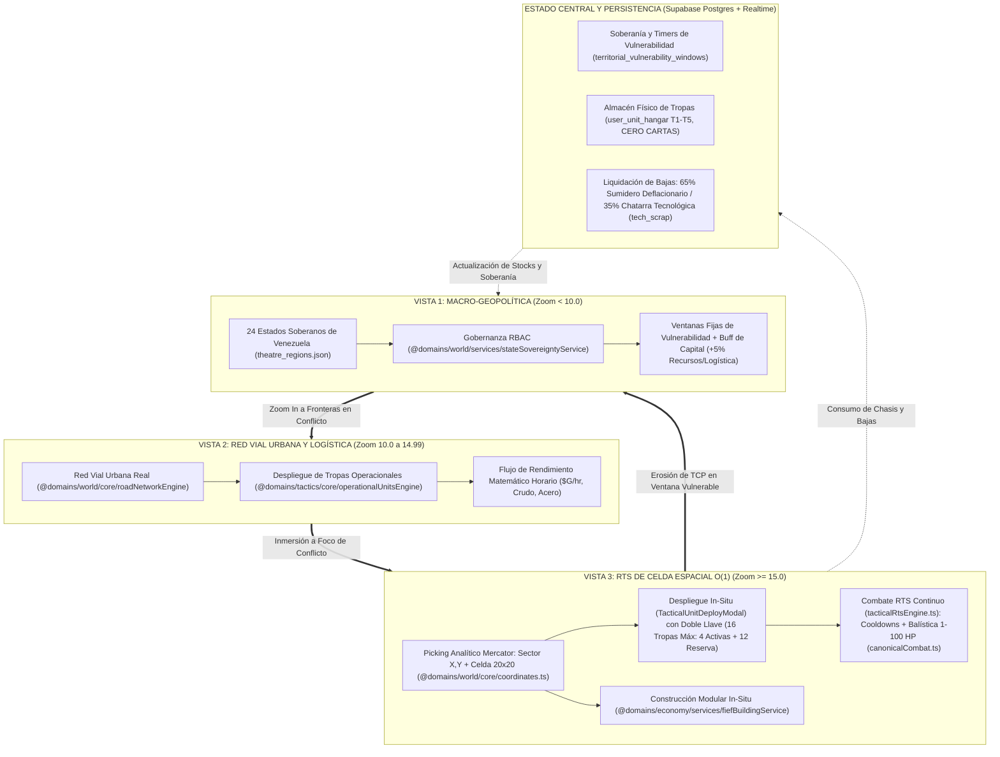

# 🛰️ ESPECIFICACIÓN CANÓNICA DE DISEÑO: SISTEMA DE ESTRATEGIA TÁCTICA CONTINUA
## *Arquitectura de 3 Vistas, RTS de Celda, Ventanas de Vulnerabilidad y Modelo Anti-P2W*

> **Código de Documento:** `docs/03_TACTICAL_STRATEGY_SYSTEM_DESIGN.md`  
> **Versión Canónica:** `v2.0.0-tactical-rts-modular`  
> **Estado:** **ESPECIFICACIÓN DE VERDAD ARQUITECTÓNICA (SSOT / CANON APROBADO)**  
> **Resultado de la Sesión:** Auditoría forense de gaps + Sincronización con arquitectura modular de 4 dominios (`src/domains/{world,tactics,economy,game-feel}`, `src/shared/`).

---

## 1. RESUMEN EJECUTIVO Y DECISIONES FUNDACIONALES

Tras auditar la base de código modular (`src/domains/world/core/coordinates.ts`, `src/domains/world/services/spatialDeploymentService.ts`, `src/domains/world/services/stateSovereigntyService.ts`, `src/domains/world/components/TacticalWorldMap.tsx`, `src/domains/tactics/core/tacticalRtsEngine.ts`, `src/domains/tactics/core/canonicalCombat.ts`) y contrastarla contra la especificación maestra (`docs/00_GEOTACTICS_ONLINE_MASTER_SPEC.md`), se consolida la síntesis del bucle de juego bajo los pilares canónicos aprobados:

1. **Resolución de Combate Táctico en Celda (Zoom x15 — `tacticalRtsEngine.ts` & `canonicalCombat.ts`)**: **RTS Continuo con Cooldowns Tácticos y Balística Determinista 1-100 HP**. Las unidades desplegadas sobre la cuadrícula celular operan con maniobra interpolada por intenciones de marcha (`UnitMoveIntent`) y disparo en tiempo real a **10 ticks/s ($100\text{ ms}$)**, gobernadas por cadencias de fuego (`reloadCooldownMs`), rangos de alcance balístico Manhattan y velocidades de desplazamiento según el tipo de chasis (`treads`, `wheels`, `foot`, `mech`, `air`), reutilizando la fórmula exacta de `CanonicalCombatEngine` sobre una escala continua de **1 a 100 HP enteros**.
2. **Almacén Físico de Tropas (CERO CARTAS — Pilar 1 Canónico) y Condiciones de Derrota Inapelable (Pilar 3 Canónico)**: No existe ningún sistema de cartas coleccionables (NO TCG/CCG). Cada comandante gestiona un almacén físico de hasta **16 unidades máximo** (**4 slots de despliegue activo en vanguardia + 12 unidades en reserva** en `src/domains/tactics/core/reinforcementsEngine.ts`). En cualquier tablero o celda de combate, **quedar con 0 tropas supervivientes en el campo (`all_units_destroyed` / `army_wiped`) provoca la derrota inmediata e inapelable**, sumada a la condición de captura del Cuartel General (`src/domains/tactics/core/hqCaptureVictory.ts`).
3. **Defensa Territorial Offline, Ventanas de Vulnerabilidad y Human Handshake de 120s (Pilar 7 Canónico)**: Inspirado en la doctrina de soberanía de *EVE Online* y *Albion Online*, cada clan defensor programa una ventana horaria de vulnerabilidad defensiva diaria (`VulnerabilityWindowConfig` en `src/domains/world/core/territorialSiegeOrchestrator.ts`). Fuera de esta ventana, los Puntos de Control Territorial (10,000 TCP en provincias regulares, 15,000 TCP en capitales) son inmunes al daño estructural. Dentro de la ventana, todo asedio inicia con un **Human Handshake de 120 segundos** antes de que asuma el mando la **Guarnición IA escalable de Niveles 1 a 5** (`src/domains/tactics/core/garrisonAIEngine.ts`).
4. **Bucle de Construcción, Buff de Capital (+5%) y Recolección**: **Simulación por Rendimiento Matemático en DB + Inyección Vectorial GPU (WebGL 2.0)**. La economía territorial se calcula analíticamente en Postgres/Supabase (`src/domains/economy/core/upkeepEngine.ts` y `src/domains/economy/core/industrialEngine.ts`), otorgando un **Buff Regional de $+5\%$ en recursos y logística al poseer la Capital regional (Pilar 5 Canónico)**. A Zoom x10 y x15, los edificios industriales (`FiefBuilding` en `src/domains/economy/services/fiefBuildingService.ts`) y convoyes (`src/domains/tactics/core/operationalUnitsEngine.ts`) se proyectan como instancias vectoriales en MapLibre GL, preservando 60 FPS y $< 140\text{ MB}$ de VRAM.
5. **Invariante Ético Anti-P2W y Esport (Pilar 4 Canónico)**: **Normalización Absoluta a Tier 1 Espejo ($+0.0\%$) en Modos Competitivos (`isCompetitiveMirror = true`)** y **Progresión Horizontal Suave de Tiers T1 a T5 ($+2\%$ por Tier sobre T1, máximo $+8\%$ en T5) en Guerra Territorial**. Mercado P2P gobernado por un impuesto total del **$2\%$ ($1\%$ quemado en Sink deflacionario $+ 1\%$ regalía al Clan dueño del Hub regional)** y bandas dinámicas **VWAP Collar $\pm 25\%$**.

---

## 2. DIAGRAMA DE FLUJO DEL BUCLE PRINCIPAL (CLOSED-LOOP ARCHITECTURE)

---

## 3. ARQUITECTURA DE COMBATE RTS CONTINUO EN CELDA ESPACIAL (ZOOM x15)

### 3.1 Proyección Analítica, Niebla Empaquetada y Espacio de Batalla
*Implementación de Referencia:* `src/domains/world/core/coordinates.ts`, `src/domains/world/services/spatialDeploymentService.ts`, `src/domains/world/core/tacticalBitmap.ts`, `src/domains/tactics/core/fogOfWar.ts`.

- Cada celda táctica se indexa unívocamente mediante la tupla analítica $O(1)$ (`lngLatToGridCoords` y `calculateSpatialCellId`):
  $$\text{CellKey} = \langle \text{Sector}_X, \text{Sector}_Y, \text{Cell}_X, \text{Cell}_Y \rangle$$
- Al aproximar la cámara a $z \ge 13.0$ / $15.0$ (`resolveSemanticLOD` en `src/domains/tactics/core/tacticalCombatSeamlessIntegration.ts`), el motor activa el `TileCanvas` HTML5/WebGL con resolución `TILE_SIZE = 1000` ($1000 \times 1000\text{ px}$) y muestreo `nearest` sobre el sector geográfico WGS84 (`src/domains/world/core/coordinates.ts`).
- La visibilidad de la cuadrícula de $20 \times 20$ ($400\text{ celdas}$) se calcula con `FogOfWarEngine` (`src/domains/tactics/core/fogOfWar.ts`) y se empaqueta de forma binaria en `TacticalBitMap` (`src/domains/world/core/tacticalBitmap.ts`) ocupando exactamente **$50\text{ bytes}$** ($400\text{ bits} / 8$) en Base64.
- Las celdas poseen microterreno determinista (`getSpatialAssignment` en `src/domains/world/services/spatialDeploymentService.ts`):
  - **Llanura Abierta (`open_plains`)**: $10\%$ Cobertura, Costo de Movimiento $1$.
  - **Asfalto Urbano (`urban_asphalt`)**: $15\%$ Cobertura, Costo de Movimiento $1$.
  - **Sector de Acopio / Edificio (`industrial_compound`)**: $25\text{–}35\%$ Cobertura ($35\%$ con edificio desplegado), Costo $1$.
  - **Cresta Defensiva (`defensive_ridge`)**: $40\%$ Cobertura, Costo de Movimiento $2$.

### 3.2 Bucle de Simulación RTS Continuo (`TacticalRtsEngine` — 10 Ticks por Segundo)
*Implementación de Referencia:* `src/domains/tactics/core/tacticalRtsEngine.ts`, `src/domains/tactics/core/canonicalCombat.ts`, `src/domains/tactics/core/canonicalDamageChart.ts`.

En el modo RTS de celda (`TacticalRtsEngine`), las unidades actualizan su estado en `tick(now)` a una frecuencia de **10 Ticks por Segundo ($\Delta t = 100\text{ ms}$)**:
1. **Intención de Marcha Interpolada (`UnitMoveIntent`)**:
   Al emitir `issueMoveOrder(unitId, path)`, el motor calcula el tiempo por paso según la velocidad del perfil (`msPerStep = Math.round(1000 / profile.moveSpeedCellsPerSec)`). En cada tick se acumula `stepProgressMs += deltaMs` hasta avanzar al siguiente waypoint de la ruta, pudiendo detenerse en cualquier instante con `haltUnit(unitId)`.
2. **Cadencia de Disparo (`reloadCooldownMs`) y Restricción Estacionaria**:
   Cada perfil en `CANONICAL_RTS_PROFILES` posee un tiempo de recarga en milisegundos (`reloadRemainingMs`). Las unidades de fuego indirecto (`artillery` y `rocket`) no pueden disparar mientras tengan un `currentMoveIntent` activo (`INDIRECT_FIRE_REQUIRES_STATIONARY`).
3. **Fórmula Balística Determinista en Escala Continua 1-100 HP (`executeFire` $\to$ `CanonicalCombatEngine.calculateEngagement`)**:
   Cuando `canFire` es válido, `TacticalRtsEngine.executeFire` invoca `CanonicalCombatEngine.calculateEngagement` con `scale100Hp: true` y `deterministic: true`:
   $$\text{attackModifier} = \left(C_{\text{atk}, A} + 10 \cdot N_{\text{towers}} + \text{TierBonus}(T_A) + \text{Aura}_{\text{atk}}\right) \times \mu_{\text{clima}}$$
   $$\text{attackFactor} = \left\lfloor B(A, D) \times \frac{\text{attackModifier}}{100} + L \right\rfloor, \quad \text{attackHPFactor} = \left\lfloor \text{attackFactor} \times \frac{\text{HP}_A / 10}{10} \right\rfloor$$
   $$\text{defenseFactor} = \frac{\left\lfloor 200 - \left(C_{\text{def}, D} + \text{Aura}_{\text{def}} + \star_{\text{terreno}, D} \times (\text{HP}_D / 10)\right) \right\rfloor}{100}$$
   $$\text{Daño}_{1\text{–}100} = \min\left(\text{HP}_D, \max\left(1, \left\lfloor \text{attackHPFactor} \times \text{defenseFactor} \right\rfloor\right)\right)$$
   Donde:
   - $B(A, D)$ es el daño base canónico de arma primaria (con munición) o secundaria (infinita) extraído de `src/domains/tactics/core/canonicalDamageChart.ts`.
   - $\text{TierBonus}(T) = \max(0, (T - 1) \times 2.0)$ otorga **$+2\%$ por Tier** de T1 a T5 (máximo **$+8\%$ en T5**) en Guerra Territorial, y se fija a $T = 1$ ($0\%$) cuando `isCompetitiveMirror = true`.
   - $\star_{\text{terreno}, D}$ son las estrellas de defensa del terreno (escaladas por el HP actual del defensor $\text{HP}_D / 10$).
   - $L$ es el modificador de suerte acotado ($L = 0$ en partidas deterministas; $0 \le L \le 9$ cuando `deterministic = false`).
   - Si el defensor sobrevive ($\text{HP}_D - \text{Daño} > 0$) y el atacante se encuentra dentro de su rango directo, se ejecuta automáticamente el contraataque con el HP sobreviviente (`defenderHpAfter`) y su propio `defenderTierBonus`.
   - Cada disparo genera una trazadora visual `BallisticTracer` de $200\text{ ms}$ de duración (`isCritical = attackerDamageDealt >= 40`).
4. **Condición de Derrota Inapelable (Pilar 3 Canónico) y Captura de HQ**:
   - Si todas las unidades desplegadas de un bando son destruidas (**0 tropas supervivientes en el tablero**), dicho bando sufre la **derrota inmediata e inapelable** (`all_units_destroyed` / `army_wiped`).
   - La captura completa del Cuartel General enemigo (`executeHqCaptureElimination` en `src/domains/tactics/core/hqCaptureVictory.ts`) transfiere de inmediato todas las propiedades del jugador derrotado al conquistador y disuelve sus unidades restantes.

---

## 4. SISTEMA DE DEFENSA OFFLINE, VENTANAS DE VULNERABILIDAD Y GUARNICIÓN IA (NIVELES 1-5)

### 4.1 Definición de la Ventana de Vulnerabilidad Diaria (`TerritorialSiegeOrchestrator`)
*Implementación de Referencia:* `src/domains/world/core/territorialSiegeOrchestrator.ts`, `src/domains/world/services/stateSovereigntyService.ts`.

- **Configuración por el Alto Mando**: Cada Clan que ostente el control soberano de una región (`ownerClanId` o `controllerClanId`) define su ventana defensiva diaria (`VulnerabilityWindowConfig`: `windowStartUtc`, `windowEndUtc`).
- **Anticipación de Cambio de Timer**: Modificar el horario de vulnerabilidad exige un período de enfriamiento constitucional de **$48\text{ horas}$** (`cooldownUntilUtc`) para impedir evasiones tácticas ante asedios inminentes.
- **Estado de Inmunidad Estructural (Fuera de la Ventana — `isWithinVulnerabilityWindow`)**:
  - Cuando `TerritorialSiegeOrchestrator.isWithinVulnerabilityWindow(windowConfig, resolutionTime)` retorna `false`, las celdas pueden registrar escaramuzas pero **el drenaje de TCP se anula a `tcpDelta = 0` (`isImmuneOfflineProtection = true`)**, protegiendo los 10,000 TCP (15,000 TCP en capitales) y las estructuras industriales frente a asedios nocturnos (*offline raiding*).

### 4.2 Protocolo de Asedio: Human Handshake de 120s y Guarnición IA (Niveles 1 a 5)
*Implementación de Referencia:* `src/domains/world/core/territorialSiegeOrchestrator.ts`, `src/domains/tactics/core/tacticalCombatSeamlessIntegration.ts`, `src/domains/tactics/core/garrisonAIEngine.ts`.

1. **Apertura de Asedio y Human Handshake (120 segundos — Pilar 7 Canónico)**:
   - Al iniciar el asedio (`TerritorialSiegeOrchestrator.createSiegeSession`), se establece `handshakeExpiresAt = now + 120s` (`HANDSHAKE_TIMEOUT_SECONDS = 120`) con estado `handshake_pending`, disparando `defconAlert = true` (`evaluateDefensiveHandshake`) en el Bark Engine (`src/domains/game-feel/core/barkEngine.ts`) y WebSockets (`src/domains/world/hooks/useSiegeRealtime.ts`).
   - **Relevo Humano (`claimDefensiveHandshake`)**: Si un oficial del clan defensor reclama el mando en $\le 120\text{ s}$, la sesión pasa a `mode: 'pvp_realtime'` y `status: 'in_combat'`.
   - **Relevo Autónomo a Guarnición IA (`resolveHandshakeTimeout`)**: Si expiran los $120\text{ s}$ sin respuesta humana, asume el control el motor `GarrisonAIEngine` (`src/domains/tactics/core/garrisonAIEngine.ts`) en modo `pve_garrison`, operando según el nivel del Búnker regional (**Niveles 1 a 5**):
     * **Nivel 1 (`Milicia Local` — `easy`)**: *1-ply Greedy Heuristic*, opera hasta Tier 2, reserva de 12 chasis, $0\text{ EC/h}$.
     * **Nivel 2 (`División Regular` — `normal`)**: *2-ply Positional Minimax*, opera hasta Tier 3, reserva de 24 chasis, activación $4,500\text{ EC}$, $180\text{ EC/h}$, permite General contratado.
     * **Nivel 3 (`Guardia Acorazada Veterana` — `hard`)**: *3-ply Task-Force Tree*, opera hasta Tier 4, reserva de 40 chasis, activación $18,000\text{ EC}$, $750\text{ EC/h}$, habilita COP.
     * **Nivel 4 (`Cuerpo de Estado Mayor` — `chess`)**: *Alpha-Beta (4-5 ply) + Killer Heuristic*, opera hasta Tier 4, reserva de 60 chasis, activación $65,000\text{ EC}$, $2,800\text{ EC/h}$, sincroniza COP y SCOP.
     * **Nivel 5 (`Gran Mariscal "Búnker Implacable"` — `mcts_legendary`)**: *Híbrido Alpha-Beta + MCTS-UCT + Heatmaps (6 plies)*, opera hasta Tier 5, reserva de 85 chasis, activación $220,000\text{ EC}$, $9,500\text{ EC/h}$, sinergia letal SCOP + CO Zone.
   - Si la reserva de chasis del búnker se agota (`checkAttritionDowngrade`), el nivel efectivo degrada automáticamente ($<25\%$ chasis reduce 1 nivel; $0$ chasis degrada a Nivel 1).
2. **Erosión Determinista de TCP y Ocupación De Facto (`calculateSiegeTcpDelta` & `resolveTerritorialSiege`)**:
   - **Victoria Atacante**: Drena una base de **$1,800\text{ TCP}$** en provincia regular (**$1,200\text{ TCP}$** en Capital blindada), mitigada por el nivel del búnker según $\max(0.60, 1.0 - (\text{bunkerLevel} - 1) \times 0.10)$ (hasta $-40\%$ en Nv. 5), acotada estrictamente entre **$800$ y $2,500\text{ TCP}$**.
   - **Victoria Defensora**: Restaura **$+500\text{ TCP}$** hacia el máximo de la región.
   - **Colapso de TCP y Escudo Anti-Third-Party**: Al caer los TCP a $0$, la provincia pasa a estado `occupied_grace` (**Ocupación De Facto** por el clan atacante), activando un **Escudo de Prioridad de 4 Horas** (`COOLDOWN_PRIORITY_HOURS = 4`) y una **Ventana de Gracia de 24 Horas** (`graceExpiresAt`) antes de consolidar la propiedad legal *De Jure* (`consolidateDeJureOwnership`).

---

## 5. BUCLE DE CONSTRUCCIÓN, RECOLECCIÓN Y MODELO ECONÓMICO

### 5.1 Extracción Agregada en Servidor y Buff de Capital (+5%)
*Implementación de Referencia:* `src/domains/economy/core/upkeepEngine.ts`, `src/domains/economy/services/fiefBuildingService.ts`, `src/domains/world/core/territorialExpansionEngine.ts`.

Para preservar 60 FPS en el navegador sin simular cientos de obreros en pantalla:
- **Producción Agregada y Pilar 5 Canónico (Buff de Capital $+5\%$)**: Cada región genera recursos brutos por ciclo según la fórmula canónica, aplicando un **bono regional del $+5\%$ en extracción de recursos y logística** cuando la facción/clan controla la Capital regional:
  $$P_{\text{ciclo}}(r) = \frac{Y_{\text{base}}(r) \times \eta_{\text{infra}} \times (1 + 0.05 \cdot \mathbb{I}_{\text{capital}}) \times (1 - D_{\text{daño}})}{60}$$
- **LOD Vectorial de Estructuras**:
  - A Zoom Nivel 2 ($6.0 \le z < 13.0$ / $10.0 \le z < 15.0$): Se renderizan marcadores pulsantes, unidades operacionales (`src/domains/tactics/core/operationalUnitsEngine.ts`) y etiquetas C4ISR de los complejos industriales activos (`fiefBuildingService.toGeoJSON()`).
  - A Zoom Nivel 3 ($z \ge 13.0$ / $15.0$): La estructura se materializa como un obstáculo físico en la celda táctica (`industrial_compound`), otorgando cobertura del $35\%$ y sirviendo como punto de despliegue o nodo de radar/suministro.

### 5.2 La Ley de la Doble Llave y Almacén Físico de 16 Tropas (CERO CARTAS)
*Implementación de Referencia:* `src/domains/tactics/core/tacticalCombatSeamlessIntegration.ts`, `src/domains/tactics/core/reinforcementsEngine.ts`, `src/domains/tactics/components/TacticalUnitDeployModal.tsx`, `src/domains/economy/hooks/useUserHangar.ts`.

Para desplegar cualquier unidad militar en una fábrica o celda (`validateDoubleKeyDeployment` y `TacticalUnitDeployModal.tsx`), se cumplen estrictamente el **Pilar 1** y la **Doble Llave**:
1. **CERO CARTAS — Almacén Físico de 16 Tropas Máximo**: Cada comandante dispone de una capacidad física máxima de **16 unidades** (**4 slots de despliegue activo inicial + 12 slots en reserva táctica**).
2. **Llave 1 — Fondos Tácticos In-Match ($\$G$)**: Disponibilidad de fondos generados en la partida (`availableFunds >= unitCostFunds`).
3. **Llave 2 — Stock Físico en Hangar (`user_unit_hangar` / `faction_hangar`)**: Poseer el chasis físico real (T1 a T5) forjado en las 10 parcelas industriales del jugador (`src/domains/economy/core/industrialEngine.ts`) o autorizado desde el Arsenal del Clan.
4. **Excepción F2P de Supervivencia (`sourceUsed: 'f2p_infinite'`)**: Las unidades básicas `infantry` (Tier 1) y `recon` (Tier 1) cuentan con dotación infinita ($\infty$), garantizando que ningún jugador quede bloqueado por bancarrota material.

### 5.3 Siniestralidad Real, 35% Chatarra Tecnológica y Mercado P2P (2% Fee)
*Implementación de Referencia:* `src/domains/tactics/core/tacticalCombatSeamlessIntegration.ts`, `src/domains/economy/core/industrialEngine.ts`.

- **Pilar 6 Canónico — Pérdida Física y Recuperación del 35% en Chatarra Tecnológica (`settleCombatLossesAndScrap`)**:
  Cuando un chasis (no F2P básico) es destruido en combate:
  - El chasis se descuenta de forma definitiva e irreversible del inventario físico (`permanentSinkUnitsCount`).
  - El **$65\%$** de su valor material desaparece como sumidero deflacionario.
  - El **$35\%$** restante se recupera automáticamente como **Chatarra Tecnológica (`tech_scrap`)** ($\lfloor 50 \times \text{Tier} \times 0.35 \rfloor$), refundible en la industria a razón de **$2\text{ Scrap} \to 1\text{ Placa de Acero}$** (`steelPlatesRefundable`).
- **Regla Financiera Canónica — Mercado P2P con Impuesto del 2% y VWAP Collar $\pm 25\%$**:
  El comercio de chasis y materiales entre jugadores en `src/domains/economy/components/P2PMarketplaceView.tsx` aplica una comisión total del **$2\%$** (**$1\%$ quemado permanentemente en Sink + $1\%$ transferido como regalía al Clan soberano del Hub regional**) y restringe las órdenes dentro de las bandas dinámicas **VWAP Collar $\pm 25\%$**.

---

## 6. MATRIZ DE UNIDADES SIMÉTRICAS Y BALANCE COMPETITIVO (`CANONICAL_RTS_PROFILES`)

*Fuente Ejecutable:* `src/domains/tactics/core/tacticalRtsEngine.ts` (`CANONICAL_RTS_PROFILES`).

| Código de Unidad | Nombre Canónico | Movilidad / Chasis | Velocidad RTS | Rango Fuego | Cooldown Recarga | Cobertura Óptima | Rol Táctico Primario |
| :--- | :--- | :--- | :---: | :---: | :---: | :--- | :--- |
| `infantry` | Infantería Ligera | 3 celdas (`foot`) | $1.5\text{ c/s}$ | 1 celda | $1.0\text{ s}$ ($1000\text{ ms}$) | Cresta / Urbano | Captura de estructuras y sedes ($1,000\$G$, Stock $\infty$). |
| `mech` | Mecanizado (Bazooka) | 2 celdas (`mech`) | $1.2\text{ c/s}$ | 1 celda | $2.0\text{ s}$ ($2000\text{ ms}$) | Cresta / Montaña | Asesino antitanque de emboscada ($3,000\$G$). |
| `recon` | Jeep Reconocimiento | 8 celdas (`wheels`) | $4.0\text{ c/s}$ | 1 celda | $1.2\text{ s}$ ($1200\text{ ms}$) | Asfalto Urbano | Exploración rápida y corte de niebla FoW ($4,000\$G$, Stock $\infty$). |
| `tank_light` | Tanque Ligero | 6 celdas (`treads`) | $2.8\text{ c/s}$ | 1 celda | $2.5\text{ s}$ ($2500\text{ ms}$) | Asfalto / Llanura | Punta de lanza blindada y control de cruces ($7,000\$G$). |
| `tank_medium`| Tanque Medio | 5 celdas (`treads`) | $2.2\text{ c/s}$ | 1 celda | $3.5\text{ s}$ ($3500\text{ ms}$) | Llanura Abierta | Ruptura de líneas fortificadas ($12,000\$G$ RTS / $16,000\$G$ Turnos). |
| `artillery` | Artillería Autopropulsada | 5 celdas (`treads`) | $1.8\text{ c/s}$ | 2–3 celdas | $5.5\text{ s}$ ($5500\text{ ms}$) | Cresta Trasera | Fuego indirecto de apoyo; exige estar estacionaria ($6,000\$G$). |
| `rocket` | Lanzacohetes Pesado | 5 celdas (`wheels`) | $2.0\text{ c/s}$ | 3–5 celdas | $7.5\text{ s}$ ($7500\text{ ms}$) | Asfalto / Llanura | Supresión de largo alcance; exige estar estacionario ($15,000\$G$). |
| `anti_air` | Blindado Antiaéreo | 6 celdas (`treads`) | $3.0\text{ c/s}$ | 1 celda | $1.0\text{ s}$ ($1000\text{ ms}$) | Asfalto / Llanura | Triturador de helicópteros e infantería ($8,000\$G$). |
| `missile` | Batería SAM Móvil | 4 celdas (`wheels`) | $1.6\text{ c/s}$ | 3–5 celdas | $6.0\text{ s}$ ($6000\text{ ms}$) | Asfalto Trasero | Intercepción antiaérea pesada ($12,000\$G$). |
| `chopper_battle`| Helicóptero Asalto | 6 celdas (`air`) | $3.5\text{ c/s}$ | 1 celda | $1.8\text{ s}$ ($1800\text{ ms}$) | Terreno Impracticable| Cazador de tanques sobrevolando obstáculos ($9,000\$G$). |

---

## 7. HOJA DE RUTA TÉCNICA DE IMPLEMENTACIÓN POR SPRINTS (ESTADO SINCRONIZADO)

### Sprint 4: Motor de Ticks RTS y Cooldowns en Celda (COMPLETADO)
- [x] Desarrollar `src/domains/tactics/core/tacticalRtsEngine.ts` implementando el loop de simulación continua (`tick` a 10 ticks/s, $\Delta t = 100\text{ ms}$).
- [x] Incorporar temporizadores de cooldown de recarga (`reloadRemainingMs`) e intenciones de marcha (`UnitMoveIntent`) sobre `TacticalRtsUnitState` y `DeployedOperationalUnit` (`src/domains/tactics/services/operationalUnitsService.ts`).
- [x] Integrar el cálculo balístico determinista 1-100 HP (`src/domains/tactics/core/canonicalCombat.ts`) en tiempo real en `TacticalRtsEngine.executeFire`.
- [x] Conectar la pérdida de HP y las trazadoras balísticas (`BallisticTracer` de $200\text{ ms}$) con el `TileCanvas` WebGL (`src/domains/tactics/components/GameCanvas.tsx`).

### Sprint 5: Ventanas Fijas de Vulnerabilidad y Protección Anti-Raid (COMPLETADO)
- [x] Esquema de base de datos Postgres y tipos de ventana de vulnerabilidad (`VulnerabilityWindowConfig`) vinculados a la soberanía estatal (`src/domains/world/services/stateSovereigntyService.ts`).
- [x] Implementar la comprobación de inmunidad `isWithinVulnerabilityWindow` en `src/domains/world/core/territorialSiegeOrchestrator.ts`: bloquear deducciones de TCP (`tcpDelta = 0`, `isImmuneOfflineProtection = true`) si la hora UTC está fuera de la ventana del clan.
- [x] Reflejar el estado de vulnerabilidad visual y el Human Handshake de 120s en `src/domains/world/components/TacticalWorldMap.tsx` y `src/domains/world/components/TerritorySiegeModal.tsx`.

### Sprint 6: Red de Canales Supabase Realtime para Combate y Despliegue Multijugador (COMPLETADO)
- [x] Habilitar canales selectivos por LOD (`resolveSemanticLOD` en `src/domains/tactics/core/tacticalCombatSeamlessIntegration.ts`), `theatre:${regionId}` en `src/domains/world/services/spatialDeploymentService.ts` y `match:${matchId}` en `src/domains/tactics/hooks/useMatchSync.ts`.
- [x] Protocolo ligero de broadcast de órdenes (`MATCH_ACTION`, `TACTICAL_PING`, `TACTICAL_PONG`) y sincronización CDC en tiempo real de unidades y estructuras.
- [x] Reconciliación determinista en cliente con soporte de reconexión instantánea (`rpc_reconnect_match_state`).

### Sprint 7: Certificación E2E Multimodal de Combate RTS y Calidad Total (COMPLETADO)
- [x] Suite de pruebas unitarias e integración en `src/domains/tactics/__tests__/` (`combat.test.ts`, `tacticalCombatSeamlessIntegration.test.ts`, `autonomousOrchestrator.test.ts`, `e2eIntegration.test.ts`) y Playwright (`tests/e2e/game-playtester.spec.ts`).
- [x] Auditoría de Game Feel bélico (`src/domains/game-feel/core/barkEngine.ts`, `src/domains/game-feel/core/audioManager.ts`, `src/domains/game-feel/core/hapticFeedback.ts`).
- [x] Validación de cero regresiones en los 3 niveles de zoom (`LOD1_GLOBAL`, `LOD2_OPERATIONAL`, `LOD3_TACTICAL`).
