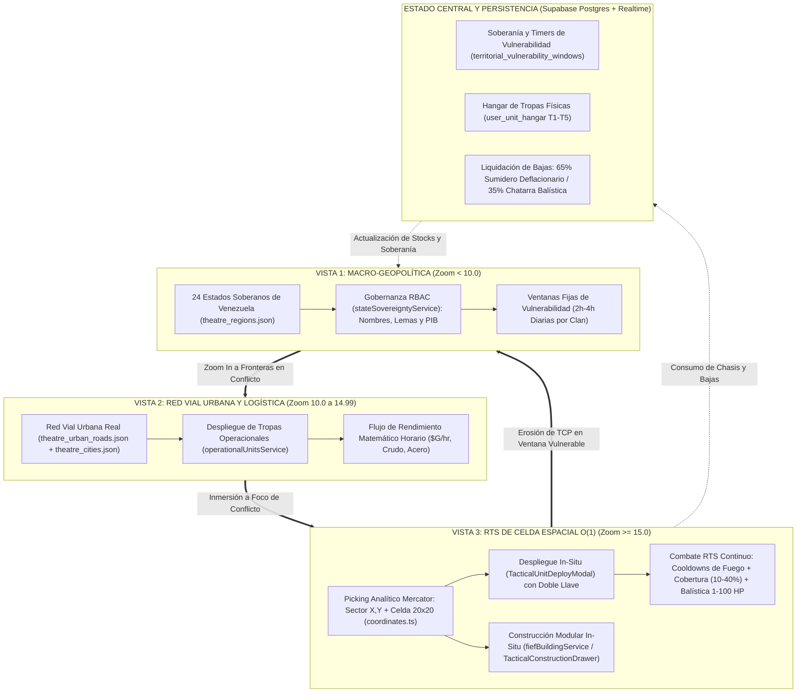

# 🛰️ ESPECIFICACIÓN CANÓNICA DE DISEÑO: SISTEMA DE ESTRATEGIA TÁCTICA CONTINUA
## *Arquitectura de 3 Vistas, RTS de Celda, Ventanas de Vulnerabilidad y Modelo Anti-P2W*

> **Código de Documento:** `docs/03_TACTICAL_STRATEGY_SYSTEM_DESIGN.md`  
> **Versión Canónica:** `v1.0.0-tactical-rts`  
> **Estado:** **ESPECIFICACIÓN DE VERDAD ARQUITECTÓNICA (SSOT / CANON APROBADO)**  
> **Resultado de la Sesión:** Auditoría forense de gaps + Sesión `/grill-me` consensuada.

---

## 1. RESUMEN EJECUTIVO Y DECISIONES FUNDACIONALES

Tras auditar la base de código funcional (`src/engine/coordinates.ts`, `src/services/spatialDeploymentService.ts`, `src/services/stateSovereigntyService.ts`, `src/components/world/TacticalWorldMap.tsx`) y contrastarla contra la especificación maestra (`docs/00_GEOTACTICS_ONLINE_MASTER_SPEC.md`), se consolida la síntesis del bucle de juego bajo cuatro pilares aprobados:

1. **Resolución de Combate Táctico en Celda (Zoom x15)**: **RTS Continuo con Cooldowns Tácticos y Balística Determinista**. Se trasciende el combate clásico por turnos IGO-UGO/WeGo dentro del mapa continuo; las unidades desplegadas sobre la cuadrícula celular operan con maniobra y disparo en tiempo real, gobernadas por cadencias de fuego (cooldowns de recarga en milisegundos), rangos de alcance balístico y velocidades de desplazamiento según el tipo de chasis (`treads`, `wheels`, `foot`, `air`, `sea`).
2. **Defensa Territorial Offline**: **Ventanas Fijas de Vulnerabilidad (Timers Soberanos de 2 a 4 Horas)**. Inspirado en la doctrina de soberanía de *EVE Online* y *Albion Online*, cada clan defensor programa una ventana horaria de vulnerabilidad defensiva diaria. Fuera de esta ventana, los Puntos de Control Territorial (10,000 TCP) de la provincia y las celdas soberanas son invulnerables al daño estructural, erradicando los asedios nocturnos desleales (*offline raiding*).
3. **Bucle de Construcción y Recolección**: **Simulación por Rendimiento Matemático en DB + Inyección Vectorial GPU (WebGL 2.0)**. La economía territorial (crudo, acero, tierras raras, blindaje) se calcula analíticamente mediante fórmulas horarias agregadas en Postgres/Supabase. A Zoom x10 y x15, los edificios industriales (`FiefBuilding`) y convoyes se proyectan como instancias vectoriales de alto rendimiento en MapLibre GL, sin simular micro-obreros hormiga en el cliente, preservando un presupuesto estricto de 60 FPS y $< 140\text{ MB}$ de VRAM.
4. **Invariante Ético Anti-P2W y Esport**: **Normalización Absoluta a Tier 1 Espejo (+0.0%) en Modos Competitivos** y **Techo Suave (+2% por Tier, máx +8% en T5) en Guerra Territorial**. Prohibición inviolable a nivel de base de datos de compra de unidades bélicas, recursos o aceleración de timers con dinero fiat.

---

## 2. DIAGRAMA DE FLUJO DEL BUCLE PRINCIPAL (CLOSED-LOOP ARCHITECTURE)

---

## 3. ARQUITECTURA DE COMBATE RTS CONTINUO EN CELDA ESPACIAL (ZOOM x15)

### 3.1 Proyección Analítica y Espacio de Batalla
- Cada celda táctica se indexa unívocamente mediante la tupla analítica $O(1)$:
  $$\text{CellKey} = \langle \text{Sector}_X, \text{Sector}_Y, \text{Cell}_X, \text{Cell}_Y \rangle$$
- Al aproximar la cámara a $z \ge 15.0$, el motor monta un `TileCanvas` WebGL con resolución $1000 \times 1000\text{ px}$ sobre el sector geográfico WGS84 (`coordinates.ts`).
- Las celdas tienen microterreno determinista (`spatialDeploymentService.ts`):
  - **Llanura Abierta (`open_plains`)**: $10\%$ Cobertura, Costo de Movimiento $1.0\times$.
  - **Asfalto Urbano (`urban_asphalt`)**: $15\%$ Cobertura, Bonificación de velocidad en ruedas $+25\%$.
  - **Sector de Acopio / Edificio (`industrial_compound`)**: $25\text{–}35\%$ Cobertura, Costo $1.0\times$.
  - **Cresta Defensiva (`defensive_ridge`)**: $40\%$ Cobertura, Costo de Movimiento $2.0\times$.

### 3.2 Bucle de Simulación RTS Continuo (Tick de Combate Local y Servidor)
En lugar de turnos IGO-UGO, las unidades en celda actualizan su estado a una frecuencia de **10 Ticks por Segundo ($100\text{ ms}$)**:
1. **Vector de Movimiento y Velocidad**:
   $$v(u) = v_{\text{base}}(u) \times \mu_{\text{terreno}} \times \mu_{\text{cooldown\_mov}}$$
   Las unidades en orugas (`treads`) avanzan a velocidad regular en cresta, mientras que las de ruedas (`wheels`) sufren penalización en terreno quebrado pero vuelan sobre `urban_asphalt`.
2. **Cadencia de Disparo (Weapon Cooldown)**:
   Cada arma tiene un cooldown de recarga continuo en segundos:
   - Cañón Principal de Tanque Medio: $\tau_{\text{reload}} = 3.5\text{ s}$.
   - Ametralladora Antiaérea / Recon: $\tau_{\text{reload}} = 1.2\text{ s}$.
   - Obús de Artillería de Asedio: $\tau_{\text{reload}} = 7.0\text{ s}$ (con rango mínimo $2$ y máximo $5$ celdas).
3. **Fórmula Balística Determinista por Disparo (1-100 HP, 0% Azar)**:
   $$\text{Daño} = \max\left(1, \left\lfloor B(A, D) \times \frac{\text{HP}_A}{100} \times \frac{200 - \left(C_{\text{def}, D} + \text{TierBonus}(T_D) + \text{Cover}\right)}{100} \times \mu_{\text{D2D}}\right\rfloor\right)$$
   Donde:
   - $B(A, D)$ es el daño base canónico extraído de `canonicalDamageChart.ts`.
   - $\text{Cover}$ es la cobertura de la celda ($10\%$ a $40\%$).
   - $\text{TierBonus}(T_D)$ es $+2\%$ por Tier sobre T1 en Guerra Territorial ($0\%$ en Esports).
   - $\mu_{\text{D2D}}$ es el modificador de día a día del Comandante activo (`coSystem.ts`).

---

## 4. SISTEMA DE DEFENSA OFFLINE Y VENTANAS DE VULNERABILIDAD SOBERANA

### 4.1 Definición de la Ventana de Vulnerabilidad Diaria (Timers de Guerra)
- **Configuración por el Alto Mando**: Cada Clan que ostente el control soberano de una región (`owner_clan_id` o `controller_clan_id`) define en `state_sovereignty_rbac` una ventana defensiva diaria obligatoria de **$3\text{ horas}$** (ejemplo: `20:00 - 23:00 UTC-4`).
- **Anticipación de Cambio de Timer**: Modificar el horario de vulnerabilidad exige un período de enfriamiento constitucional de **$48\text{ horas}$** para evitar evasiones tácticas ante asedios inminentes.
- **Estado de Inmunidad Estructural (Fuera de la Ventana)**:
  - Fuera del horario vulnerable, las celdas pueden registrar escaramuzas entre patrullas pero **la barra de 10,000 TCP del estado y los edificios industriales son inmunes al daño permanente**.
  - No es posible capturar fábricas clave ni mutar la soberanía del territorio mientras el clan se encuentre fuera de su ventana programada.

### 4.2 Protocolo de Asedio durante la Ventana Vulnerable
1. **Apertura de la Ventana**: El estado entra en estado `vulnerable_active` en el `TacticalWorldMap.tsx`, visualizado con un halo pulsante ámbar en la vista Nivel 1.
2. **Incursión y Handshake Humano (120s)**:
   - Al recibir el primer impacto balístico en una estructura o nodo de celda, se detona una alerta push DEFCON 1 a los miembros del clan mediante el Bark Engine y WebSockets.
   - Si oficiales humanos ingresan a la celda en $\le 120\text{ s}$, toman el control manual de las defensas.
   - Si no hay respuesta humana tras 120s, la **Guarnición IA (Búnker Nivel 1 a 5)** asume el control del fuego y de las unidades de guarnición pre-estacionadas.
3. **Erosión de TCP y Ocupación De Facto**:
   - Cada estructura militar destruida drena entre $500$ y $1,500$ TCP.
   - Al colapsar los 10,000 TCP a cero, la soberanía pasa inmediatamente a **Ocupación De Facto** del atacante y se activa un **Escudo de Gracia de 4 Horas** (`COOLDOWN_PRIORITY_HOURS = 4`), impidiendo que terceros clanes hagan *third-partying* oportunista.

---

## 5. BUCLE DE CONSTRUCCIÓN, RECOLECCIÓN Y MODELO ECONÓMICO

### 5.1 Extracción Agregada en Servidor (Zero-Micro-Workers)
Para preservar 60 FPS en el navegador sin simular cientos de obreros en pantalla:
- **Producción Agregada**: Cada región genera recursos brutos cada 60 segundos según la fórmula canónica:
  $$P_{\text{ciclo}}(r) = \frac{Y_{\text{base}}(r) \times \eta_{\text{infra}} \times (1 - D_{\text{daño}})}{60}$$
- **LOD Vectorial de Estructuras**:
  - A Zoom Nivel 2 ($10 \le z < 15$): Se renderizan marcadores pulsantes y etiquetas C4ISR de los complejos industriales activos (`fiefBuildingService.toGeoJSON()`).
  - A Zoom Nivel 3 ($z \ge 15$): La estructura se materializa como un obstáculo físico en la celda táctica (`industrial_compound`), otorgando cobertura del $35\%$ y sirviendo como punto de despliegue o nodo de radar/suministro.

### 5.2 La Ley de la Doble Llave en Fábricas Tácticas
Para desplegar cualquier unidad militar en una fábrica o base (`TacticalUnitDeployModal.tsx`), el jugador debe satisfacer simultáneamente:
1. **Fondos Tácticos In-Match ($\$G$)**: Generados en tiempo real por el PIB de guerra regional o la captura de nodos energéticos.
2. **Stock Físico en Hangar (`user_unit_hangar`)**: Contar con un chasis real forjado previamente en la industria territorial.
3. **Excepción F2P de Emergencia**: Las unidades `infantry` (T1) y `recon` (T1) cuentan con dotación infinita ($\infty$), asegurando que ningún jugador quede fuera de combate por bancarrota industrial.

### 5.3 Siniestralidad Real y Reciclaje Balístico
Cuando un chasis es aniquilado en el combate RTS de celda:
- Se ejecuta la función RPC atómica `settle_territorial_combat_losses`.
- El **$65\%$** del valor material del chasis se destruye permanentemente como sumidero deflacionario del juego.
- El **$35\%$** restante retorna al inventario del comandante en forma de **Chatarra Balística (`tech_scrap`)**, que puede refundirse en altos hornos territoriales para forjar nuevas placas de blindaje ($2\text{ Scrap} \to 1\text{ Acero}$).

---

## 6. MATRIZ DE UNIDADES SIMÉTRICAS Y BALANCE COMPETITIVO

| Código de Unidad | Nombre Canónico | Movilidad / Tipo | Rango Fuego | Cooldown Recarga | Cobertura Óptima | Rol Táctico Primario |
| :--- | :--- | :--- | :--- | :--- | :--- | :--- |
| `infantry` | Infantería Ligera | 3 celdas (Pie) | 1 celda | 1.0 s | Cresta / Urbano | Captura de estructuras y sedes ($1,000\$G$, Stock $\infty$). |
| `mech` | Mecanizado (Bazooka) | 2 celdas (Mec) | 1 celda | 2.0 s | Cresta / Montaña | Asesino antitanque de emboscada ($3,000\$G$). |
| `recon` | Jeep Reconocimiento | 8 celdas (Ruedas) | 1 celda | 1.2 s | Asfalto Urbano | Exploración rápida y corte de niebla FoW ($4,000\$G$, Stock $\infty$). |
| `tank_light` | Tanque Ligero | 6 celdas (Orugas) | 1 celda | 2.5 s | Asfalto / Llanura | Punta de lanza blindada y control de cruces ($7,000\$G$). |
| `tank_medium`| Tanque Medio | 5 celdas (Orugas) | 1 celda | 3.5 s | Llanura Abierta | Ruptura de líneas fortificadas ($12,000\$G$). |
| `artillery` | Artillería Autoprop. | 5 celdas (Orugas) | 2–3 celdas | 5.5 s | Cresta Trasera | Fuego indirecto de apoyo; no puede disparar en movimiento ($6,000\$G$). |
| `rocket` | Lanzacohetes Pesado | 5 celdas (Ruedas) | 3–5 celdas | 7.5 s | Asfalto / Llanura | Supresión de largo alcance ($15,000\$G$). |
| `anti_air` | Blindado Antiaéreo | 6 celdas (Orugas) | 1 celda | 1.0 s | Asfalto / Llanura | Triturador de helicópteros e infantería ($8,000\$G$). |
| `missile` | Batería SAM Móvil | 4 celdas (Ruedas) | 3–5 celdas | 6.0 s | Asfalto Trasero | Intercepción antiaérea pesada ($12,000\$G$). |
| `chopper_battle`| Helicóptero Asalto| 6 celdas (Aéreo) | 1 celda | 1.8 s | Terreno Impracticable| Cazador de tanques sobrevolando obstáculos ($9,000\$G$). |

---

## 7. HOJA DE RUTA TÉCNICA DE IMPLEMENTACIÓN POR SPRINTS

### Sprint 4: Motor de Ticks RTS y Cooldowns en Celda (Fase Inmediata)
- [ ] Desarrollar `src/engine/tacticalRtsEngine.ts` implementando el loop de simulación continua (10 ticks/s).
- [ ] Incorporar temporizadores de cooldown de recarga y movimiento sobre `DeployedOperationalUnit`.
- [ ] Integrar el cálculo balístico determinista en tiempo real al hacer clic de ataque entre celdas adyacentes o con armas indirectas.
- [ ] Conectar la pérdida de HP con la barra de vida en el `TileCanvas` WebGL.

### Sprint 5: Ventanas Fijas de Vulnerabilidad y Protección Anti-Raid
- [ ] Migrar esquema de base de datos Postgres: añadir tabla `territorial_vulnerability_windows` vinculada a `state_sovereignty`.
- [ ] Implementar la comprobación de inmunidad en `territorialSiegeOrchestrator.ts`: rechazar deducciones de TCP si la hora del servidor está fuera de la ventana del clan.
- [ ] Reflejar el estado de vulnerabilidad visual en `TacticalWorldMap.tsx` con halo pulsante en vista Macro.

### Sprint 6: Red de Canales Supabase Realtime para Combate RTS Multijugador
- [ ] Habilitar canal `cell_rts:{sectorX}_{sectorY}` con suscripción selectiva únicamente a Zoom x15.
- [ ] Protocolo ligero de broadcast de órdenes: `{ unitId, targetCell, action: 'move' | 'attack' }`.
- [ ] Reconciliación determinista en cliente con oráculo autoritativo en Postgres RPC para evitar trampas en la cadencia de fuego.

### Sprint 7: Certificación E2E Multimodal de Combate RTS y Calidad Total
- [ ] Expandir la suite Playwright `tests/e2e/game-playtester.spec.ts` para ejecutar una escaramuza RTS continua en Chromium real.
- [ ] Auditar Game Feel bélico (vibración de pantalla, efectos Ben-Day y sellos de daño del Bark Engine).
- [ ] Validar cero regresiones en los 3 niveles de zoom y compilar la build de producción.
