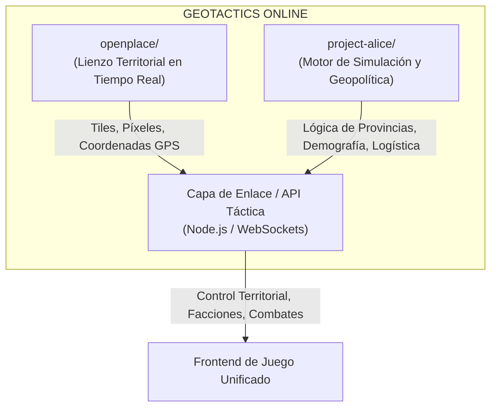

# Análisis de Arquitectura: GEOTACTICS ONLINE

> **Proyecto Matriz:** `GEOTACTICS ONLINE` (anteriormente `TacticalCommand`)  
> **Entorno de ejecución:** Antigravity Cloud Virtual Workspace  
> **Fecha:** Noviembre 2026

---

## 1. Visión y Fundamento del Proyecto

**GEOTACTICS ONLINE** une dos mundos del software libre en una experiencia de estrategia geopolítica y territorial en tiempo real:

---

## 2. Análisis Detallado de los Componentes

### 📍 Módulo 1: OpenPlace (`openplace/`)
* **Propósito:** Proporcionar la infraestructura de mapa de cuadrícula de píxeles colaborativo (estilo Wplace) sobre la geografía terrestre real.
* **Aspectos técnicos clave:**
  - **Cálculo de Tiles y Píxeles:** División de la superficie terrestre en cuadrículas (`tiles`) de $1024 \times 1024$ píxeles vinculadas a coordenadas geográficas (Latitud y Longitud) según la proyección de Mercator.
  - **Sistema de Alianzas y Clanes:** Endpoint `/alliance` y `/alliance/update-headquarters` para establecer cuarteles generales territoriales.
  - **Stack Tecnológico:** Node.js, TypeScript, Caddy (proxy inverso HTTPS), Prisma ORM y MariaDB.

### ⚔️ Módulo 2: Project Alice (`project-alice/`)
* **Propósito:** Proporcionar la inteligencia y la profundidad de simulación de un juego de gran estrategia (continuación y modernización de Victoria 2).
* **Aspectos técnicos clave:**
  - **Estructura Provincial (`the_map.md`):** División del mundo en regiones lógicas con datos demográficos, recursos naturales e infraestructura.
  - **Sistema Logístico (`feature_logistics.md`):** Abastecimiento de tropas y líneas de suministro según el control de carreteras y vías fluviales.
  - **Motor de Eventos y Triggers (`triggers.md`):** Reglas dinámicas que disparan tratados de paz, rebeliones, declaraciones de guerra o crisis diplomáticas.

---

## 3. Plan de Integración en la Nube de Antigravity

Para desarrollar este proyecto 100% desde la web sin necesidad de configuraciones complejas en tu PC física:

1. **Persistencia del Repositorio:**
   - La matriz está estructurada en `/home/antigravity/GEOTACTICS-ONLINE`.
   - Se conectará con tu repositorio remoto de GitHub (`davikisea/GEOTACTICS-ONLINE`).
2. **Despliegue del Frontend y Centro de Mando:**
   - Visualización interactiva en tiempo real mediante el Centro de Mando de Geotactics.
   - Servidor de previsualización en la nube para testear el cliente web de OpenPlace.
3. **Capa de Conexión (El "Pegamento" Táctico):**
   - Desarrollo de un servicio ligero en Node.js que capture los píxeles colocados por cada alianza y los traduzca en **porcentaje de influencia y ocupación** de las provincias de Alice.

---

## 4. Estado de las Carpetas en el Espacio de Trabajo

* `GEOTACTICS-ONLINE/openplace/` &rarr; 575 dependencias de Node.js instaladas y validadas.
* `GEOTACTICS-ONLINE/project-alice/` &rarr; Código fuente en C++ y documentación completa disponible.
* `GEOTACTICS-ONLINE/scripts/` &rarr; Instaladores desatendidos para Linux y Windows.
