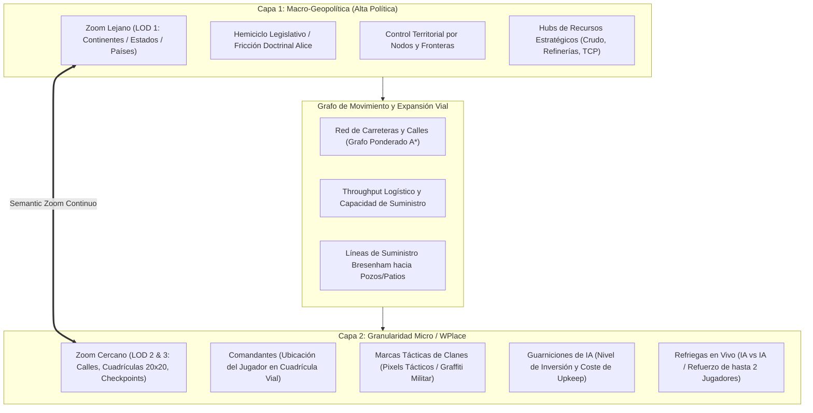
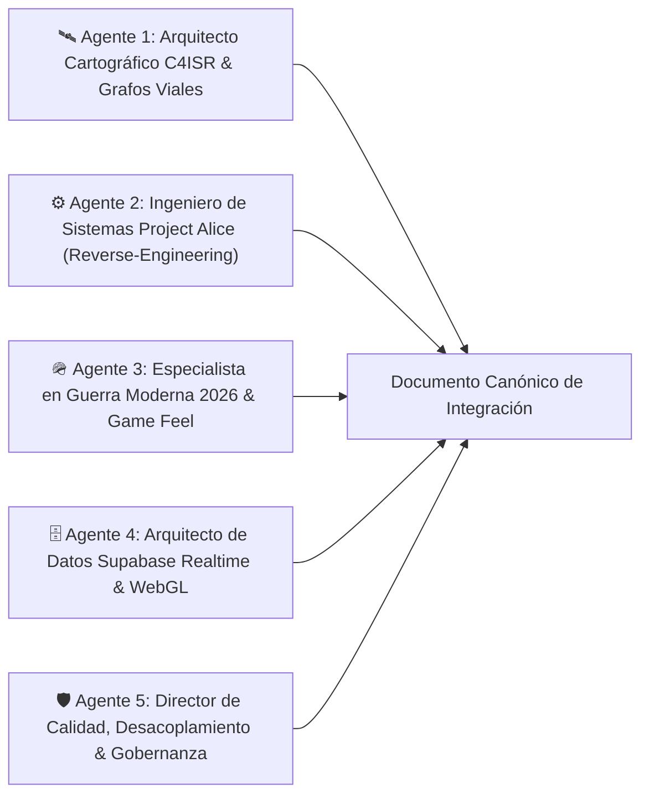
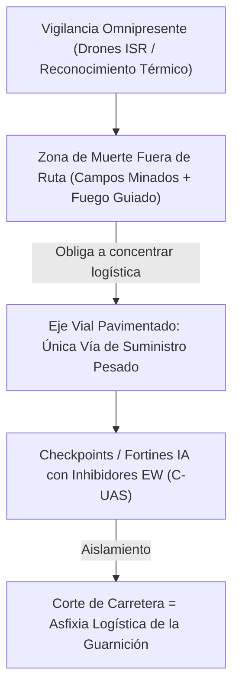
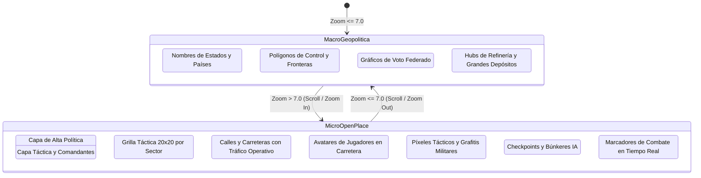
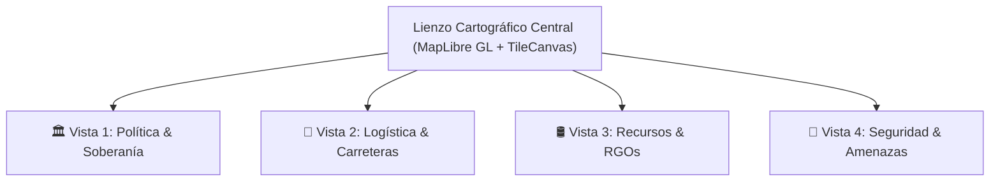
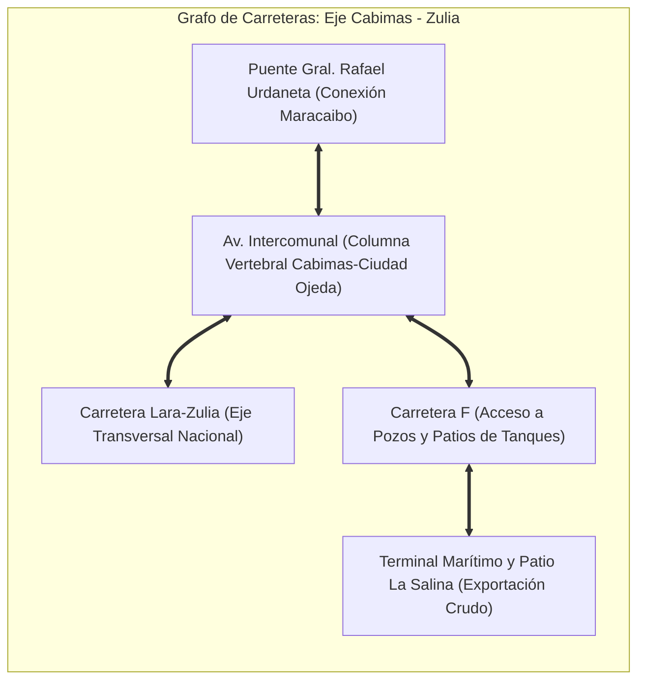
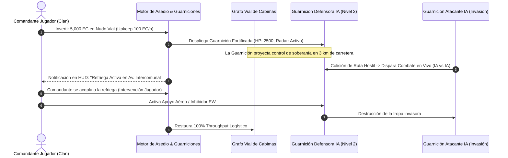
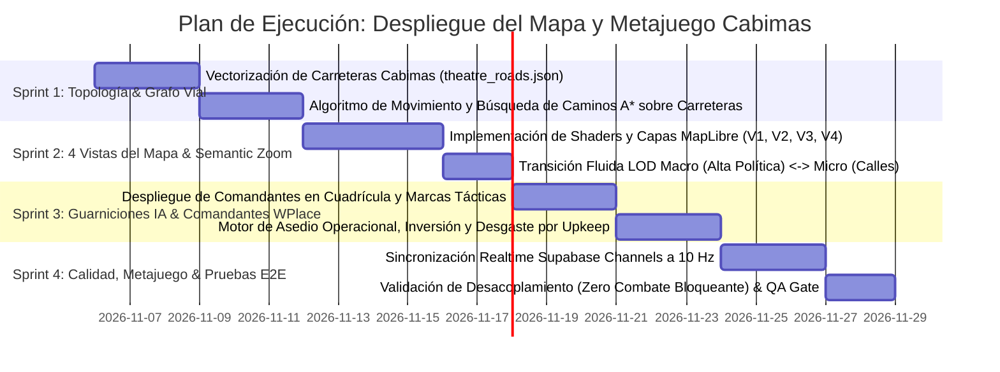

# 🌐 ESPECIFICACIÓN MAESTRA DE INGENIERÍA: SISTEMA POLÍTICO PROJECT ALICE, MAPA VIAL CONTINENTAL Y METAPOLÍTICA MODERNA 2026

> **Código de Documento:** `docs/ANALISIS_PROJECT_ALICE_RUTAS_INGENIERIA_MAPA_METAPOLITICA.md`  
> **Clasificación:** Arquitectura de Sistemas, Cartografía C4ISR, Ingeniería Inversa C++20 y Metajuego Geopolítico  
> **Versión Canónica:** `v0.1.0-genesis-cabimas`  
> **Repositorio Fuente de Análisis:** `C:\Users\Morín\Project-Alice-1.3.0` (C++20 Open V2 Engine)  
> **Repositorio de Aplicación:** `c:\Users\Morín\GEOTACTICS-ONLINE` (React 19, TypeScript, MapLibre GL, Supabase PostgreSQL, Tailwind CSS)  
> **Punto Inicial de Despliegue:** Región de Cabimas (Costa Oriental del Lago de Maracaibo, Zulia, Venezuela)

---

## 🧭 TABLA DE CONTENIDOS
1. [Manifiesto Ejecutivo y Premisas Inviolables de Misión](#1-manifiesto-ejecutivo-y-premisas-inviolables-de-misión)
2. [Panel de Agentes Especialistas Orquestados](#2-panel-de-agentes-especialistas-orquestados)
3. [Deconstrucción Forense de Project Alice 1.3.0: Módulos Rescatables](#3-deconstrucción-forense-de-project-alice-130-módulos-rescatables)
4. [La Realidad de la Guerra Moderna 2026: Doctrina de Carreteras, Drones y Desgaste](#4-la-realidad-de-la-guerra-moderna-2026-doctrina-de-carreteras-drones-y-desgaste)
5. [Arquitectura Cartográfica Dual y Mecánica WPlace / OpenPlace](#5-arquitectura-cartográfica-dual-y-mecánica-wplace--openplace)
6. [Las 4 Vistas Especializadas del Mapa C4ISR](#6-las-4-vistas-especializadas-del-mapa-c4isr)
7. [Vectorización y Topología Operativa: El Teatro Cabimas (Génesis Zulia)](#7-vectorización-y-topología-operativa-el-teatro-cabimas-génesis-zulia)
8. [Motor de Guarniciones IA, Inversión, Mantenimiento y Frentes de Asedio](#8-motor-de-guarniciones-ia-inversión-mantenimiento-y-frentes-de-asedio)
9. [Desacoplamiento Estricto: Aislamiento del Combate Táctico y del Bark Engine](#9-desacoplamiento-estricto-aislamiento-del-combate-táctico-y-del-bark-engine)
10. [Modelo de Datos en Supabase (PostGIS + Realtime Channels)](#10-modelo-de-datos-en-supabase-postgis--realtime-channels)
11. [Hoja de Ruta de Implementación Quirúrgica (Sprints 1 al 4)](#11-hoja-de-ruta-de-implementación-quirúrgica-sprints-1-al-4)

---

## 1. MANIFIESTO EJECUTIVO Y PREMISAS INVIOLABLES DE MISIÓN

El propósito de esta propuesta de ingeniería es materializar un **teatro de operaciones geopolítico, territorial y táctico en tiempo real**, sintetizando la complejidad de gran estrategia de *Victoria 2* / *Project Alice* con la adicción visual masiva y la granularidad espacial colaborativa de *r/place* (*WPlace* / *OpenPlace*), anclado en la doctrina de combate de la **Guerra Moderna 2026**.



### Premisas Inviolables del Sistema:
1. **El Mapa como Vector Exclusivo de Expansión por Carreteras:**  
   El desplazamiento de tropas, la proyección de soberanía y la expansión territorial no ocurren en el vacío ni por teletransporte. Se transmiten exclusivamente **a lo largo de carreteras, avenidas y conexiones viarias**. Las carreteras son las arterias de la economía, el soporte vital de las guarniciones y los ejes de avance.
2. **Arquitectura Dual de 2 Capas con Semantic Zoom Continuo:**  
   * **Capa de Alta Política (Macro-Geopolítica):** Al alejar el zoom, el mapa sintetiza las entidades federales, los países, las fronteras consolidadas, los balances parlamentarios y las estadísticas macroeconómicas.
   * **Capa Operativa / Táctica (Micro-WPlace):** Al acercar el zoom, el mapa renderiza la cuadrícula de calles, los comandantes desplegados, las marcas tácticas del clan, los convoyes en tránsito y las refriegas activas en intersecciones clave.
3. **Punto de Partida Canónico: Cabimas (Zulia):**  
   El despliegue de prueba y expansión inicial toma como epicentro la ciudad de **Cabimas** y la **Costa Oriental del Lago de Maracaibo (Zulia)**, corazón de la infraestructura petrolera venezolana, conectada por la Avenida Intercomunal, la Carretera Lara-Zulia y el Puente General Rafael Urdaneta hacia Maracaibo.
4. **Desacoplamiento Estricto de Subsistemas:**  
   * **Fase 1:** Foco $100\%$ en el mapa funcional, la red vial, las 4 vistas temáticas, el despliegue en cuadrícula, el movimiento y el metajuego político.
   * **Combate Táctico (Advance Wars 1-100 HP) y Bark Engine (Mayor Stella):** Operan de forma completamente desacoplada mediante un patrón de arquitectura dirigida por eventos (*Event-Driven Architecture*). Las batallas en el mapa se resuelven o simulan a nivel operacional sin forzar la apertura del tablero por turnos.

---

## 2. PANEL DE AGENTES ESPECIALISTAS ORQUESTADOS

Para garantizar rigor analítico y coherencia multidisciplinaria, la presente propuesta ha sido articulada mediante la orquestación de cinco agentes especializados:



* **🛰️ Agente 1 (Cartografía C4ISR & Topología de Redes):** Diseña el sistema de coordenadas Web Mercator, la proyección $O(1)$ entre lat/long y cuadrícula de combate, y la estructura de datos del grafo de carreteras.
* **⚙️ Agente 2 (Ingeniería Inversa Project Alice):** Extrae y adapta las fórmulas de suministro de `military.cpp`, los modos de mapa de `map_modes.hpp`, las restricciones de infraestructura de `infrastructure.hpp` y el escrutinio de `politics.cpp`.
* **🪖 Agente 3 (Doctrina Militar 2026 & Game Design):** Modela el comportamiento de las guarniciones de IA, los frentes de combate en carreteras, las zonas de muerte (*kill zones*) por drones y el despliegue de comandantes tipo WPlace.
* **🗄️ Agente 4 (Infraestructura Realtime & Supabase):** Define las tablas PostGIS, los canales de WebSocket optimizados para sincronización masiva y los shaders de renderizado en MapLibre GL.
* **🛡️ Agente 5 (Garantía de Calidad & Desacoplamiento):** Asegura que el combate táctico por turnos y el motor de diálogos (*Bark Engine*) se mantengan como capas downstream aisladas, garantizando una arquitectura libre de deuda técnica.

---

## 3. DECONSTRUCCIÓN FORENSE DE PROJECT ALICE 1.3.0: MÓDULOS RESCATABLES

El análisis profundo del árbol de fuentes de `C:\Users\Morín\Project-Alice-1.3.0` revela subsistemas de alto valor algorítmico directamente aplicables a GEOTACTICS: ONLINE.

### 3.1 El Grafo de Transporte y Renderizado Vial (`src/map/map.hpp` & `map_borders.cpp`)
En Project Alice, las carreteras y ferrocarriles no son simples polilíneas decorativas:
* Estructuras de datos dedicadas:
  ```cpp
  // Project Alice: src/map/map.hpp
  struct textured_line_vertex {
      glm::vec2 position_;
      glm::vec2 normal_direction_;
      float texture_coordinate_ = 0.f;
      float distance_ = 0.f;
  };
  std::vector<textured_line_vertex> railroad_vertices;
  std::vector<GLint> railroad_starts;
  std::vector<GLsizei> railroad_counts;
  ```
* **Mapeo a GEOTACTICS:**  
  En MapLibre GL, esta lógica se traslada a fuentes vectoriales GeoJSON dinámicas (`theatre_roads.json`) renderizadas como `line` layers con gradientes de color según el ancho de banda logístico (*throughput*) y el nivel de control militar.

### 3.2 Modos de Mapa Especializados (`src/map/modes/`)
Alice cuenta con 22 modos de mapa nativos. Para el sistema de GEOTACTICS rescatamos e hibridamos cuatro módulos críticos:
1. **`infrastructure.hpp`:**  
   Determina si una conexión vial permite el tránsito militar rápido en función del nivel de desarrollo y las reglas del partido en el poder (`issue_rule::build_railway`, `allow_foreign_investment`).
2. **`supply.hpp` (`supply_limit_in_province`):**  
   Calcula la capacidad de carga militar antes de que las unidades sufran atrición (*attrition*):
   $$\text{CapacidadSuministro} = \text{Base} \times (1 + \text{NivelVial}) \times \text{ModificadorClimático}$$
3. **`political.hpp`:**  
   Renderiza las fronteras de control soberano con paleta heráldica por nación/clan.
4. **`rgo_output.hpp`:**  
   Visualiza la producción de materias primas por provincia (Crudo liviano, crudo pesado, gas licuado, energía eléctrica).

### 3.3 Tiempos de Movimiento e Intercepción (`src/military/military.cpp`)
En Alice (`military.cpp:L4832-L4870`), el tiempo de viaje entre dos nodos conectados se define por:
```cpp
float movement_time_from_to(sys::state& state, dcon::army_id a, dcon::province_id from, dcon::province_id to) {
    float prov_from_mod = province::get_province_modifier(state, controller, from, sys::provincial_mod_offsets::movement_cost);
    float prov_to_mod = province::get_province_modifier(state, controller, to, sys::provincial_mod_offsets::movement_cost);
    float average_modifier = (prov_from_mod + prov_to_mod) * 0.5f;
    return (base_distance / army_speed) * average_modifier;
}
```
Si una tropa enemiga entra en el nodo intermedio, `stop_army_movement` congela la marcha y dispara la fase de combate. En GEOTACTICS, este principio impide que un jugador o guarnición salte nodos viales sin antes neutralizar los puestos de control hostiles.

---

## 4. LA REALIDAD DE LA GUERRA MODERNA 2026: DOCTRINA DE CARRETERAS, DRONES Y DESGASTE

El diseño del juego no busca emular la Segunda Guerra Mundial, sino la doctrina contemporánea observada en teatros de alta intensidad (2022–2026):



1. **La Tiranía del Asfalto y las Vías de Comunicación:**  
   Fuera de las carreteras consolidadas, las formaciones acorazadas y los convoyes de suministro sufren de terreno intransitable, campos minados densos y vulnerabilidad total a enjambres de drones FPV. El avance territorial se convierte en una batalla por **nudos viales, intersecciones y puentes**.
2. **Guarniciones de Bloqueo Autónomas:**  
   Los clanes no pueden mantener jugadores humanos despiertos 24/7 en cada kilómetro de carretera. Por ello, establecen **Guarniciones de IA** en los nudos viales. El nivel de inversión financiera y tecnológica determina su capacidad defensiva:
   * *Nivel 1 (Puesto Ligero / Retén):* Milicia básica, escasa cobertura contra drones.
   * *Nivel 2 (Puesto Avanzado Fortificado):* Zanjas antitanque, ametralladoras pesadas, bloqueadores de radiobacheo.
   * *Nivel 3 (Fortín Integrado C4ISR):* Sistema antiaéreo de punto (C-UAS), sensores térmicos de largo alcance, nidos de drones de ataque rápido.
   * *Nivel 4 (Complejo de Búnker de Asedio):* Capacidad de fuego indirecto guiado sobre celdas viales adyacentes.
3. **El Coste de Mantenimiento (Upkeep):**  
   Una guarnición consume **Créditos de Energía (EC)** y **Puntos de Suministro** cada hora. Si la facción no paga el mantenimiento o la carretera de suministro que conecta con la refinería/depósito central es cortada por el enemigo, la guarnición entra en **Inanición Operacional**, perdiendo HP y defensas progresivamente.

---

## 5. ARQUITECTURA CARTOGRÁFICA DUAL Y MECÁNICA WPLACE / OPENPLACE

Para replicar la adicción visual de proyectos masivos colaborativos como *r/place* dentro de un contexto táctico-militar militarizado:

### 5.1 Los Dos Niveles de Representación Espacial



### 5.2 El Sistema de Comandantes en Cuadrícula (Representación del Jugador)
* Cada jugador registrado encarna a un **Comandante de Campo**.
* Su ficha/avatar ocupa una celda táctica específica sobre la red vial o un centro de mando provincial.
* El jugador puede ordenar el desplazamiento de su comandante marcando una ruta por carretera. La velocidad de marcha depende de la calidad de la vía y del nivel de control del clan sobre la misma.
* Al situarse sobre una guarnición aliada en combate, el comandante otorga bonificadores de mando directos y puede activar habilidades tácticas.

### 5.3 Marcas Tácticas Comunitarias (Estilo WPlace / OpenPlace)
* Los jugadores pueden estampar **marcas tácticas temporales** sobre la cuadrícula del mapa (con un enfriamiento o coste de energía para prevenir spam):
  * Señal de reconocimiento de drones (*Target Mark*).
  * Advertencia de emboscada o campo minado (*Mine Warning*).
  * Reclamo territorial con el blasón o color heráldico del clan.
* Estas marcas se transmiten a través de WebSockets de Supabase a todos los comandantes que tengan visión de radar sobre el sector.

---

## 6. LAS 4 VISTAS ESPECIALIZADAS DEL MAPA C4ISR

En el HUD de la consola de mando se habilitan cuatro filtros de visualización independientes mediante botones de palanca rápida:



| ID | Modo de Mapa | Paleta de Color | Elementos Renderizados | Decisión Estratégica Asociada |
|---|---|---|---|---|
| **V1** | **Política & Soberanía** | Heráldica por Clan (Ferro: Oro/Negro, Orinoco: Cobre, Caribe: Turquesa, Andes: Esmeralda) | Polígonos provinciales, fronteras de soberanía, nombres de estados y municipios, banderas de ocupación. | Identificar qué clan domina la región para las elecciones del Senado. |
| **V2** | **Logística & Vías** | Cian Neón (Vías libres), Amarillo (Cuello de botella), Rojo Pulsante (Carretera cortada/Asediada) | Grafo de carreteras, líneas de suministro de convoyes, capacidad de throughput, puentes críticos. | Detectar rutas viables para despliegue de refuerzos o planificar emboscadas a líneas de abastecimiento. |
| **V3** | **Recursos & RGOs** | Ámbar Crudo (#E5A93C), Azul Eléctrico (Energía), Verde Militar (Munición) | Pozos petroleros, estaciones de bombeo, refinerías, depósitos de combustible, complejos petroquímicos. | Priorizar expansión hacia fuentes de ingresos y asegurar el suministro de combustible pesado. |
| **V4** | **Seguridad & Amenazas** | Gradiente Térmico FLIR (Verde seguro $\to$ Naranja alerta $\to$ Rojo combate activo) | Guarniciones de IA y su nivel de fortificación, cobertura de radar/EW, combates activos en tiempo real. | Identificar frentes desprotegidos o intervenir en refriegas críticas entre guarniciones de IA. |

---

## 7. VECTORIZACIÓN Y TOPOLOGÍA OPERATIVA: EL TEATRO CABIMAS (GÉNESIS ZULIA)

Para el arranque de la Fase 1, la región elegida como semillero operativo es el **Municipio Cabimas y el corredor de la Costa Oriental del Lago de Maracaibo (Estado Zulia)**.



### 7.1 Puntos de Interés (POIs) Estratégicos en Cabimas
1. **Patio de Tanques y Terminal La Salina:**  
   * **Tipo:** Hub de Infraestructura / Exportación.
   * **Función de Juego:** Genera el mayor multiplicador de Créditos de Energía (EC) del sector; controlarlo otorga una tasa impositiva arancelaria a todas las exportaciones del Lago.
2. **Eje Av. Intercomunal (Cabimas - Punta Gorda - Tía Juana):**  
   * **Tipo:** Arteria Vial Primaria.
   * **Función de Juego:** Permite velocidad de marcha máxima para los comandantes ($100\%$ bonus de velocidad) y soporta convoyes pesados sin desgaste.
3. **El Barroso II / Zumaque 1 (Área de Extracción Petrolífera):**  
   * **Tipo:** Depósito de Recursos (RGO).
   * **Función de Juego:** Produce crudo pesado necesario para abastecer la logística de los clanes.
4. **Intersección Lara-Zulia (Nudo Las Cabillas):**  
   * **Tipo:** Nudo Carretero Clave.
   * **Función de Juego:** Punto de asedio natural; quien controle este nudo con una guarnición nivel 3 corta la conexión hacia el centro y oriente de Venezuela.

---

## 8. MOTOR DE GUARNICIONES IA, INVERSIÓN, MANTENIMIENTO Y FRENTES DE ASEDIO

Las carreteras se mantienen aseguradas mediante el despliegue de **Guarniciones de Inteligencia Artificial**:



### 8.1 Niveles de Inversión y Escala de Dificultad
* **Coste de Instalación:** Inversión inicial en EC y Suministros para construir el puesto.
* **Coste de Mantenimiento:** Deducción automática del tesoro del clan cada tick de 1 hora. Si el tesoro no cubre el coste, el nivel de fortificación decae un nivel por ciclo.
* **Capacidad de Intervención Limitada:**  
  Hasta un máximo de **2 jugadores humanos** pueden acoplarse activamente a una refriega en una intersección de carretera para proporcionar soporte táctico, garantizando que el juego no se convierta en una bola de nieve inalcanzable para clanes pequeños.

---

## 9. DESACOPLAMIENTO ESTRICTO: AISLAMIENTO DEL COMBATE TÁCTICO Y DEL BARK ENGINE

Conforme a la directriz canónica y las premisas del usuario:
1. **La Capa 1 (Mapa y Metajuego) es Totalmente Autosuficiente:**  
   El movimiento de tropas por carreteras, el cálculo de soberanía, la asamblea legislativa, la recaudación de impuestos y las refriegas operacionales de guarniciones de IA se resuelven de forma **determinista y matemática en el motor del mapa**.
2. **Aislamiento del Combate Táctico (Advance Wars 1-100 HP):**  
   El tablero táctico por turnos (`subActionsAndArrow`, `expandedCOs`) permanece como un módulo *downstream* inactivo en esta fase. Cuando dos unidades colisionan en una carretera, el resultado se calcula mediante fórmulas de desgaste inspiradas en Victoria 2 (`military.cpp`), emitiendo únicamente eventos de telemetría:
   ```typescript
   export interface RoadBattleEvent {
     battleId: string;
     roadSegmentId: string;
     attackerClanId: string;
     defenderClanId: string;
     attackerHp: number;
     defenderHp: number;
     status: 'in_progress' | 'attacker_victory' | 'defender_victory';
     updatedAt: string;
   }
   ```
3. **Aislamiento del Bark Engine:**  
   El motor de bocadillos y voces tácticas de los comandantes no procesa lógica de victoria ni gobierna el mapa. Se suscribe a los eventos del mapa únicamente para disparar mensajes de radio atmosféricos cuando un puesto de control en Cabimas entra en alerta.

---

## 10. MODELO DE DATOS EN SUPABASE (POSTGIS + REALTIME CHANNELS)

La base de datos PostgreSQL en Supabase gestiona la red vial, las guarniciones, la posición de los comandantes y las marcas tácticas con soporte geoespacial nativo:

```sql
-- 1. EXTENSIÓN ESPACIAL
CREATE EXTENSION IF NOT EXISTS postgis;

-- 2. TABLA DE SEGMENTOS VIALES Y CARRETERAS
CREATE TABLE public.world_roads (
    id UUID PRIMARY KEY DEFAULT gen_random_uuid(),
    theater_iso VARCHAR(8) NOT NULL DEFAULT 'VE',
    name VARCHAR(120) NOT NULL,
    road_class VARCHAR(32) NOT NULL, -- 'highway', 'avenue', 'rural_track', 'bridge'
    geometry GEOMETRY(LineString, 4326) NOT NULL,
    length_km NUMERIC(8,2) NOT NULL,
    controller_clan_id VARCHAR(64),
    logistics_throughput NUMERIC(5,2) DEFAULT 100.0, -- Capacidad de suministro (0 - 100%)
    is_blocked BOOLEAN DEFAULT FALSE,
    created_at TIMESTAMPTZ DEFAULT NOW()
);

CREATE INDEX idx_world_roads_geometry ON public.world_roads USING GIST(geometry);

-- 3. GUARNICIONES DE IA EN NODOS VIALES
CREATE TABLE public.road_garrisons (
    id UUID PRIMARY KEY DEFAULT gen_random_uuid(),
    road_id UUID REFERENCES public.world_roads(id) ON DELETE CASCADE,
    location GEOMETRY(Point, 4326) NOT NULL,
    clan_id VARCHAR(64) NOT NULL,
    tier_level INT NOT NULL CHECK (tier_level BETWEEN 1 AND 4),
    current_hp INT NOT NULL DEFAULT 1000,
    max_hp INT NOT NULL DEFAULT 1000,
    hourly_upkeep_ec INT NOT NULL DEFAULT 50,
    is_under_attack BOOLEAN DEFAULT FALSE,
    last_upkeep_paid_at TIMESTAMPTZ DEFAULT NOW(),
    created_at TIMESTAMPTZ DEFAULT NOW()
);

CREATE INDEX idx_road_garrisons_location ON public.road_garrisons USING GIST(location);

-- 4. POSICIÓN DE COMANDANTES (JUGADORES EN CUADRÍCULA / WPLACE)
CREATE TABLE public.commander_positions (
    user_id UUID PRIMARY KEY REFERENCES auth.users(id),
    clan_id VARCHAR(64) NOT NULL,
    callsign VARCHAR(64) NOT NULL,
    current_location GEOMETRY(Point, 4326) NOT NULL,
    current_road_id UUID REFERENCES public.world_roads(id),
    target_location GEOMETRY(Point, 4326),
    speed_kmh NUMERIC(5,2) DEFAULT 60.0,
    is_moving BOOLEAN DEFAULT FALSE,
    updated_at TIMESTAMPTZ DEFAULT NOW()
);

-- 5. MARCAS TÁCTICAS WPLACE
CREATE TABLE public.tactical_map_marks (
    id UUID PRIMARY KEY DEFAULT gen_random_uuid(),
    clan_id VARCHAR(64) NOT NULL,
    created_by UUID REFERENCES auth.users(id),
    mark_type VARCHAR(32) NOT NULL, -- 'recon', 'danger', 'claim', 'rally'
    location GEOMETRY(Point, 4326) NOT NULL,
    color_hex VARCHAR(7) NOT NULL DEFAULT '#E5A93C',
    expires_at TIMESTAMPTZ NOT NULL,
    created_at TIMESTAMPTZ DEFAULT NOW()
);

-- 6. CANAL REALTIME BROADCAST
ALTER PUBLICATION supabase_realtime ADD TABLE public.road_garrisons;
ALTER PUBLICATION supabase_realtime ADD TABLE public.commander_positions;
ALTER PUBLICATION supabase_realtime ADD TABLE public.tactical_map_marks;
```

---

## 11. HOJA DE RUTA DE IMPLEMENTACIÓN QUIRÚRGICA (SPRINTS 1 AL 4)



### Hitos de Entrega:
1. **Hito S1 (Grafo Vial Operativo):**  
   Navegación fluida por carreteras entre Cabimas, La Salina y el Puente Gral. Rafael Urdaneta. Los comandantes se desplazan respetando las conexiones físicas sin salirse del trazado vial.
2. **Hito S2 (Consola C4ISR Multivista):**  
   Selector interactivo en UI para alternar instantáneamente entre la vista de Soberanía Política, Logística Vial, Recursos Petroleros y Amenazas Militares.
3. **Hito S3 (Simulación de Asedio y Guarniciones IA):**  
   Puestos de control fortificados en intersecciones que consumen EC y defienden las rutas comerciales contra incursiones de IA hostiles.
4. **Hito S4 (Metajuego 100% Funcional):**  
   Integración con la base de datos de Supabase, soporte colaborativo multiusuario estilo OpenPlace y validación de calidad mediante suites automatizadas de prueba.
