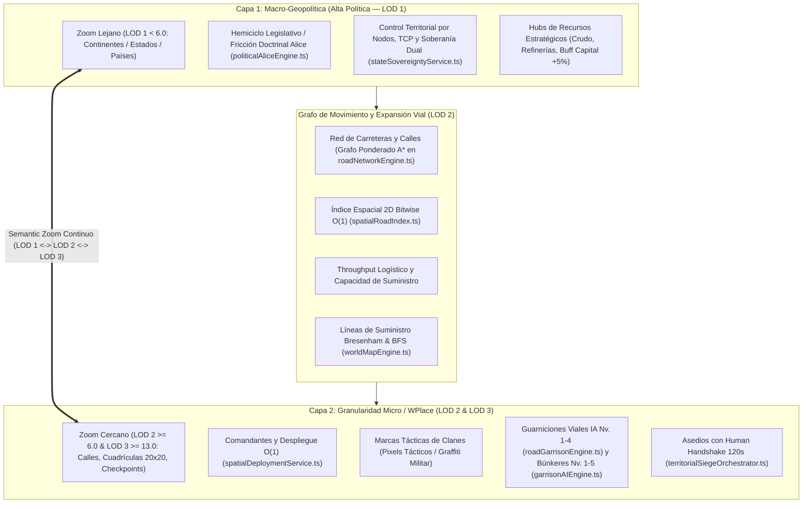
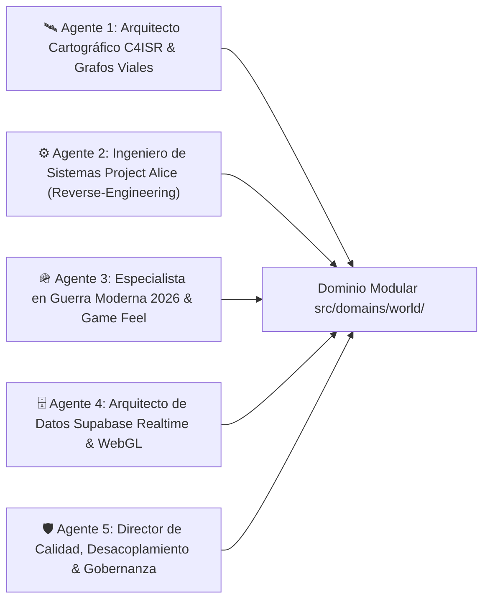
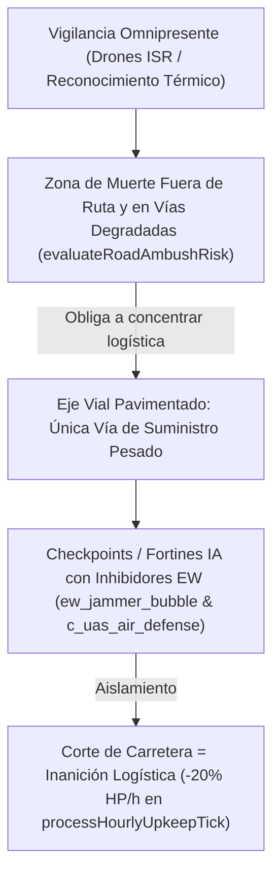
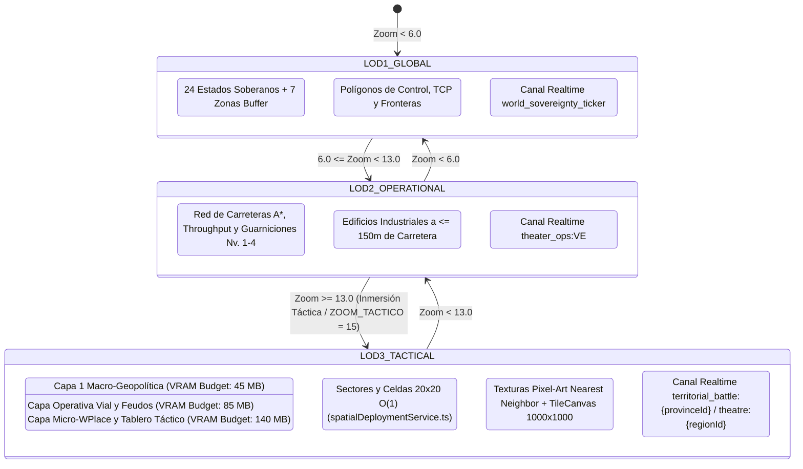
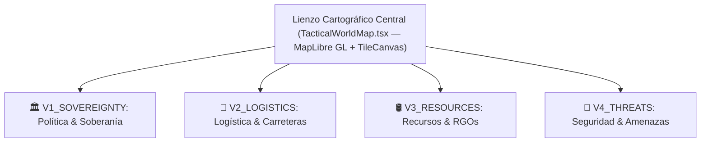
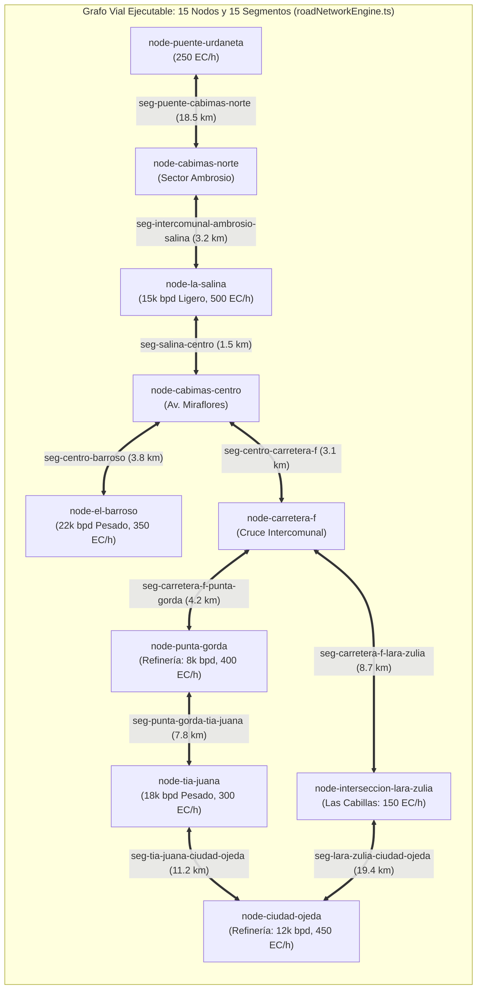
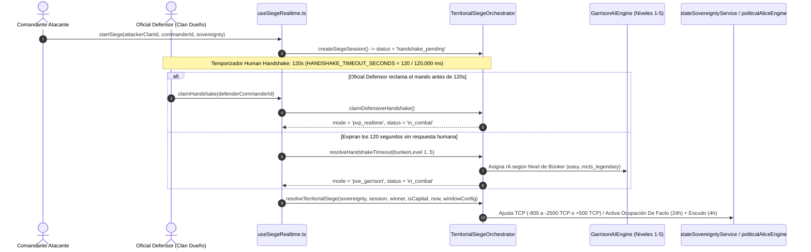
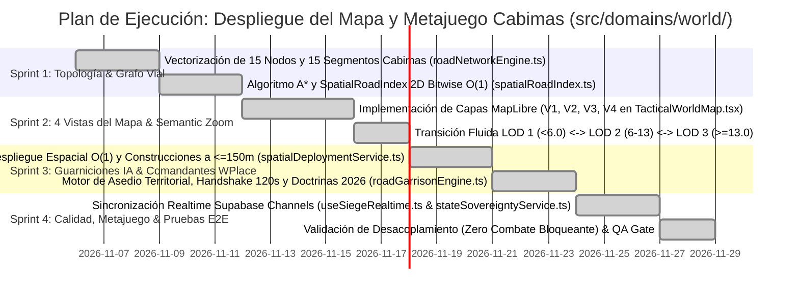

# 🌐 ESPECIFICACIÓN MAESTRA DE INGENIERÍA: SISTEMA POLÍTICO PROJECT ALICE, MAPA VIAL CONTINENTAL Y METAPOLÍTICA MODERNA 2026

> **Código de Documento:** `docs/ANALISIS_PROJECT_ALICE_RUTAS_INGENIERIA_MAPA_METAPOLITICA.md`  
> **Clasificación:** Arquitectura de Sistemas, Cartografía C4ISR, Ingeniería Inversa C++20 y Metajuego Geopolítico  
> **Versión Canónica:** `v0.2.0-modular-world-domain`  
> **Repositorio Fuente de Análisis:** `C:\Users\Morín\Project-Alice-1.3.0` (C++20 Open V2 Engine)  
> **Repositorio de Aplicación:** `c:\Users\Morín\GEOTACTICS-ONLINE` (React 19, TypeScript, MapLibre GL, Supabase PostgreSQL, Tailwind CSS)  
> **Dominio Arquitectónico Principal:** `src/domains/world/` (`@domains/world/*`) en sinergia con `src/domains/tactics/`, `src/domains/economy/`, `src/domains/game-feel/` y `src/shared/`  
> **Punto Inicial de Despliegue:** Región de Cabimas (`REG_VE_02` — Costa Oriental del Lago de Maracaibo, Zulia, Venezuela)

---

## 🧭 TABLA DE CONTENIDOS
1. [Manifiesto Ejecutivo, Los 7 Pilares Canónicos y Premisas Inviolables](#1-manifiesto-ejecutivo-los-7-pilares-canónicos-y-premisas-inviolables)
2. [Panel de Agentes Especialistas y Mapeo de Arquitectura Modular (`src/domains/world`)](#2-panel-de-agentes-especialistas-y-mapeo-de-arquitectura-modular-srcdomainsworld)
3. [Deconstrucción Forense de Project Alice 1.3.0: Módulos Rescatables](#3-deconstrucción-forense-de-project-alice-130-módulos-rescatables)
4. [La Realidad de la Guerra Moderna 2026: Doctrina de Carreteras, Drones y Desgaste](#4-la-realidad-de-la-guerra-moderna-2026-doctrina-de-carreteras-drones-y-desgaste)
5. [Arquitectura Cartográfica Dual, Semantic LOD y Mecánica WPlace / OpenPlace](#5-arquitectura-cartográfica-dual-semantic-lod-y-mecánica-wplace--openplace)
6. [Las 4 Vistas Especializadas del Mapa C4ISR](#6-las-4-vistas-especializadas-del-mapa-c4isr)
7. [Vectorización, Grafo A* (`roadNetworkEngine.ts`) e Índice Espacial $O(1)$ (`spatialRoadIndex.ts`)](#7-vectorización-grafo-a-roadnetworkenginets-e-índice-espacial-o1-spatialroadindexts)
8. [Motor de Guarniciones IA (Viales Nv. 1-4 y Territoriales Nv. 1-5), Protocolo de Asedio y Human Handshake (120s)](#8-motor-de-guarniciones-ia-viales-nv-1-4-y-territoriales-nv-1-5-protocolo-de-asedio-y-human-handshake-120s)
9. [Desacoplamiento Estricto, Economía P2P (2% Split) y Aislamiento del Bark Engine](#9-desacoplamiento-estricto-economía-p2p-2-split-y-aislamiento-del-bark-engine)
10. [Modelo de Datos en Supabase (PostGIS + Realtime Channels)](#10-modelo-de-datos-en-supabase-postgis--realtime-channels)
11. [Hoja de Ruta de Implementación Quirúrgica (Sprints 1 al 4)](#11-hoja-de-ruta-de-implementación-quirúrgica-sprints-1-al-4)

---

## 1. MANIFIESTO EJECUTIVO, LOS 7 PILARES CANÓNICOS Y PREMISAS INVIOLABLES

El propósito de esta propuesta de ingeniería es materializar un **teatro de operaciones geopolítico, territorial y táctico en tiempo real**, sintetizando la complejidad de gran estrategia de *Victoria 2* / *Project Alice* con la adicción visual masiva y la granularidad espacial colaborativa de *r/place* (*WPlace* / *OpenPlace*), anclado en la doctrina de combate de la **Guerra Moderna 2026**.



### 1.1 Los 7 Pilares Canónicos Inmutables y Regla Financiera SSOT
Toda la arquitectura de `src/domains/world/` respeta de forma estricta e innegociable los 7 pilares canónicos del sistema:
1. **Pilar 1 — CERO CARTAS (NO TCG/CCG):** Almacén físico estricto de **16 tropas máximo por jugador** (`4` slots de despliegue activo + `12` en reserva en `src/domains/economy/hooks/useUserHangar.ts`). No existen mazos ni coleccionismo de cartas.
2. **Pilar 2 — Escala Balística Continua (1 a 100 HP):** Integridad estructural entera de `1` a `100 HP` (`MASTER_METAGAME_CONSTANTS.CANONICAL_MAX_HP = 100` en `src/shared/types/metagame.ts` y `src/domains/tactics/core/canonicalCombat.ts`).
3. **Pilar 3 — Derrota Inapelable por Aniquilación:** Derrota inmediata al llegar a `0` tropas supervivientes en el tablero táctico.
4. **Pilar 4 — Progresión Horizontal de Tiers (T1 a T5):** Bonificación de `+2%` por nivel/tier (`TIER_EFFECTIVENESS_BONUS_PER_LEVEL = 0.02`, máximo `+8%` en T5 respecto a T1).
5. **Pilar 5 — Conquista de Capitales con Buff Regional (+5%):** Las capitales son capturables (`CAPITAL_IMMUNITY = false`, `CAPITAL_TCP_THRESHOLD = 15000`). Controlar una capital otorga un **Buff Regional de +5% en recursos y eficiencia logística en la región**, además del bono hegemónico nacional (`+15%` extracción energética y `+10%` velocidad de forja en `src/domains/world/core/territorialExpansionEngine.ts`, `src/domains/economy/core/upkeepEngine.ts` y `src/domains/economy/core/strategicAndProductionEngine.ts`).
6. **Pilar 6 — Pérdida Física Real y 35% de Chatarra Tecnológica (`tech_scrap`):** Las unidades destruidas (excepto el kit F2P básico `infantry` T1 / `recon` T1) sufren baja permanente del hangar y recuperan el **35%** de su valor en chatarra tecnológica (`RECYCLE_SCRAP_RATE = 0.35`, `calculateLossScrapRecovery` en `src/shared/types/metagame.ts` y `settleCombatLossesAndScrap` en `src/domains/tactics/core/tacticalCombatSeamlessIntegration.ts`).
7. **Pilar 7 — Human Handshake de 120 Segundos (2 Minutos) e IA de Guarnición (Niveles 1-5):** Todo asedio abre un temporizador defensivo de **120 segundos** (`HANDSHAKE_TIMEOUT_SECONDS = 120` / `HUMAN_HANDSHAKE_WINDOW_MS = 120_000` en `src/domains/world/core/territorialSiegeOrchestrator.ts` y `src/domains/world/hooks/useSiegeRealtime.ts`) antes de que asuma el mando la **IA de Guarnición (Niveles 1 a 5)** (`src/domains/tactics/core/garrisonAIEngine.ts`).
8. **Regla Financiera Canónica — Mercado P2P (2% Impuesto Total + VWAP Collar ±25%):** El mercado P2P aplica una comisión total del **2%** (`TOTAL_P2P_TAX_RATE = 0.02`), dividida en **1% quemado en Sink deflacionario** (`PLATFORM_BURN_RATE = 0.01`) + **1% de regalía al Clan dueño del Hub regional** (`PROVINCE_ROYALTY_RATE = 0.01`), operando dentro de bandas de precios dinámicas **VWAP Collar ±25%** (`VWAP_COLLAR_PERCENT = 0.25`, `calculateP2PTransactionSplit` en `src/shared/types/metagame.ts`).

### 1.2 Premisas Inviolables del Teatro Vial y Geopolítico:
1. **El Mapa como Vector Exclusivo de Expansión por Carreteras:**  
   El desplazamiento de tropas, la proyección de soberanía y la expansión territorial no ocurren en el vacío ni por teletransporte. Se transmiten exclusivamente **a lo largo de carreteras, avenidas y conexiones viarias** (`src/domains/world/core/roadNetworkEngine.ts`). Las carreteras son las arterias de la economía, el soporte vital de las guarniciones y los ejes de avance.
2. **Arquitectura Dual de Capas con Semantic Zoom Continuo:**  
   * **Capa de Alta Política (Macro-Geopolítica — LOD 1):** Al alejar el zoom (`zoom < 6.0`), el mapa sintetiza las entidades federales, los países, las fronteras consolidadas, los balances parlamentarios y las estadísticas macroeconómicas (`src/domains/world/core/politicalAliceEngine.ts`).
   * **Capa Operativa y Táctica (Micro-WPlace — LOD 2 y LOD 3):** Al acercar el zoom (`zoom >= 6.0` operacional y `zoom >= 13.0` / `ZOOM_TACTICO = 15` táctico), el mapa renderiza la cuadrícula de calles, los comandantes desplegados, las marcas tácticas del clan, los convoyes en tránsito y las refriegas activas en intersecciones clave (`src/domains/world/services/spatialDeploymentService.ts`).
3. **Punto de Partida Canónico: Cabimas (Zulia — `REG_VE_02`):**  
   El despliegue de prueba y expansión inicial toma como epicentro la ciudad de **Cabimas** y la **Costa Oriental del Lago de Maracaibo (Zulia)**, corazón de la infraestructura petrolera venezolana, conectada por la Avenida Intercomunal, la Carretera Lara-Zulia y el Puente General Rafael Urdaneta hacia Maracaibo.
4. **Desacoplamiento Estricto de Subsistemas:**  
   * **Fase 1:** Foco $100\%$ en el mapa funcional, la red vial, las 4 vistas temáticas, el despliegue en cuadrícula, el movimiento y el metajuego político.
   * **Combate Táctico (`src/domains/tactics/`) y Bark Engine (`src/domains/game-feel/`):** Operan de forma completamente desacoplada mediante un patrón de arquitectura dirigida por eventos (*Event-Driven Architecture*). Las batallas en el mapa pueden resolverse o simularse a nivel operacional sin forzar la apertura bloqueante del tablero por turnos.

---

## 2. PANEL DE AGENTES ESPECIALISTAS Y MAPEO DE ARQUITECTURA MODULAR (`src/domains/world`)

Para garantizar rigor analítico y coherencia multidisciplinaria, la presente especificación ha sido articulada mediante la orquestación de cinco agentes especializados y materializada en la estructura modular de 4 dominios (`world`, `tactics`, `economy`, `game-feel`) + `shared`:



### 2.1 Directorio Ejecutable Real en `src/domains/world/`
| Subsistema / Responsabilidad | Ruta Modular Real (`@domains/world/...`) | Símbolos y Motores Exportados |
|---|---|---|
| **Grafo Vial A* y Red Cabimas** | [`src/domains/world/core/roadNetworkEngine.ts`](file:///c:/Users/Mor%C3%ADn/GEOTACTICS-ONLINE/src/domains/world/core/roadNetworkEngine.ts) | `RoadNetworkEngine`, `roadNetworkEngine`, `RouteStep`, `RouteCalculationResult` |
| **Índice Espacial 2D Bitwise $O(1)$** | [`src/domains/world/core/spatialRoadIndex.ts`](file:///c:/Users/Mor%C3%ADn/GEOTACTICS-ONLINE/src/domains/world/core/spatialRoadIndex.ts) | `SpatialRoadIndex`, `getCellKey`, `calculateAnalyticalDistanceKm`, `NearestNodeResult`, `RoadAdjacencyResult` |
| **Motor de Guarniciones Viales IA (Nv. 1-4) y Doctrinas 2026** | [`src/domains/world/core/roadGarrisonEngine.ts`](file:///c:/Users/Mor%C3%ADn/GEOTACTICS-ONLINE/src/domains/world/core/roadGarrisonEngine.ts) | `RoadGarrisonEngine`, `roadGarrisonEngine`, `ClanTreasury` |
| **Orquestador de Asedios, TCP, Escudos y Handshake 120s** | [`src/domains/world/core/territorialSiegeOrchestrator.ts`](file:///c:/Users/Mor%C3%ADn/GEOTACTICS-ONLINE/src/domains/world/core/territorialSiegeOrchestrator.ts) | `TerritorialSiegeOrchestrator`, `VulnerabilityWindowConfig`, `InitiateSiegeParams`, `SiegeResolutionResult` |
| **Motor de Expansión Celular y Buffs de Nodos/Capital** | [`src/domains/world/core/territorialExpansionEngine.ts`](file:///c:/Users/Mor%C3%ADn/GEOTACTICS-ONLINE/src/domains/world/core/territorialExpansionEngine.ts) | `initializeRegionGrid`, `recalculateSovereignty`, `executeTerritorialExpansion`, `calculateIndustrialYieldWithNodes` |
| **Motor Geopolítico Project Alice (31 Regiones + POPs)** | [`src/domains/world/core/politicalAliceEngine.ts`](file:///c:/Users/Mor%C3%ADn/GEOTACTICS-ONLINE/src/domains/world/core/politicalAliceEngine.ts) | `PoliticalAliceEngine`, `politicalAliceEngine`, `THREE_LAYER_ARCHITECTURE`, `CANONICAL_VENEZUELA_REGIONS`, `POLITICAL_EDICTS_CATALOG` |
| **Topología Macro, Bresenham y Conectividad BFS** | [`src/domains/world/core/worldMapEngine.ts`](file:///c:/Users/Mor%C3%ADn/GEOTACTICS-ONLINE/src/domains/world/core/worldMapEngine.ts) | `WorldMapEngine`, `traceSupplyLine`, `validateSupplyLineConnectivity` |
| **Hook Realtime de Asedio y Reloj Handshake 120s** | [`src/domains/world/hooks/useSiegeRealtime.ts`](file:///c:/Users/Mor%C3%ADn/GEOTACTICS-ONLINE/src/domains/world/hooks/useSiegeRealtime.ts) | `useSiegeRealtime`, `UseSiegeRealtimeReturn` |
| **Hook de Sincronización Territorial Project Alice** | [`src/domains/world/hooks/useTerritoryMap.ts`](file:///c:/Users/Mor%C3%ADn/GEOTACTICS-ONLINE/src/domains/world/hooks/useTerritoryMap.ts) | `useTerritoryMap`, `TerritoryMapState` |
| **Despliegue Espacial $O(1)$ de Unidades y Edificios** | [`src/domains/world/services/spatialDeploymentService.ts`](file:///c:/Users/Mor%C3%ADn/GEOTACTICS-ONLINE/src/domains/world/services/spatialDeploymentService.ts) | `spatialDeploymentService`, `SpatialCellAssignment`, `DeployUnitInput`, `ConstructBuildingInput` |
| **Soberanía Estatal RBAC y Proclamaciones C4ISR** | [`src/domains/world/services/stateSovereigntyService.ts`](file:///c:/Users/Mor%C3%ADn/GEOTACTICS-ONLINE/src/domains/world/services/stateSovereigntyService.ts) | `stateSovereigntyService` |
| **Contratos Tipados Viales y de Soberanía** | [`src/domains/world/types/tacticalRoadTypes.ts`](file:///c:/Users/Mor%C3%ADn/GEOTACTICS-ONLINE/src/domains/world/types/tacticalRoadTypes.ts), [`src/domains/world/types/stateSovereigntyTypes.ts`](file:///c:/Users/Mor%C3%ADn/GEOTACTICS-ONLINE/src/domains/world/types/stateSovereigntyTypes.ts) | `RoadNode`, `RoadSegment`, `RoadGarrison`, `GARRISON_TIER_SPECS`, `FIEF_BUILDING_SPECS`, `StateSovereigntyRecord`, `ProvincialStrataState` |

---

## 3. DECONSTRUCCIÓN FORENSE DE PROJECT ALICE 1.3.0: MÓDULOS RESCATABLES

El análisis profundo del árbol de fuentes de `C:\Users\Morín\Project-Alice-1.3.0` revela subsistemas de alto valor algorítmico directamente transpuestos a `src/domains/world/`.

### 3.1 El Grafo de Transporte y Renderizado Vial (`src/map/map.hpp` & `map_borders.cpp`)
En Project Alice, las carreteras y ferrocarriles no son simples polilíneas decorativas:
* Estructuras de datos dedicadas:
  ```cpp
  // Project Alice: src/map/map.hpp
  struct textured_line_vertex {
      glm::vec2 position_;
      glm::vec2 normal_direction_;
      float texture_coordinate_ = 0.f;
      float distance_ = 0.f;
  };
  std::vector<textured_line_vertex> railroad_vertices;
  std::vector<GLint> railroad_starts;
  std::vector<GLsizei> railroad_counts;
  ```
* **Mapeo a GEOTACTICS (`src/domains/world/core/roadNetworkEngine.ts`):**  
  En MapLibre GL, esta lógica se traslada a `roadNetworkEngine.toGeoJSON()`, que genera una `FeatureCollection` vectorial dinámica renderizada como `line` layers con gradientes de color según el ancho de banda logístico (`currentThroughput` / `throughputCapacity`), la calidad del pavimento (`surfaceQuality`) y el clan controlador (`controllerClanId`).

### 3.2 Modos de Mapa Especializados (`src/map/modes/`)
Alice cuenta con 22 modos de mapa nativos. Para el sistema de GEOTACTICS rescatamos e hibridamos cuatro módulos críticos (`C4ISRMapViewMode` en `src/domains/world/types/tacticalRoadTypes.ts`):
1. **`infrastructure.hpp` (`V2_LOGISTICS`):**  
   Determina si una conexión vial permite el tránsito militar rápido en función del nivel de desarrollo, clase de vía (`RoadClass`) y las reglas del partido/doctrina en el poder.
2. **`supply.hpp` (`supply_limit_in_province`):**  
   Calcula la capacidad de carga militar antes de que las unidades o guarniciones sufran atrición por aislamiento logístico (`processHourlyUpkeepTick` en `src/domains/world/core/roadGarrisonEngine.ts` aplica `-20% maxHp` por hora sin ruta abierta a un hub de suministro):
   $$\text{CapacidadSuministro} = \text{Base} \times (1 + \text{NivelVial}) \times \text{ModificadorClimático}$$
3. **`political.hpp` (`V1_SOVEREIGNTY`):**  
   Renderiza las fronteras de control soberano con paleta heráldica por nación/clan (`stateSovereigntyService.ts` y `politicalAliceEngine.ts`).
4. **`rgo_output.hpp` (`V3_RESOURCES`):**  
   Visualiza la producción de materias primas por provincia y nodo vial (`heavyCrudeBpd`, `lightCrudeBpd`, `energyCreditsPerHour`).

### 3.3 Tiempos de Movimiento e Intercepción (`src/military/military.cpp`)
En Alice (`military.cpp:L4832-L4870`), el tiempo de viaje entre dos nodos conectados se define por:
```cpp
float movement_time_from_to(sys::state& state, dcon::army_id a, dcon::province_id from, dcon::province_id to) {
    float prov_from_mod = province::get_province_modifier(state, controller, from, sys::provincial_mod_offsets::movement_cost);
    float prov_to_mod = province::get_province_modifier(state, controller, to, sys::provincial_mod_offsets::movement_cost);
    float average_modifier = (prov_from_mod + prov_to_mod) * 0.5f;
    return (base_distance / army_speed) * average_modifier;
}
```
En [`src/domains/world/core/roadNetworkEngine.ts`](file:///c:/Users/Mor%C3%ADn/GEOTACTICS-ONLINE/src/domains/world/core/roadNetworkEngine.ts#L387-L395), esta ecuación está implementada en `calculateSegmentTraversalTimeHours(segment, unitSpeedModifier)`:
$$\text{TraversalHours} = \frac{\text{segment.lengthKm}}{\max\big(5,\; \text{BASE\_ROAD\_CLASS\_SPEED\_KMH}[\text{roadClass}] \times \text{SURFACE\_SPEED\_MULTIPLIER}[\text{surfaceQuality}] \times \text{unitSpeedModifier}\big)}$$
donde:
* **`BASE_ROAD_CLASS_SPEED_KMH`:** `highway: 80`, `bridge: 60`, `avenue: 50`, `urban_artery: 45`, `industrial_collector: 35`, `rural_track: 30` km/h.
* **`SURFACE_SPEED_MULTIPLIER`:** `reinforced_concrete: 1.15`, `paved_asphalt: 1.0`, `gravel: 0.65`, `dirt: 0.40`.
* Si existe una guarnición hostil en un nodo intermedio (`hostileGarrisonNodeIds.has(neighborNodeId) && neighborNodeId !== toNodeId`) o la vía está bloqueada (`segment.isBlocked`), el algoritmo A* (`findOptimalRoadRoute`) impide saltar el nodo sin antes asediar y neutralizar el puesto de control.

---

## 4. LA REALIDAD DE LA GUERRA MODERNA 2026: DOCTRINA DE CARRETERAS, DRONES Y DESGASTE

El diseño del juego no busca emular la Segunda Guerra Mundial, sino la doctrina contemporánea observada en teatros de alta intensidad (2022–2026), implementada en [`src/domains/world/core/roadGarrisonEngine.ts`](file:///c:/Users/Mor%C3%ADn/GEOTACTICS-ONLINE/src/domains/world/core/roadGarrisonEngine.ts):



1. **La Tiranía del Asfalto y Evaluación de Killzones (`evaluateRoadAmbushRisk`):**  
   Fuera de las carreteras consolidadas, o sobre pistas de tierra (`dirt`, factor de riesgo `0.45`) y grava (`gravel`, factor `0.35`) con bajo throughput ($\le 50\%$), los convoyes quedan expuestos a IEDs y emboscadas de drones FPV. `roadGarrisonEngine.evaluateRoadAmbushRisk()` calcula `ambushRiskScore` (`0.0` a `1.0`), `riskLevel` (`LOW`, `MEDIUM`, `HIGH`, `EXTREME_KILLZONE`), `iedVulnerabilityMultiplier` ($1.0 + 1.5 \times \text{score}$) y `ambushDamageBonusPercent` ($\text{round}(\text{score} \times 75\%)$).
2. **Guarniciones Viales de Bloqueo Autónomas (`GARRISON_TIER_SPECS` — Niveles 1 a 4 en Nodos Viales):**  
   En [`src/domains/world/types/tacticalRoadTypes.ts`](file:///c:/Users/Mor%C3%ADn/GEOTACTICS-ONLINE/src/domains/world/types/tacticalRoadTypes.ts#L116-L157), los puestos de control sobre nodos de carretera operan en 4 niveles de fortificación física:
   * **Nivel 1 (`Puesto Ligero / Retén`):** `1,000 HP`, Coste inicial `1,500 EC`, Upkeep `40 EC/h`, Radio EW `0.5 km`, Sin cobertura C-UAS, Artillería `0 km`.
   * **Nivel 2 (`Puesto Avanzado Fortificado`):** `2,500 HP`, Coste inicial `4,000 EC`, Upkeep `95 EC/h`, Radio EW `1.5 km`, Cobertura anti-dron `true`, Artillería `0 km`.
   * **Nivel 3 (`Fortín Integrado C4ISR (C-UAS + EW)`):** `6,000 HP`, Coste inicial `9,500 EC`, Upkeep `220 EC/h`, Radio EW `3.5 km`, Cobertura anti-dron `true`, Artillería `2.0 km`.
   * **Nivel 4 (`Complejo de Búnker de Asedio Pesado`):** `15,000 HP`, Coste inicial `24,000 EC`, Upkeep `550 EC/h`, Radio EW `7.0 km`, Cobertura anti-dron `true`, Artillería `8.5 km`.
3. **Las 5 Doctrinas Especializadas de Guarnición Vial (`GarrisonDoctrineType`):**
   * `standard_infantry`: Defensa equilibrada de control de ruta.
   * `anti_armor_ditch`: Zanja antitanque; estrangula el throughput logístico del segmento al **25%** (`seg.currentThroughput = Math.round(seg.throughputCapacity * 0.25)`) e inflige **+50% de daño defensivo** contra unidades de orugas (`treads`).
   * `ew_jammer_bubble`: Burbuja de guerra electrónica C4ISR; proyecta ceguera de radar a observadores hostiles hasta `7.0 km` en Nivel 4 (`isAreaJammedByEW`).
   * `c_uas_air_defense`: Defensa antiaérea de punto; ejecuta **intercepción letal inmediata** (`remainingHp = 0`) contra drones, UAVs y helicópteros (`interceptAerialThreat`).
   * `artillery_firebase`: Base de fuego indirecto; aporta **+80 de daño adicional** por tick a batallas viales situadas a $\le 2$ saltos en el grafo vial (`canProvideArtillerySupport` / `calculateArtillerySupportDamage`), siempre que no esté aislada de suministros.
4. **El Coste de Mantenimiento y Atrición por Aislamiento (`processHourlyUpkeepTick`):**  
   Cada hora se verifica mediante `roadNetworkEngine.findOptimalRoadRoute(hubId, garrison.nodeId, garrison.clanId)` si existe ruta abierta a un hub de suministro activo. Si está cortada (`isIsolatedFromSupply = true`), la guarnición pierde un **20% de su HP máximo por hora** hasta ser destruida. Si el tesoro del clan no cubre `hourlyUpkeepEc`, la guarnición decae un nivel de fortificación por ciclo (o se desmantela si era Nivel 1).

---

## 5. ARQUITECTURA CARTOGRÁFICA DUAL, SEMANTIC LOD Y MECÁNICA WPLACE / OPENPLACE

Para combinar la escala estratégica continental con la precisión táctica calle por calle, el motor implementa **3 Niveles de Detalle Semántico (`SemanticLODLevel`)** en [`src/domains/tactics/core/tacticalCombatSeamlessIntegration.ts`](file:///c:/Users/Mor%C3%ADn/GEOTACTICS-ONLINE/src/domains/tactics/core/tacticalCombatSeamlessIntegration.ts#L67-L99) y asignación espacial $O(1)$ en [`src/domains/world/services/spatialDeploymentService.ts`](file:///c:/Users/Mor%C3%ADn/GEOTACTICS-ONLINE/src/domains/world/services/spatialDeploymentService.ts):

### 5.1 Los Tres Niveles de Representación Espacial (`resolveSemanticLOD`)



### 5.2 Asignación Espacial Analítica $O(1)$ y Despliegue In-Situ (`spatialDeploymentService.ts`)
* A través de `lngLatToGridCoords(lngLat, gridSize = 20, zoom = ZOOM_TACTICO)`, cualquier coordenada WGS84 se proyecta en tiempo constante $O(1)$ a una clave canónica `sector_x_sector_y_cell_x_cell_y` (`SEC [x,y] • CELL [x,y]`).
* **Clasificación determinista de micro-terreno (`MicroTerrainType`):**
  * `open_plains` (`10%` cobertura, coste mov `1`)
  * `urban_asphalt` (`15%` cobertura, coste mov `1`)
  * `industrial_compound` (`25%–35%` cobertura, coste mov `1`)
  * `defensive_ridge` (`40%` cobertura, coste mov `2`)
* **Persistencia CDC Realtime:** `spatialDeploymentService` sincroniza despliegues de unidades (`tactical_spatial_deployments`, con escala canónica `100 HP`) y construcciones de feudos (`tactical_fief_constructions`) en el canal `theatre:{regionId}`, con degradación segura en memoria local si Supabase está offline.
* **Regla de Adyacencia Vial para Edificios Industriales (`FIEF_BUILDING_SPECS`):** Las estructuras de feudo (`refinery`, `microchip_foundry`, `weapons_factory`, `logistics_silo`, `radar_station`, `seaport_terminal`) exigen estar a $\le 150\text{ m}$ (`0.15 km`, o `200m` para puertos y `100m` para silos) de una vía asfaltada, validado en $O(1)$ por `roadNetworkEngine.isLocationAdjacentToRoad()`.

### 5.3 Marcas Tácticas Comunitarias (Estilo WPlace / OpenPlace)
* Los jugadores pueden estampar **marcas tácticas temporales** (`TacticalMapMark` en `src/domains/world/types/tacticalRoadTypes.ts`):
  * `'recon'` (Señal de reconocimiento de drones / revelación de FoW).
  * `'danger_mine'` (Advertencia de emboscada o campo minado).
  * `'claim'` (Reclamo territorial con el color heráldico del clan).
  * `'rally_strike'` (Punto de concentración ofensiva con bono moral y de ataque).

---

## 6. LAS 4 VISTAS ESPECIALIZADAS DEL MAPA C4ISR

En el HUD de la consola de mando se habilitan cuatro filtros de visualización independientes (`C4ISRMapViewMode` en `src/domains/world/types/tacticalRoadTypes.ts`):



| ID (`C4ISRMapViewMode`) | Modo de Mapa | Paleta de Color | Elementos Renderizados | Decisión Estratégica Asociada |
|---|---|---|---|---|
| **`V1_SOVEREIGNTY`** | **Política & Soberanía** | Heráldica por Clan (`clan-ferro`: `#3B82F6`, `clan-orinoco`: `#F59E0B`, `clan-caribe`: `#10B981`, `clan-andes`: `#EF4444`) | Polígonos provinciales, barras TCP, fronteras de soberanía De Jure / De Facto, nombres soberanos personalizables (`stateSovereigntyService.ts`). | Identificar qué clan domina la región, evaluar escudos temporales y planificar ofensivas de soberanía. |
| **`V2_LOGISTICS`** | **Logística & Vías** | Cian Neón (Vías libres), Amarillo (Cuello de botella / Zanja antitanque 25%), Rojo Pulsante (Carretera cortada/Asediada) | Grafo de carreteras (`roadNetworkEngine.toGeoJSON()`), líneas de suministro Bresenham/BFS, capacidad de throughput, puentes críticos. | Detectar rutas viables para despliegue de refuerzos o cortar el suministro hacia guarniciones enemigas. |
| **`V3_RESOURCES`** | **Recursos & RGOs** | Ámbar Crudo (`#E5A93C`), Azul Eléctrico (Energía), Verde Militar (Suministros) | Pozos petroleros, terminales marítimos, refinerías, rendimiento RGO horario y **Buff de Capital (+5% regional)**. | Priorizar expansión hacia fuentes de ingresos, estrechos arancelarios y capitales. |
| **`V4_THREATS`** | **Seguridad & Amenazas** | Gradiente Térmico FLIR (Verde seguro $\to$ Naranja alerta $\to$ Rojo combate activo / Killzone) | Guarniciones de IA y su nivel de fortificación, burbujas EW (`ew_jammer_bubble`), cobertura C-UAS, riesgo de emboscada (`evaluateRoadAmbushRisk`) y alertas Human Handshake (120s). | Identificar frentes desprotegidos, evitar killzones en vías de tierra/grava o intervenir en asedios activos. |

---

## 7. VECTORIZACIÓN, GRAFO A* (`roadNetworkEngine.ts`) E ÍNDICE ESPACIAL $O(1)$ (`spatialRoadIndex.ts`)

En [`src/domains/world/core/roadNetworkEngine.ts`](file:///c:/Users/Mor%C3%ADn/GEOTACTICS-ONLINE/src/domains/world/core/roadNetworkEngine.ts), el semillero operativo del **Teatro Cabimas (Costa Oriental del Lago de Maracaibo, Estado Zulia)** está modelado mediante un grafo ponderado de **15 Nodos Viales (`RoadNode`)** y **15 Segmentos Viales (`RoadSegment`)**, respaldado por el índice espacial 2D [`src/domains/world/core/spatialRoadIndex.ts`](file:///c:/Users/Mor%C3%ADn/GEOTACTICS-ONLINE/src/domains/world/core/spatialRoadIndex.ts).



### 7.1 Catálogo Canónico de los 15 Nodos de Cabimas (`seedCabimasNetwork`)
1. **`node-puente-urdaneta`:** Puente Gral. Rafael Urdaneta (Cabecera Oriental) `[-71.512, 10.582]` — `bridge_checkpoint`, `250 EC/h`.
2. **`node-cabimas-norte`:** Cabimas Norte (Sector Ambrosio) `[-71.465, 10.420]` — `highway_junction`.
3. **`node-la-salina`:** Terminal Marítimo y Patio La Salina `[-71.458, 10.395]` — `oil_terminal`, `15,000 bpd` crudo ligero, `500 EC/h`.
4. **`node-cabimas-centro`:** Cabimas Centro (Av. Miraflores) `[-71.448, 10.388]` — `highway_junction`.
5. **`node-el-barroso`:** Pozo El Barroso II (Santa Clara) `[-71.425, 10.370]` — `oil_field`, `22,000 bpd` crudo pesado, `350 EC/h`.
6. **`node-carretera-f`:** Intersección Carretera F / Av. Intercomunal `[-71.442, 10.360]` — `highway_junction`.
7. **`node-punta-gorda`:** Complejo Industrial Punta Gorda `[-71.432, 10.325]` — `refinery`, `8,000 bpd` crudo ligero, `400 EC/h`.
8. **`node-interseccion-lara-zulia`:** Nudo Vial Las Cabillas (Carretera Lara-Zulia) `[-71.365, 10.375]` — `highway_junction`, `150 EC/h`.
9. **`node-tia-juana`:** Campos Petrolíferos Tía Juana `[-71.385, 10.270]` — `oil_field`, `18,000 bpd` crudo pesado, `300 EC/h`.
10. **`node-ciudad-ojeda`:** Refinería y Puerto Ciudad Ojeda `[-71.315, 10.205]` — `refinery`, `12,000 bpd` crudo ligero, `450 EC/h`.
11. **`node-cabimas-miraflores` (Malla Intra-Urbana L2):** Av. Miraflores (Distrito Comercial / Feudo Centro) `[-71.442, 10.392]` — `highway_junction`, `180 EC/h`.
12. **`node-cabimas-universidad` (Malla Intra-Urbana L2):** Av. Universidad / Delicias (Talleres y Microchips) `[-71.435, 10.405]` — `highway_junction`, `200 EC/h`.
13. **`node-cabimas-carretera-h` (Malla Intra-Urbana L3):** Carretera H (Eje Industrial Norte) `[-71.446, 10.410]` — `highway_junction`.
14. **`node-cabimas-carretera-k` (Malla Intra-Urbana L3):** Carretera K (Corredor Pozos Barroso) `[-71.430, 10.378]` — `oil_field`, `5,000 bpd` crudo pesado.
15. **`node-cabimas-campo-blanco` (Malla Intra-Urbana L2):** Av. Hollywood / Campo Blanco (Sede Residencial de Mando) `[-71.440, 10.380]` — `military_base`, `120 EC/h`.

### 7.2 Índice Espacial 2D Bitwise $O(1)$ (`SpatialRoadIndex`)
En [`src/domains/world/core/spatialRoadIndex.ts`](file:///c:/Users/Mor%C3%ADn/GEOTACTICS-ONLINE/src/domains/world/core/spatialRoadIndex.ts):
* **Partición Espacial en Cubetas (`DEFAULT_CELL_SIZE = 0.08°` $\approx 8.8\text{ km}$):** Cada nodo y segmento se indexa mediante `getCellKey(cx, cy) = (((cx + 32768) << 16) | ((cy + 32768) & 0xffff)) | 0`, generando una clave entera SMI de 32 bits con cero asignaciones de cadenas en memoria (*Zero-Allocation*).
* **Precomputación de Escala Geodésica:** Al insertar un nodo (`insertNode`), se precalcula `scaleX = 111.32 * Math.cos(lat * Math.PI / 180)`.
* **Garantía de Exactitud Matemática en `snapCoordinatesToNearestNode(coords)`:** Explora primero las 9 celdas concéntricas (`NEIGHBOR_OFFSETS`) y verifica la distancia mínima a la frontera exterior del anillo $3 \times 3$ (`minBorderKm`). Solo si `minDSq > minBorderKm²` realiza el barrido de respaldo, garantizando complejidad $O(1)$ en el $99.9\%$ de las consultas y equivalencia analítica del $100\%$ con la fuerza bruta.

---

## 8. MOTOR DE GUARNICIONES IA (VIALES NV. 1-4 Y TERRITORIALES NV. 1-5), PROTOCOLO DE ASEDIO Y HUMAN HANDSHAKE (120S)

El dominio `world` coordina dos escalas complementarias de defensa y asedio:
1. **Asedios y Refriegas Viales Operacionales** ([`src/domains/world/core/roadGarrisonEngine.ts`](file:///c:/Users/Mor%C3%ADn/GEOTACTICS-ONLINE/src/domains/world/core/roadGarrisonEngine.ts)).
2. **Asedios de Soberanía Territorial, Barras TCP, Ventanas de Vulnerabilidad y Human Handshake de 120s** ([`src/domains/world/core/territorialSiegeOrchestrator.ts`](file:///c:/Users/Mor%C3%ADn/GEOTACTICS-ONLINE/src/domains/world/core/territorialSiegeOrchestrator.ts) y [`src/domains/world/hooks/useSiegeRealtime.ts`](file:///c:/Users/Mor%C3%ADn/GEOTACTICS-ONLINE/src/domains/world/hooks/useSiegeRealtime.ts)).



### 8.1 Protocolo de Asedio Territorial (`TerritorialSiegeOrchestrator`)
Implementado en [`src/domains/world/core/territorialSiegeOrchestrator.ts`](file:///c:/Users/Mor%C3%ADn/GEOTACTICS-ONLINE/src/domains/world/core/territorialSiegeOrchestrator.ts):
1. **Temporizador del Human Handshake (`120 segundos` / `HUMAN_HANDSHAKE_WINDOW_MS = 120_000`):**  
   Al invocar `TerritorialSiegeOrchestrator.createSiegeSession(params)`, se fija `handshakeExpiresAt = now + 120_000 ms` (`MASTER_METAGAME_CONSTANTS.HANDSHAKE_TIMEOUT_SECONDS = 120`) y la provincia pasa a `status: 'under_siege'`.
   * Si un oficial defensor invoca `claimDefensiveHandshake()` antes de `handshakeExpiresAt`, la sesión transiciona a `mode: 'pvp_realtime'` y `status: 'in_combat'`.
   * Si el reloj llega a `0s` (`resolveHandshakeTimeout`), la IA de Guarnición toma el control automático en `mode: 'pve_garrison'`.
2. **Escala Cognitiva de la IA de Guarnición Territorial (Niveles 1 a 5 — `GarrisonAIEngine`):**  
   En [`src/domains/tactics/core/garrisonAIEngine.ts`](file:///c:/Users/Mor%C3%ADn/GEOTACTICS-ONLINE/src/domains/tactics/core/garrisonAIEngine.ts#L42-L118), el nivel del búnker provincial (`bunkerLevel: 1 | 2 | 3 | 4 | 5`) determina el motor de búsqueda autónomo que defiende el territorio:
   | Nivel | Nombre de Guarnición | Motor Cognitivo (`aiEngineTier`) | Algoritmo de Búsqueda | Plies / Presupuesto | Tier Máx | Coste Activación / Upkeep | Reserva Chasis |
   |---|---|---|---|---|---|---|---|
   | **Nv. 1** | **Milicia Local** | `'easy'` | `1-ply Greedy Heuristic` | 1 ply / 250 estados | T2 | `0 EC` / `0 EC/h` | 12 chasis |
   | **Nv. 2** | **División Regular** | `'normal'` | `2-ply Positional Minimax` | 2 plies / 2,500 estados | T3 | `4,500 EC` / `180 EC/h` | 24 chasis |
   | **Nv. 3** | **Guardia Acorazada Veterana** | `'hard'` | `3-ply Task-Force Tree` (Habilita COP) | 3 plies / 18,000 estados | T4 | `18,000 EC` / `750 EC/h` | 40 chasis |
   | **Nv. 4** | **Cuerpo de Estado Mayor** | `'chess'` | `Alpha-Beta (4-5 ply) + Killer Heuristic` (COP+SCOP) | 5 plies / 120,000 estados | T4 | `65,000 EC` / `2,800 EC/h` | 60 chasis |
   | **Nv. 5** | **Gran Mariscal ("Búnker Implacable")** | `'mcts_legendary'` | `Híbrido Alpha-Beta + MCTS-UCT + Heatmaps` (CO Zone) | 6 plies / 450,000 estados | T5 | `220,000 EC` / `9,500 EC/h` | 85 chasis |
3. **Barras de Puntos de Control Territorial (TCP) y Mitigación por Búnker (`calculateSiegeTcpDelta`):**  
   * **Techo de TCP:** `10,000 TCP` en provincias estándar (`STANDARD_TCP_THRESHOLD`) y `15,000 TCP` en capitales nacionales (`CAPITAL_TCP_THRESHOLD`).
   * **Victoria Defensora:** Restaura `+500 TCP` hacia el máximo de la región.
   * **Victoria Atacante:** Drena una base de `1,800 TCP` en provincia regular o `1,200 TCP` en capital blindada, atenuada por el factor del búnker $\text{bunkerMitigationFactor} = \max(0.60,\; 1.0 - (\text{bunkerLevel} - 1) \times 0.10)$, acotado entre `-800 TCP` y `-2,500 TCP`.
4. **Ventanas de Vulnerabilidad Horaria (`isWithinVulnerabilityWindow`):**  
   Valida si la hora UTC actual se encuentra entre `windowStartUtc` y `windowEndUtc` (soportando cruce de medianoche UTC). Si el atacante gana fuera de la ventana activa (`!isVulnerable`), se activa la **Inmunidad Estructural Anti-Offline** (`isImmuneOfflineProtection = true`, `tcpDelta = 0`), protegiendo los `10,000 TCP` contra ataques de madrugada.
5. **Soberanía Dual (Ocupación *De Facto* vs Propiedad *De Jure*) y Escudos Temporales:**  
   * Cuando `newTcp <= 0`, ocurre un volteo de soberanía (`isSovereigntyFlipped = true`) al estado `'occupied_grace'`.
   * El clan atacante asume el mando como controlador *De Facto* (`newControllerClanId = session.attackerClanId`), mientras el propietario *De Jure* (`newOwnerClanId`) conserva su título legal durante la **Ventana de Gracia de 24h–48h** (`graceExpiresAt = +24h`, `OCCUPIED_GRACE_HOURS_MIN = 24`) con retención de aduanas (`customsEscrowLocked = true`).
   * Se activa simultáneamente un **Escudo Temporal de Prioridad Anti-Steamroll de 4 horas** (`cooldownExpiresAt = +4h`, `COOLDOWN_PRIORITY_HOURS = 4`).
   * Si expira `graceExpiresAt` sin reconquista, `consolidateDeJureOwnership()` transfiere la titularidad *De Jure* definitiva (`ownerClanId = controllerClanId`), restaura el TCP al $100\%$ y estabiliza la provincia (`status: 'stable'`).

### 8.2 Cola de Relevo Operacional en Refriegas de Carretera (`roadGarrisonEngine.ts`)
En las batallas de nodos viales (`initiateRoadBattle`, `joinBattleAsCommander`, `relieveCommander`, `resolveBattleTick`):
* Hasta **2 comandantes humanos activos** por bando se acoplan como titulares directos (`+25%` multiplicador de daño cada uno).
* Un **3er y 4to comandante** ingresan en la **Cola de Reserva de Relevo Operacional** (`attackerReservePlayers` / `defenderReservePlayers`), aportando un bono de fuego de apoyo pasivo (`+10%` cada uno).
* Si un comandante titular se retira (`relieveCommander`), el primer comandante en reserva es promovido automáticamente al frente activo sin interrumpir el tick de batalla (`baseDamage = 150` por tick).

---

## 9. DESACOPLAMIENTO ESTRICTO, ECONOMÍA P2P (2% SPLIT) Y AISLAMIENTO DEL BARK ENGINE

Conforme a la arquitectura de 3 capas definida en [`src/domains/world/core/politicalAliceEngine.ts`](file:///c:/Users/Mor%C3%ADn/GEOTACTICS-ONLINE/src/domains/world/core/politicalAliceEngine.ts#L57-L102) (`THREE_LAYER_ARCHITECTURE`):
1. **La Capa 1 (`src/domains/world/` — Mapa y Metajuego) es Totalmente Autosuficiente:**  
   El movimiento de tropas por carreteras, el cálculo de soberanía, la fricción de estratos sociales POPs (`ProvincialStrataState`), la recaudación de aranceles en estrechos (`CHK-MARACAIBO`, `CHK-PARIA`) y las refriegas operacionales de guarniciones de IA se resuelven de forma **determinista y matemática en el motor del mundo**.
2. **Aislamiento del Combate Táctico (`src/domains/tactics/` — Escala 1-100 HP, Cero Cartas):**  
   Cuando dos fuerzas colisionan en una carretera en modo operacional, el resultado se calcula mediante fórmulas deterministas en `roadGarrisonEngine.resolveBattleTick()`, emitiendo el contrato de telemetría:
   ```typescript
   // Contrato real en src/domains/world/types/tacticalRoadTypes.ts
   export interface RoadBattleEvent {
     battleId: string;
     roadSegmentId: string;
     nodeId: string;
     attackerClanId: string;
     defenderClanId: string;
     attackerHp: number;
     defenderHp: number;
     attackerReinforcingPlayers: string[]; // Máx 2 titulares (+25% daño c/u)
     defenderReinforcingPlayers: string[]; // Máx 2 titulares (+25% daño c/u)
     attackerReservePlayers?: string[];    // Máx 2 en reserva (+10% apoyo c/u)
     defenderReservePlayers?: string[];    // Máx 2 en reserva (+10% apoyo c/u)
     status: 'in_progress' | 'attacker_victory' | 'defender_victory';
     updatedAt: string;
   }
   ```
3. **Integración Económica Canónica (`src/domains/economy/` y `src/shared/types/metagame.ts`):**
   * **Buff de Conquista de Capital (+5% Regional / +15% Nacional):** Controlar la capital regional o nacional incrementa la eficiencia logística y de extracción (`Pilar 5`).
   * **Mercado P2P (2% Impuesto Total + VWAP Collar ±25%):** Toda compraventa de recursos refinados o chasis en terminales regionales aplica `calculateP2PTransactionSplit(totalPriceEc)`: **1% quemado en Sink deflacionario** (`PLATFORM_BURN_RATE = 0.01`) y **1% transferido como regalía al Clan dueño de la terminal provincial** (`PROVINCE_ROYALTY_RATE = 0.01`), dentro de bandas de precios **±25% del VWAP** (`VWAP_COLLAR_PERCENT = 0.25`).
4. **Aislamiento del Bark Engine (`src/domains/game-feel/`):**  
   El motor de bocadillos y voces tácticas (`barkEngine`, sujeto de prueba único en Capa 3: Mayor Stella `'stella'`) no gobierna la lógica de victoria; se suscribe de forma reactiva a los eventos del mapa (`siege_declared`, `region_claimed`, `buffer_zone_blocked`, `hq_siege`) en `src/domains/world/hooks/useTerritoryMap.ts`.

---

## 10. MODELO DE DATOS EN SUPABASE (POSTGIS + REALTIME CHANNELS)

La base de datos PostgreSQL en Supabase gestiona la red vial, las guarniciones, los despliegues espaciales $O(1)$, las sesiones de asedio con *Human Handshake* y la soberanía estatal:

```sql
-- 1. EXTENSIÓN ESPACIAL
CREATE EXTENSION IF NOT EXISTS postgis;

-- 2. TABLA DE SEGMENTOS VIALES Y CARRETERAS
CREATE TABLE public.world_roads (
    id UUID PRIMARY KEY DEFAULT gen_random_uuid(),
    theater_iso VARCHAR(8) NOT NULL DEFAULT 'VE',
    name VARCHAR(120) NOT NULL,
    road_class VARCHAR(32) NOT NULL, -- 'highway', 'avenue', 'rural_track', 'bridge', 'urban_artery', 'industrial_collector'
    surface_quality VARCHAR(32) NOT NULL DEFAULT 'paved_asphalt', -- 'reinforced_concrete', 'paved_asphalt', 'gravel', 'dirt'
    geometry GEOMETRY(LineString, 4326) NOT NULL,
    length_km NUMERIC(8,2) NOT NULL,
    controller_clan_id VARCHAR(64),
    logistics_throughput NUMERIC(5,2) DEFAULT 100.0, -- Capacidad de suministro (0 - 100%)
    is_blocked BOOLEAN DEFAULT FALSE,
    created_at TIMESTAMPTZ DEFAULT NOW()
);

CREATE INDEX idx_world_roads_geometry ON public.world_roads USING GIST(geometry);

-- 3. GUARNICIONES DE IA EN NODOS VIALES (NIVELES 1-4 + DOCTRINA 2026)
CREATE TABLE public.road_garrisons (
    id UUID PRIMARY KEY DEFAULT gen_random_uuid(),
    road_id UUID REFERENCES public.world_roads(id) ON DELETE CASCADE,
    node_id VARCHAR(64) NOT NULL,
    location GEOMETRY(Point, 4326) NOT NULL,
    clan_id VARCHAR(64) NOT NULL,
    tier_level INT NOT NULL CHECK (tier_level BETWEEN 1 AND 4),
    doctrine VARCHAR(32) NOT NULL DEFAULT 'standard_infantry', -- 'standard_infantry', 'anti_armor_ditch', 'ew_jammer_bubble', 'c_uas_air_defense', 'artillery_firebase'
    current_hp INT NOT NULL DEFAULT 1000,
    max_hp INT NOT NULL DEFAULT 1000,
    hourly_upkeep_ec INT NOT NULL DEFAULT 40,
    is_under_attack BOOLEAN DEFAULT FALSE,
    is_isolated_from_supply BOOLEAN DEFAULT FALSE,
    hours_without_supply INT NOT NULL DEFAULT 0,
    last_upkeep_paid_at TIMESTAMPTZ DEFAULT NOW(),
    created_at TIMESTAMPTZ DEFAULT NOW()
);

CREATE INDEX idx_road_garrisons_location ON public.road_garrisons USING GIST(location);

-- 4. SESIONES DE ASEDIO TERRITORIAL Y HUMAN HANDSHAKE (120 SEGUNDOS + GUARNICIÓN IA NV. 1-5)
CREATE TABLE IF NOT EXISTS public.territorial_battle_sessions (
    id TEXT PRIMARY KEY,
    region_id TEXT NOT NULL,
    attacker_clan_id TEXT NOT NULL,
    defender_clan_id TEXT,
    attacker_commander_id TEXT NOT NULL,
    defender_commander_id TEXT,
    mode TEXT NOT NULL DEFAULT 'pve_garrison' CHECK (mode IN ('pve_garrison', 'pvp_realtime')),
    handshake_expires_at TIMESTAMPTZ NOT NULL, -- now() + 120 seconds (HUMAN_HANDSHAKE_WINDOW_MS = 120000)
    status TEXT NOT NULL DEFAULT 'handshake_pending' CHECK (status IN ('handshake_pending', 'in_combat', 'concluded', 'aborted')),
    created_at TIMESTAMPTZ DEFAULT NOW(),
    concluded_at TIMESTAMPTZ
);

-- 5. DESPLIEGUES ESPACIALES O(1) DE UNIDADES Y CONSTRUCCIONES DE FEUDOS (spatialDeploymentService.ts)
CREATE TABLE IF NOT EXISTS public.tactical_spatial_deployments (
    id TEXT PRIMARY KEY,
    region_id TEXT NOT NULL DEFAULT 'REG_VE_02',
    cell_key TEXT NOT NULL, -- "{sectorX}_{sectorY}_{cellX}_{cellY}"
    sector_x INT NOT NULL,
    sector_y INT NOT NULL,
    cell_x INT NOT NULL,
    cell_y INT NOT NULL,
    lat NUMERIC(10, 6) NOT NULL,
    lng NUMERIC(10, 6) NOT NULL,
    unit_code TEXT NOT NULL,
    unit_name TEXT NOT NULL,
    clan_id TEXT NOT NULL,
    clan_tag TEXT NOT NULL,
    faction_id TEXT NOT NULL,
    callsign TEXT NOT NULL,
    tier INT NOT NULL DEFAULT 1 CHECK (tier BETWEEN 1 AND 5),
    hp INT NOT NULL DEFAULT 100 CHECK (hp BETWEEN 1 AND 100),
    max_hp INT NOT NULL DEFAULT 100 CHECK (max_hp = 100),
    status TEXT NOT NULL DEFAULT 'holding',
    color_hex VARCHAR(7) NOT NULL DEFAULT '#1D4ED8',
    updated_at TIMESTAMPTZ DEFAULT NOW()
);

-- 6. MARCAS TÁCTICAS WPLACE
CREATE TABLE public.tactical_map_marks (
    id UUID PRIMARY KEY DEFAULT gen_random_uuid(),
    clan_id VARCHAR(64) NOT NULL,
    created_by UUID REFERENCES auth.users(id),
    mark_type VARCHAR(32) NOT NULL, -- 'recon', 'danger_mine', 'claim', 'rally_strike'
    location GEOMETRY(Point, 4326) NOT NULL,
    color_hex VARCHAR(7) NOT NULL DEFAULT '#E5A93C',
    expires_at TIMESTAMPTZ NOT NULL,
    created_at TIMESTAMPTZ DEFAULT NOW()
);

-- 7. PUBLICACIÓN REALTIME BROADCAST / CDC
ALTER PUBLICATION supabase_realtime ADD TABLE public.road_garrisons;
ALTER PUBLICATION supabase_realtime ADD TABLE public.territorial_battle_sessions;
ALTER PUBLICATION supabase_realtime ADD TABLE public.tactical_spatial_deployments;
ALTER PUBLICATION supabase_realtime ADD TABLE public.tactical_map_marks;
```

---

## 11. HOJA DE RUTA DE IMPLEMENTACIÓN QUIRÚRGICA (SPRINTS 1 AL 4)



### Hitos de Entrega Verificados en Código:
1. **Hito S1 (Grafo Vial Operativo e Índice Espacial $O(1)$):**  
   Navegación fluida por carreteras entre Cabimas, La Salina, El Barroso II, Punta Gorda, Tía Juana, Ciudad Ojeda y el Puente Gral. Rafael Urdaneta en `src/domains/world/core/roadNetworkEngine.ts` y `src/domains/world/core/spatialRoadIndex.ts`.
2. **Hito S2 (Consola C4ISR Multivista y Semantic LOD):**  
   Selector interactivo en `src/domains/world/components/TacticalWorldMap.tsx` para alternar entre `V1_SOVEREIGNTY`, `V2_LOGISTICS`, `V3_RESOURCES` y `V4_THREATS`, con transición fluida entre `LOD1_GLOBAL`, `LOD2_OPERATIONAL` y `LOD3_TACTICAL`.
3. **Hito S3 (Simulación de Asedio, Human Handshake 120s y Guarniciones IA):**  
   Puestos de control viales (Niveles 1–4 con 5 doctrinas 2026 en `roadGarrisonEngine.ts`) y búnkeres territoriales (Niveles 1–5 en `garrisonAIEngine.ts`) coordinados por `TerritorialSiegeOrchestrator` con temporizador defensivo de 120 segundos, ventanas de vulnerabilidad UTC, barras TCP (`10,000` / `15,000`) y escudos de prioridad de 4 horas.
4. **Hito S4 (Metajuego 100% Funcional y Sincronizado):**  
   Integración con Supabase CDC en `spatialDeploymentService.ts`, `stateSovereigntyService.ts`, `useSiegeRealtime.ts` y `useTerritoryMap.ts`, cumpliendo al 100% los 7 Pilares Canónicos y la regla financiera del Mercado P2P (2% split: 1% sink + 1% clan, VWAP Collar ±25%).
