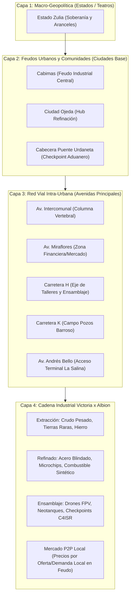
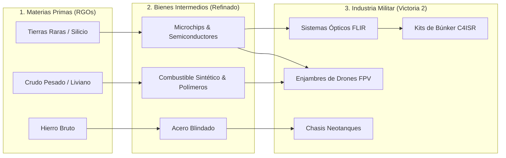

# 🏙️ ARQUITECTURA DE FEUDOS URBANOS, CADENA INDUSTRIAL ALICE Y ECONOMÍA ALBION

> **Documento:** `docs/ARQUITECTURA_FEUDOS_CADENA_INDUSTRIAL_ALICE_ALBION.md`  
> **Clasificación:** Diseño de Sistemas, Microgestión Urbana, Cadena de Suministro Militar 2026 y Economía Player-Driven  
> **Inspiración:** *Project Alice 1.3.0* (Victoria 2 Economy) + *Albion Online* (Mercado P2P Crafteado) + *OpenPlace / WPlace* (Coordenadas Reales de Assets)  
> **Área Geográfica Inicial:** Municipio Cabimas (Centro, Ambrosio, La Salina, Las Cabillas, Punta Gorda)

---

## 1. RESUMEN EJECUTIVO Y MANIFIESTO DEL SISTEMA

El paso de la **geopolítica macro** (regiones/estados) a la **microgestión táctica urbana** transforma las ciudades y comunidades en **Feudos de Clanes**. En lugar de ser simples polígonos decorativos, cada ciudad se compone de una red de **avenidas y calles principales**, en cuyas intersecciones y parcelas los clanes erigen infraestructuras militares, refinerías, talleres de chips y puestos de control.

---

## 2. LA RED VIAL INTRA-URBANA: MÁS ALLÁ DE LAS TRONCALES NACIONALES

A diferencia de los simuladores convencionales que solo dibujan autopistas interurbanas, el motor cartográfico C4ISR incorpora la malla vial urbana con jerarquía de 3 niveles:

| Nivel | Tipo de Vía | Ejemplos en Cabimas | Capacidad Logística | Velocidad Base | Uso Táctico |
|---|---|---|---|---|---|
| **L1: Troncal Interurbana** | Autopista / Corredor Pesado | Troncal Lara-Zulia, Av. Intercomunal | 100% Throughput | 80 km/h | Tránsito de convoyes pesados entre ciudades. |
| **L2: Arteria Urbana Principal** | Avenida de Alta Densidad | Av. Miraflores, Av. Universidad, Av. Andrés Bello | 75% Throughput | 50 km/h | Conexión con Terminal La Salina y zonas de mercado. |
| **L3: Colectora Industrial** | Carreteras Alfanuméricas | Carretera H, Carretera J, Carretera K (Barroso) | 55% Throughput | 40 km/h | Acceso a refinerías, patios de tanques y pozos petroleros. |

---

## 3. LOS FEUDOS DE CLANES: GESTIÓN DE BASES EN COMUNIDADES

Un **Feudo de Clan** es un distrito urbano controlado por un clan donde sus miembros pueden:
1. **Desplegar Edificios en Coordenadas Exactas (OpenPlace):**
   * Los assets de edificios existentes (`city`, `factory`, `airport`, `seaport`, `radar`, `silo`) se proyectan sobre coordenadas lat/long precisas en solares adyacentes a las avenidas.
2. **Establecer Puestos de Control (Checkpoints):**
   * En las intersecciones viales (ej. cruce Av. Intercomunal con Carretera H).
   * Cobro de peajes automáticos a convoyes de otros clanes o bloqueo total mediante guarniciones IA.
3. **Construcción en Zonas Foráneas / Neutrales:**
   * Clanes con suficiente nivel de cuenta y poderío logístico pueden levantar puestos avanzados y refinerías en comunidades no dominadas, arriesgando la inversión si no mantienen una guarnición que la proteja.

---

## 4. LA CADENA INDUSTRIAL ESTILO VICTORIA 2 & ECONOMÍA PLAYER-DRIVEN TIPO ALBION

Siguiendo el principio de *Albion Online*, **los NPCs no generan equipamiento militar infinito del aire**. Cada tanque, dron, munición y búnker desplegado en el mapa debe ser crafteado por los jugadores a partir de recursos extraídos y refinados:

### Tabla de Recetas y Costes de Fabricación Realistas (Guerra 2026):
* **Kit de Checkpoint Nivel 1:** $500$ Acero Blindado + $200$ Cemento Refinado + $50$ Combustible.
* **Fortín C4ISR Nivel 3 (C-UAS / EW):** $2,500$ Acero + $800$ Cemento + $450$ Microchips + $200$ Óptica FLIR.
* **Neotanque Pesado:** $4,000$ Acero Blindado + $800$ Microchips + $1,200$ Combustible + $300$ Munición Pesada.
* **Enjambre de Drones FPV (x10):** $300$ Microchips + $150$ Polímeros + $200$ Baterías de Litio.

---

## 5. PROYECCIÓN DE ASSETS EN COORDENADAS OPENPLACE

Los edificios y tropas se renderizan directamente en la capa WebGL de MapLibre utilizando los spritesheets existentes (`public/assets/spritesheets/`):
* `neutral.png / .json`: Ciudades (`city`), Fábricas (`factory`), Puertos (`seaport`), Radares (`commtower`).
* Facciones heráldicas: `orange-star.png`, `blue-moon.png`, `black-hole.png`.
* Cada entidad en el mapa tiene un registro en la base de datos con coordenadas geodésicas `[lng, lat]`, salud `current_hp / max_hp`, clan propietario y cola de producción activa.
