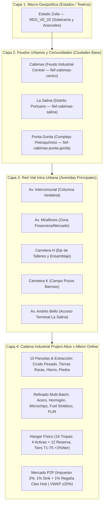
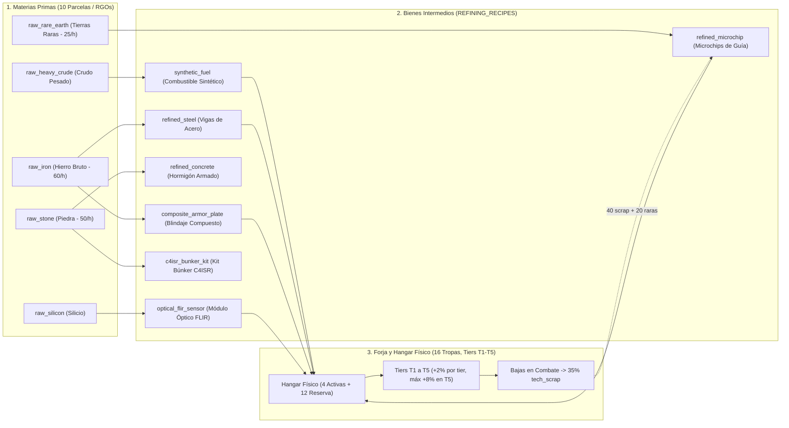

# 🏙️ ARQUITECTURA DE FEUDOS URBANOS, CADENA INDUSTRIAL ALICE Y ECONOMÍA ALBION

> **Documento:** `docs/ARQUITECTURA_FEUDOS_CADENA_INDUSTRIAL_ALICE_ALBION.md`  
> **Clasificación:** Diseño de Sistemas, Microgestión Urbana, Cadena de Suministro Militar 2026 y Economía Player-Driven  
> **Inspiración:** *Project Alice 1.3.0* (Victoria 2 Economy) + *Albion Online* (Mercado P2P Crafteado) + *OpenPlace / WPlace* (Coordenadas Reales de Assets y Ticker Continuo)  
> **Área Geográfica Inicial:** Municipio Cabimas — Teatro Operacional `REG_VE_02` (Centro, Ambrosio, La Salina, Las Cabillas, Punta Gorda)  
> **Módulos Ejecutables de Referencia (`@domains/economy` & `@domains/world`):**  
> - `src/domains/economy/services/fiefBuildingService.ts` (`fiefBuildingService`, `FiefBuildingService`, `applyTacticalMarkEffects`)  
> - `src/domains/economy/core/industrialEngine.ts` (`IndustrialEngine`, `REFINING_RECIPES`, `PLOT_UNLOCK_TABLE`)  
> - `src/domains/economy/core/strategicAndProductionEngine.ts` (`calculateUnitProductionDuration`, `calculateUnitProductionCost`, `evaluateStrategicNodes`)  
> - `src/domains/economy/core/upkeepEngine.ts` (`TerritorialUpkeepEngine`, `calculateImperialUpkeep`, `calculateRgoRegionalYield`)  
> - `src/domains/economy/hooks/useTerritoryEconomyTicker.ts` (`useTerritoryEconomyTicker`)  
> - `src/domains/economy/hooks/useUserHangar.ts` & `src/domains/economy/components/UnitHangarModal.tsx`  
> - `src/domains/economy/components/IndustrialComplexView.tsx` & `src/domains/economy/components/P2PMarketplaceView.tsx`  
> - `src/domains/world/core/roadNetworkEngine.ts` & `src/domains/world/components/TacticalWorldMap.tsx`  
> - `src/shared/types/tacticalRoadTypes.ts` (`ClanFief`, `FiefBuilding`, `FIEF_BUILDING_SPECS`) & `src/shared/types/metagame.ts` (`MASTER_METAGAME_CONSTANTS`)

---

## 1. RESUMEN EJECUTIVO Y MANIFIESTO DEL SISTEMA

El paso de la **geopolítica macro** (regiones/estados) a la **microgestión táctica urbana** transforma las ciudades y comunidades en **Feudos de Clanes**. En lugar de ser simples polígonos decorativos, cada ciudad se compone de una red de **avenidas y calles principales**, en cuyas intersecciones y **10 parcelas industriales por feudo/comandante** los clanes erigen infraestructuras militares, refinerías, talleres de chips y puestos de control.

Toda la economía de feudos opera bajo los **7 Pilares Canónicos Inmutables**:
1. **Pilar 1 (CERO CARTAS — Almacén Físico de 16 Tropas):** No existen mazos de cartas, coleccionables TCG/CCG ni gacha. Cada comandante administra un **Almacén Físico / Hangar de 16 tropas máximo (4 slots de despliegue activo + 12 en reserva)**.
2. **Pilar 2 (Escala Balística 1 a 100 HP Enteros):** Toda unidad opera en la escala continua de `1` a `100 HP` enteros.
3. **Pilar 3 (Derrota por Aniquilación):** Llegar a `0` tropas supervivientes en el tablero provoca la derrota inapelable.
4. **Pilar 4 (Progresión Horizontal T1 a T5 de +2% por Tier):** Los chasis forjados escalan estrictamente un **$+2\%$ por tier** ($+0\%$ en T1, $+2\%$ en T2, $+4\%$ en T3, $+6\%$ en T4 y **máximo $+8\%$ en T5**).
5. **Pilar 5 (Conquista de Capitales con Buff Regional):** El control de Capitales otorga el **Buff Regional Canónico (+5% recursos/logística en la región)** además de bonificaciones de producción y energía.
6. **Pilar 6 (Pérdida Física Real y Reciclaje de Chatarra al 35%):** Toda unidad destruida se pierde físicamente del hangar, recuperándose exactamente el **35% en chatarra tecnológica (`tech_scrap` / `SALVAGE_TECH_SCRAP_RATE = 0.35`)**.
7. **Pilar 7 (Human Handshake de 120 Segundos):** En todo asedio territorial o urbano, el defensor dispone de **120 segundos (2 minutos)** para asumir el mando directo antes de que tome el control la IA de Guarnición (Niveles 1 a 5).
8. **Regla Financiera Canónica P2P:** El Mercado Libre P2P aplica un **impuesto total estricto del 2%** (**1% quemado en Sink deflacionario + 1% regalía al Clan dueño del Hub regional**) y **bandas de precios dinámicas VWAP Collar $\pm 25\%$**.

---

## 2. LA RED VIAL INTRA-URBANA: MÁS ALLÁ DE LAS TRONCALES NACIONALES

A diferencia de los simuladores convencionales que solo dibujan autopistas interurbanas, el motor cartográfico C4ISR (`src/domains/world/core/roadNetworkEngine.ts`) incorpora la malla vial urbana con jerarquía de 3 niveles:

| Nivel | Tipo de Vía (`RoadClass`) | Ejemplos en Cabimas | Capacidad Logística | Velocidad Base | Uso Táctico |
|---|---|---|---|---|---|
| **L1: Troncal Interurbana** | `highway` / Corredor Pesado | Troncal Lara-Zulia, Av. Intercomunal | 100% Throughput | 80 km/h | Tránsito de convoyes pesados entre ciudades. |
| **L2: Arteria Urbana Principal** | `urban_artery` / `avenue` | Av. Miraflores, Av. Universidad, Av. Andrés Bello | 75% Throughput | 50 km/h | Conexión con Terminal La Salina y zonas de mercado. |
| **L3: Colectora Industrial** | `industrial_collector` | Carretera H, Carretera J, Carretera K (Barroso), Carretera F | 55% Throughput | 40 km/h | Acceso a refinerías, patios de tanques y pozos petroleros. |

---

## 3. LOS FEUDOS DE CLANES, TICKER WPLACE Y MARCAS TÁCTICAS (`fiefBuildingService.ts`)

Un **Feudo de Clan (`ClanFief`)** es un distrito urbano controlado por un clan (administrado en `src/domains/economy/services/fiefBuildingService.ts`) donde sus miembros operan sobre el terreno:

1. **Despliegue de Edificios en Coordenadas Exactas (`placeBuilding`):**
   * Los assets de edificios (`FiefBuilding`) se proyectan sobre coordenadas geodésicas `[lng, lat]` en solares adyacentes a las avenidas.
   * **Regla Inviolable de Adyacencia Vial:** Todo edificio requiere fondos suficientes en la tesorería del clan (`energyCredits >= spec.initialCostEc`) y estar ubicado a **$\le 150\text{ m}$ ($0.15\text{ km}$) de una carretera transitable** (`roadNetworkEngine.isLocationAdjacentToRoad(order.location, 0.15)`).
2. **Catálogo Canónico de Edificios de Feudo (`FIEF_BUILDING_SPECS` en `src/shared/types/tacticalRoadTypes.ts`):**

| Tipo (`FiefBuildingType`) | Nombre Oficial | Coste Inicial (`EC`) | Upkeep Horario (`EC/h`) | Integridad (`maxHp`) | Distancia Máx. Vial | Sprite MapLibre |
|:---|:---|:---:|:---:|:---:|:---:|:---:|
| `refinery` | **Refinería y Complejo Petroquímico** | $12,000\text{ EC}$ | $250\text{ EC/h}$ | $8,000\text{ HP}$ | $150\text{ m}$ | `factory` |
| `microchip_foundry` | **Taller de Fundición de Microchips y Silicio** | $18,000\text{ EC}$ | $380\text{ EC/h}$ | $6,500\text{ HP}$ | $150\text{ m}$ | `city` |
| `weapons_factory` | **Fábrica de Armamento y Chasis Militares** | $15,000\text{ EC}$ | $310\text{ EC/h}$ | $10,000\text{ HP}$ | $150\text{ m}$ | `factory` |
| `logistics_silo` | **Silo Logístico y Patio de Carga** | $6,000\text{ EC}$ | $110\text{ EC/h}$ | $5,000\text{ HP}$ | $100\text{ m}$ | `silo` |
| `radar_station` | **Estación de Radar EW y Detección Térmica** | $9,500\text{ EC}$ | $190\text{ EC/h}$ | $4,000\text{ HP}$ | $150\text{ m}$ | `radar` |
| `seaport_terminal` | **Terminal Marítimo y Muelle de Exportación** | $20,000\text{ EC}$ | $450\text{ EC/h}$ | $12,000\text{ HP}$ | $200\text{ m}$ | `seaport` |

3. **Ciclo Horario de Mantenimiento y Bloqueo de Suministros (`processHourlyBuildingTick`) y Ticker Wplace (`useTerritoryEconomyTicker`):**
   * En cada tick horario (`processHourlyBuildingTick`), si el segmento vial adyacente está bloqueado por combate o sabotaje (`roadSeg.isBlocked`), el edificio entra en estado `isIsolatedFromSupply = true` y detiene operaciones (`isOperating = false`). Si la tesorería del clan no cubre `hourlyUpkeepEc`, también se apaga.
   * Simultáneamente, el **Ticker Económico Continuo estilo Wplace** (`src/domains/economy/hooks/useTerritoryEconomyTicker.ts`) acumula recursos minuto a minuto (`ecPerMinute`, `steelPerMinute`) ponderados por `TerritorialUpkeepEngine.calculateClanTerritorialUpkeep` (`src/domains/economy/core/upkeepEngine.ts`) y por el **Buff Regional de Capital (+5% recursos/logística en la región, Pilar 5)**.
4. **Soberanía Aduanera Portuaria y Embargos Comerciales (`setFiefTariff`, `declareCommercialEmbargo`, `executeSeaportDischarge`):**
   * El clan controlador de un feudo portuario (como `fief-cabimas-salina`) puede declarar embargos comerciales contra clanes hostiles (bloqueando descargas de convoyes en sus muelles) o fijar peajes aduaneros de descarga portuaria (`0%` a `25%`) sobre convoyes foráneos (mientras que el **Mercado Libre P2P mantiene de forma invariable su impuesto canónico del 2%: 1% Sink + 1% Regalía al Clan dueño del Hub regional y bandas VWAP Collar $\pm 25\%$**).
5. **Efectos Tácticos Reales de Marcas WPlace (`applyTacticalMarkEffects` en `src/domains/economy/services/fiefBuildingService.ts`):**
   * `danger_mine`: Inflige **$400\text{ HP}$** de daño directo a convoyes o unidades hostiles en un radio de **$200\text{ m}$ ($0.2\text{ km}$)**.
   * `rally_strike`: Confiere **$+10\%$ de ataque y $+10\%$ de moral** a tropas aliadas del clan en un radio de **$500\text{ m}$ ($0.5\text{ km}$)**.
   * `recon`: Disipa la niebla de guerra en un radio de **$5$ celdas espaciales** ($\approx 500\text{ m}$).

---

## 4. LA CADENA INDUSTRIAL ESTILO PROJECT ALICE (VICTORIA 2) & ECONOMÍA PLAYER-DRIVEN TIPO ALBION

Siguiendo el principio de *Project Alice* y *Albion Online*, **los NPCs no generan equipamiento militar de élite del aire**. Cada tanque, caza, artillería y kit de búnker desplegado en el mapa debe ser forjado por los jugadores a partir de recursos extraídos en las **10 parcelas territoriales** (`src/domains/economy/core/industrialEngine.ts`) y refinados en hornos multi-batch:

### 4.1 Recetas de Refinado (`REFINING_RECIPES` en `src/domains/economy/core/industrialEngine.ts`):
* **`refined_steel` (Vigas de Acero Militar):** $100$ `raw_iron` $\to 10$ vigas en $240\text{ min}$ ($4\text{h}$).
* **`refined_concrete` (Hormigón Armado):** $80$ `raw_stone` $\to 15$ bloques en $120\text{ min}$ ($2\text{h}$).
* **`refined_microchip` (Microprocesadores de Guía):** $150$ `raw_rare_earth` $\to 5$ chips en $240\text{ min}$ ($4\text{h}$).
* **`synthetic_fuel` (Combustible Sintético y Polímeros):** $100$ `raw_heavy_crude` $\to 20$ unidades en $180\text{ min}$ ($3\text{h}$).
* **`optical_flir_sensor` (Módulo Óptico Térmico FLIR):** $80$ `raw_silicon` $\to 4$ sensores en $300\text{ min}$ ($5\text{h}$).
* **`composite_armor_plate` (Placa de Blindaje Compuesto):** $120$ `raw_iron` $\to 8$ placas en $270\text{ min}$ ($4.5\text{h}$).
* **`c4isr_bunker_kit` (Kit Prefabricado de Búnker C4ISR):** $200$ `raw_stone` $\to 2$ kits en $360\text{ min}$ ($6\text{h}$).

### 4.2 Forja de Unidades para el Hangar Físico de 16 Tropas (`strategicAndProductionEngine.ts` & `useUserHangar.ts`):
* **Capacidad Estructural (Pilar 1):** El almacén físico aloja hasta **16 unidades por comandante (4 en slots de despliegue activo + 12 en reserva)**, con **CERO cartas**.
* **Progresión Horizontal T1–T5 (Pilar 4):** Cada unidad se ensambla en un Tier $T \in \{1, 2, 3, 4, 5\}$ con un bono estricto de **$+2\%$ por tier** ($+0\%, +2\%, +4\%, +6\%, +8\%$ máximo en T5). El coste base escala según `calculateUnitProductionCost`: $\text{fundsG} = \text{round}(2500 \times 1.25^{T-1})$, $\text{energyCreditEc} = \text{round}(150 \times 1.25^{T-1})$, $\text{steelPlates} = 4T$, y $\text{microchips} = 2(T-2)$ para $T \ge 3$ (con excepción del Kit Básico F2P de Infantería T1 y Recon T1, que tienen $0\text{s}$ de forja y $0$ materiales).
* **Reciclaje de Chatarra al 35% (Pilar 6):** Cuando una tropa es destruida en combate (`settleCombatLossesAndScrap` en `src/domains/tactics/core/tacticalCombatSeamlessIntegration.ts`) o desguazada voluntariamente en el hangar (`scrapUnit` en `src/domains/economy/hooks/useUserHangar.ts`), se elimina físicamente del inventario y retorna exactamente el **35% de su valor base en chatarra tecnológica (`tech_scrap`, `RECYCLE_SCRAP_RATE = 0.35` / `SALVAGE_TECH_SCRAP_RATE = 0.35`)**.

---

## 5. PROYECCIÓN DE ASSETS EN COORDENADAS OPENPLACE (`TacticalWorldMap.tsx`)

Los edificios (`fiefBuildingService.toGeoJSON()`) y tropas desplegadas se renderizan directamente en la capa WebGL de MapLibre (`src/domains/world/components/TacticalWorldMap.tsx`) utilizando los spritesheets existentes (`public/assets/spritesheets/`):
* `neutral.png / .json`: Ciudades (`city`), Fábricas (`factory`), Puertos (`seaport`), Radares (`radar` / `commtower`), Silos (`silo`).
* Facciones heráldicas: `orange-star.png`, `blue-moon.png`, `black-hole.png`.
* Cada entidad en el mapa se sincroniza en tiempo real con Supabase (`public.tactical_fief_constructions` y `public.tactical_spatial_deployments`, Migración `20261107_theatre_cabimas_realtime.sql`) con coordenadas geodésicas `[lng, lat]`, salud `current_hp / max_hp`, clan propietario y estado operativo.
