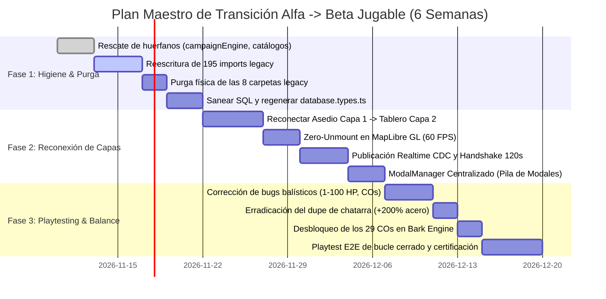

# 🛰️ DIAGNÓSTICO ESTRATÉGICO, RADIOGRAFÍA DE PUNTOS CIEGOS Y ROADMAP HACIA LA BETA JUGABLE
**GEOTACTICS ONLINE (Tactical Command: Wars of Legacy)**  
**Comité de Auditoría:** Enjambre de 10 Auditores Especializados (B01 a B10) + Lead Game Director (B11)  
**Fecha de Certificación:** 07 de Noviembre de 2026  
**Documento Rector:** `docs/DIAGNOSTICO_META_Y_ROADMAP_BETA.md`  
**Estado:** Dictamen Estratégico Aprobado — Plan Maestro de Transición Alfa -> Beta

---

## 1. RADIOGRAFÍA CRÍTICA DE PUNTOS CIEGOS Y SESGOS DEL FLUJO ACTUAL

A pesar de que el proyecto compila limpiamente (`npm run build`, exit code 0) y aprueba sus suites deterministas (`npm run test:all`, `npm run test:geotactics`), la auditoría transversal del Comité de 10 Subagentes Especializados ha desvelado que el proyecto sufre de un grave **Sesgo de Complacencia Automatizada**: el software parece completo y sólido porque sus pruebas unitarias y de estrés evalúan subsistemas aislados en código legacy, ocultando que **el bucle de juego principal está roto, la arquitectura modular está infiltrada por dependencias zombi y las reglas matemáticas contienen bucles de explotación infinita**.

A continuación, se exponen los **3 Puntos Ciegos Críticos** del equipo de desarrollo:

```
+----------------------------------------------------------------------------------------------------+
|                                    LOS 3 PUNTOS CIEGOS CRÍTICOS                                    |
+----------------------------------------------------------------------------------------------------+
| 1. "DOMAIN MOCKERY" Y ARQUITECTURA FANTASMA:                                                       |
|    Coexistencia de 8 carpetas legacy con 195 imports cruzados en 67 archivos de producción.        |
|    Build inflado con 576 kB en chunk 'engine-core', migraciones SQL 23-31 omitidas en script      |
|    consolidado, y tipado desfasado forzando (supabase as any).                                      |
+----------------------------------------------------------------------------------------------------+
| 2. LA GRAN DESCONEXIÓN DEL CORE LOOP ("CLICKER DE INTERFACES"):                                    |
|    Capa 1 (Geopolítica) y Capa 2 (Tablero Táctico) están amputadas. El asedio es una resta en CPU. |
|    El botón de combate aborta forzando setMainNav('lobby'). Capa 2 es un búnker inalcanzable.      |
|    La tabla territorial_battle_sessions JAMÁS fue agregada a la publicación realtime.             |
+----------------------------------------------------------------------------------------------------+
| 3. CORRUPCIÓN MATEMÁTICA Y REGRESIONES CANÓNICAS:                                                  |
|    Dupe de acero del +200% al desguazar chasis T1.                                                 |
|    Poderes de CO rompen unidades a 10 HP (Andy destruye 70 HP de sus tropas).                      |
|    Inversión defensiva (Kanbei sufre +20% daño). Neotanque inexistente en matriz de daño.          |
|    IA Nivel 5 (MCTS) es un stub inexistente. Captura en 1 turno para toda infantería.              |
+----------------------------------------------------------------------------------------------------+
```

---

### PUNTO CIEGO 1: El Espejismo Arquitectural ("Domain Mockery") y Deuda Operativa
- **Doble Realidad de Código**: Nominalmente se estructuraron los 4 dominios (`@domains/world`, `@domains/tactics`, `@domains/economy`, `@domains/game-feel`) y `@shared`. Sin embargo, 8 directorios legacy monolíticos (`src/engine/`, `src/services/`, `src/components/`, `src/hooks/`, `src/types/`, `src/utils/`, `src/lib/`, `src/editor/`) siguen vivos en el repositorio con más de 160 archivos.
- **Infección de Código de Producción**: 67 archivos dentro de `src/domains/` importan activamente de `src/engine/` (114 imports), `src/types/` (37 imports) y `src/services/` (13 imports). Vite se ve forzado a empaquetar un chunk duplicado de 576.11 kB (`engine-core`), demorando la compilación a más de 40 segundos.
- **Suites de Pruebas Falsas**: `package.json` ejecuta exclusivamente pruebas sobre `src/engine/*.test.ts`. Peor aún: 32 de las 35 suites ubicadas en `src/domains/*/__tests__/` importan directamente de `src/engine/` y usan valores no canónicos (`hp: 10` y `maxHp: 10` en 150 instancias, violando el Pilar 2).
- **Abandono del Script SQL Consolidado**: `supabase/CONSOLIDATED_FULL_DATABASE_DEPLOY.sql` está congelado en la migración 22. Las migraciones 23 a 31 (9 migraciones completas con el mapa de Venezuela, soberanía dual, 16 tropas y vulnerabilidades de asedio) no forman parte del script maestro, el cual sigue conteniendo tablas deprecadas de cartas y cofres gacha (`user_cards`).
- **Invasión de `(supabase as any)`**: `database.types.ts` carece de las 13 tablas modernas de las migraciones 26-31. Esto obligó a insertar 12 casts descontrolados de `(supabase as any)` en los servicios centrales de persistencia.

---

### PUNTO CIEGO 2: La Desconexión del Core Loop ("Clicker de Interfaces" vs Simulador Táctico)
- **El Combate Táctico está Desactivado**: En `src/domains/world/core/politicalAliceEngine.ts`, el flag `THREE_LAYER_ARCHITECTURE.layer2TacticalCombat.enabled = false` desvía cualquier declaración de asedio en el mapa hacia un autoresuelve instantáneo (`alice_political_autoresolve`), restando TCP matemáticamente sin abrir jamás la cuadrícula 20x20.
- **El Botón Mudo de la War Room**: En `src/App.tsx` (líneas 555-578), la función `handleStartMatchFromLobby` reproduce un toque de corneta militar (`playDeployHorn`), dispara un bark de Mayor Stella y fuerza `setMainNav('lobby')`. El usuario jamás entra al combate táctico.
- **Código Zombi en Producción**: `<TerritorySiegeModal>`, `isSiegeModalOpen` y `activeSiegeRegionId` son inalcanzables en la UI (nunca se activan). La vista táctica `CombatTheaterView` es un búnker sellado en tiempo de ejecución.
- **Falla Silenciosa de Netcode en Supabase**: La tabla `territorial_battle_sessions` **nunca fue añadida a la publicación `supabase_realtime`** en ninguna migración SQL. Postgres jamás emite eventos de asedio en tiempo real.
- **Canal P2P Desconectado y Reconexión Rota**: `useMatchSync.ts` no está montado en `CombatTheaterView` ni en `App.tsx`, y la RPC `rpc_reconnect_match_state` busca datos en tablas de snapshots (`match_turn_snapshots`) donde ningún servicio escribe, devolviendo `null` y congelando al jugador reconectado de forma perpetua.

---

### PUNTO CIEGO 3: Corrupción Matemática, Explotaciones Infinitas y Regresiones Balísticas
- **El Bucle de Duplicación Infinita de Acero (+200%)**:
  - En `settle_territorial_combat_losses` y `settleCombatLossesAndScrap`, un chasis T1 destruido acredita 17 de chatarra tecnológica (`tech_scrap`).
  - Al refundir en la fundición (2 chatarra $\to$ 1 placa de acero), el jugador recibe $\lfloor 17 / 2 \rfloor = 8$ placas de acero.
  - El costo de forjar un chasis T1 en `industrialEngine.ts` es de solo **4 placas de acero**.
  - **Resultado:** Autodestruir un tanque devuelve el doble del material invertido (+200%), destruyendo la economía del metajuego.
- **Fuga de Materiales en el Mercado P2P**: La RPC `execute_p2p_market_transaction` descuenta el dinero y acredita la unidad física si es un chasis, pero **no tiene código para acreditar materias primas ni materiales refinados** en `user_industrial_inventory`. El comprador paga EC y el vendedor cobra, pero los materiales se evaporan.
- **Poderes de CO Letales contra Tropas Propias**:
  - Andy cura `Math.min(10, u.hp + 2)`. En la escala 1-100 HP, una unidad aliada con 80 HP pasa a tener **10 HP** al recibir Hyper Repair (pierde 70 HP).
  - Los ataques de Hawke y Sturm infligen 1 a 8 HP sobre barras de 100 HP (1% a 8% de daño en vez de 10% a 80%).
  - La velocidad de carga del medidor de CO divide el costo entre 10 en vez de 100, cargando estrellas **10 veces más rápido**.
- **Inversión Defensiva**: En `combat.ts:173`, la fórmula `coDefenseModifier: Math.round((1 - coDefenseBonus) * 100)` invierte el signo defensivo. El Comandante Kanbei (+20% armadura) recibe 20% MÁS de daño, mientras que Grimm (-20% armadura) recibe 20% MENOS de daño.
- **Arquetipos Fantasma**: El `neotank`, `apc`, `t_copter` y `missile` no existen en `CANONICAL_DAMAGE_CHART`. Si se despliega un Neotanque, no puede hacer daño a nadie ni recibir daño de ninguna unidad.
- **Captura en 1 Turno**: Con la escala 1-100 HP, cualquier unidad con $\ge 20$ HP captura un Cuartel General de 20 puntos en un solo turno, destruyendo la cadencia táctica.
- **Disparo Indirecto Ciego**: La artillería ataca casillas en niebla de guerra con 100% de precisión sin necesidad de visión de explorador.
- **IA de Guarnición Nivel 5 (`mcts_legendary`) Ficticia**: Es un stub cosmético; `BotDifficulty` solo soporta heurísticas voraces de 1 paso y ninguna IA activa poderes de CO.
- **Amordazamiento del Bark Engine**: `singleSubjectLock = true` en `barkEngine.ts` es privado y bloquea la voz de los 28 comandantes restantes, forzando la voz y textos de Stella en todas las viñetas y partidas.

---

## 2. EVALUACIÓN DE MADUREZ DE LOS 4 DOMINIOS (% REAL PARA LA BETA)

| Dominio Funcional | % Madurez Código | % Conectividad Viva | % Madurez Real Beta | Dictamen Crítico del Comité de Auditoría |
| :--- | :---: | :---: | :---: | :--- |
| **@domains/world**<br>*(Cartografía, Asedios, Red Vial, Clanes)* | **92%** | **45%** | **68%** | **Excelente base espacial, integración rota.** MapLibre GL v6 vuela a 60 FPS con proyección $O(1)$ y red vial de 15 nodos en Cabimas. Sin embargo: sufre de tirones por `setData` disparado por `hoveredCell`, filtro CSS `blur` en el contenedor WebGL, y la declaración de asedios no abre el combate táctico. |
| **@domains/tactics**<br>*(Motor Balístico, 29 COs, IA Guarnición)* | **88%** | **30%** | **59%** | **Motor de combate terminado pero aislado como búnker.** El simulador TBS 20x20 es fiel a Advance Wars, pero está desconectado del lobby geopolítico. Tiene bugs balísticos graves por clampeo a 10 HP en poderes de CO, inversión de defensa, captura en 1 turno y ausencia de Neotanque en la matriz de daño. |
| **@domains/economy**<br>*(10 Parcelas, Hangar 16 Tropas, Mercado P2P)* | **85%** | **50%** | **67%** | **Concepto de Doble Llave impecable, matemáticas defectuosas.** La forja de chasis y el mercado P2P al 2% (1% burn + 1% clan) están bien diseñados, pero el dupe de chatarra (+200% acero), la omisión de inventario en la RPC de mercado y la falta de restricción a 16 tropas en base de datos impiden su lanzamiento comercial. |
| **@domains/game-feel**<br>*(Web Audio procedural, Háptica, Bark Engine)* | **90%** | **60%** | **75%** | **Inmersión artística sobresaliente, cableado desalineado.** Síntesis procedural 16-bit de cañones y ducking dinámico excelentes. Sin embargo: botones mudos por claves de audio desalineadas, invocación de perfiles hápticos inexistentes, y el Bark Engine tiene amordazados a 28 de los 29 comandantes por `singleSubjectLock`. |
| **@shared & Backend**<br>*(Supabase, 31 Migraciones, Netcode)* | **70%** | **25%** | **47%** | **El eslabón más débil del proyecto.** `territorial_battle_sessions` fuera de publicación CDC, reconexión de partidas rota por ausencia de snapshots, script consolidado omitiendo 9 migraciones y bugs de sintaxis SQL apuntando a tablas inexistentes (`player_profiles`). |
| **PROMEDIO PONDERADO DEL PROYECTO** | **85.0%** | **42.0%** | **63.2%** | **ESTADO ALFA ESTABILIZADO EN MOTOR / DESCONECTADO EN EXPERIENCIA DE USUARIO.** |

---

## 3. EL "META" DE DESARROLLO: METODOLOGÍA, HERRAMIENTAS Y CADENCIA DE SPRINTS

Para superar el estado actual y alcanzar la **BETA JUGABLE CERRADA** en 6 semanas de desarrollo determinista, se establece el siguiente **META de Desarrollo**:

```
+----------------------------------------------------------------------------------------------------+
|                                    EL "META" DE DESARROLLO CANÓNICO                                 |
+----------------------------------------------------------------------------------------------------+
| 1. CADENCIA DE TRABAJO:                                                                            |
|    Sprints semanales de 5 días con "Freeze de Calidad" obligatorio los viernes.                     |
|    Regla de Cero Regresiones: Ningún PR se aprueba sin compilar limpio y pasar test:all.           |
+----------------------------------------------------------------------------------------------------+
| 2. HIGIENE ARQUITECTÓNICA "ZERO-COMPROMISE":                                                       |
|    Prohibición absoluta de imports legacy (@/src/engine, @/src/services).                          |
|    Uso exclusivo de barriles públicos (@domains/*, @shared).                                       |
|    Erradicación definitiva de (supabase as any) mediante regeneración estricta de database.types.   |
+----------------------------------------------------------------------------------------------------+
| 3. CADENA DE VERIFICACIÓN AUTOMÁTICA EN 4 NIVELES (QUALITY GATE):                                  |
|    Nivel 1: Compilación limpia sin warnings de Vite (npm run build).                                |
|    Nivel 2: Verificación de tipos estricta sin TypeScript errors (npx tsc --noEmit).                |
|    Nivel 3: Suite de Dominio Agregada bajo un solo proceso Node.js (<10s).                          |
|    Nivel 4: Playtest E2E Multimodal con Playwright sobre el Canvas real (test:qa).                 |
+----------------------------------------------------------------------------------------------------+
```

### Herramientas e Instrumentación del Equipo:
- **Playwright Test Runner**: Pruebas E2E sobre Chromium inspeccionando `window.__TACTICAL_QA_BRIDGE__` (`qaHarness.ts`).
- **Vitest / TSX Test Harness**: Reemplazo de las 13 ejecuciones concatenadas de `npx tsx` por un runner agregador estructurado (`scripts/runAllDomainTests.ts`).
- **Supabase CLI Local**: Migraciones SQL idempotentes con test de despliegue sobre base de datos Postgres en limpio para verificar que `CONSOLIDATED_FULL_DATABASE_DEPLOY.sql` funcione sin errores.
- **Web Audio Context Mock**: Harness de audio para verificar que todas las llamadas a `playCue` tengan una clave válida en `AUDIO_SYNTHESIS_CATALOG`.

---

## 4. ROADMAP OPERATIVO HACIA LA BETA (PLAN DE 3 FASES)



---

### FASE 1: HIGIENE ARQUITECTÓNICA, PURGA LEGACY Y SANEAMIENTO SQL (Semanas 1 y 2)
**Objetivo:** Erradicar la deuda técnica, sincronizar la base de datos con las 31 migraciones y eliminar los 576 kB de código zombi.

1. **Rescate de Archivos Huérfanos en `src/engine/`**:
   - Mover `src/engine/campaignEngine.ts` a `src/domains/tactics/core/campaignEngine.ts`.
   - Modificar `scripts/syncCatalogsFromDb.ts` para que sincronice los catálogos en `src/shared/data/catalogs.generated.ts`.
   - Migrar las 10 suites de test huérfanas a sus dominios respectivos (`spatialRoadIndex`, `stateSovereignty`, `vulnerabilityWindows`, etc.).
2. **Reescritura Determinista de los 195 Imports Legacy**:
   - Reemplazar en los 67 archivos de producción cualquier referencia a `@/src/engine`, `@/src/services`, `@/src/components`, `@/src/hooks`, `@/src/types` y `@/src/lib` por sus equivalentes en `@domains/*` y `@shared`.
   - Modificar `src/App.tsx` para importar `CommanderProfileModal` desde `@shared` y `CosmeticSkin` desde `@shared/lib/shopData`.
3. **Purga Física de las 8 Carpetas Legacy**:
   - Ejecutar la eliminación física permanente de: `src/engine/`, `src/services/`, `src/components/`, `src/hooks/`, `src/types/`, `src/utils/`, `src/lib/`, `src/editor/`.
   - Retirar la regla de chunking de `src/engine/` en `vite.config.ts`.
4. **Saneamiento de Base de Datos y Generación de Tipos**:
   - Crear la migración `supabase/migrations/20261110_fix_database_audit_regressions.sql`:
     - Corregir referencias a `public.player_profiles` $\to$ `public.profiles`.
     - Agregar restricción única obligatoria: `ALTER TABLE public.user_unit_hangar ADD CONSTRAINT uq_user_unit_hangar UNIQUE (user_id, unit_code, tier);`.
     - Implementar el trigger que limita la capacidad del hangar a 16 tropas físicas (`check_user_hangar_capacity_limit`).
     - Incorporar `ALTER PUBLICATION supabase_realtime ADD TABLE public.territorial_battle_sessions;`.
     - Corregir la RPC `execute_p2p_market_transaction` para que acredite materias primas y materiales refinados en `user_industrial_inventory`.
     - Restaurar la liquidación en lote de `settle_territorial_combat_losses`.
   - Regenerar `src/shared/types/database.types.ts` con todas las 13 tablas modernas y purgar las interfaces de cartas gacha.
   - Reconstruir `supabase/CONSOLIDATED_FULL_DATABASE_DEPLOY.sql` para abarcar las migraciones 1 a 31 sin tablas gacha.

---

### FASE 2: RECONEXIÓN DE CAPAS, ZERO-UNMOUNT Y NETCODE REALTIME (Semanas 3 y 4)
**Objetivo:** Cerrar el bucle jugable: que un asedio en el mapa abra la partida táctica en vivo y liquide las bajas al concluir.

1. **Reconexión de la Tubería Capa 1 $\to$ Capa 2**:
   - En `useTerritoryMap.ts`, retirar el autoresuelve ciego `executePoliticalSiegeOperation`. Al pulsar atacar, emitir `onInitiateSiege(provinceId)` abriendo `TerritorySiegeModal`.
   - En `App.tsx`, reparar `handleStartMatchFromLobby` para que abra el modal de despliegue `setIsPreBattleModalOpen(true)` y permita iniciar el combate táctico.
   - Activar el botón "Entrar a la Batalla" en `TerritorySiegeModal` para que configure los 4 chasis de vanguardia y navegue a `mainNav = 'combat'`.
2. **Arquitectura Zero-Unmount en MapLibre GL**:
   - Modificar `App.tsx` para no desmontar `WarLobbyHub` / `TacticalWorldMap` al pasar a combate.
   - Ocultar la capa del mapa mediante visibilidad CSS y pausar el bucle de renderizado para conservar el contexto WebGL 2.0 y los GeoJSON en VRAM, eliminando las recargas de 5 segundos al salir de combate.
3. **Optimización de Rendimiento WebGL (60 FPS sin tirones)**:
   - Desacoplar `hoveredCell` del `useEffect` de provincias en `TacticalWorldMap.tsx`, erradicando las llamadas espurias a `provSource.setData()`.
   - Reemplazar la selección visual de provincias por `map.setFeatureState({ isSelected: true })`.
   - Eliminar el filtro CSS `filter: blur(...)` sobre el contenedor de MapLibre que colapsa los FPS de 60 a 18.
   - Ajustar `minzoom: 6.5` en `theatre_roads.json` para no sobrecargar el vertex shader a zoom macro.
4. **Implementación del ModalManager Centralizado**:
   - Reemplazar los 10+ booleanos de modales en `App.tsx` por un `ModalProvider` unificado con un único backdrop compartido y manejo estricto de tecla `Escape` (LIFO).
5. **Netcode Realtime y Handshake de 120s**:
   - Implementar la RPC `rpc_claim_defensive_handshake` para emparejar al atacante y defensor humano en una sala común de `active_matches`.
   - Si expira el plazo de 120s, conmutar a `pve_garrison` contra el nivel de búnker correspondiente.
   - Corregir `rpc_reconnect_match_state` para que calcule el tiempo restante de turno a partir de `turn_deadline - NOW()`.
   - Limpiar canales WebSocket con `supabase.removeChannel(channel)` en vez de `unsubscribe()`.

---

### FASE 3: PLAYTESTING DETERMINISTA, GAME FEEL Y BALANCE DE METAGAME (Semanas 5 y 6)
**Objetivo:** Corregir todas las fórmulas balísticas, asegurar el principio 0% Pay-to-Win y garantizar la retención a 30 días.

1. **Corrección Integral de Balística (1-100 HP y 29 Comandantes)**:
   - Corregir en `coSystem.ts` los poderes de Andy, Hawke, Sturm, Drake, Olaf y Rachel para que curen o dañen en escala 1-100 HP (Andy cura +20/+50 HP; Hawke drena 10/20 HP; Sturm inflige 80 HP).
   - Corregir la velocidad de carga de CO dividiendo entre 100 (`targetUnitCost / 100`).
   - Invertir el signo defensivo en `combat.ts:173` para que Kanbei reciba menos daño (+20% armadura) y Grimm reciba más daño.
   - Incorporar `neotank`, `apc`, `t_copter` y `missile` a `CANONICAL_DAMAGE_CHART`.
   - Restaurar la captura de 2 turnos con `Math.ceil(unit.hp / 10)` en `captureSystem.ts`.
   - Bloquear el disparo indirecto en casillas ocultas por niebla de guerra.
2. **Erradicación del Dupe de Chatarra y Calibración Económica**:
   - Modificar `settleCombatLossesAndScrap` y `settle_territorial_combat_losses` para que el reembolso de chatarra sea:
     $$\text{Placas de Acero Reembolsadas} = \lfloor \text{Costo Acero} \times 0.35 \rfloor$$
     $$\text{Tech Scrap} = \text{Placas Reembolsadas} \times 2$$
   - Para un T1 (costo 4 placas): devuelve 1 placa de acero (2 de chatarra), sellando el sumidero deflacionario del 65%.
3. **Desbloqueo de Game Feel & Bark Engine**:
   - Establecer `singleSubjectLock = false` en `barkEngine.ts` para habilitar el selector de los 28 comandantes en combate y viñetas vivas.
   - Corregir el texto de derrota en `barkEngine.ts:1003` sustituyendo "Mazo de 10 Cartas" por "Tus Chasis en el Hangar" (Pilar 1).
   - Vincular todas las claves de sonido faltantes (`tactical_confirm_click`, `action_confirmed`, etc.) en `AUDIO_SYNTHESIS_CATALOG`.
   - Añadir los perfiles hápticos faltantes (`confirm`, `unit_order`, `cannon_recoil`, `critical_hit`, `siege_alert`).
4. **Verificación de Calidad Total & Playtest E2E de Bucle Cerrado**:
   - Expandir `tests/e2e/game-playtester.spec.ts` para jugar una partida completa:
     1. Iniciar sesión.
     2. Forjar un Tanque Ligero T1 en el Complejo Industrial.
     3. Asignarlo a la vanguardia en el Hangar de 16 tropas.
     4. Declarar asedio territorial en el mapa WebGL.
     5. Entrar a combate táctico 20x20.
     6. Destruir las unidades enemigas o capturar el HQ.
     7. Liquidar bajas, verificar acreditación de chatarra y actualización de soberanía provincial.
   - Ejecutar la suite completa:
     ```powershell
     npm run lint && npm run build && npm run test:all && npm run test:geotactics && npm run test:qa
     ```

---

## 5. CONCLUSIÓN Y DECLARACIÓN DEL LEAD GAME DIRECTOR (B11)

GEOTACTICS ONLINE posee los cimientos conceptuales, matemáticos y artísticos más ambiciosos en la historia de los juegos de estrategia bélica en la web:
- Un **Teatro Geopolítico WebGL Zero-Raster** con soberanía territorial dual.
- Un **Motor Táctico Determinista Advance Wars 1-100 HP** con 29 Comandantes y 0% Pay-to-Win.
- Una **Economía Descentralizada de 10 Parcelas** con Hangar Físico de 16 Tropas y Mercado P2P al 2%.
- Una **Atmósfera Audiovisual Nativa** sintetizada al vuelo con Web Audio API y cómic cinemático.

Los fallos detectados por el Comité de Auditoría no son deficiencias de diseño conceptual; son **fricciones de integración, banderas cautelares olvidadas y código duplicado remanente de una fase de prototipado veloz**. 

Con la ejecución rigurosa de este Roadmap de 3 Fases, el proyecto purgará su deuda técnica, reconectará sus capas operacionales y se presentará a la **Beta Jugable Cerrada** como un título de referencia en la industria de los videojuegos independientes.

*Certificado por el Comité de Auditoría de GEOTACTICS ONLINE.*
