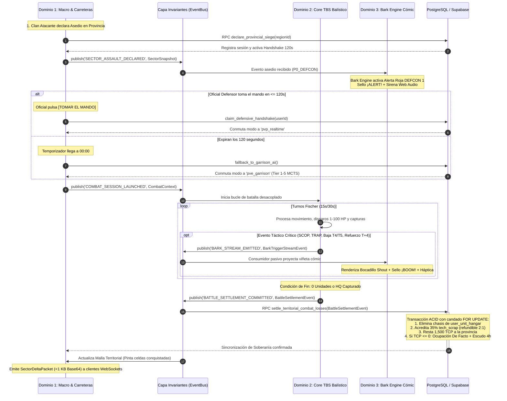

# 🎖️ MASTER MVP BLUEPRINT & ROADMAP: REFUNDACIÓN MODULAR Y CONTRATOS INMUTABLES
## *Tactical Command: Wars of Legacy (GEOTACTICS-ONLINE)*
**Versión de Arquitectura:** `5.1.0-MODULAR-FOUNDATION`  
**Fecha de Ratificación:** Noviembre 2026  
**Documento Canónico Rector:** `docs/MASTER_MVP_BLUEPRINT_AND_ROADMAP.md`  
**Alineación SSOT:** Calibrado contra `docs/00_ARBOL_CANONICO_DE_SISTEMAS_Y_DESARROLLO.md` (SSOT v5.0.0) y verificado por la Asamblea de Arquitectura de los 4 Estudios Especializados (Alpha, Beta, Gamma y Delta).

---

# 1. VISIÓN EJECUTIVA Y PRINCIPIOS DE DESACOPLAMIENTO

Tactical Command se refundamenta sobre una **Arquitectura Hexagonal Pura (Ports & Adapters) y Estado Unidireccional Basado en Eventos**, desacoplando el juego en **tres dominios funcionales independientes** conectados exclusivamente a través de una **Capa de Invariantes Universales (Puentes de Información Inmutables)**:

```
┌────────────────────────────────────────────────────────────────────────────────────────┐
│                        DOMINIO 1: METAPOLÍTICA MACRO (ESTUDIO ALPHA)                   │
│   Cartografía Matricial WGS84 • Picking O(1) • Sparse Bitmaps • Red Troncal Carreteras │
└───────────────────────────────────────────┬────────────────────────────────────────────┘
                                            │ [Emite CombatContext inmutable]
                                            ▼
┌────────────────────────────────────────────────────────────────────────────────────────┐
│                    CAPA DE INVARIANTES UNIVERSALES (ESTUDIO DELTA)                     │
│      Puentes de Información DTO • Bus de Eventos Tipado • Sandboxing Transaccional     │
└─────────────────────┬────────────────────────────────────────────────────┬─────────────┘
                      │                                                    │
       [Inyecta Snapshot Terreno & Chasis]                     [Stream Pasivo de Eventos]
                      ▼                                                    ▼
┌──────────────────────────────────────────┐    ┌────────────────────────────────────────┐
│    DOMINIO 2: MOTOR TÁCTICO TBS &        │    │    DOMINIO 3: BARK ENGINE & EXPRESIVO  │
│        ATRICIÓN (ESTUDIO BETA)           │    │          (ESTUDIO GAMMA)               │
│ • Advance Wars Determinista (RNG=0)      │    │ • Novela Gráfica Cómic Atompunk        │
│ • Escala Continua 1-100 HP               │    │ • Cero Voces: 100% Gráfico/Háptico     │
│ • Pérdida Física Chasis (35% Scrap)      │    │ • 6 Bocadillos + Sellos Pop-Art        │
│ • Índice Victoria Pírrica (PVI)          │    │ • Cola de Prioridades P0-P3            │
│ • Handshake 120s & 2v2 Cross-Chess       │    │ • Web Audio API Sintetizada            │
│ • Retardo Vial Refuerzos (T_arrival)     │    │ • Inmunidad Total al Loop Balístico    │
└─────────────────────┬────────────────────┘    └────────────────────────────────────────┘
                      │
                      │ [Emite BattleSettlementEvent inmutable]
                      ▼
┌────────────────────────────────────────────────────────────────────────────────────────┐
│                        LIQUIDACIÓN ATÓMICA EN POSTGRESQL / SUPABASE                    │
│   Deducción Chasis Hangar • Retorno Chatarra • Delta TCP • Escudo 4h • Buff Capital    │
└────────────────────────────────────────────────────────────────────────────────────────┘
```

### Los 4 Mandatos de Aislamiento Inviolables:
1. **El Motor Táctico no conoce el Mapa:** El Core TBS puede compilarse, ejecutarse y testearse en local (`npx tsx`) sin importar una sola línea de MapLibre GL, WebGL ni esquemas territoriales. Recibe un `CombatContext` inmutable y emite un `BattleSettlementEvent`.
2. **El Mapa Macro no calcula Balística:** La geopolítica territorial recibe los resultados consolidados de atrición y TCP sin evaluar nunca alcances de disparo, matrices de daño ni fórmulas de contraataque.
3. **El Bark Engine es Pasivo y Desacoplado:** El motor narrativo es un observador puro (`Event Subscriber`). Jamás muta el estado de una partida, no bloquea el reloj Fischer ni las transacciones de base de datos.
4. **Persistencia Física de Chasis (Cero Cartas):** Todo chasis no-F2P destruido es consumido físicamente de la base de datos (`user_unit_hangar`), recuperando el $35\%$ de su valor en chatarra balística (`tech_scrap`).

---

# 2. CAPA DE INVARIANTES UNIVERSALES (PUENTES DE INFORMACIÓN)

Los contratos canónicos de tipo TypeScript representan la **Única Fuente de Verdad Inmutable** para la comunicación inter-dominio:

- `WorldCoordinate` y `SectorAddress`: Georreferenciación WGS84 y direccionamiento de celdas planetarias ($20 \times 20$ por sector a Zoom 14).
- `SectorSnapshot`: Terreno base, bioma canónico, clima, nivel de búnker (1 a 5), cobertura de defensa y red vial conectada.
- `UnitManifest` y `UnitChassisAllocation`: Despliegue físico de tropas desde el Hangar Personal (`user_unit_hangar`) o Comunitario (`faction_unit_hangar`), con escala continua de 1 a 100 HP.
- `CombatContext`: Snapshot inmutable inyectado al motor táctico determinista (reloj Fischer, partes de combate, semilla pseudoaleatoria Mulberry32 y estado de Handshake).
- `BattleSettlementEvent`: Liquidación auditada de batalla emitida al finalizar el encuentro (vencedor, lista exacta de chasis destruidos, $35\%$ de chatarra balística devuelta, delta de TCP, horas de asedio e Índice de Victoria Pírrica $PVI$).
- `BarkTriggerStreamEvent`: Telemetría pasiva emitida hacia el Bark Engine (prioridades `P0_DEFCON` a `P3_AMBIENT_IDLE`, triggers contextuales, sugerencia de bocadillo y sello pop-art).

---

# 3. ESPECIFICACIÓN TÉCNICA DEL MÓDULO 1: CARTOGRAFÍA MATRICIAL Y METAPOLÍTICA

### 3.1 Proyección Analítica $O(1)$ sin Pérdida de Precisión (Fixed-Point Q16.16)
Para erradicar cualquier drift o indeterminismo de redondeo entre navegadores, el picking geográfico opera en punto fijo normalizado sobre $2^{32}$:

$$X_{\text{int}} = \left\lfloor \left(\frac{\lambda + 180}{360}\right) \cdot 2^{32} \right\rfloor$$
$$S_x = X_{\text{int}} \gg (32 - Z), \qquad c_x = \left\lfloor \frac{\Big(X_{\text{int}} \ \& \ ((1 \ll (32 - Z)) - 1)\Big) \cdot 20}{2^{32 - Z}} \right\rfloor$$

- **Costo de Ejecución:** $\le 0.0005\text{ ms}$ por consulta ($O(1)$ analítico).
- **Resolución:** Sector de $20 \times 20$ celdas a Zoom 14. En un Canvas HTML5 de $1000 \times 1000\text{ px}$, cada celda táctica equivale exactamente a un bloque de $50 \times 50\text{ px}$.

### 3.2 Buffer Matricial Ultra-Eficiente: Packed Uint32Array (32 Bits / Celda)
Sustituye objetos de alto costo por un array contiguo de 32 bits:
```
 31 30 29 28 27 26 25 24 23 22 21 20 19 18 17 16 15 14 13 12 11 10  9  8  7  6  5  4  3  2  1  0
┌──┬────────┬───────────┬───────────────────────┬───────────────────────────────────────────────┐
│CH│BUNKER  │TERRAIN ★  │ CONTROL STRENGTH      │ CLAN INDEX                                    │
│1b│ 3 bits │  4 bits   │  8 bits (0-255)       │  16 bits (0-65,535)                           │
└──┴────────┴───────────┴───────────────────────┴───────────────────────────────────────────────┘
```
- **Bits 0..15:** `Clan Index` (hasta 65,535 clanes). `0x0000` = Neutral.
- **Bits 16..23:** `Control Strength` (0..255 $\to$ 0..100%).
- **Bits 24..27:** `Terrain Stars` (0★ a 4★).
- **Bits 28..30:** `Bunker Level` (0 a 5).
- **Bit 31:** `Chokepoint / Bridge Flag` (1 si es paso crítico).

**Huella de Memoria RAM:**
- Sector $20 \times 20$: **1,600 bytes** ($1.56\text{ KB}$).
- Región completa $50 \times 50$: **10,000 bytes** ($10\text{ KB}$).
- Teatro Completo de Venezuela (31 regiones): **$\approx 310\text{ KB}$**.
- **0% GPU Standby:** Canvas HTML5 en modo `animate: false`; solo se dispara `source.play() -> map.triggerRepaint() -> source.pause()` ante mutaciones de soberanía.

### 3.3 Transmisión Delta por WebSockets (<1 KB / Tick)
En combate no se transmiten los 1,600 bytes del sector. Se emite un paquete delta binario:
- **Cabecera (14 bytes):** `sectorX` (4B) + `sectorY` (4B) + `versionSeq` (4B) + `deltaCount` (2B).
- **Por mutación (6 bytes):** `cellIndex` (Uint16, 2B) + `packedValue` (Uint32, 4B).
- **Pulso típico (10 celdas):** $14 + 60 = \mathbf{74\text{ bytes binarios}}$ ($\approx 100\text{ caracteres Base64}$).

### 3.4 Grafo Vial y Algoritmo Balístico de Combustible
El mundo modela arterias del mundo real (ej. Autopista Regional del Centro, Troncal 9, Troncal 5, Puente Maracaibo y Puentes Orinoco):

$$FuelCost(P) = \sum_{e \in P} \Big[ d_e \times \mu_{\text{surface}}(e) \times \phi_{\text{weather}} \times \theta_{\text{convoy}} \times (1 - \beta_{\text{doctrine}}) \Big]$$

- **Fricción de Superficie ($\mu_{\text{surface}}$):** Ferrocarril $0.25$, Autopista $0.50$, Asfalto $0.75$, Rural $1.20$, Sabana $1.80$, Alta Montaña $2.80$, Selva Densa $3.50$.
- **Regla de Fatiga Fatal:** Si un convoy agota su combustible en ruta (`remainingFuel === 0`), queda **Inmovilizado de Inmediato (`immobilized = true`)** en mitad del sector geográfico, quedando a merced de emboscadas (`¡TRAP!`).

---

# 4. ESPECIFICACIÓN TÉCNICA DEL MÓDULO 2: MOTOR TÁCTICO, ATRICIÓN Y DESPACHO

### 4.1 Bucle Táctico Headless Determinista
- **Cuadrícula de Batalla:** $20 \times 20$ celdas derivadas deterministamente mediante `Mulberry32(Seed)` donde $\text{Seed} = \text{FNV-1a}(\text{regionId} \mathbin{\Vert} \text{matchId} \mathbin{\Vert} \text{countryIso})$.
- **Condición de Fin:**
  1. $0$ Tropas Vivas $\to$ **Derrota Inmediata**.
  2. Reducción de puntos de captura de HQ a $0 \to$ **Victoria Inmediata**.
  3. Turno 50 cumplido $\to$ **Desempate Patrimonial Determinista** ($\sum \frac{\text{coste} \times \text{HP}}{100} + \text{Fondos} + 1000 \times \text{Propiedades}$).

### 4.2 Siniestralidad Física y Algoritmo de Chatarra (35% `tech_scrap`)
Las tropas destruidas no regresan al hangar: se eliminan físicamente de la base de datos (`user_unit_hangar`), recuperando el $35\%$ de su valor en chatarra balística:

$$\text{TechScrapRecovered} = \left\lfloor 50 \times \text{Tier} \times 0.35 \right\rfloor$$
$$2\text{ unidades de tech\_scrap} \longrightarrow 1\text{ Placa de Acero Estructural}$$

### 4.3 Formulación del Índice de Victoria Pírrica ($PVI$)
$$PVI = \frac{L_{own}}{V_{target} + L_{enemy}}$$

- **$PVI \le 0.50$ (Victoria Decisiva):** $+20\%$ de Gloria.
- **$0.50 < PVI \le 1.00$ (Victoria Sostenible):** $100\%$ de Gloria y Créditos.
- **$1.00 < PVI \le 2.00$ (Victoria Pírrica Moderada):** **Penalización del $-15\%$** en Créditos y Gloria.
- **$PVI > 2.00$ (Catástrofe Patrimonial):** **Penalización del $-35\%$** en Créditos y alerta de desgaste crítico.

### 4.4 Protocolo Human Handshake de 120s y Escalamiento a 2v2
- **Handshake 120s:** Al asediar un territorio, el clan defensor dispone de 120s para aceptar el combate (*Human Handshake*). Si expira el plazo, asume la defensa autónoma la `GarrisonAIEngine` (Tier 1 a 5 MCTS).
- **Retardo de Refuerzos Viales:**
  $$T_{\text{arrival}} = T_{\text{request}} + \left\lceil \frac{d_{\text{road}}}{v_{\text{unit}}} \right\rceil + \text{congestion}$$
  Refuerzos ingresan exclusivamente por los 4 bordes de carretera del mapa de $20 \times 20$ ($y=0$, $y=19$, $x=0$, $x=19$).
- **Ajedrez Cruzado 2v2:** Secuencia de turnos alternada: $A_1 \to B_1 \to A_2 \to B_2$.

---

# 5. ESPECIFICACIÓN TÉCNICA DEL MÓDULO 3: BARK ENGINE Y DOMINIO EXPRESIVO

- **Living Comic War-Room:** Cero archivos de audio de voz pesados; inmersión 100% visual y táctil.
- **6 Formas de Bocadillo:** `speech` (asimétrico 28px/6px), `shout` (dentado con clip-path), `thought` (nube con 3 esferas), `whisper` (discontinuo con desenfoque), `radio` (chaflanes a 45°, marco fósforo `#00FF66` y scanlines CRT) y `panic` (doble borde carmesí con animación de temblor `jitter`).
- **Sellos Pop-Art Rotados:** Textos deterministamente angulados ($-8^\circ$ a $+8^\circ$) con sombra de tinta dura: `¡BOOM!`, `¡TRAP!`, `¡AIRDROP!`, `¡CLUTCH!`, `¡ALERT!`, `¡CRASH!`, `¡SINK!`.
- **Motor de Colas P0-P3:** P0 (DEFCON 1, preemption en $<16\text{ ms}$), P1 (Hito Táctico), P2 (Operacional, FIFO máx 2), P3 (Ambiente, drop-if-busy). Memoria anti-repetición $O(1)$ con buffer circular y decaimiento estocástico.
- **Síntesis Web Audio Procedural:** Sonidos sintéticos en tiempo real sin archivos de audio externos acoplados a patrones de vibración (`navigator.vibrate`).

---

# 6. ROADMAP DE CONSTRUCCIÓN AISLADA DEL MVP

| Hito | Nombre | Foco de Desarrollo | Entregable Clave | Criterio de Aceptación (DoD) |
| :---: | :--- | :--- | :--- | :--- |
| **Hito 1** | **Contratos Base y Motor Táctico Local** | Core TBS headless determinista, atrición 1-100 HP, pérdida física de chasis y PVI. | `HeadlessTacticalEngine.ts` y test suite aislada. | 50 turnos de combate simulados en $<100\text{ ms}$ con deducción exacta del 35% scrap sin UI. |
| **Hito 2** | **Mapa Matricial, Carreteras y Combustible** | Picking analítico Q16.16 O(1), Packed Uint32Array, deltas WebSocket y física vial. | `PackedCellBuffer.ts`, `FixedPointCoordinates.ts` y grafo vial. | Picking $\le 0.0005\text{ ms}$, delta $<1\text{ KB}$ Base64, inmovilización a 0 Fuel. |
| **Hito 3** | **Integrador de Eventos Macro-Combate** | Asedios, Handshake 120s, retardo vial T_arrival, escalamiento 2v2 y RPC Postgres. | `TerritorialCombatBridge.ts` y RPC `settle_territorial_combat_losses`. | Drenaje de 10,000 TCP, ventana de 120s funcional y deducción atómica en base de datos. |
| **Hito 4** | **Bark Engine y Game Feel Cómic** | Suscriptor pasivo de eventos, bocadillos CSS, sellos pop-art, Web Audio API y háptica. | `BarkEngineArbiter.ts` y `ComicVignetteOverlay.tsx`. | Cero lag en loop balístico, preemption P0 en $<16\text{ ms}$ y memoria anti-repetición O(1). |

---

# 7. DIAGRAMA DE FLUJO INTEGRAL DEL CICLO DE VIDA (MERMAID)


