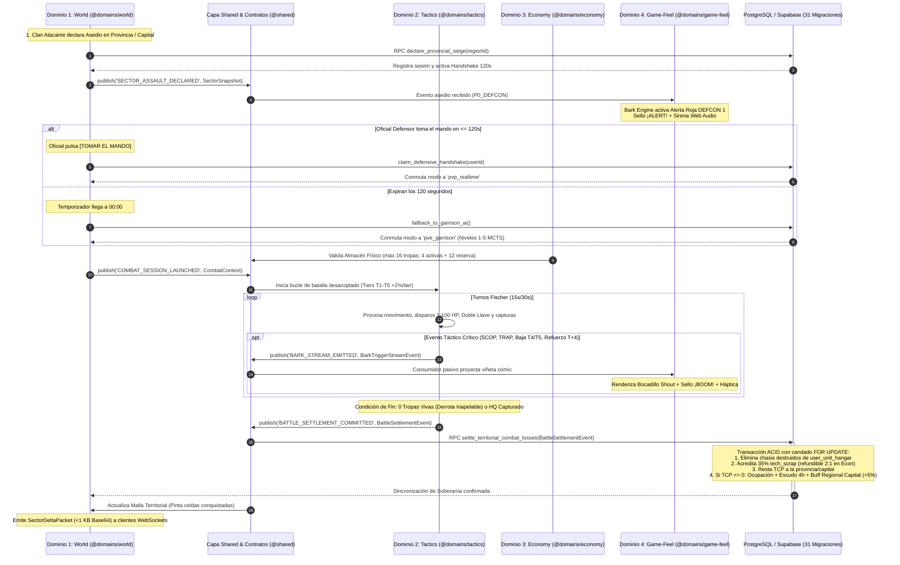

# 🎖️ MASTER MVP BLUEPRINT & ROADMAP: REFUNDACIÓN MODULAR Y CONTRATOS INMUTABLES
## *Tactical Command: Wars of Legacy (GEOTACTICS-ONLINE)*
**Versión de Arquitectura:** `5.1.0-MODULAR-FOUNDATION`  
**Fecha de Ratificación:** Noviembre 2026  
**Documento Canónico Rector:** `docs/MASTER_MVP_BLUEPRINT_AND_ROADMAP.md`  
**Alineación SSOT:** Calibrado contra `docs/00_ARBOL_CANONICO_DE_SISTEMAS_Y_DESARROLLO.md` (SSOT v5.0.0) y verificado por la Asamblea de Arquitectura de los 4 Estudios Especializados (Alpha, Beta, Gamma y Delta).

---

# 1. VISIÓN EJECUTIVA Y PRINCIPIOS DE DESACOPLAMIENTO

Tactical Command se refundamenta sobre una **Arquitectura Hexagonal Pura (Ports & Adapters) y Estado Unidireccional Basado en Eventos**, desacoplando el código fuente ejecutable en **cuatro dominios funcionales independientes (`@domains/world`, `@domains/tactics`, `@domains/economy`, `@domains/game-feel`)** conectados exclusivamente a través de una **Capa de Invariantes Universales y Servicios Compartidos (`@shared` y `docs/contracts/`)**:

```
┌────────────────────────────────────────────────────────────────────────────────────────┐
│            DOMINIO 1: WORLD — METAPOLÍTICA MACRO & CARTOGRAFÍA (@domains/world)        │
│   Cartografía Matricial WGS84 • Picking O(1) • Sparse Bitmaps • Red Troncal Carreteras │
│   Asedios 120s (territorialSiegeOrchestrator) • Capitales (+5% Buff Regional / +15% EC)│
└───────────────────────────────────────────┬────────────────────────────────────────────┘
                                            │ [Emite CombatContext / Eventos de Soberanía]
                                            ▼
┌────────────────────────────────────────────────────────────────────────────────────────┐
│        CAPA DE INVARIANTES UNIVERSALES & SHARED (@shared + docs/contracts/)            │
│    MASTER_METAGAME_CONSTANTS (metagame.ts) • Puentes DTO • Cliente Supabase & Auth     │
└──────────┬────────────────────────────────────────┬───────────────────────────┬────────┘
           │                                        │                           │
[Snapshot Terreno & Chasis]             [Doble Llave & Liquidación]    [Stream Pasivo de Eventos]
           ▼                                        ▼                           ▼
┌──────────────────────────────┐  ┌──────────────────────────────┐  ┌────────────────────────────┐
│   DOMINIO 2: TACTICS —       │  │   DOMINIO 3: ECONOMY —       │  │  DOMINIO 4: GAME-FEEL —    │
│ MOTOR TÁCTICO (@domains/tactics)│ │ HANGAR & P2P (@domains/economy)│ │ BARK & AUDIO (@domains/game-feel)│
│ • Advance Wars Determinista  │  │ • Cero Cartas: Almacén Físico│  │ • Novela Gráfica Atompunk  │
│ • Escala Continua 1-100 HP   │  │   16 Tropas (4 Act + 12 Res) │  │ • Cero Voces: 100% Gráfico │
│ • Derrota Inapelable 0 Tropas│  │ • Tiers T1-T5 (+2%/tier, +8%)│  │ • 6 Bocadillos + Pop-Art   │
│ • Pérdida Física (35% Scrap) │  │ • Forja 10 Parcelas Circad.  │  │ • Cola Prioridades P0-P3   │
│ • Handshake 120s & IA Nv.1-5 │  │ • Mercado P2P 2% (1% Sink +  │  │ • Web Audio API Sintetizada│
│ • Retardo Vial (T_arrival)   │  │   1% Clan) & VWAP Collar ±25%│  │ • Inmunidad Loop Balístico │
└──────────────┬───────────────┘  └──────────────┬───────────────┘  └────────────────────────────┘
               │                                 │
               └────────────────┬────────────────┘
                                │ [Emite BattleSettlementEvent / Orden P2P inmutable]
                                ▼
┌────────────────────────────────────────────────────────────────────────────────────────┐
│           LIQUIDACIÓN ATÓMICA EN POSTGRESQL / SUPABASE (31 MIGRACIONES DDL)            │
│   Deducción Chasis Hangar • Retorno 35% tech_scrap • Delta TCP • Escudo 4h • Split 2%  │
└────────────────────────────────────────────────────────────────────────────────────────┘
```

### Los Mandatos de Aislamiento e Invariantes Canónicas Inviolables:
1. **El Motor Táctico (`@domains/tactics`) no conoce el Mapa:** El Core TBS (`src/domains/tactics/core/canonicalCombat.ts`, `src/domains/tactics/core/combat.ts`) puede compilarse, ejecutarse y testearse en local (`npx tsx`) sin importar una sola línea de MapLibre GL, WebGL ni esquemas territoriales. Opera en **escala continua de 1 a 100 HP enteros**, aplica **Tiers T1 a T5 (+2% por tier, máximo +8% en T5)**, decreta **derrota inapelable al llegar a 0 tropas vivas (`units.length === 0`)**, recibe un `CombatContext` inmutable y emite un `BattleSettlementEvent`.
2. **El Mapa Macro (`@domains/world`) no calcula Balística:** La geopolítica territorial (`src/domains/world/core/worldMapEngine.ts`, `src/domains/world/core/territorialSiegeOrchestrator.ts`, `src/domains/world/core/territorialExpansionEngine.ts`) gestiona el **Human Handshake de 120 segundos** antes de delegar en la IA de Guarnición (Niveles 1-5), aplica el **Buff Regional de Conquista de Capitales (+5% recursos/logística en la región, +15% EC nacional, +10% velocidad de forja y -20% aranceles P2P)** y recibe los resultados consolidados de atrición y TCP sin evaluar nunca alcances de disparo ni matrices de daño.
3. **El Bark Engine (`@domains/game-feel`) es Pasivo y Desacoplado:** El motor narrativo y sensorial (`src/domains/game-feel/core/barkEngine.ts`, `src/domains/game-feel/core/audioManager.ts`, `src/domains/game-feel/core/hapticFeedback.ts`) es un observador puro (`Event Subscriber`). Jamás muta el estado de una partida, no bloquea el reloj Fischer ni las transacciones de base de datos.
4. **Persistencia Física de Chasis (Cero Cartas) y Economía P2P (`@domains/economy`):** Queda erradicado todo sistema de cartas (NO TCG/CCG). Cada comandante opera un **Almacén Físico de 16 tropas máximo por jugador (4 slots de despliegue activo de vanguardia + 12 unidades en reserva táctica)** sobre los 16 arquetipos militares (`src/domains/economy/hooks/useUserHangar.ts`, `src/domains/economy/components/UnitHangarModal.tsx`). Todo chasis no-F2P destruido se elimina físicamente de `user_unit_hangar` / `faction_unit_hangar`, recuperando el **35% en chatarra tecnológica (`tech_scrap`, `RECYCLE_SCRAP_RATE = 0.35`)**. El **Mercado Libre P2P** (`src/domains/economy/core/industrialEngine.ts`) aplica un **impuesto total del 2% (1% quemado en Sink deflacionario + 1% regalía al Clan dueño del Hub regional)** con bandas dinámicas **VWAP Collar ±25%**.

---

# 2. CAPA DE INVARIANTES UNIVERSALES (PUENTES DE INFORMACIÓN)

Los contratos canónicos de tipo TypeScript en `src/shared/types/metagame.ts` (`@shared/types/metagame`), `src/shared/types/index.ts` (`@shared`) y `docs/contracts/typesBridge.ts` representan la **Única Fuente de Verdad Inmutable** para la comunicación inter-dominio:

- `WorldCoordinate`, `SectorAddress` y `TacticalGridCoords` (`src/domains/world/core/coordinates.ts` y `docs/contracts/typesBridge.ts`): Georreferenciación WGS84 y direccionamiento de celdas planetarias ($20 \times 20$ por sector a Zoom táctico).
- `SectorSnapshot` y `GeotacticsRegionSovereignty` (`src/shared/types/metagame.ts` y `src/domains/world/types/stateSovereigntyTypes.ts`): Terreno base, bioma canónico, clima, nivel de búnker (1 a 5), cobertura de defensa, Puntos de Control Territorial (TCP) y red vial conectada.
- `UnitManifest`, `UnitChassisAllocation` y `UnitHangarEntry` (`src/shared/types/metagame.ts` y `src/domains/economy/hooks/useUserHangar.ts`): Despliegue físico de tropas (máximo 16 tropas en orden de batalla: 4 slots activos + 12 en reserva) desde el Hangar Personal (`user_unit_hangar`) o Comunitario (`faction_unit_hangar`), con escala continua de 1 a 100 HP enteros y Tiers T1 a T5 (+2% por tier, máx. +8% en T5).
- `CombatContext` (`docs/contracts/typesBridge.ts` y `docs/contracts/beta/tacticalContracts.ts`): Snapshot inmutable inyectado al motor táctico determinista (reloj Fischer, partes de combate, semilla pseudoaleatoria Mulberry32 y estado de Handshake de 120 segundos).
- `BattleSettlementEvent` y `CombatLossSettlementResult` (`src/domains/tactics/core/tacticalCombatSeamlessIntegration.ts` y `docs/contracts/typesBridge.ts`): Liquidación auditada de batalla emitida al finalizar el encuentro (vencedor, lista exacta de chasis destruidos, $35\%$ de chatarra tecnológica `tech_scrap` devuelta mediante `calculateLossScrapRecovery`, delta de TCP, horas de asedio e Índice de Victoria Pírrica $PVI$).
- `BarkTriggerStreamEvent` y `BarkTriggerContext` (`src/domains/game-feel/core/barkEngine.ts` y `docs/contracts/typesBridge.ts`): Telemetría pasiva emitida hacia el Bark Engine (prioridades `P0_DEFCON` a `P3_AMBIENT_IDLE`, triggers contextuales, sugerencia de bocadillo y sello pop-art).
- `MASTER_METAGAME_CONSTANTS` (`src/shared/types/metagame.ts`): Constantes universales inmutables (`CANONICAL_MAX_HP: 100`, `TIER_EFFECTIVENESS_BONUS_PER_LEVEL: 0.02`, `RECYCLE_SCRAP_RATE: 0.35`, `HANDSHAKE_TIMEOUT_SECONDS: 120`, `TOTAL_P2P_TAX_RATE: 0.02`, `PLATFORM_BURN_RATE: 0.01`, `PROVINCE_ROYALTY_RATE: 0.01`, `VWAP_COLLAR_PERCENT: 0.25`).

---

# 3. ESPECIFICACIÓN TÉCNICA DEL DOMINIO 1 (`@domains/world`): CARTOGRAFÍA MATRICIAL Y METAPOLÍTICA

*Implementación ejecutable en `src/domains/world/index.ts` (`src/domains/world/core/{coordinates,tacticalBitmap,roadNetworkEngine,roadGarrisonEngine,territorialExpansionEngine,territorialSiegeOrchestrator,politicalAliceEngine,worldMapEngine}.ts`).*

### 3.1 Proyección Analítica $O(1)$ sin Pérdida de Precisión (`src/domains/world/core/coordinates.ts`)
Para erradicar cualquier drift o indeterminismo de redondeo entre navegadores, el picking geográfico (`lngLatToGridCoords`, `gridCoordsToLngLat`, `getTileBounds`) y la indexación matricial (`docs/contracts/alpha/macroCartographyContracts.ts`) operan en tiempo constante $O(1)$:

$$X_{\text{int}} = \left\lfloor \left(\frac{\lambda + 180}{360}\right) \cdot 2^{32} \right\rfloor$$
$$S_x = X_{\text{int}} \gg (32 - Z), \qquad c_x = \left\lfloor \frac{\Big(X_{\text{int}} \ \& \ ((1 \ll (32 - Z)) - 1)\Big) \cdot 20}{2^{32 - Z}} \right\rfloor$$

- **Costo de Ejecución:** $\le 0.0005\text{ ms}$ por consulta ($O(1)$ analítico).
- **Resolución:** Sector de $20 \times 20$ celdas tácticas. En un Canvas HTML5 de $1000 \times 1000\text{ px}$ (`TILE_SIZE = 1000`), cada celda táctica equivale exactamente a un bloque de $50 \times 50\text{ px}$.

### 3.2 Buffer Matricial Ultra-Eficiente: `TacticalBitMap` y Packed Uint32Array (`src/domains/world/core/tacticalBitmap.ts`)
Sustituye objetos de alto costo por buffers binarios compactos (`TacticalBitMap` de 50 bytes para 400 celdas en niebla/ocupación y `MacroChunkSoAView` / `Uint32Array` de 32 bits por celda):
```
 31 30 29 28 27 26 25 24 23 22 21 20 19 18 17 16 15 14 13 12 11 10  9  8  7  6  5  4  3  2  1  0
┌──┬────────┬───────────┬───────────────────────┬───────────────────────────────────────────────┐
│CH│BUNKER  │TERRAIN ★  │ CONTROL STRENGTH      │ CLAN INDEX                                    │
│1b│ 3 bits │  4 bits   │  8 bits (0-255)       │  16 bits (0-65,535)                           │
└──┴────────┴───────────┴───────────────────────┴───────────────────────────────────────────────┘
```
- **Bits 0..15:** `Clan Index` (hasta 65,535 clanes). `0x0000` = Neutral.
- **Bits 16..23:** `Control Strength` (0..255 $\to$ 0..100%).
- **Bits 24..27:** `Terrain Stars` (0★ a 4★).
- **Bits 28..30:** `Bunker Level` (0 a 5).
- **Bit 31:** `Chokepoint / Bridge Flag` (1 si es paso crítico).

**Huella de Memoria RAM:**
- Sector $20 \times 20$: **1,600 bytes** ($1.56\text{ KB}$).
- Región completa $50 \times 50$: **10,000 bytes** ($10\text{ KB}$).
- Teatro Completo de Venezuela (31 regiones): **$\approx 310\text{ KB}$**.
- **0% GPU Standby (`src/domains/world/components/TacticalWorldMap.tsx`):** Canvas HTML5 en modo `animate: false`; solo se dispara `source.play() -> map.triggerRepaint() -> source.pause()` ante mutaciones de soberanía.

### 3.3 Transmisión Delta por WebSockets (<1 KB / Tick)
En combate no se transmiten los 1,600 bytes del sector. Se emite un paquete delta binario sincronizado mediante `src/domains/world/hooks/useSiegeRealtime.ts` y `src/domains/tactics/hooks/useMatchSync.ts`:
- **Cabecera (14 bytes):** `sectorX` (4B) + `sectorY` (4B) + `versionSeq` (4B) + `deltaCount` (2B).
- **Por mutación (6 bytes):** `cellIndex` (Uint16, 2B) + `packedValue` (Uint32, 4B).
- **Pulso típico (10 celdas):** $14 + 60 = \mathbf{74\text{ bytes binarios}}$ ($\approx 100\text{ caracteres Base64}$).

### 3.4 Grafo Vial y Algoritmo Balístico de Combustible (`src/domains/world/core/roadNetworkEngine.ts`)
El mundo modela arterias del mundo real (ej. Autopista Regional del Centro, Troncal 9, Troncal 5, Puente Maracaibo y Puentes Orinoco) junto con guarniciones viales (`src/domains/world/core/roadGarrisonEngine.ts`):

$$FuelCost(P) = \sum_{e \in P} \Big[ d_e \times \mu_{\text{surface}}(e) \times \phi_{\text{weather}} \times \theta_{\text{convoy}} \times (1 - \beta_{\text{doctrine}}) \Big]$$

- **Fricción de Superficie ($\mu_{\text{surface}}$):** Ferrocarril $0.25$, Autopista $0.50$, Asfalto $0.75$, Rural $1.20$, Sabana $1.80$, Alta Montaña $2.80$, Selva Densa $3.50$.
- **Regla de Fatiga Fatal (`src/domains/tactics/core/fuelLogistics.ts`):** Si un convoy agota su combustible en ruta (`remainingFuel === 0`), queda **Inmovilizado de Inmediato (`immobilized = true`)** en mitad del sector geográfico (o sufre derribo si es unidad aérea), quedando a merced de emboscadas (`¡TRAP!`).

### 3.5 Conquista de Capitales con Buff Regional (+5%) y Expansión Celular (`src/domains/world/core/territorialExpansionEngine.ts`)
- **0% Capitales Inexpugnables (`CAPITAL_IMMUNITY = false`):** Todas las capitales nacionales y regionales son asediables (`TCP_MAX_FORTRESS = 15000`, `STANDARD_TCP_THRESHOLD = 10000`).
- **Pilar 5 — Buff Regional y Hegemonía Nacional:** La conquista de la Capital otorga un **Buff Regional de +5% en recursos y logística en la región**, además del multiplicador hegemónico nacional (**+15% Créditos Energéticos EC**, **+10% velocidad de forja** y **-20% en aranceles P2P**) calculado en `calculateIndustrialYieldWithNodes` (`src/domains/world/core/territorialExpansionEngine.ts`) y `evaluateStrategicNodes` (`src/domains/economy/core/strategicAndProductionEngine.ts`).

---

# 4. ESPECIFICACIÓN TÉCNICA DEL DOMINIO 2 (`@domains/tactics`) Y DOMINIO 3 (`@domains/economy`): MOTOR TÁCTICO, ATRICIÓN, HANGAR Y MERCADO P2P

*Implementación ejecutable en `src/domains/tactics/index.ts` y `src/domains/economy/index.ts`.*

### 4.1 Bucle Táctico Headless Determinista y Escala 1-100 HP (`src/domains/tactics/core/canonicalCombat.ts`)
- **Cuadrícula de Batalla:** $20 \times 20$ celdas derivadas deterministamente mediante `Mulberry32(Seed)` en `src/domains/tactics/core/proceduralMapGenerator.ts` donde $\text{Seed} = \text{FNV-1a}(\text{regionId} \mathbin{\Vert} \text{matchId} \mathbin{\Vert} \text{countryIso})$.
- **Escala Balística Continua (Pilar 2):** Todas las unidades operan sobre **1 a 100 HP enteros (`CANONICAL_MAX_HP = 100`)** sin redondeos toscos (`CanonicalCombatEngine.calculateEngagement`).
- **Progresión Horizontal de Tiers (Pilar 4):** Cero niveles de carta. Los chasis progresan horizontalmente de **Tier T1 a T5 (+2% de efectividad balística por tier, máximo +8% en T5: T1 $+0\%$, T2 $+2\%$, T3 $+4\%$, T4 $+6\%$, T5 $+8\%$)**. En modo Torneo y Duelo Espejo se normaliza a **Tier 1 (+0%)**.
- **Condición de Fin (`src/domains/tactics/core/combat.ts` y `src/domains/tactics/core/hqCaptureVictory.ts`):**
  1. $0$ Tropas Vivas (`units.length === 0`) $\to$ **Derrota Inmediata Inapelable (Pilar 3)**.
  2. Reducción de los 20 puntos de captura de HQ a $0 \to$ **Victoria Inmediata**.
  3. Turno 50 cumplido $\to$ **Desempate Patrimonial Determinista** ($\sum \frac{\text{coste} \times \text{HP}}{100} + \text{Fondos} + 1000 \times \text{Propiedades}$).

### 4.2 Almacén Físico de 16 Tropas, Doble Llave y Algoritmo de Chatarra (35% `tech_scrap`)
- **Almacén Físico Cero Cartas (Pilar 1):** Cada comandante gestiona un almacén físico en `public.user_unit_hangar` (`src/domains/economy/hooks/useUserHangar.ts` y `src/domains/economy/components/UnitHangarModal.tsx`) con **capacidad operativa de 16 tropas máximo por jugador en orden de batalla (4 slots de despliegue activo de vanguardia + 12 unidades en reserva táctica)** sobre el catálogo de 16 arquetipos militares (`src/domains/economy/core/turnEconomy.ts`).
- **Validación de Doble Llave (`validateDoubleKeyDeployment` en `src/domains/tactics/core/tacticalCombatSeamlessIntegration.ts`):** El despliegue en fábricas, aeropuertos y puertos (`src/domains/tactics/components/ProductionModal.tsx`) requiere simultáneamente Fondos Tácticos `$G` y **1 chasis físico en stock** (`user_unit_hangar` o `faction_unit_hangar`), salvo la Línea Básica F2P inagotable (`infantry` T1 y `recon` T1).
- **Siniestralidad Física y 35% Chatarra (Pilar 6):** Las tropas destruidas no regresan al hangar: se eliminan físicamente de la base de datos (`settleCombatLossesAndScrap` y `calculateLossScrapRecovery` en `src/shared/types/metagame.ts`), recuperando el **$35\%$ (`RECYCLE_SCRAP_RATE = 0.35`)** de su valor en chatarra tecnológica (`tech_scrap`):

$$\text{TechScrapRecovered} = \left\lfloor 50 \times \text{Tier} \times 0.35 \right\rfloor$$
$$2\text{ unidades de tech\_scrap} \longrightarrow 1\text{ Placa de Acero Estructural}$$

### 4.3 Formulación del Índice de Victoria Pírrica ($PVI$)
$$PVI = \frac{L_{own}}{V_{target} + L_{enemy}}$$

- **$PVI \le 0.50$ (Victoria Decisiva):** $+20\%$ de Gloria.
- **$0.50 < PVI \le 1.00$ (Victoria Sostenible):** $100\%$ de Gloria y Créditos.
- **$1.00 < PVI \le 2.00$ (Victoria Pírrica Moderada):** **Penalización del $-15\%$** en Créditos y Gloria (`PYRRHIC_VICTORY_PENALTY = 0.15`).
- **$PVI > 2.00$ (Catástrofe Patrimonial):** **Penalización del $-35\%$** en Créditos y alerta de desgaste crítico.

### 4.4 Protocolo Human Handshake de 120s y Escalamiento a 2v2 (`src/domains/world/core/territorialSiegeOrchestrator.ts`)
- **Handshake 120s (Pilar 7):** Al asediar un territorio, el clan defensor dispone de **120 segundos (`HANDSHAKE_TIMEOUT_SECONDS = 120`)** para aceptar el combate (*Human Handshake* mediante `TerritorialSiegeOrchestrator.claimDefensiveHandshake`). Si expira el plazo, asume la defensa autónoma la `GarrisonAIEngine` (`src/domains/tactics/core/garrisonAIEngine.ts`, Niveles 1 a 5 MCTS).
- **Retardo de Refuerzos Viales (`src/domains/tactics/core/reinforcementsEngine.ts` y `src/domains/tactics/core/reinforcementEngine.ts`):**
  $$T_{\text{arrival}} = T_{\text{request}} + \left\lceil \frac{d_{\text{road}}}{v_{\text{unit}}} \right\rceil + \text{congestion}$$
  Latencia base canónica de $T + 4$ rondas (`REINFORCEMENT_ARRIVAL_TURNS = 4`); los refuerzos ingresan por los 4 bordes de carretera del mapa de $20 \times 20$ ($y=0$, $y=19$, $x=0$, $x=19$).
- **Ajedrez Cruzado 2v2 (`src/domains/tactics/core/autonomousOrchestrator.ts`):** Secuencia de turnos alternada: $A_1 \to B_1 \to A_2 \to B_2$.

### 4.5 Complejo Industrial de 10 Parcelas y Mercado Libre P2P (`src/domains/economy/core/industrialEngine.ts`)
- **Forja de 10 Parcelas y Ciclo Circadiano:** Cuadrícula industrial territorial (`src/domains/economy/components/IndustrialComplexView.tsx` y `src/domains/economy/services/fiefBuildingService.ts`) con 12h de producción + 4h de gracia, merma suavizada del $1.5\%/\text{h}$ con piso del $60\%$ y sistema de **Cargamento Varado** ($70\%$ recuperable en combate).
- **Regla Financiera Canónica P2P (`calculateP2PTransactionSplit` en `src/shared/types/metagame.ts` y `src/domains/economy/components/P2PMarketplaceView.tsx`):**
  - **Impuesto Total del 2% (`TOTAL_P2P_TAX_RATE = 0.02`):** Dividido estrictamente en **1% quemado en Sink deflacionario (`PLATFORM_BURN_RATE = 0.01`)** + **1% de regalía transferida al Clan dueño del Hub regional (`PROVINCE_ROYALTY_RATE = 0.01`)**.
  - **Bandas Dinámicas VWAP Collar ±25% (`VWAP_COLLAR_PERCENT = 0.25`):** Bloqueo automático de órdenes fuera del rango $[0.75 \times \text{VWAP}_{24\text{h}}, 1.25 \times \text{VWAP}_{24\text{h}}]$ para erradicar lavado de recursos y RMT.

---

# 5. ESPECIFICACIÓN TÉCNICA DEL DOMINIO 4 (`@domains/game-feel`): BARK ENGINE Y DOMINIO EXPRESIVO

*Implementación ejecutable en `src/domains/game-feel/index.ts` (`src/domains/game-feel/core/{barkEngine,audioManager,hapticFeedback}.ts` y `src/domains/game-feel/components/{CommanderBarkWidget,CommanderLivingVignette}.tsx`).*

- **Living Comic War-Room:** Cero archivos de audio de voz pesados; inmersión 100% visual y táctil operada por `barkEngine` (`src/domains/game-feel/core/barkEngine.ts`) y renderizada en `CommanderBarkWidget.tsx`, `CommanderLivingVignette.tsx` y `src/domains/tactics/components/ComicVignetteOverlay.tsx`.
- **6 Formas de Bocadillo:** `speech` (asimétrico 28px/6px), `shout` (dentado con clip-path), `thought` (nube con 3 esferas), `whisper` (discontinuo con desenfoque), `radio` (chaflanes a 45°, marco fósforo `#00FF66` y scanlines CRT) y `panic` (doble borde carmesí con animación de temblor `jitter`).
- **Sellos Pop-Art Rotados:** Textos deterministamente angulados ($-8^\circ$ a $+8^\circ$) con sombra de tinta dura: `¡BOOM!`, `¡TRAP!`, `¡AIRDROP!`, `¡CLUTCH!`, `¡ALERT!`, `¡CRASH!`, `¡SINK!`.
- **Motor de Colas P0-P3:** P0 (DEFCON 1, preemption en $<16\text{ ms}$), P1 (Hito Táctico), P2 (Operacional, FIFO máx 2), P3 (Ambiente, drop-if-busy). Memoria anti-repetición $O(1)$ con buffer circular y decaimiento estocástico.
- **Síntesis Web Audio Procedural y Háptica (`src/domains/game-feel/core/audioManager.ts` y `src/domains/game-feel/core/hapticFeedback.ts`):** Sonidos sintéticos en tiempo real sin archivos de audio externos acoplados a patrones de vibración (`triggerHaptic` / `navigator.vibrate`).

---

# 6. ROADMAP DE CONSTRUCCIÓN AISLADA DEL MVP (4 DOMINIOS + SHARED)

| Hito | Nombre | Dominio & Foco de Desarrollo | Entregable Clave en Repositorio | Criterio de Aceptación (DoD) |
| :---: | :--- | :--- | :--- | :--- |
| **Hito 1** | **Contratos Base y Motor Táctico Local** | `@domains/tactics` & `@shared`: Core TBS determinista, escala 1-100 HP, derrota por 0 tropas, Tiers T1-T5 (+2%) y PVI. | `src/domains/tactics/core/canonicalCombat.ts`, `src/domains/tactics/core/combat.ts` y `src/shared/types/metagame.ts`. | 50 turnos de combate simulados en $<100\text{ ms}$ con deducción exacta del 35% `tech_scrap` sin UI. |
| **Hito 2** | **Mapa Matricial, Carreteras y Combustible** | `@domains/world`: Picking analítico O(1), `TacticalBitMap`, deltas WebSocket, grafo vial y Capitales (+5% Buff Regional). | `src/domains/world/core/tacticalBitmap.ts`, `src/domains/world/core/coordinates.ts` y `src/domains/world/core/roadNetworkEngine.ts`. | Picking $\le 0.0005\text{ ms}$, delta $<1\text{ KB}$ Base64, inmovilización a 0 Fuel y Buff Regional activo. |
| **Hito 3** | **Hangar Físico (16 Tropas), Industria y P2P** | `@domains/economy` & `@domains/tactics`: Almacén físico (4 activas + 12 reserva), Doble Llave, Handshake 120s y Mercado P2P 2%. | `src/domains/economy/core/industrialEngine.ts`, `src/domains/tactics/core/tacticalCombatSeamlessIntegration.ts` y `src/domains/world/core/territorialSiegeOrchestrator.ts`. | Drenaje de 10,000 TCP, Handshake 120s funcional, split P2P 2% (1% Sink + 1% Clan) y VWAP Collar ±25%. |
| **Hito 4** | **Bark Engine y Game Feel Cómic** | `@domains/game-feel`: Suscriptor pasivo de eventos, bocadillos CSS, sellos pop-art, Web Audio API y háptica. | `src/domains/game-feel/core/barkEngine.ts`, `src/domains/game-feel/components/CommanderBarkWidget.tsx` y `src/domains/tactics/components/ComicVignetteOverlay.tsx`. | Cero lag en loop balístico, preemption P0 en $<16\text{ ms}$ y memoria anti-repetición O(1). |

---

# 7. DIAGRAMA DE FLUJO INTEGRAL DEL CICLO DE VIDA (MERMAID)


