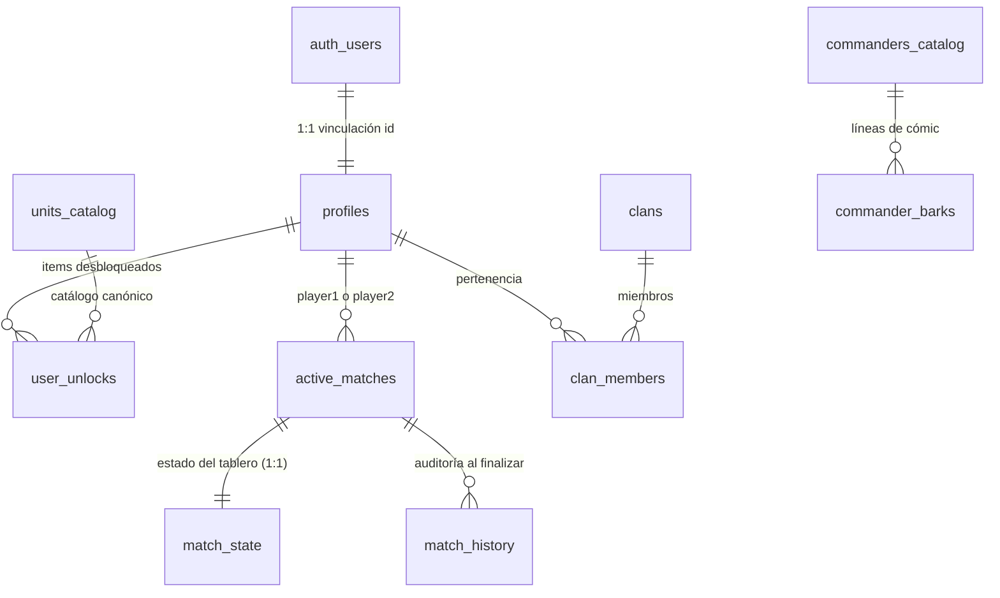

# PROPUESTA MAESTRA DE REAJUSTE ARQUITECTÓNICO, ORQUESTACIÓN DE BASE DE DATOS Y ROADMAP HACIA VERCEL
**Proyecto:** *Tactical Command: Wars of Legacy*  
**Documento Canónico de Remediación:** `/docs/MASTER_REMEDIATION_AND_DEPLOYMENT_PROPOSAL.md`  
**Versión:** 1.0.0-PROPOSAL-ARCH-COUNCIL  
**Fecha:** 31 de Octubre, 2026  
**Modo de Ejecución:** `PLAN_AND_DEBATE_ONLY` (Sin mutación de código fuente hasta aprobación)  
**Consejo Técnico:**
- `[AG-CoreStateArchitect]` (Arquitecto React 19, Determinismo & State Machine)
- `[AG-TacticalEnginePurist]` (Algoritmos de Gameplay, Visión Fog-of-War & Ciclo de Vida IA)
- `[AG-SupabaseOrchestrator]` (Arquitecto PostgreSQL, Schemas, Migraciones & Hidratación)
- `[AG-RealtimeNetcode]` (Ingeniero de Sincronización WebSocket, Optimistic UI & Reconnect)
- `[AG-VercelReleaseEngineer]` (Ingeniero DevOps, Bundling Vite, Edge Security & CI/CD)

---

# 1. RESUMEN EJECUTIVO Y CAMBIO DE PARADIGMA ARQUITECTÓNICO

### 1.1 Diagnóstico de Causa Raíz
La auditoría de viabilidad reveló una paradoja crítica en *Tactical Command: Wars of Legacy*:
1. **El Motor Matemático (`/src/engine`):** Posee una completitud del **94%**, con determinismo estricto tipo *Advance Wars*, algoritmos de Dijkstra/A* para costes de tracción por terreno, fórmulas canónicas de daño, captura a 20 HP, Superpoderes de Comandante (COP/SCOP) y Niebla de Guerra.
2. **El Frontend y la Capa de Integración:** Sufre una degradación severa por deuda técnica debida a:
   - **Monolito Volátil en `src/App.tsx` (2,375 líneas):** Más de 40 hooks `useState` desconectados mantienen el estado del juego exclusivamente en memoria volátil. No existe hidratación ni persistencia real.
   - **Race Conditions de React 19:** El flujo de ataque (`handleMoveUnit -> setTargetEnemyId -> handleExecuteCombat`) en [`CombatTheaterView.tsx#L400-L415`](file:///c:/Users/Mor%C3%ADn/TacticalCommand/src/components/game/CombatTheaterView.tsx#L400-L415) invoca cálculos de combate sincrónicos contra estados asíncronos pendientes de render, abortando ataques válidos silenciosamente.
   - **Divergencia Algorítmica en Niebla de Guerra:** [`src/App.tsx#L1180-L1192`](file:///c:/Users/Mor%C3%ADn/TacticalCommand/src/App.tsx#L1180-L1192) evalúa emboscadas (TRAP) con una trayectoria en "L" hardcodeada en lugar de utilizar el vector de camino calculado por [`src/engine/pathfinding.ts`](file:///c:/Users/Mor%C3%ADn/TacticalCommand/src/engine/pathfinding.ts) y dibujado por [`src/engine/pathingArrow.ts`](file:///c:/Users/Mor%C3%ADn/TacticalCommand/src/engine/pathingArrow.ts).
   - **Timers Huérfanos de IA:** Al cambiar entre modos (`vs_bot` a `hotseat_2p`), los timeouts asíncronos del Bot persisten y sobreescriben turnos de jugadores humanos.
   - **Colapso Inmediato en Vite:** [`src/lib/supabase/client.ts`](file:///c:/Users/Mor%C3%ADn/TacticalCommand/src/lib/supabase/client.ts) intenta leer `process.env.NEXT_PUBLIC_*`, arrojando `Uncaught ReferenceError: process is not defined` en el navegador.
   - **Persistencia Fantasma:** Existen 20 migraciones SQL de alta calidad en `/supabase/migrations` y un módulo WebSockets en [`src/lib/supabase/realtime.ts`](file:///c:/Users/Mor%C3%ADn/TacticalCommand/src/lib/supabase/realtime.ts), pero operan en aislamiento total sin conexión con la UI.

```
       ARQUITECTURA ACTUAL (FRÁGIL)                   NUEVA ARQUITECTURA (TRANSACCIONAL)
┌──────────────────────────────────────┐       ┌──────────────────────────────────────────────┐
│  src/App.tsx (2,375 líneas)          │       │  UI Views (Lobby, CombatTheater, Shop, etc.) │
│  40+ useState dispersos              │       └──────────────────────┬───────────────────────┘
│  Acciones asíncronas no atómicas     │                              ▼
│  Cálculo "L" para TRAP               │       ┌──────────────────────────────────────────────┐
│  Bot con timeouts descontrolados     │       │   useTacticalMatchEngine (Custom Hook)       │
└──────────────────┬───────────────────┘       │   Action Reducer Puro / Command Pattern      │
                   │                           │   Transacciones Atómicas (Move + Attack)     │
                   ▼                           └──────────────┬───────────────────────────────┘
┌──────────────────────────────────────┐                      │
│  /src/engine (Puro, 94% funcional)   │◄─────────────────────┼───────────────────────────────┐
└──────────────────────────────────────┘                      ▼                               ▼
                   │                           ┌──────────────────────────────┐ ┌─────────────┴────────────────┐
                   ▼ (Desconectado)            │  Data Hydration & Sync Layer │ │  useMatchSync (Realtime WS)  │
┌──────────────────────────────────────┐       │  Supabase Client (Vite-safe) │ │  Broadcast + Presence        │
│  20 Migraciones SQL / realtime.ts    │◄──────┤  PostgreSQL RPCs & Tables    │ │  Reconnection & Anti-AFK     │
└──────────────────────────────────────┘       └──────────────────────────────┘ └──────────────────────────────┘
```

### 1.2 Visión del Cambio de Paradigma
Transformar el frontend de un "prototipo interactivo monolítico basado en estados efímeros" a una **Arquitectura Táctica Orientada a Comandos Atómicos** con **Persistencia Híbrida (Event Sourcing ligero en memoria + Sincronización asíncrona en Supabase)** y **Total Compatibilidad CI/CD con Vercel**.

---

# 2. ACTAS DEL DEBATE MULTI-AGENTE (TESIS, ANTÍTESIS Y SÍNTESIS)

---

### MESA 1: El Dilema del Estado Reactivo vs. Motor Transaccional
* **Participantes:** `[AG-CoreStateArchitect]` vs `[AG-TacticalEnginePurist]`

#### Tesis (`[AG-CoreStateArchitect]`):
> "El fallo en `CombatTheaterView.tsx#L400-L415` demuestra que React no debe gestionar la verdad táctica del tablero. Al mezclar `handleMoveUnit(pendingMove.destination)`, `setTargetEnemyId(id)` y `handleExecuteCombat()` de forma consecutiva, confiamos en un re-render síncrono que React 19 jamás garantiza. Debemos desacoplar `App.tsx` en un Reducer determinista (`useTacticalMatchEngine`) y crear una acción atómica `EXECUTE_MOVE_AND_ATTACK` que valide y mute el estado en una sola pasada lógica."

#### Antítesis (`[AG-TacticalEnginePurist]`):
> "Un Reducer monolítico en React puede introducir sobrecarga de re-renderizado si no se aíslan las animaciones, el trazado de flechas (`pathingArrow`) y las viñetas del Bark Engine. La animación de disparo, el retroceso y el cálculo de daño de contraataque necesitan pausas deliberadas (350 ms - 450 ms) para que el jugador perciba visualmente el intercambio balístico. Un comando puramente síncrono no puede congelar la UI sin arruinar la experiencia de usuario."

#### Síntesis de Consenso (Aprobada por Unanimidad):
1. **Transacción Lógica Atómica con Desacoplamiento Visual:**
   - La resolución matemática del combate y el movimiento se calcula de forma **atómica e inmediata** en el motor lógico (`CanonicalCombatEngine`), generando un objeto inmutable `CombatResolutionResult`.
   - El estado lógico del tablero se actualiza inmediatamente para evitar condiciones de carrera, pero la UI entra en un sub-estado `isAnimatingCombat: true` durante $350\text{ ms}$, disparando los efectos de sonido de `audioManager` y las partículas en `GameCanvas.tsx`.
2. **Firma de Comando Unificado:**
   En lugar de encadenar 3 funciones dispersas, `CombatTheaterView` emite un único comando:
   ```typescript
   dispatchTacticalAction({
     type: 'MOVE_AND_ATTACK',
     payload: {
       unitId: selectedUnit.id,
       path: currentPathVector,
       destination: pendingMove.destination,
       targetEnemyId: enemyOnTile.id
     }
   });
   ```
3. **Desacoplamiento de `App.tsx`:** Extraer la lógica de combate, turnos, economía y producción a `src/hooks/useTacticalMatchEngine.ts`, reduciendo `App.tsx` a un enrutador de vistas de nivel superior (< 400 líneas).

---

### MESA 2: Precisión Algorítmica en Emboscadas (TRAP) y Control de IA
* **Participantes:** `[AG-TacticalEnginePurist]` vs `[AG-CoreStateArchitect]`

#### Tesis (`[AG-TacticalEnginePurist]`):
> "En [`src/App.tsx#L1180-L1192`](file:///c:/Users/Mor%C3%ADn/TacticalCommand/src/App.tsx#L1180-L1192), la interpolación en 'L' (`currX += ...` luego `currY += ...`) es inaceptable para un juego táctico canónico. Si una unidad se mueve bordeando un río, la 'L' atraviesa casillas con coste `Infinity` o pisa casillas de bosque que el jugador evitó deliberadamente, activando emboscadas ilegítimas. Además, cuando el bot entra en ejecución en [`App.tsx#L1076`](file:///c:/Users/Mor%C3%ADn/TacticalCommand/src/App.tsx#L1076), los `setTimeout` encadenados no tienen referencia cancelable; si el jugador cambia a modo Hotseat o reinicia la partida, el bot continúa ejecutando acciones en segundo plano y corrompe el nuevo estado."

#### Antítesis (`[AG-CoreStateArchitect]`):
> "Consultar A* en cada micro-movimiento del cursor podría degradar el framerate en dispositivos móviles si el cálculo no está memoizado. Respecto al bot, cancelar promesas nativas de JavaScript requiere manejar estados de aborto explícitos para no dejar unidades 'a medio mover'."

#### Síntesis de Consenso (Aprobada por Unanimidad):
1. **Consumo Directo del Vector de Ruta de `pathfinding.ts`:**
   - El hook de selección de celdas mantendrá la ruta óptima ya precalculada en `ReachableTileInfo.path` (o la ruta customizada trazada con `pathingArrow.ts`).
   - La función `handleMoveUnit` recibirá obligatoriamente `plannedPath: GridPosition[]`.
   - `FogOfWarEngine.checkTrapOnPath` iterará exclusivamente sobre ese vector verificado. Si colisiona con una unidad oculta:
     * La unidad se detiene en `interruptedAt` ($N-1$).
     * Se consumen **todos** los puntos de movimiento restantes.
     * La unidad enemiga oculta se marca como revelada.
     * Se bloquea cualquier sub-acción subsiguiente (Ataque/Captura cancelados forzosamente).
2. **Ciclo de Vida de IA Blindado con `turnSessionId` y `AbortController`:**
   - Cada inicio de turno genera un `turnSessionId` criptográfico/único.
   - La función `triggerBotTurn` recibe una señal `AbortSignal`.
   - En cada paso secuencial del bot (`SPAWN`, `MOVE`, `ATTACK`), el bucle evalúa `if (signal.aborted || currentSessionId !== activeSessionId) return;`.
   - Al desmontar la vista o cambiar a `hotseat_2p`, el `cleanup` de React invoca `abortController.abort()`.

---

### MESA 3: Orquestación de Base de Datos Supabase, Hidratación y Netcode (`0% -> 100%`)
* **Participantes:** `[AG-SupabaseOrchestrator]` vs `[AG-RealtimeNetcode]`

#### Tesis (`[AG-SupabaseOrchestrator]`):
> "Tenemos 20 migraciones SQL de primer nivel con RLS, triggers y RPCs transaccionales (`grant_match_rewards`, `rpc_get_contextual_bark`, `active_matches`, `match_state`). Debemos forzar que cada movimiento y ataque se guarde inmediatamente en `match_state` vía RPC para garantizar total consistencia en PostgreSQL."

#### Antítesis (`[AG-RealtimeNetcode]`):
> "Escribir en la base de datos en cada micro-movimiento o cambio de celda saturaría el límite de I/O de Supabase Free/Pro Tier y agregaría una latencia de 120 ms - 200 ms inaceptable para el ritmo de juego *Blitz Skirmish* (turnos de 30s). La comunicación durante el combate activo debe fluir por canales **WebSockets Broadcast** de latencia ultra-baja (< 30 ms), y persistirse en PostgreSQL de forma estructurada al **finalizar cada turno** (`END_TURN`) o al concluir la partida (`handleConcludeMatch`)."

#### Síntesis de Consenso (Aprobada por Unanimidad):
1. **Estrategia Híbrida: Broadcast en Vivo + Snapshot Autorizado por Turno:**
   - **En el turno activo:** Las acciones tácticas (`MOVE_UNIT`, `ATTACK_UNIT`, `CAPTURE_BUILDING`, `SPAWN_UNIT`) se transmiten vía **Supabase Realtime Broadcast** para animación instantánea en el cliente del oponente.
   - **En el cierre de turno (`END_TURN`):** Se ejecuta un `UPSERT` transaccional sobre la tabla `match_state` (vía RPC `rpc_commit_turn_state`) conteniendo el snapshot validado del tablero, fondos, estado de COs y log de acciones.
   - **Al finalizar partida:** Invocación atómica de la RPC `rpc_conclude_match` para transferir trofeos, XP, créditos y actualizar ELO en `profiles` y `match_history`.
2. **Semilla de Arranque y Modo Offline-First:**
   - Crear un script unificado [`supabase/seed.sql`](file:///c:/Users/Mor%C3%ADn/TacticalCommand/supabase/seed.sql) que genere usuarios de prueba en `auth.users`, active sus perfiles en `public.profiles` con fondos iniciales, desbloquee el catálogo básico en `user_unlocks` e inserte una partida modelo.
   - Si el cliente no detecta conectividad con Supabase o si las variables están vacías, la capa de datos activa automáticamente el **Modo Aislado / Mock Offline**, permitiendo jugar partidas completas contra la IA o en Hotseat sin crashear.

---

### MESA 4: Pipeline de Entorno Local (Windows/Vite) a Producción en Vercel
* **Participantes:** `[AG-VercelReleaseEngineer]` vs `[AG-CoreStateArchitect]`

#### Tesis (`[AG-VercelReleaseEngineer]`):
> "El proyecto está roto en su arranque inicial por mezclar conceptos de Next.js y Vite. El archivo [`src/lib/supabase/client.ts`](file:///c:/Users/Mor%C3%ADn/TacticalCommand/src/lib/supabase/client.ts) usa `process.env.NEXT_PUBLIC_*`. [`src/lib/supabase/server.ts`](file:///c:/Users/Mor%C3%ADn/TacticalCommand/src/lib/supabase/server.ts) intenta cargar `SUPABASE_SERVICE_ROLE_KEY` en una SPA estática, lo cual representa una **vulnerabilidad de seguridad severa** si se incluye en el bundle cliente. Además, `package.json` incluye `express`, pero no hay servidor; y el script `clean` usa sintaxis Bash (`rm -rf`) que falla en terminales nativas de Windows PowerShell."

#### Antítesis (`[AG-CoreStateArchitect]`):
> "No debemos romper las interfaces actuales ni descartar la posibilidad de Edge Functions para arbitraje de partidas. La transición debe mantener la capacidad de compilar con Vite sin requerir dependencias complejas de backend."

#### Síntesis de Consenso (Aprobada por Unanimidad):
1. **Estandarización Estricta de Variables en Vite:**
   - Toda variable accesible por el cliente usará el prefijo canónico `VITE_` (`import.meta.env.VITE_SUPABASE_URL`, `import.meta.env.VITE_SUPABASE_ANON_KEY`).
   - Se inyectará un polyfill de seguridad en `vite.config.ts`: `define: { 'process.env': {} }` para neutralizar dependencias heredadas.
2. **Depuración de Seguridad en `server.ts`:**
   - Aislar [`src/lib/supabase/server.ts`](file:///c:/Users/Mor%C3%ADn/TacticalCommand/src/lib/supabase/server.ts) o marcarlo como exclusivo para Vercel Serverless Functions (`/api/*`), impidiendo que sea importado por ningún componente de `src/`.
3. **Limpieza de `package.json` y Compatibilidad Windows:**
   - Eliminar `express` y `@types/express`.
   - Modificar scripts para compatibilidad universal:
     `"clean": "node -e \"fs.rmSync('dist', { recursive: true, force: true })\""`
4. **Optimización de CSP en `vercel.json`:**
   - Adaptar `connect-src` para permitir `http://127.0.0.1:54321` y `ws://127.0.0.1:54321` en desarrollo, manteniendo el bloqueo estricto en producción.

---

# 3. ESPECIFICACIÓN DE REINGENIERÍA DEL CORE LOOP Y ESTADO

### 3.1 Flujo Atómico Move + Attack (Resolución de la Condición de Carrera)

```
[ Usuario hace clic en objetivo enemigo ]
                   │
                   ▼
[ CombatTheaterView: onCellSelect ]
                   │
                   ├──> Valida: targetingState.actionType === 'attack'
                   ├──> Empaqueta Payload Atómico:
                   │    {
                   │      unitId: selectedUnit.id,
                   │      destination: pendingMove.destination,
                   │      targetEnemyId: enemyOnTile.id,
                   │      pathVector: precalculatedPath
                   │    }
                   ▼
[ useTacticalMatchEngine: dispatchTacticalAction ]
                   │
                   ├── 1. Traslada la unidad en el modelo de datos a 'destination'
                   ├── 2. Calcula alcance de combate real desde 'destination'
                   ├── 3. Computa CanonicalCombatEngine.calculateDamage(...)
                   ├── 4. Aplica daño a atacante y defensor simultáneamente
                   ├── 5. Elimina bajas y carga medidores de CO Power
                   ├── 6. Marca unidad: hasMoved = true, hasActed = true
                   ├── 7. Limpia targetingState y pendingMove
                   │
                   ▼
[ Notificación a UI ] ──> Dispara animación SFX/VFX (350ms) sin bloquear datos
```

#### Definición de Tipos TypeScript del Comando Atómico
```typescript
// src/types/tacticalActions.ts

export interface MoveAndAttackPayload {
  unitId: string;
  destination: GridPosition;
  pathVector: GridPosition[];
  targetEnemyId: string;
}

export interface TacticalActionResult {
  success: boolean;
  error?: string;
  trapTriggered?: boolean;
  combatSummary?: {
    damageDealt: number;
    counterDamageDealt: number;
    defenderEliminated: boolean;
    attackerEliminated: boolean;
  };
}
```

### 3.2 Refactorización de Emboscadas (TRAP) en Niebla de Guerra
Se sustituye el algoritmo en "L" por la validación paso a paso contra el camino real generado por Dijkstra:

```typescript
// Lógica canónica a integrar en useTacticalMatchEngine.ts
function executeUnitMoveWithTrapCheck(
  unit: TacticalUnit,
  targetCoord: GridPosition,
  providedPath?: GridPosition[]
): { finalPosition: GridPosition; isTrapped: boolean } {
  // 1. Obtener la ruta exacta precalculada por Dijkstra o A*
  const actualPath = providedPath && providedPath.length > 0
    ? providedPath
    : TacticalPathfindingEngine.findOptimalPath(
        unit.x, unit.y, targetCoord.x, targetCoord.y,
        { unit, tiles: matchTiles, unitsMap, gridWidth, gridHeight, weather }
      ) || [{ x: unit.x, y: unit.y }, targetCoord];

  // 2. Evaluar colisiones con enemigos ocultos casilla por casilla
  const trapResult = FogOfWarEngine.checkTrapOnPath(
    unit,
    actualPath,
    convertedUnits,
    viewerPerspective,
    matchTiles
  );

  if (trapResult.isTrapped) {
    // 3. Penalización canónica Advance Wars:
    // La unidad se detiene en la casilla previa a la emboscada y PIERDE todo el turno
    audioManager.playSFX('combat_hit');
    return {
      finalPosition: trapResult.interruptedAt,
      isTrapped: true,
    };
  }

  return {
    finalPosition: targetCoord,
    isTrapped: false,
  };
}
```

### 3.3 Blindaje de IA: Cancelación e Invalidación de Timers
Para evitar que el bot ejecute acciones cuando el jugador pasa a modo Hotseat o reinicia la partida:

```typescript
// src/hooks/useBotOrchestrator.ts
export function useBotOrchestrator() {
  const activeSessionRef = useRef<number>(0);
  const abortControllerRef = useRef<AbortController | null>(null);

  const cancelBotExecution = useCallback(() => {
    if (abortControllerRef.current) {
      abortControllerRef.current.abort();
      abortControllerRef.current = null;
    }
    activeSessionRef.current += 1; // Invalida cualquier callback en espera
  }, []);

  const triggerBotTurn = useCallback(async (gameState: BotGameState) => {
    cancelBotExecution();

    const sessionId = activeSessionRef.current;
    const controller = new AbortController();
    abortControllerRef.current = controller;

    try {
      const plan = TacticalBotAI.computeBotTurn(gameState, botDifficulty);

      for (const action of plan.actions) {
        if (controller.signal.aborted || sessionId !== activeSessionRef.current) {
          break; // Aborto inmediato si el turno cambió
        }

        await new Promise((resolve, reject) => {
          const timeout = setTimeout(resolve, BOT_ACTION_STEP_MS);
          controller.signal.addEventListener('abort', () => {
            clearTimeout(timeout);
            reject(new Error('Bot aborted'));
          }, { once: true });
        });

        // Aplicar acción al motor transaccional
        applyBotAction(action);
      }
    } catch (err) {
      // Salida limpia ante cancelación
    }
  }, [cancelBotExecution]);

  return { triggerBotTurn, cancelBotExecution };
}
```

### 3.4 Plan de Desacoplamiento Modular de `src/App.tsx`
El archivo monolítico de 2,375 líneas se particiona en módulos de responsabilidad única:

```
src/
├── App.tsx                              # Enrutador de vistas principales (< 350 líneas)
├── hooks/
│   ├── useTacticalMatchEngine.ts        # Tablero, Unidades, Turnos, Combate y Capturas
│   ├── useBotOrchestrator.ts            # Ciclo de vida de IA con cancelación
│   ├── useMatchSync.ts                  # WebSockets Realtime & Broadcast Supabase
│   └── usePlayerDataHydration.ts        # Perfil, Inventario, Clanes y Cosméticos
├── components/
│   └── navigation/
│       └── TacticalHeader.tsx           # Cabecera desacoplada con recursos y profile
└── config/
    └── systemParameters.ts              # Matriz unificada de calibración técnica
```

---

# 4. PLAN MAESTRO DE ORQUESTACIÓN DE BASE DE DATOS Y SUPABASE REALTIME

### 4.1 Mapa Entidad-Relación de las 20 Migraciones SQL



### 4.2 Script de Inicialización y Semillas (`supabase/seed.sql`)
Diseño completo para inicializar un entorno local de Supabase (`supabase start`) o resetear la base de datos sin errores de claves foráneas:

```sql
-- supabase/seed.sql
-- ==============================================================================
-- SEMILLA CANÓNICA: Tactical Command: Wars of Legacy
-- ==============================================================================

-- 1. Crear usuarios de prueba en auth.users (evita violaciones de FK)
INSERT INTO auth.users (id, instance_id, aud, role, email, encrypted_password, email_confirmed_at, raw_app_meta_data, raw_user_meta_data, created_at, updated_at)
VALUES 
  ('00000000-0000-0000-0000-000000000001', '00000000-0000-0000-0000-000000000000', 'authenticated', 'authenticated', 'commander1@tactical.local', crypt('password123', gen_salt('bf')), now(), '{"provider":"email","providers":["email"]}', '{"username":"OrangeCommander"}', now(), now()),
  ('00000000-0000-0000-0000-000000000002', '00000000-0000-0000-0000-000000000000', 'authenticated', 'authenticated', 'commander2@tactical.local', crypt('password123', gen_salt('bf')), now(), '{"provider":"email","providers":["email"]}', '{"username":"BlueCommander"}', now(), now())
ON CONFLICT (id) DO NOTHING;

-- 2. Crear perfiles militares correspondientes en public.profiles
INSERT INTO public.profiles (
  id, username, avatar_url, account_level, current_xp, battle_credits, command_gems, elo_rating, trophies_count, equipped_loadout, equipped_cosmetics
) VALUES 
  ('00000000-0000-0000-0000-000000000001', 'OrangeCommander', 'https://images.unsplash.com/photo-1579783900882-c0d3dad7b119?w=150', 5, 1250, 6000, 450, 1200, 350, 
   '["infantry", "mech", "recon", "tank_light", "artillery", "anti_air", "b_copter"]'::jsonb,
   '{"tank_light": "skin_tank_desert", "infantry": "skin_infantry_urban"}'::jsonb),
  ('00000000-0000-0000-0000-000000000002', 'BlueCommander', 'https://images.unsplash.com/photo-1579783900882-c0d3dad7b119?w=150', 5, 980, 5000, 300, 1180, 310,
   '["infantry", "mech", "recon", "tank_light", "artillery", "anti_air", "b_copter"]'::jsonb,
   '{"tank_light": "skin_default", "infantry": "skin_default"}'::jsonb)
ON CONFLICT (id) DO NOTHING;

-- 3. Desbloqueos iniciales de armería
INSERT INTO public.user_unlocks (user_id, item_type, item_id, acquisition_method)
VALUES
  ('00000000-0000-0000-0000-000000000001', 'skin', 'skin_tank_desert', 'starter'),
  ('00000000-0000-0000-0000-000000000001', 'skin', 'skin_infantry_urban', 'starter'),
  ('00000000-0000-0000-0000-000000000001', 'co_commander', 'andy', 'starter'),
  ('00000000-0000-0000-0000-000000000002', 'co_commander', 'colin', 'starter')
ON CONFLICT DO NOTHING;

-- 4. Partida modelo para pruebas de reconexión Realtime
INSERT INTO public.active_matches (
  id, room_code, player1_id, player2_id, current_turn_player_id, status, game_mode, map_id, turn_number, turn_time_limit_sec
) VALUES (
  'a0000000-0000-0000-0000-000000000001', 'WAR-TEST', 
  '00000000-0000-0000-0000-000000000001', '00000000-0000-0000-0000-000000000002',
  '00000000-0000-0000-0000-000000000001', 'in_progress', 'blitz_skirmish', 'caustic_finale', 1, 30
) ON CONFLICT (id) DO NOTHING;
```

### 4.3 Capa de Hidratación de Datos (`Data Hydration Layer`)
Define las interacciones exactas entre el cliente y Supabase a lo largo del ciclo de vida:

| Evento del Ciclo de Vida | Operación en Supabase | Fallback Offline en caso de error |
| :--- | :--- | :--- |
| **Arranque de App** | `SELECT * FROM profiles WHERE id = auth.uid()` | Carga perfil mock local (`Commander 01`, 2400G, 650💎). |
| **Carga de Armería** | `SELECT * FROM user_unlocks WHERE user_id = auth.uid()` | Habilita skins y tropas base estándar. |
| **Crear / Unirse a Partida** | `INSERT INTO active_matches ... RETURNING id` | Genera `match_local_${Date.now()}` en memoria. |
| **Acción Táctica (`MOVE`, `ATTACK`)**| `channel.send({ type: 'broadcast', event: 'match_action', payload })` | Procesa en el canvas local sin latencia de red. |
| **Fin de Turno (`END_TURN`)** | `rpc('rpc_commit_turn_state', { p_match_id, p_tiles, p_units, ... })` | Guarda en el estado del reducer en memoria. |
| **Conclusión de Partida** | `rpc('grant_match_rewards', { p_match_id, p_winner_id, ... })` | Muestra `MatchSummaryModal` con cálculo local de XP. |

### 4.4 Especificación del Hook `useMatchSync`
Conecta el gestor [`src/lib/supabase/realtime.ts`](file:///c:/Users/Mor%C3%ADn/TacticalCommand/src/lib/supabase/realtime.ts) con la UI:

```typescript
// src/hooks/useMatchSync.ts
export function useMatchSync(matchId: string | null, userId: string) {
  const [connectionStatus, setConnectionStatus] = useState<'CONNECTING' | 'CONNECTED' | 'DISCONNECTED'>('DISCONNECTED');
  const [isOpponentOnline, setIsOpponentOnline] = useState<boolean>(false);
  const managerRef = useRef<RealtimeConnectionManager | null>(null);

  useEffect(() => {
    if (!matchId || !supabase) return;

    const manager = new RealtimeConnectionManager(supabase, matchId, userId, {
      onActionReceived: (action) => {
        // Ejecutar acción del rival de forma determinista
        tacticalEngine.applyRemoteAction(action);
      },
      onOpponentPresenceChange: (online) => setIsOpponentOnline(online),
      onConnectionStatusChange: (status) => setConnectionStatus(status),
      onStateResynced: (serverState) => {
        // En caso de discrepancia, el estado de PostgreSQL prevalece
        tacticalEngine.rehydrateFromServer(serverState);
      },
    });

    manager.connect();
    managerRef.current = manager;

    return () => {
      manager.disconnect();
      managerRef.current = null;
    };
  }, [matchId, userId]);

  const sendAction = useCallback(async (action: RealtimeMatchEvent) => {
    if (managerRef.current && connectionStatus === 'CONNECTED') {
      await managerRef.current.sendAction(action);
    }
  }, [connectionStatus]);

  return { connectionStatus, isOpponentOnline, sendAction };
}
```

---

# 5. MATRIZ DE PARÁMETROS DE CALIBRACIÓN DEL SISTEMA

Los siguientes parámetros serán expuestos en el nuevo archivo centralizado [`src/config/systemParameters.ts`](file:///c:/Users/Mor%C3%ADn/TacticalCommand/src/config/systemParameters.ts) para permitir al desarrollador calibrar la experiencia sin tocar código del motor:

| Parámetro | Valor por Defecto | Rango Válido | Propósito Técnico |
| :--- | :---: | :---: | :--- |
| `COMBAT_ANIMATION_DELAY_MS` | `350` | `100 - 800` | Tiempo de retardo visual durante el intercambio de disparos antes de retirar bajas. |
| `BOT_ACTION_STEP_MS` | `400` | `150 - 1000` | Intervalo de pausa entre movimientos individuales del bot de IA. |
| `REALTIME_HEARTBEAT_MS` | `5000` | `2000 - 10000`| Frecuencia del ping WebSocket para verificar presencia del rival. |
| `STATE_PERSISTENCE_MODE` | `'per_turn'` | `'per_turn' \| 'per_action'` | Estrategia de guardado en PostgreSQL (por turno ahorra 90% de llamadas). |
| `FOG_TRAP_PENALTY_MODE` | `'stop_and_exhaust'` | `'stop_and_exhaust' \| 'stop_only'` | Penalización al caer en emboscada: perder todas las acciones restantes del turno. |
| `SUPABASE_OFFLINE_FALLBACK`| `true` | `boolean` | Si es `true`, la app opera con mocks locales cuando no hay credenciales de Supabase. |
| `FISCHER_TIME_BONUS_BLITZ` | `3` | `1 - 10` | Segundos añadidos al reloj por cada acción ejecutada en modo Blitz. |
| `FISCHER_MAX_CAP_BLITZ` | `45` | `20 - 120` | Tiempo máximo acumulable en el reloj de turno en modo Blitz. |

---

# 6. NUEVO ROADMAP DE EJECUCIÓN PASO A PASO UNIFICADO (DE CERO A VERCEL PROD)

```
═══════════════════════════════════════════════════════════════════════════════════════════════════
                             PIPELINE MAESTRO DE ORQUESTACIÓN (7 FASES)
═══════════════════════════════════════════════════════════════════════════════════════════════════
  [FASE 0] ──► Saneamiento de Entorno, Build System y Variables Vite (Pre-requisito Bloqueante)
     │
     ▼
  [FASE 1] ──► Cirugía del Core Loop: Ataque Atómico, TRAP con Dijkstra y Cancelación de Bot
     │
     ▼
  [FASE 2] ──► Purga de UI, Aislamiento de Debug (Ctrl+Shift+D), Multitouch Móvil y Háptica
     │
     ▼
  [FASE 3] ──► Orquestación de Base de Datos Supabase (seed.sql), Soft Cap y Tournament Cap
     │
     ▼
  [FASE 4] ──► Protocolo de Red, Sincronización Realtime, Snapshots y Catálogo Fabril Completo
     │
     ▼
  [FASE 5] ──► Onboarding ("Bautismo de Fuego" 8x6), Web Audio Sintetizado y Modo Campaña
     │
     ▼
  [FASE 6] ──► Partición de Bundles (<300KB), Verificación CI/CD y Despliegue en Vercel
═══════════════════════════════════════════════════════════════════════════════════════════════════
```

---

### FASE 0: Saneamiento de Entorno, Build System y Variables Vite
* **Objetivo:** Lograr que el proyecto ejecute `npm run build` y `npm run dev` limpiamente en cualquier entorno (Windows y Linux), erradicando las excepciones en tiempo de carga.

#### Tarea 0.1: Estandarización de Variables de Entorno en Cliente y Servidor
- **[Agente Responsable]:** `[AG-VercelReleaseEngineer]`
- **[Archivos Afectados]:**
  - [`src/lib/supabase/client.ts`](file:///c:/Users/Mor%C3%ADn/TacticalCommand/src/lib/supabase/client.ts)
  - [`src/lib/supabase/server.ts`](file:///c:/Users/Mor%C3%ADn/TacticalCommand/src/lib/supabase/server.ts)
  - [`.env.example`](file:///c:/Users/Mor%C3%ADn/TacticalCommand/.env.example)
- **[Lógica Exacta a Implementar]:**
  1. En `client.ts`, reemplazar `process.env.NEXT_PUBLIC_SUPABASE_URL` por `import.meta.env.VITE_SUPABASE_URL`.
  2. En `client.ts`, reemplazar `process.env.NEXT_PUBLIC_SUPABASE_ANON_KEY` por `import.meta.env.VITE_SUPABASE_ANON_KEY`.
  3. Proteger la inicialización: si las variables son nulas o cadenas vacías, instanciar un cliente en modo desconectado seguro o advertir sin lanzar excepción no capturada.
- **[Criterio de Éxito / Test de Verificación]:** Al abrir la app en el navegador sin variables de entorno configuradas, la consola no arroja `ReferenceError: process is not defined`.

#### Tarea 0.2: Polyfill de Seguridad en Vite y Purga de Dependencias
- **[Agente Responsable]:** `[AG-VercelReleaseEngineer]`
- **[Archivos Afectados]:**
  - [`vite.config.ts`](file:///c:/Users/Mor%C3%ADn/TacticalCommand/vite.config.ts)
  - [`package.json`](file:///c:/Users/Mor%C3%ADn/TacticalCommand/package.json)
- **[Lógica Exacta a Implementar]:**
  1. Añadir `define: { 'process.env': {} }` en `vite.config.ts` para capturar cualquier acceso residual de librerías externas.
  2. Eliminar las dependencias `"express"` y `"@types/express"` de `package.json`.
  3. Modificar el script `"clean"` por una instrucción universal de Node: `"clean": "node -e \"try { fs.rmSync('dist', { recursive: true, force: true }); } catch (e) {}\""`.
- **[Criterio de Éxito / Test de Verificación]:** Ejecución exitosa de `npx vite build` (o comando de build disponible) generando la carpeta `dist/` sin advertencias de variables no resueltas.

---

### FASE 1: Cirugía del Motor Interactivo y Erradicación de Bugs de Jugabilidad
* **Objetivo:** Garantizar que una partida táctica pueda completarse de principio a fin al 100% en modo Local Hotseat y vs Bot, sin clics fallidos, falsas emboscadas ni cuelgues.

#### Tarea 1.1: Creación de la Acción Atómica Move + Attack
- **[Agente Responsable]:** `[AG-CoreStateArchitect]`
- **[Archivos Afectados]:**
  - [`src/components/game/CombatTheaterView.tsx`](file:///c:/Users/Mor%C3%ADn/TacticalCommand/src/components/game/CombatTheaterView.tsx)
  - [`src/App.tsx`](file:///c:/Users/Mor%C3%ADn/TacticalCommand/src/App.tsx) (o nuevo hook `useTacticalMatchEngine.ts`)
- **[Lógica Exacta a Implementar]:**
  1. Reemplazar la secuencia fragmentada en `CombatTheaterView.tsx#L405-L415`:
     ```typescript
     // ANTES (Roto):
     if (pendingMove) handleMoveUnit(pendingMove.destination);
     setTargetEnemyId(enemyOnTile.id);
     handleExecuteCombat();
     ```
  2. Implementar `handleAtomicMoveAndAttack({ unitId, destination, path, targetEnemyId })`, calculando el daño directamente con la posición `destination` y ejecutando la mutación de estado en una sola pasada.
- **[Criterio de Éxito / Test de Verificación]:** Seleccionar un tanque, ordenar movimiento a 3 casillas de distancia y atacar a una unidad enemiga en rango en un solo flujo. El daño se aplica instantáneamente y la unidad enemiga reduce su HP o es destruida sin requerir clics adicionales.

#### Tarea 1.2: Unificación del Trazado Canónico en Emboscadas (TRAP)
- **[Agente Responsable]:** `[AG-TacticalEnginePurist]`
- **[Archivos Afectados]:**
  - [`src/App.tsx#L1180-L1227`](file:///c:/Users/Mor%C3%ADn/TacticalCommand/src/App.tsx#L1180-L1227)
  - [`src/engine/pathfinding.ts`](file:///c:/Users/Mor%C3%ADn/TacticalCommand/src/engine/pathfinding.ts)
- **[Lógica Exacta a Implementar]:**
  1. Eliminar el bucle de aproximación en "L" en `handleMoveUnit`.
  2. Recuperar la ruta precalculada desde `reachableCells.find(c => c.x === targetCoord.x && c.y === targetCoord.y)?.path`.
  3. Enviar dicho vector ordenado a `FogOfWarEngine.checkTrapOnPath(...)`.
- **[Criterio de Éxito / Test de Verificación]:** Mover una unidad bordeando un bosque que oculta a un enemigo: si la ruta calculada no entra en la casilla del bosque, la unidad NO sufre emboscada. Si la ruta atraviesa la casilla ocupada, la unidad se detiene en la casilla inmediatamente anterior con la alerta `¡EMBOSCADA DETECTADA! (TRAP)` y agota su turno.

#### Tarea 1.3: Control de Ciclo de Vida y Cancelación del Bot de IA
- **[Agente Responsable]:** `[AG-TacticalEnginePurist]`
- **[Archivos Afectados]:**
  - [`src/App.tsx#L790-L968`](file:///c:/Users/Mor%C3%ADn/TacticalCommand/src/App.tsx#L790-L968)
- **[Lógica Exacta a Implementar]:**
  1. Implementar un `AbortController` asociado al turno actual.
  2. Si el jugador pasa a `hotseat_2p` o presiona "Reiniciar Partida", disparar `abortController.abort()`.
  3. En `triggerBotTurn`, comprobar `signal.aborted` antes de cada acción.
- **[Criterio de Éxito / Test de Verificación]:** Iniciar turno del Bot en `vs_bot`, alternar inmediatamente a `hotseat_2p`. El Bot detiene su cálculo al instante y el control de P2 queda completamente en manos del usuario sin interferencias.

---

### FASE 2: Purga de UI, Aislamiento de Debug y Ergonomía Móvil
* **Objetivo:** Limpiar la interfaz de producción de controles de depuración y garantizar fluidez táctil en dispositivos móviles.
* **Referencia:** `docs/orchestration/01_UI_AND_MOBILE_ERGONOMICS.md`
* **Agente Líder:** `[AG-CoreStateArchitect]`

#### Tareas Técnicas:
1. **Extracción de la Consola de Depuración (`DebugDevConsoleModal.tsx`):**
   - Retirar del Drawer lateral de `CombatTheaterView.tsx` los controles de Niebla manual, Clima forzado, Sensor Sonja, Bark manual e importación de mapas AWBW.
   - Encapsularlos en `src/components/game/DebugDevConsoleModal.tsx` accesible con `Ctrl + Shift + D` o en modo `import.meta.env.DEV`.
2. **Insignias Pasivas de Atajos de Teclado:**
   - Integrar badges visuales de atajo (`[1]`, `[2]`, `[Space]`) en `TileContextMenu.tsx` y barra de CO Powers.
3. **Módulo de Retroalimentación Háptica:**
   - Crear `src/engine/hapticFeedback.ts` utilizando la API `navigator.vibrate` para selección, combate, emboscadas y superpoderes.
4. **Reconocimiento Multitáctil en Canvas:**
   - Implementar en `GameCanvas.tsx` el soporte por dos dedos (*pinch-to-zoom*) entre $0.65\times$ y $1.80\times$, paneo inercial y doble toque para confirmar celda.
* **Criterio de Aceptación (Verification Gate 2):** Drawer táctico 100% limpio en producción; gestos multitáctiles y vibración háptica responsivos a 60 FPS en móviles.

---

### FASE 3: Orquestación de Base de Datos Supabase, Semillas y Economía
* **Objetivo:** Dejar el backend de Supabase listo para ser ejecutado tanto en local (`supabase start`) como conectado a un proyecto en la nube, con datos semilla completos y rebalanceo de retención.
* **Referencias:** `docs/MASTER_REMEDIATION...` y `docs/orchestration/02_ECONOMY_AND_RETENTION_REBALANCE.md`
* **Agente Líder:** `[AG-SupabaseOrchestrator]`

#### Tareas Técnicas:
1. **Script de Semillas Canónicas (`supabase/seed.sql`):**
   - Insertar 2 usuarios de prueba con contraseñas encriptadas en `auth.users`.
   - Poblar `public.profiles` con perfiles Orange y Blue Stars.
   - Vincular desbloqueos básicos en `public.user_unlocks`.
   - Generar una sala de prueba en `public.active_matches`.
2. **Rebalanceo de Economía Offline (Soft Cap Escalonado):**
   - Sustituir el corte binario por la curva decreciente $\mu(k) = [0.60 \rightarrow 0.30 \rightarrow 0.10 \rightarrow 0.02]$ en `autonomousOrchestrator.ts` con suelo de $+5\text{ XP}$ y $+10\text{ Créditos}$.
3. **Normalización de Torneo (Tournament Cap Nivel 11):**
   - Implementar `normalizeCardLevel(lvl, isTournamentMode)` en `canonicalCombat.ts` forzando estadísticas de Nivel 11 en torneos esports.
4. **Verificación de Políticas RLS y Permisos de Tablas:**
   - Asegurar lectura pública anónima en catálogos de unidades y comandantes.
* **Criterio de Aceptación (Verification Gate 3):**
  - Ejecución limpia de `supabase db reset` sin errores de integridad referencial.
  - Al completar partidas consecutivas offline vs bot, el jugador recibe recompensas graduales sin interrupción súbita.

---

### FASE 4: Protocolo de Red Realtime, Reconexión y Catálogo Fabril
* **Objetivo:** Conectar el multijugador en tiempo real con recuperación ante desconexiones y habilitar el catálogo completo de producción.
* **Referencias:** `docs/MASTER_REMEDIATION...` y `docs/orchestration/03_NETWORKING_AND_TECHNICAL_DEBT.md`
* **Agentes Líderes:** `[AG-RealtimeNetcode]` & `[AG-SupabaseOrchestrator]`

#### Tareas Técnicas:
1. **Hook de Sincronización WebSocket (`src/hooks/useMatchSync.ts`):**
   - Conectar `src/lib/supabase/realtime.ts` a la vista de combate para emitir y recibir eventos Broadcast en vivo.
2. **Protocolo de Recuperación en Caliente (Snapshot + Deltas):**
   - Implementar la reconstrucción de partida al reconectar consumiendo el Banco de Gracia de 30s sin reiniciar el turno.
3. **Ampliación del Catálogo en Fábricas (`ProductionModal.tsx`):**
   - Integrar en `turnEconomy.ts` y `ProductionModal.tsx` las unidades APC, Neotanque, T-Copter y Batería de Misiles.
* **Criterio de Aceptación (Verification Gate 4):**
  - Dos ventanas del navegador en la misma partida sincronizan movimientos y ataques instantáneamente.
  - Al simular caída de red en DevTools, el cliente reconecta y reconstruye la cuadrícula exacta en menos de 200 ms.
  - El modal de producción despliega las 14 unidades canónicas respetando fondos e instalaciones.

---

### FASE 5: Onboarding, Audio Procedural y Gran Campaña
* **Objetivo:** Proveer la experiencia guiada de primera sesión ("Bautismo de Fuego"), síntesis de audio Web Audio API y el Acto I de la campaña.
* **Referencia:** `docs/orchestration/04_CONTENT_AND_ONBOARDING_PIPELINE.md`
* **Agente Líder:** `[AG-TacticalEnginePurist]`

#### Tareas Técnicas:
1. **Tutorial Guiado "Bautismo de Fuego" ($8 \times 6$):**
   - Crear `src/engine/tutorialEngine.ts` con máquina de estados restrictiva (bloqueo celda a celda en 7 pasos) y `src/components/game/TutorialOverlay.tsx`.
2. **Sintetizador Procedural Web Audio API:**
   - En `src/engine/audioManager.ts`, implementar la matriz de osciladores paramétricos (cañones, ráfagas, cohetes y explosiones), garantizando funcionamiento offline instantáneo con 0 archivos pesados de audio.
3. **Estructura del Acto I de Campaña:**
   - Crear `src/engine/campaignEngine.ts` con las misiones introductorias del conflicto en mapas ampliados ($24\times24$).
* **Criterio de Aceptación (Verification Gate 5):**
  - Un jugador nuevo completa el tutorial guiado sin poder hacer clics erróneos en celdas no autorizadas.
  - El sonido balístico reproduce detonaciones nítidas generadas sintéticamente sin descargar archivos de audio externos.

---

### FASE 6: Certificación CI/CD, Chunking y Despliegue Final en Vercel
* **Objetivo:** Optimizar el bundle para Vercel Edge, certificar la suite de pruebas y desplegar a producción.
* **Agente Líder:** `[AG-VercelReleaseEngineer]`

#### Tareas Técnicas:
1. **Partición de Bundles en `vite.config.ts`:**
   - Configurar `manualChunks` para `vendor-react`, `vendor-supabase`, `vendor-lucide` y `engine-core`.
2. **Auditoría de Seguridad y Cabeceras en `vercel.json`:**
   - Ajustar Content Security Policy (CSP) en `vercel.json` asegurando conectividad dual (Supabase Cloud + Localhost).
3. **Ejecución y Certificación de la Suite de Pruebas:**
   - Ejecutar la suite completa de tests unitarios e integrados (`e2eIntegration.test.ts`, `combat.test.ts`, etc.) logrando 100% PASS sin regresiones.
* **Criterio de Aceptación (Verification Gate 6):**
  - Despliegue exitoso en Vercel con URL de producción activa.
  - Bundle inicial menor a 250 KB gzipped y First Contentful Paint < 1.0s.

---

# 7. PROTOCOLO DE APROBACIÓN DEL DESARROLLADOR (SIGN-OFF GATE)

Para autorizar el inicio de la **Fase 0** y la ejecución secuencial del roadmap, el Desarrollador Principal debe revisar y rubricar las siguientes decisiones de arquitectura:

```markdown
### CHECKLIST DE CONFORMIDAD TÉCNICA (LEAD DEVELOPER APPROVAL)

[ ] 1. APROBACIÓN DE SANEAMIENTO VITE (Fase 0):
    Autorizo reemplazar 'process.env.NEXT_PUBLIC_*' por 'import.meta.env.VITE_*' en client.ts 
    y eliminar las dependencias residuales de Express en package.json.

[ ] 2. APROBACIÓN DEL COMANDO ATÓMICO MOVE + ATTACK (Fase 1):
    Autorizo unificar el flujo de ataque en una transacción lógica atómica para erradicar 
    la condición de carrera asíncrona en CombatTheaterView.tsx.

[ ] 3. APROBACIÓN DEL TRAZADO DE RUTA CANÓNICO EN TRAP (Fase 1):
    Autorizo sustituir el cálculo en 'L' por el consumo del vector exacto de Dijkstra/A* en App.tsx.

[ ] 4. APROBACIÓN DE LA ESTRATEGIA DE BASE DE DATOS (Fases 2 y 3):
    Autorizo la estrategia híbrida: Broadcast en vivo para acciones inmediatas + Snapshot en 
    PostgreSQL por turno (STATE_PERSISTENCE_MODE = 'per_turn') con fallback offline automático.

[ ] 5. APROBACIÓN DE PARTICIÓN MODULAR DE APP.TSX:
    Autorizo desacoplar src/App.tsx extrayendo hooks especializados (useTacticalMatchEngine, 
    useBotOrchestrator, useMatchSync).
```

---
*Fin del Documento de Propuesta Maestra. Esperando validación del Desarrollador Principal para proceder a la Fase 0.*
