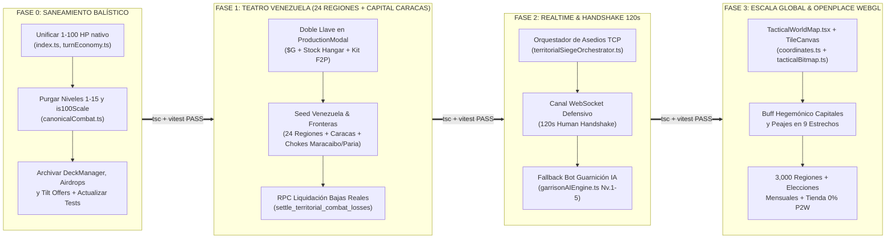

# 🛡️ PLAN MAESTRO DE MIGRACIÓN QUIRÚRGICA Y PURGA DE LEGADO (`MIGRATION_AND_LEGACY_PURGE_PLAN`)

> **Proyecto:** **GEOTACTICS: ONLINE (`v0.0.1-alfa`)** *(Refundación Canónica desde Tactical Command: Wars of Legacy)*  
> **Código de Documento:** `docs/MIGRATION_AND_LEGACY_PURGE_PLAN.md`  
> **Autoridad Emisora:** Agente 6 — Auditor Forense y Gatekeeper de Depuración (*Legacy Purge Manager*)  
> **Documento Rector Padre (SSOT):** `docs/00_GEOTACTICS_ONLINE_MASTER_SPEC.md`  
> **Invariante de Ingeniería:** **Zero-Downtime Migration** (`tsc --noEmit` = 0 errores y `npm test` = 100% verde al cierre de cada sub-etapa).

---

## 1. PROPÓSITO Y PRINCIPIO DE CONTINUIDAD OPERATIVA (ZERO-DOWNTIME MIGRATION)

La transición desde el prototipo híbrido anterior (*Tactical Command: Wars of Legacy*, que mezclaba mecánicas de CCG estilo *Clash Royale* con niveles 1-15, mazos de 10 cartas, cofres gacha y escala dual 1-10 / 1-100 HP) hacia **GEOTACTICS: ONLINE (`v0.0.1-alfa`)** exige una cirugía forense sin interrupción del compilador ni rotura de la suite de pruebas automatizadas.

### 1.1 Las 5 Reglas de Oro de la Transición Sin Ruptura (`Zero-Downtime`)
1. **Prohibición de Borrado a Ciegas (*No Blind Deletes*):** Ningún módulo legado (`deckManager.ts`, `asymmetricLadderEngine.ts`, `airdropSystem.ts`) se elimina del árbol de compilación antes de haber desacoplado sus consumidores en `src/App.tsx`, `src/components/game/ProductionModal.tsx` y `src/engine/e2eIntegration.test.ts`.
2. **Patrón *Strangler Fig* en Contratos TypeScript:**
   - En `Fase 0`, las propiedades obsoletas en `TacticalUnit` y `CanonicalCombatOptions` (`attackerLevel`, `defenderLevel`, `scale100Hp`) se marcan primero como `@deprecated` o se puentean internamente a la escala única `1-100 HP` mientras se actualizan los archivos de test unitarios.
   - Una vez que los tests operan nativamente en `1-100 HP` y con `tier: 1 | 2 | 3 | 4 | 5` ($+2\%$ por nivel industrial sobre T1), se retiran las ramas muertas (`is100Scale`, `getLevelAttackBonus`, `normalizeCardLevel`).
3. **Invariante de Compilación Continua (`Gatekeeper Check`):** Cada commit atómico dentro de las Fases 0 a 3 debe superar secuencialmente:
   - `npx tsc --noEmit` (Verificación estricta de tipos en `src/`).
   - `npx vitest run` (Ejecución determinista de suites de motor).
4. **Preservación de Activos de Alto Valor:** Se conserva el **100%** del motor balístico y de movimiento (`canonicalDamageChart.ts`, `canonicalMovement.ts`, `pathfinding.ts`, `fogOfWar.ts`, `weatherSystem.ts`, `coSystem.ts`, `barkEngine.ts`), el complejo industrial de 10 parcelas (`industrialEngine.ts`), el mercado P2P con split del 2% (`P2PMarketplaceView.tsx`) y la topología geopolítica en Supabase (`world_countries`, `world_provinces`, `territory_control`, `user_unit_hangar`).
5. **Trazabilidad Histórica en Archivo Frío:** Todo documento superado por el nuevo SSOT se mueve de forma ordenada a `docs/archive_legacy/v0_tactical_command_ccg/` o `docs/archive_legacy/v1_metagame_drafts/` para preservar la memoria arquitectónica sin contaminar el contexto de agentes ni desarrolladores.



---

## 2. MATRIZ FORENSE DE DOCUMENTACIÓN (`@docs/` Y `@METAGAME_DESIGN/`)

Se han auditado todos los **75 archivos** del repositorio documental en `docs/` (incluyendo `architecture/`, `orchestration/`, `archive_legacy/` y los 2 nuevos documentos rectores) y `METAGAME_DESIGN/` (26 archivos). Ningún archivo ha sido omitido.

### 2.1 Directorio Principal `docs/` (22 Archivos)

| # | Ruta Exacta | Estado de Alineación | Conceptos Deprecados Detectados | Dictamen de Acción |
| :--- | :--- | :--- | :--- | :--- |
| 0A | `docs/00_GEOTACTICS_ONLINE_MASTER_SPEC.md` | 🟢 **SSOT SUPREMO (`v0.0.1-alfa`)** | Cero conceptos deprecados. Documento de Verdad Absoluta unificado por el Concilio de 6 Agentes. | `[MANTENER COMO SSOT]` |
| 0B | `docs/MIGRATION_AND_LEGACY_PURGE_PLAN.md` | 🟢 **SSOT DE DEPURACIÓN** | Cero conceptos deprecados. Matriz forense de migración y purga de legado. | `[MANTENER COMO SSOT]` |
| 1 | `docs/00_ARBOL_CANONICO_DE_SISTEMAS_Y_DESARROLLO.md` | 🟡 Híbrido (Transición V5) | Menciona coexistencia con niveles 1-15 de cartas, AirDrops dinámicos y referencias a mazos antiguos junto al Hangar V2. | `[MIGRAR / ACTUALIZAR]` (Reemplazado como SSOT raíz por `docs/00_GEOTACTICS_ONLINE_MASTER_SPEC.md`) |
| 2 | `docs/01_MASTER_GAME_DESIGN_DOCUMENT.md` | 🔴 Obsoleto (Canon CCG V4) | Mazo obligatorio de 10 cartas, niveles de unidad 1 a 15, AirDrops en turnos 2 y 5, cofres y ofertas Tilt. | `[ARCHIVAR EN docs/archive_legacy/v0_tactical_command_ccg/]` |
| 3 | `docs/02_MASTER_METAGAME_INDUSTRY_ECONOMY.md` | 🟡 Parcialmente Alineado | Industria de 10 parcelas y mercado P2P válidos, pero incluye monetización reactiva por Tilt ($0.99), cofres y AirDrops. | `[MIGRAR / ACTUALIZAR]` (Purgar secciones de Cofres/Tilt; conservar Industria 10 parcelas y P2P) |
| 4 | `docs/03_MASTER_COMMANDERS_BARK_AND_SOCIAL.md` | 🟢 Alta Alineación (90%) | Sistema de COs y Bark Engine en viñetas 100% vigente; contiene triggers menores de `airdrop_spawn` y cofres de clan. | `[MIGRAR / ACTUALIZAR]` (Limpiar triggers de AirDrop/Cofres; mantener como especificación de COs y Bark Engine) |
| 5 | `docs/04_MASTER_DATABASE_AND_SECURITY_SPEC.md` | 🟡 Parcialmente Obsoleto | Documenta tablas legadas `user_cards`, `user_chests`, `user_loadouts`, RPC `claim_airdrop` y telemetría de Tilt. | `[MIGRAR / ACTUALIZAR]` (Actualizar al esquema soberano V2: `regions`, `region_sovereignty`, `user_unit_hangar`) |
| 6 | `docs/05_MASTER_GAME_ENGINE_AND_NETWORKING.md` | 🟡 Parcialmente Alineado | Arquitectura Canvas y WebSockets válida; incluye referencias a `airdropSystem` y validación de mazo de 10 cartas. | `[MIGRAR / ACTUALIZAR]` (Purgar mazo y AirDrop; documentar LOD Semántico y Handshake de 120s) |
| 7 | `docs/06_MASTER_DEVOPS_QA_AND_TELEMETRY.md` | 🟡 Parcialmente Obsoleto | Suite QA válida, pero audita invariantes de mazo de 10 cartas, niveles 1-15, AirDrop y ofertas flash por Tilt. | `[MIGRAR / ACTUALIZAR]` (Actualizar invariantes QA a escala 1-100 HP y Doble Llave de Hangar) |
| 8 | `docs/07_MASTER_PROJECT_ROADMAP_AND_SPRINTS.md` | 🔴 Obsoleto | Sprints históricos basados en construcción de mazos, cofres, AirDrops, niveles 1-15 y capitales inexpugnables. | `[ARCHIVAR EN docs/archive_legacy/v0_tactical_command_ccg/]` |
| 9 | `docs/08_MASTER_MATCHMAKING_PROPOSAL.md` | 🔴 Obsoleto (CCG Ladder) | Emparejamiento W-APL basado en niveles de cartas 1-15, Boltzmann LUT para mazos de 10 cartas y Tournament Cap Nivel 11. | `[ARCHIVAR EN docs/archive_legacy/v0_tactical_command_ccg/]` |
| 10 | `docs/08_PROPOSAL_ECONOMY_IDLE_REWORK.md` | 🔴 Superado | Borrador intermedio de economía idle que aún conserva el mazo de 10 cartas, cofres y niveles 1-15. | `[ARCHIVAR EN docs/archive_legacy/v0_tactical_command_ccg/]` |
| 11 | `docs/09_PROPOSAL_ECONOMY_REBALANCE_V2.md` | 🔴 Superado | Propuesta de rebalanceo de progresión de cartas (niveles 1-15), mazos de 10 cartas y cofres a 100 días. | `[ARCHIVAR EN docs/archive_legacy/v0_tactical_command_ccg/]` |
| 12 | `docs/09_RFC_SYSTEM_REBALANCE_AND_UI_PARITY.md` | 🔴 Superado | RFC de paridad que incluye mazo de 10 cartas, cofres y suministros por AirDrop. | `[ARCHIVAR EN docs/archive_legacy/v0_tactical_command_ccg/]` |
| 13 | `docs/FASE_2_DESPLIEGUE_LOCAL_MASTER_PLAN.md` | 🟢 Operativo / Infraestructura | Guía operativa de aprovisionamiento local (`localhost` + Supabase). Sin contradicciones de diseño. | `[MANTENER COMO SSOT]` (Referencia operativa de entorno local) |
| 14 | `docs/MASTER_REMEDIATION_AND_DEPLOYMENT_PROPOSAL.md` | 🔴 Superado | Propuesta puntual del 31-Oct-2026 con referencias a tablas de cofres (`user_chests`). | `[ARCHIVAR EN docs/archive_legacy/v0_tactical_command_ccg/]` |
| 15 | `docs/ORQUESTACION_SISTEMA_E2E_PLAYTEST_QA_MULTIMODAL.md` | 🟢 Alineado (QA Técnico) | Especificación del agente de playtesting E2E con Playwright y captura multimodal. | `[MANTENER COMO SSOT]` |
| 16 | `docs/PLAN_MAESTRO_REESTRUCTURACION_HEGEMONIA.md` | 🟢 Totalmente Alineado (100%) | Define los 5 pilares de Hegemonía / GeoTactics: escala 1-100 HP, Doble Llave, Isla de Prueba (50 regiones), Handshake 120s y Buff Hegemónico de Capital. | `[MANTENER COMO SSOT]` (Pilar 3 de `00_GEOTACTICS_ONLINE_MASTER_SPEC.md`) |
| 17 | `docs/PROPOSAL_DB_ARCHITECTURE.md` | 🔴 Obsoleto | RFC antiguo de base de datos centrado en mazos (`deck`), cofres (`chest`) y cartas nivel 15. | `[ARCHIVAR EN docs/archive_legacy/v0_tactical_command_ccg/]` |
| 18 | `docs/PROPUESTA_REINGENIERIA_SOCIAL_Y_CLANES.md` | 🟡 Parcialmente Superado | Introduce clanes y guerra territorial, pero conserva referencias a cofres y mazos. | `[ARCHIVAR EN docs/archive_legacy/v0_tactical_command_ccg/]` |
| 19 | `docs/UI_UX_AUDIT_REPORT.md` | 🟢 Alineado (Estética C4ISR) | Auditoría visual bajo la directriz *Kinetic Comic War-Room* (`tactical-command-intel`). | `[MANTENER COMO SSOT]` |
| 20 | `docs/UI_UX_RESTRUCTURE_BLUEPRINT.md` | 🟡 Parcialmente Alineado | Diseño de la consola C4ISR válido; menciona pestaña de Mazo de 10 Cartas junto al Hangar. | `[MIGRAR / ACTUALIZAR]` (Sustituir referencias a Mazo por Hangar Físico y Camuflajes) |

### 2.2 Subdirectorios `docs/architecture/` y `docs/orchestration/` (6 Archivos)

| # | Ruta Exacta | Estado de Alineación | Conceptos Deprecados Detectados | Dictamen de Acción |
| :--- | :--- | :--- | :--- | :--- |
| 21 | `docs/architecture/PROPUESTA_REINGENIERIA_MIGRACION_16.md` | 🔴 Superado | Documento de la migración 16 con tablas de cofres (`chest`) previas a las migraciones 23-25. | `[ARCHIVAR EN docs/archive_legacy/v0_tactical_command_ccg/]` |
| 22 | `docs/orchestration/00_MASTER_EXECUTION_PLAN.md` | 🔴 Superado | Plan de ejecución de la etapa CCG (Octubre 2026) con referencias a cofres. | `[ARCHIVAR EN docs/archive_legacy/v0_tactical_command_ccg/]` |
| 23 | `docs/orchestration/01_UI_AND_MOBILE_ERGONOMICS.md` | 🟡 Parcialmente Superado | Ergonomía móvil útil, pero vinculada al ciclo de cofres del lobby antiguo. | `[ARCHIVAR EN docs/archive_legacy/v0_tactical_command_ccg/]` |
| 24 | `docs/orchestration/02_ECONOMY_AND_RETENTION_REBALANCE.md` | 🔴 Obsoleto | Especifica el Tournament Cap Nivel 11, niveles 1-15 en `asymmetricLadderEngine.ts` y cofres. | `[ARCHIVAR EN docs/archive_legacy/v0_tactical_command_ccg/]` |
| 25 | `docs/orchestration/03_NETWORKING_AND_TECHNICAL_DEBT.md` | 🟡 Parcialmente Superado | Reconexión de partidas útil, pero acoplada a sincronización de mazos y AirDrops. | `[ARCHIVAR EN docs/archive_legacy/v0_tactical_command_ccg/]` |
| 26 | `docs/orchestration/04_CONTENT_AND_ONBOARDING_PIPELINE.md` | 🟡 Parcialmente Superado | Pipeline de tutorial y audio válido; menciona recompensas de cofres y AirDrops. | `[ARCHIVAR EN docs/archive_legacy/v0_tactical_command_ccg/]` |

### 2.3 Subdirectorio `docs/archive_legacy/` (21 Archivos Ya Archivados)

| # | Ruta Exacta | Estado de Alineación | Conceptos Deprecados Detectados | Dictamen de Acción |
| :--- | :--- | :--- | :--- | :--- |
| 27 | `docs/archive_legacy/01_GAME_DESIGN_DOCUMENT.md` | ⚫ Archivado (V3 CCG) | Mazo 10 cartas, niveles 1-15, cofres, Tilt. | `[MANTENER EN ARCHIVO FRÍO: docs/archive_legacy/v0_tactical_command_ccg/]` |
| 28 | `docs/archive_legacy/02_DATABASE_SCHEMA.md` | ⚫ Archivado (V1 DB) | Tablas `user_cards`, `user_chests`, Tilt. | `[MANTENER EN ARCHIVO FRÍO: docs/archive_legacy/v0_tactical_command_ccg/]` |
| 29 | `docs/archive_legacy/03_GAME_ENGINE_ARCHITECTURE.md` | ⚫ Archivado (V1 Engine) | Mazo 10 cartas, Tilt. | `[MANTENER EN ARCHIVO FRÍO: docs/archive_legacy/v0_tactical_command_ccg/]` |
| 30 | `docs/archive_legacy/04_NETWORKING_AND_BOTS.md` | ⚫ Archivado (V1 Net) | Mazo 10 cartas. | `[MANTENER EN ARCHIVO FRÍO: docs/archive_legacy/v0_tactical_command_ccg/]` |
| 31 | `docs/archive_legacy/05_MONETIZATION_AND_PROGRESSION.md` | ⚫ Archivado (V1 Monet.) | Cofres gacha, cartas nivel 15. | `[MANTENER EN ARCHIVO FRÍO: docs/archive_legacy/v0_tactical_command_ccg/]` |
| 32 | `docs/archive_legacy/06_PROJECT_ROADMAP.md` | ⚫ Archivado (V2 Roadmap) | Fusión con Clash Royale (10 cartas, cofres, PTE). | `[MANTENER EN ARCHIVO FRÍO: docs/archive_legacy/v0_tactical_command_ccg/]` |
| 33 | `docs/archive_legacy/07_DATABASE_INFRASTRUCTURE_PLAN.md` | ⚫ Archivado | Mazos de 10 cartas y cofres. | `[MANTENER EN ARCHIVO FRÍO: docs/archive_legacy/v0_tactical_command_ccg/]` |
| 34 | `docs/archive_legacy/08_TACTICAL_AND_ECONOMIC_SYSTEMS_GDD.md` | ⚫ Archivado | Mazos de 10 cartas y cofres. | `[MANTENER EN ARCHIVO FRÍO: docs/archive_legacy/v0_tactical_command_ccg/]` |
| 35 | `docs/archive_legacy/09_FRONTEND_ENGINE_AND_AI_ARCHITECTURE.md` | ⚫ Archivado | Validación de deck en cliente. | `[MANTENER EN ARCHIVO FRÍO: docs/archive_legacy/v0_tactical_command_ccg/]` |
| 36 | `docs/archive_legacy/10_DEFINITIVE_SPRINT_EXECUTION_PLAN.md` | ⚫ Archivado | Sprints de mazos de 10 cartas, cofres y Tilt. | `[MANTENER EN ARCHIVO FRÍO: docs/archive_legacy/v0_tactical_command_ccg/]` |
| 37 | `docs/archive_legacy/11_DEVOPS_PERFORMANCE_AND_E2E_QA.md` | ⚫ Archivado | Especificación DevOps V1. | `[MANTENER EN ARCHIVO FRÍO: docs/archive_legacy/v0_tactical_command_ccg/]` |
| 38 | `docs/archive_legacy/12_EXTENDED_METAGAME_ARCHITECTURE.md` | ⚫ Archivado | Reconciliación Advance Wars + Clash Royale (N1-N15, cofres). | `[MANTENER EN ARCHIVO FRÍO: docs/archive_legacy/v0_tactical_command_ccg/]` |
| 39 | `docs/archive_legacy/13_CO_SYSTEM_MONETIZATION_AND_BARK_ENGINE.md` | ⚫ Archivado | COs con monetización de cofres y Tilt. | `[MANTENER EN ARCHIVO FRÍO: docs/archive_legacy/v0_tactical_command_ccg/]` |
| 40 | `docs/archive_legacy/14_REALISTIC_PROJECT_ROADMAP_AND_STATUS.md` | ⚫ Archivado | Auditoría de `v0.5.0-DECKS-AND-SUPPLY-COMPLETED`. | `[MANTENER EN ARCHIVO FRÍO: docs/archive_legacy/v0_tactical_command_ccg/]` |
| 41 | `docs/archive_legacy/15_HYPER_ENGAGEMENT_AIRDROP_SYSTEM.md` | ⚫ Archivado (`HYPER-01`) | Sistema de cajas AirDrop equidistantes en combate. | `[MANTENER EN ARCHIVO FRÍO: docs/archive_legacy/v0_tactical_command_ccg/]` |
| 42 | `docs/archive_legacy/16_HYPER_ENGAGEMENT_MIRROR_TACTICAL_DUEL.md` | ⚫ Archivado (`HYPER-02`) | Duelo espejo con mazos de 10 cartas y Tilt. | `[MANTENER EN ARCHIVO FRÍO: docs/archive_legacy/v0_tactical_command_ccg/]` |
| 43 | `docs/archive_legacy/17_HYPER_ENGAGEMENT_MILITARY_INDUSTRY_P2P.md` | ⚫ Archivado (`HYPER-03`) | Primer borrador de industria y mercado P2P (con cofres). | `[MANTENER EN ARCHIVO FRÍO: docs/archive_legacy/v0_tactical_command_ccg/]` |
| 44 | `docs/archive_legacy/18_HYPER_ENGAGEMENT_SAFEGUARD_PROTOCOL.md` | ⚫ Archivado (`HYPER-04`) | Seguro de rachas y cofres. | `[MANTENER EN ARCHIVO FRÍO: docs/archive_legacy/v0_tactical_command_ccg/]` |
| 45 | `docs/archive_legacy/19_HYPER_ENGAGEMENT_CLAN_LOOT_DISHONOR.md` | ⚫ Archivado (`HYPER-05`) | Botín de cofres de clan y embargo por deshonor. | `[MANTENER EN ARCHIVO FRÍO: docs/archive_legacy/v0_tactical_command_ccg/]` |
| 46 | `docs/archive_legacy/20_HYPER_ENGAGEMENT_TILT_FLASH_OFFERS.md` | ⚫ Archivado (`HYPER-06`) | Ofertas flash de $0.99 por Tilt tras derrotas consecutivas. | `[MANTENER EN ARCHIVO FRÍO: docs/archive_legacy/v0_tactical_command_ccg/]` |
| 47 | `docs/archive_legacy/21_HYPER_ENGAGEMENT_ASYMMETRIC_LADDER_NEARMISS.md` | ⚫ Archivado (`HYPER-07`) | Ladder asimétrico N1-N15 y diagnóstico Near-Miss. | `[MANTENER EN ARCHIVO FRÍO: docs/archive_legacy/v0_tactical_command_ccg/]` |

### 2.4 Directorio `METAGAME_DESIGN/` (26 Archivos)

| # | Ruta Exacta | Estado de Alineación | Conceptos Deprecados Detectados | Dictamen de Acción |
| :--- | :--- | :--- | :--- | :--- |
| 48 | `METAGAME_DESIGN/00_SUMMARY_OVERVIEW.md` | 🟡 Pre-Calibración (V1) | Menciona transición desde mazos y asume capitales inexpugnables de la V1. | `[MIGRAR / ACTUALIZAR]` (Subordinar a `14_CALIBRATED_HYBRID_CANON.md` y `00_GEOTACTICS_ONLINE_MASTER_SPEC.md`) |
| 49 | `METAGAME_DESIGN/01_WORLD_MAP_STRUCTURE.md` | 🟡 Contradicción Parcial | Define las 195 Capitales como regiones *High-Sec Inexpugnables* (corregido en Vol. 14 a Capitales Conquistables con Buff Hegemónico). | `[MIGRAR / ACTUALIZAR]` (Corregir cláusula de capitales inexpugnables $\to$ Conquistables + Buff Hegemónico) |
| 50 | `METAGAME_DESIGN/02_FACTION_CORPORATION_MODEL.md` | 🟡 Contradicción Parcial | Menciona sedes inexpugnables y límite antiguo de alianzas (corregido a máx. 10 clanes por corporación matriz). | `[MIGRAR / ACTUALIZAR]` (Alinear tope de 10 clanes y capitales conquistables) |
| 51 | `METAGAME_DESIGN/03_ECONOMY_PRODUCTION_PIPELINE.md` | 🟢 Totalmente Alineado | Cadena de suministro industrial, refinado en cascada y recursos contemporáneos. | `[MANTENER COMO SSOT]` |
| 52 | `METAGAME_DESIGN/04_UNIT_MANUFACTURING_AND_MARKET.md` | 🟢 Alta Alineación | Manufactura de chasis físicos en hangar, logística de 4 rondas y mercado P2P (prohibición de venta de tropas listas). | `[MANTENER COMO SSOT]` |
| 53 | `METAGAME_DESIGN/05_COMBAT_MECHANICS.md` | 🟢 Alta Alineación | Combate balístico 1-100 HP, mapas procedurales por semilla y guerra climática. | `[MANTENER COMO SSOT]` |
| 54 | `METAGAME_DESIGN/06_GUARDIAN_AI_AND_HEROES.md` | 🟢 Alta Alineación | Guarniciones IA de 5 niveles (Greedy a MCTS Legendario con retiro a los 21 días); menciona comparativamente el antiguo mazo de 10 cartas. | `[MANTENER COMO SSOT]` |
| 55 | `METAGAME_DESIGN/07_POLITICAL_AND_ALLIANCE_SYSTEM.md` | 🟡 Contradicción Parcial | Incluye referencias a capitales inexpugnables previas a la calibración del Vol. 14. | `[MIGRAR / ACTUALIZAR]` (Sincronizar con Buff Hegemónico de Capital Nacional conquistable) |
| 56 | `METAGAME_DESIGN/08_RISK-STYLE_EXPANSION_RULES.md` | 🟡 Contradicción Parcial | Reglas de adyacencia y sobre-expansión válidas; menciona inmunidad de capitales en ejemplos iniciales. | `[MIGRAR / ACTUALIZAR]` (Eliminar inmunidad de capitales; ratificar Cooldown de Prioridad de 4h) |
| 57 | `METAGAME_DESIGN/09_ECONOMIC_BALANCING_MODEL.md` | 🟢 Totalmente Alineado | Modelo cuantitativo de sumideros, quema deflacionaria del 1% P2P y mantenimiento en Créditos Energéticos (EC). | `[MANTENER COMO SSOT]` |
| 58 | `METAGAME_DESIGN/10_GAME_LOOP_AND_PLAYER_FLOW.md` | 🟢 Alta Alineación | Bucles concéntricos (Micro-Táctico, Meso-Industrial, Macro-Geopolítico) con Hangar Físico. | `[MANTENER COMO SSOT]` |
| 59 | `METAGAME_DESIGN/11_UI_UX_IMPACT_ANALYSIS.md` | 🟢 Alta Alineación | Transformación diegética C4ISR, sustitución del Mazo por el Hangar Físico y War-Room viva. | `[MANTENER COMO SSOT]` |
| 60 | `METAGAME_DESIGN/12_RISK_ASSESSMENT_AND_ITERATION_PLAN.md` | 🟢 Totalmente Alineado | Gobernanza de riesgos anti-monopolio (*Blue Donut*), gemelo digital ABM y hoja de ruta iterativa. | `[MANTENER COMO SSOT]` |
| 61 | `METAGAME_DESIGN/13_APPENDIX_REFERENCES.md` | 🟢 Alta Alineación | Glosario maestro y genealogía sistémica (*Advance Wars*, *Albion*, *Victoria 3*, *Stellaris*). | `[MANTENER COMO SSOT]` |
| 62 | `METAGAME_DESIGN/14_CALIBRATED_HYBRID_CANON.md` | 🟢 **CANON RECTOR V2.0** | Cero conceptos deprecados; erradica explícitamente el mazo de 10 cartas, la escala 1-10 HP, los niveles 1-15 y las capitales inexpugnables. | `[MANTENER COMO SSOT]` |
| 63 | `METAGAME_DESIGN/AUDIT_COMPARATIVE_MATRIX.md` | 🟢 Documento Forense Base | Matriz diagnóstica que identificó las brechas entre `METAGAME_DESIGN` y `src/`. | `[ARCHIVAR EN docs/archive_legacy/v1_metagame_drafts/]` (Cumplió su ciclo tras este plan) |
| 64 | `METAGAME_DESIGN/AUDIT_OPEN_QUESTIONS.md` | 🟢 Documento Forense Base | Resolución de preguntas abiertas integradas en el Volumen 14. | `[ARCHIVAR EN docs/archive_legacy/v1_metagame_drafts/]` |
| 65 | `METAGAME_DESIGN/FINAL_AUDIT_AND_QUESTIONNAIRE.md` | 🔴 Contradicción Directa | En su punto 1 afirmaba que las capitales *"deben ser incapturables"*, tesis formalmente revocada por el Canon V2.0 (`is_capturable = true` + Buff Hegemónico). | `[ARCHIVAR EN docs/archive_legacy/v1_metagame_drafts/]` |
| 66 | `METAGAME_DESIGN/GEOTACTICS_MMO_OPENPLACE_SYNTHESIS_PROPOSAL.md` | 🟢 Propuesta Arquitectónica | Síntesis técnica de renderizado continuo estilo OpenPlace y GeoTactics MMO. | `[MANTENER COMO SSOT]` (Pilar 2 de `00_GEOTACTICS_ONLINE_MASTER_SPEC.md`) |
| 67 | `METAGAME_DESIGN/MASTER_METAGAME_SPEC_V1.md` | 🟡 Superado por V2.0 | Especificación V1 que aún incluía restricción `chk_capital_uncapturable` (revocada en Migración 24 y Vol. 14). | `[ARCHIVAR EN docs/archive_legacy/v1_metagame_drafts/]` |
| 68 | `METAGAME_DESIGN/OPENPLACE_MAP_ENGINE_ANALYSIS.md` | 🟢 Referencia Técnica | Ingeniería inversa del motor de tiles y cámara de OpenPlace adaptado a C4ISR. | `[MANTENER COMO SSOT]` |
| 69 | `METAGAME_DESIGN/PROJECT_ALICE_EXTRACTION_BLUEPRINT.md` | 🟢 Referencia Técnica | Extracción de fórmulas geopolíticas e industriales de Project Alice (Victoria II C++20) hacia TypeScript/Supabase. | `[MANTENER COMO SSOT]` |
| 70 | `METAGAME_DESIGN/PROPOSAL_GEOTACTICS_MMO_INTEGRATION.md` | 🟢 Alineado | Integración del documento fundacional de Hegemonía / GeoTactics MMO. | `[MANTENER COMO SSOT]` |
| 71 | `METAGAME_DESIGN/PROPOSAL_MAP_ENGINE_RESTRUCTURING_AND_DB_ALIGNMENT.md` | 🟢 Alineado | Alineación del motor cartográfico WebGL/Canvas con las migraciones 23 a 25 de Supabase. | `[MANTENER COMO SSOT]` |
| 72 | `METAGAME_DESIGN/PROPOSAL_UNIFIED_MAP_ENGINE_ARCHITECTURE.md` | 🟢 Alineado | Arquitectura Unificada del Motor de Mapas (UMA) con LOD Semántico. | `[MANTENER COMO SSOT]` |
| 73 | `METAGAME_DESIGN/PROPUESTA_GEOTACTICS_ALICE_HYBRID_MMO.md` | 🟢 Alineado | Blueprint de hibridación entre Project Alice, Albion P2P y combate táctico 1-100 HP. | `[MANTENER COMO SSOT]` (Pilar 1 de `00_GEOTACTICS_ONLINE_MASTER_SPEC.md`) |

---

## 3. MATRIZ FORENSE DE CÓDIGO FUENTE (`src/` Y `supabase/`)

Auditoría quirúrgica línea por línea de todos los módulos del código fuente y migraciones SQL afectados por la transición a **GEOTACTICS: ONLINE (`v0.0.1-alfa`)**.

### 3.1 Contratos de Tipos (`src/types/`) y Datos Documentales (`src/docsData.ts`)

| Archivo | Líneas Exactas | Funciones / Interfaces Afectadas | Diagnóstico Forense | Acción Quirúrgica |
| :--- | :--- | :--- | :--- | :--- |
| `src/types/index.ts` | L39–L62 | `interface TacticalUnit` | Carece del campo `tier?: 1 \| 2 \| 3 \| 4 \| 5`; comentarios y consumidores asumen `hp: 10, maxHp: 10`. | `[REFACTORIZAR]` Documentar `hp: number` (1 a 100), `maxHp: 100` y añadir `tier?: 1 \| 2 \| 3 \| 4 \| 5`. |
| `src/types/index.ts` | L78 | `PlayerProfile.equippedLoadout: string[]` | Residuo del mazo de 10 cartas en el perfil del jugador. | `[REFACTORIZAR]` Marcar como `@deprecated` y sustituir por referencia al `battlegroup` del hangar (`useUserHangar`). |
| `src/types/metagame.ts` | L193, L266 | `GarrisonDeploymentState.handshakeDeadline`, `MASTER_METAGAME_CONSTANTS.HANDSHAKE_TIMEOUT_SECONDS` | L266 define `HANDSHAKE_TIMEOUT_SECONDS: 60` (60 segundos), mientras que el Canon V2.0 (`14_CALIBRATED_HYBRID_CANON.md` §9 y `PLAN_MAESTRO` §4.3) establece **120 segundos (2 minutos)**. | `[REFACTORIZAR]` Actualizar `HANDSHAKE_TIMEOUT_SECONDS: 120` en L266 y el comentario de L193 a `// 120 segundos`. |
| `src/types/database.types.ts` | L3140–L3190 | Definición generada de tabla `user_cards` | Mantiene los tipos autogenerados de la tabla legada `user_cards`. | `[REFACTORIZAR]` Regenerar tipos tras la migración de deprecación de tablas CCG o mantener aislada sin imports en `src/`. |
| `src/docsData.ts` | L165, L435, L690, L720 | `DOCS_DATA` (Visor interno de documentación) | L165, L435 y L690 citan `user_cards`, niveles 1-15 (+2.5%/lvl) y Cap Nivel 11 de Torneo. | `[REFACTORIZAR]` Sincronizar los textos del visor con la especificación `v0.0.1-alfa` (Escala 1-100 HP, Hangar Físico y Tiers 1-5). |

### 3.2 Motores Lógicos y Tests (`src/engine/`)

| Archivo | Líneas Exactas | Funciones / Clases Afectadas | Diagnóstico Forense | Acción Quirúrgica |
| :--- | :--- | :--- | :--- | :--- |
| `src/engine/canonicalCombat.ts` | L30–L53 | `normalizeCardLevel()`, `getLevelAttackBonus()` | Implementan el escalado de cartas estilo Clash Royale (niveles 1 a 15 y Tournament Cap Nivel 11). | `[REFACTORIZAR]` Eliminar `normalizeCardLevel` y `getLevelAttackBonus`. El único bono de calidad es `tierBonus = (tier - 1) * 2.0`. |
| `src/engine/canonicalCombat.ts` | L61–L69, L113–L120 | `CanonicalCombatOptions` (`attackerLevel`, `defenderLevel`, `scale100Hp`, `isTournamentMode`) | Propiedades de niveles de carta 1-15 y flag condicional `scale100Hp`. | `[REFACTORIZAR]` Retirar niveles 1-15; fijar `scale100Hp = true` por defecto como comportamiento nativo único. |
| `src/engine/canonicalCombat.ts` | L184–L196, L208–L231, L257–L271 | `CanonicalCombatEngine.calculateEngagement()` | L184 y L257 suman `attackerLevelBonus` / `defenderLevelBonus`. L208 evalúa `const is100Scale = scale100Hp \|\| attacker.hp > 10 \|\| defender.hp > 10;` y L227/L267 bifurcan el daño entre escala 10 y escala 100. | `[REFACTORIZAR]` Operar 100% en escala `1-100 HP` (`attackerHPVal = attacker.hp / 10`, daño directo en puntos 1-100 sin dividir entre 10). |
| `src/engine/turnEconomy.ts` | L341–L355 | `TurnEconomyEngine.processRepairsAndResupply()` | L342 calcula `const missingHp = 10 - unit.hp;`, L344 `costPerHp = Math.floor(unit.productionCost / 10)`, L346 `Math.min(2, ...)` y L352 `Math.min(10, ...)`. | `[REFACTORIZAR]` Escalar a 100 HP: `missingHp = 100 - unit.hp`, curación máxima de `+20 HP` por turno a razón de `unit.productionCost / 100` por cada punto de HP, tope `Math.min(100, unit.hp + hpToHeal)`. |
| `src/engine/turnEconomy.ts` | L470–L491 | `TurnEconomyEngine.produceUnit()` | L477–L478 instancia unidades recién fabricadas con `hp: 10, maxHp: 10`. | `[REFACTORIZAR]` Instanciar toda unidad con `hp: 100, maxHp: 100`. |
| `src/engine/combat.ts` | L238–L250 | `CombatEngine.processPropertyCapture()` | L238 define `previousCaptureHp = propertyTile.captureHp ?? 20` (escala antigua donde infantería tiene 10 HP y captura en 2 turnos). En escala 1-100 HP, una infantería con 100 HP restaría 100 de golpe si no se normaliza. | `[REFACTORIZAR]` Normalizar el poder de captura a `Math.max(1, Math.ceil(unit.hp / 10))` sobre los 20 puntos de captura (o escalar propiedades a 200 puntos de captura), preservando la regla canónica de 2 turnos a salud completa. |
| `src/engine/deckManager.ts` | L1–L238 | `DeckCard`, `PREDEFINED_DECKS`, `DeckManager` (`validateDeck`, `getDeployableUnitsForFacility`, `calculateSupplyStatus`) | Motor íntegro del sistema deprecado de Mazos de 10 Cartas. Nota: `calculateSupplyStatus` ya existe en `TurnEconomyEngine.calculateSupplyUpkeep` (`turnEconomy.ts` L373). | `[DEPRECAR / RETIRAR]` Mover a `docs/archive_legacy/code_v0_ccg/deckManager.legacy.ts` tras desacoplar `ProductionModal.tsx` y `App.tsx`. |
| `src/engine/deckAndSupply.test.ts` | L1–L230 | Suite de tests de `DeckManager` y `PREDEFINED_DECKS` | Valida mazos de 10 cartas (L46–L120) y unidades con `hp: 10, maxHp: 10` (L178–L179). | `[REFACTORIZAR]` Transformar en `src/engine/hangarAndSupply.test.ts` validando `TurnEconomyEngine.calculateSupplyUpkeep`, la Doble Llave de Producción (`infantry`/`recon` F2P $\infty$ + stock de hangar) y unidades a `100 HP`. |
| `src/engine/asymmetricLadderEngine.ts` | L1–L437 | `UNIT_PROGRESSION_TABLE` (N1-N15), `AsymmetricLadderEngine`, `evaluateNearMiss`, `evaluateTiltOffer` | Motor completo de progresión de cartas N1-N15, W-APL de mazos y ofertas flash de $0.99 por Tilt. | `[DEPRECAR / RETIRAR]` Desacoplar de `App.tsx` y `e2eIntegration.test.ts`; archivar junto con su test `asymmetricLadderEngine.test.ts`. |
| `src/engine/asymmetricLadderEngine.test.ts` | L1–L230 | `runAsymmetricLadderTests()` | Prueba multiplicadores de cartas N1-N15, mazos tramposos y ofertas Tilt. | `[DEPRECAR / RETIRAR]` Archivar junto con `asymmetricLadderEngine.ts`. |
| `src/engine/airdropSystem.ts` | L1–L234 | `AirDropEngine` (`calculateEquidistantDrop`, `claimAirDrop`) | Sistema de cajas de botín AirDrop en turnos 2 y 5 con recompensas de gemas/fondos. | `[DEPRECAR / RETIRAR]` Desacoplar de `App.tsx` y archivar junto con `airdropSystem.test.ts`. |
| `src/engine/airdropSystem.test.ts` | L1–L120 | Tests de `AirDropEngine` | Prueba aparición de cajas AirDrop. | `[DEPRECAR / RETIRAR]` Archivar junto con `airdropSystem.ts`. |
| `src/engine/autonomousOrchestrator.ts` | L501–L502 | Instanciación de unidades en simulaciones autónomas | Crea unidades con `hp: 10, maxHp: 10`. | `[REFACTORIZAR]` Cambiar a `hp: 100, maxHp: 100`. |
| `src/engine/mapImporter.ts` | L434–L435 | Importador de unidades predesplegadas en mapas AWBW | Asigna `hp: 10, maxHp: 10` al parsear mapas. | `[REFACTORIZAR]` Cambiar a `hp: 100, maxHp: 100`. |
| `src/engine/tutorialEngine.ts` | L81–L82, L104 | Unidades del tutorial interactivo | Instancia tropas de práctica con `hp: 10, maxHp: 10`. | `[REFACTORIZAR]` Cambiar a `hp: 100, maxHp: 100`. |
| `src/engine/assetOptimization.ts` | L95 | Telemetría de bundles diferidos | Menciona `LoadoutCustomizer` en descripción de métricas. | `[REFACTORIZAR]` Actualizar referencia descriptiva. |
| `src/engine/*.test.ts` (12 suites) | Múltiples líneas | `combat.test.ts` (L29-30, L62-220), `turnEconomy.test.ts` (L54), `coSystem.test.ts` (L32, L53, L179), `expandedCOs.test.ts` (L65, L87, L121), `advancedTactics.test.ts` (L47-216), `advancedWarsWorldSystems.test.ts` (L45-263), `aiBot.test.ts` (L33), `autonomousOrchestrator.test.ts` (L78-239), `fogOfWar.test.ts` (L36), `pathfinding.test.ts` (L46), `subActionsAndArrow.test.ts` (L137-252), `e2eIntegration.test.ts` (L20, L24, L121, L192-240, L900-945) | Crean fixtures de `TacticalUnit` con `hp: 10, maxHp: 10`; `e2eIntegration.test.ts` importa además `AirDropEngine` y `AsymmetricLadderEngine`. | `[REFACTORIZAR]` Migrar todos los fixtures de prueba a `hp: 100, maxHp: 100` y retirar las aserciones de `AirDropEngine` y `AsymmetricLadderEngine` en `e2eIntegration.test.ts`. |
| `src/engine/coordinates.ts` | Archivo nuevo | `lngLatToGridCoords`, `getTileBounds`, `traceSupplyLine` | Módulo de proyección Web Mercator $O(1)$ ($<0.002\text{ ms}$) y Bresenham rescatado de OpenPlace. | `[CREAR]` Implementar según Sección 3.3 de `00_GEOTACTICS_ONLINE_MASTER_SPEC.md`. |
| `src/engine/tacticalBitmap.ts` | Archivo nuevo | `class TacticalBitMap` | Empaquetado binario en `Uint8Array` (50 bytes para FoW $20\times 20$) rescatado de OpenPlace. | `[CREAR]` Implementar según Sección 3.4 de `00_GEOTACTICS_ONLINE_MASTER_SPEC.md`. |
| `src/engine/territorialSiegeOrchestrator.ts` | Archivo nuevo | `TerritorialSiegeOrchestrator` | Coordinador entre el clic de ataque en el mapa mundial, el temporizador de Handshake de 120s, el montaje del tablero táctico y la liquidación de TCP/bajas. | `[CREAR]` Implementar el orquestador de asedios territoriales en Fase 1-2. |

### 3.3 Componentes UI (`src/components/`) y Orquestador Raíz (`src/App.tsx`)

| Archivo | Líneas Exactas | Funciones / Componentes Afectados | Diagnóstico Forense | Acción Quirúrgica |
| :--- | :--- | :--- | :--- | :--- |
| `src/components/game/ProductionModal.tsx` | L7, L18, L31, L36–L46, L162 | `ProductionModal` (`import { DeckManager, PREDEFINED_DECKS }`, prop `activeDeck`, filtro `deckCodes.includes(code)`) | Filtra las unidades construibles según el mazo de 10 cartas (`PREDEFINED_DECKS.balanced.cards`) y solo comprueba `currentFunds >= effectiveCost`. | `[REFACTORIZAR]` Eliminar `DeckManager` y `activeDeck`. Inyectar stock del hangar (`hangarUnits`) y aplicar la **Ley de Doble Llave**: `canDeploy = currentFunds >= effectiveCost && (code === 'infantry' \|\| code === 'recon' \|\| (hangarStock[code] ?? 0) > 0)`. |
| `src/components/game/GameCanvas.tsx` | L702–L712, L853–L865 | Tooltip balístico in-situ (`defenderHp / 10`) y badge de HP sobre el sprite (`unit.hp`) | L704 muestra `({Math.max(0, inSituTargetBadge.defenderHp - inSituTargetBadge.estimatedDamage)}/10)`. L853-864 dibuja `unit.hp` asumiendo 1-2 dígitos en escala 10. | `[REFACTORIZAR]` Actualizar el tooltip a `/100 HP` y renderizar en el badge del sprite el valor visual compacto (`Math.ceil(unit.hp / 10)` o `unit.hp` con barra de integridad de 1-100 HP). |
| `src/components/armory/LoadoutCustomizer.tsx` | L40, L55, L70, L85, L100, L115, L130, L145, L160, L175, L190, L205, L221 | `CATALOG_UNITS` (`hpMax: 10`), `activeLoadoutUnits` prop | Define `hpMax: 10` en el catálogo visual. El componente en sí ya es un **Personalizador de Skins/Camuflajes 100% Cosmético (No-P2W)**, lo cual es compatible con el canon si se limpia la prop `activeLoadoutUnits`. | `[REFACTORIZAR]` Actualizar `hpMax: 100` en `CATALOG_UNITS`, retirar props de mazo (`activeLoadoutUnits`, `onUpdateLoadout`) y mantener exclusivamente como **Armería de Camuflajes Cosméticos**. |
| `src/components/shop/TiltEmergencyOfferModal.tsx` | L1–L210 | `TiltEmergencyOfferModal` | Modal de oferta predatoria de $0.99 en 180s tras derrotas por Tilt (vende 100 planos + 30 de acero por USD). Viola la regla **0% Pay-to-Win**. | `[DEPRECAR / RETIRAR]` Desacoplar de `src/App.tsx` (L90, L2778) y archivar/eliminar. |
| `src/components/battle/NearMissAnalysisModal.tsx` | L1–L190 | `NearMissAnalysisModal` | Modal que incita a subir cartas a Nivel 11 tras perder por $\le 2\text{ HP}$. | `[DEPRECAR / RETIRAR]` Desacoplar de `src/App.tsx` y archivar, o reconvertir en reporte balístico neutro sin niveles 1-15. |
| `src/components/world/WorldMapCanvas.tsx` | L61–L502 | `WorldMapCanvas` | Lienzo DOM/SVG previo a MapLibre GL. Conecta con `useTerritoryMap`, pero carece de los 3 niveles de **LOD Semántico** y del disparador que monta la partida táctica contra la guarnición IA. | `[REFACTORIZAR / REEMPLAZAR]` Evolucionar hacia `src/components/world/TacticalWorldMap.tsx` (MapLibre GL + `TileCanvas`) y conectar el callback `onLaunchTerritorialSiege(provinceId)` hacia `App.tsx`. |
| `src/components/world/TacticalWorldMap.tsx` | Archivo nuevo | `TacticalWorldMap` | Motor cartográfico WebGL 2.0 con `TileCanvas` ($1000\times 1000\text{ px}$), Semantic LOD y Standby 0% CPU. | `[CREAR]` Implementar según Sección 3.2 de `00_GEOTACTICS_ONLINE_MASTER_SPEC.md`. |
| `src/components/world/TerritorySiegeModal.tsx` | Archivo nuevo | `TerritorySiegeModal` | Modal de briefing pre-asedio con selector de Battlegroup del Hangar y cuenta atrás de Handshake (120s). | `[CREAR]` Implementar modal de declaración de asedio y ventana de relevo humano. |
| `src/hooks/useSiegeRealtime.ts` | Archivo nuevo | `useSiegeRealtime` | Suscripción WebSocket específica para alertas de asedio al clan defensor (`territorial_battle:{province_id}`). | `[CREAR]` Implementar hook Realtime en Fase 2. |
| `src/App.tsx` | L64, L67, L70, L81, L90, L223–226, L357–358, L714–727, L830–1950, L2292, L2328, L2719, L2778 | `App` (Orquestador principal) | Importa `PREDEFINED_DECKS`, `DeckManager`, `AirDropEngine`, `AsymmetricLadderEngine`, `TiltEmergencyOfferModal`; inicializa unidades con `hp: 10, maxHp: 10`; pasa `activeDeck` a `ProductionModal`. | `[REFACTORIZAR]` Retirar imports y estados de `activeDeck`, `AirDrop`, `AsymmetricLadder` y `TiltEmergencyOfferModal`. Inicializar todas las unidades a `100 HP`. Conectar `useUserHangar` con `ProductionModal` y `TacticalWorldMap` con el inicio de batalla territorial. |

### 3.4 Esquema SQL y Migraciones (`supabase/`)

| Archivo | Líneas Exactas | Tablas / RPCs Afectados | Diagnóstico Forense | Acción Quirúrgica |
| :--- | :--- | :--- | :--- | :--- |
| `supabase/migrations/20261024000001_initial_schema.sql` y `20261031000010_metagame_cards_chests_pass_and_social.sql` | Esquema histórico | `public.user_cards`, `public.user_loadouts`, `public.user_chests`, `public.tilt_flash_offers` | Tablas legadas del modelo CCG y ofertas Tilt. No deben borrarse abruptamente en migraciones pasadas para no romper el historial de replay de migraciones. | `[DEPRECAR / RETIRAR]` En la nueva migración de Fase 1, revocar políticas de escritura activa o marcar vistas como deprecadas; el cliente dejará de consultarlas al 100%. |
| `supabase/migrations/20261103000001` a `20261103000003_v2_canonical_consolidation.sql` | L1–L844 | `world_countries`, `world_provinces`, `territory_nodes`, `territory_adjacencies`, `territory_control`, `corporate_subsidiaries`, `user_unit_hangar`, `user_patents`, `garrison_deployments`, `p2p_market_orders` | **100% Alineado con el Canon V2.0**: `chk_capital_uncapturable` ya fue eliminado en Migración 24 (L20-21), `check_corporate_clan_limit` impone el tope de 10 clanes (L170-199), y `user_unit_hangar` opera con `hp: 100` y `tier: 1..5`. | `[MANTENER COMO SSOT]` Base estructural sólida sobre la cual se apoya la Fase 1. |
| `supabase/migrations/20261104000001_geotactics_alpha_siege_and_venezuela_seed.sql` | Archivo nuevo | `public.regions`, `public.region_adjacencies`, `public.region_sovereignty`, `public.territorial_battle_sessions`, RPC `public.settle_territorial_combat_losses`, Seed de **24 Regiones de Venezuela + 7 Buffers Fronterizos** | Tablas de topología Alice, sesiones de asedio en vivo con `handshake_expires_at` (`now() + 120s`), RPC que descuenta bajas reales del `user_unit_hangar` abonando 35% de `tech_scrap` (excluyendo `infantry` y `recon`), Capital Nacional Caracas (`REG_VE_01`), estrechos `CHK-MARACAIBO` y `CHK-PARIA`, y principio de visibilidad global con jugabilidad soberana acotada (`is_playable = true` solo en Venezuela). | `[CREAR]` Desplegar migración canónica en Fase 1. |

---

## 4. PROTOCOLO DE EJECUCIÓN DE PURGA EN 4 FASES (FASE 0 A FASE 3)

### 4.1 FASE 0: Purga Documental, Escala 1-100 HP Nativa y Retiro de Cartas/Tilt
**Objetivo:** Dejar la documentación limpia y el motor táctico operando exclusivamente en escala `1-100 HP`, sin niveles de carta 1-15, sin `DeckManager`, sin `AirDropEngine` y sin `TiltEmergencyOfferModal`, manteniendo `tsc --noEmit` y `vitest` en verde.

#### Paso 0.1 — Comandos Exactos de Archivado de Documentación Legada (PowerShell)
```powershell
# 1. Crear subdirectorios de archivo frío clasificados por época arquitectónica
New-Item -ItemType Directory -Force -Path "docs/archive_legacy/v0_tactical_command_ccg"
New-Item -ItemType Directory -Force -Path "docs/archive_legacy/v1_metagame_drafts"

# 2. Consolidar los 21 documentos ya ubicados en docs/archive_legacy/ dentro de v0_tactical_command_ccg/
Get-ChildItem -Path "docs/archive_legacy" -File -Filter "*.md" | Move-Item -Destination "docs/archive_legacy/v0_tactical_command_ccg/" -Force

# 3. Archivar documentos de docs/ raíz, architecture/ y orchestration/ que responden al modelo CCG (Mazos 10 cartas, Niveles 1-15, Cofres, Tilt)
$ccgDocsToArchive = @(
  "docs/01_MASTER_GAME_DESIGN_DOCUMENT.md",
  "docs/07_MASTER_PROJECT_ROADMAP_AND_SPRINTS.md",
  "docs/08_MASTER_MATCHMAKING_PROPOSAL.md",
  "docs/08_PROPOSAL_ECONOMY_IDLE_REWORK.md",
  "docs/09_PROPOSAL_ECONOMY_REBALANCE_V2.md",
  "docs/09_RFC_SYSTEM_REBALANCE_AND_UI_PARITY.md",
  "docs/MASTER_REMEDIATION_AND_DEPLOYMENT_PROPOSAL.md",
  "docs/PROPOSAL_DB_ARCHITECTURE.md",
  "docs/PROPUESTA_REINGENIERIA_SOCIAL_Y_CLANES.md",
  "docs/architecture/PROPUESTA_REINGENIERIA_MIGRACION_16.md",
  "docs/orchestration/00_MASTER_EXECUTION_PLAN.md",
  "docs/orchestration/01_UI_AND_MOBILE_ERGONOMICS.md",
  "docs/orchestration/02_ECONOMY_AND_RETENTION_REBALANCE.md",
  "docs/orchestration/03_NETWORKING_AND_TECHNICAL_DEBT.md",
  "docs/orchestration/04_CONTENT_AND_ONBOARDING_PIPELINE.md"
)
foreach ($doc in $ccgDocsToArchive) {
  if (Test-Path $doc) { Move-Item -Path $doc -Destination "docs/archive_legacy/v0_tactical_command_ccg/" -Force }
}

# 4. Archivar borradores de auditoría intermedia de METAGAME_DESIGN/ superados por el Canon V2.0
$metagameDraftsToArchive = @(
  "METAGAME_DESIGN/AUDIT_COMPARATIVE_MATRIX.md",
  "METAGAME_DESIGN/AUDIT_OPEN_QUESTIONS.md",
  "METAGAME_DESIGN/FINAL_AUDIT_AND_QUESTIONNAIRE.md",
  "METAGAME_DESIGN/MASTER_METAGAME_SPEC_V1.md"
)
foreach ($draft in $metagameDraftsToArchive) {
  if (Test-Path $draft) { Move-Item -Path $draft -Destination "docs/archive_legacy/v1_metagame_drafts/" -Force }
}
```

#### Paso 0.2 — Secuencia Exacta de Parches en `src/` (Sin Romper Tests)
1. **Parche 1 (`src/types/index.ts` & `src/types/metagame.ts`):**
   - Añadir `tier?: 1 | 2 | 3 | 4 | 5;` a `TacticalUnit`.
   - Actualizar `HANDSHAKE_TIMEOUT_SECONDS: 120` en `src/types/metagame.ts` (L266).
2. **Parche 2 (`src/engine/canonicalCombat.ts`):**
   - Retirar `normalizeCardLevel` y `getLevelAttackBonus`.
   - Eliminar el condicional `is100Scale` (L208): toda unidad opera sobre base 100 (`attackerHPVal = attacker.hp / 10`, `defenderHPVal = defender.hp / 10`), y el daño devuelto (`attackerDamageDealt`, `counterDamageDealt`) es directamente el entero en escala `1-100 HP`.
3. **Parche 3 (`src/engine/turnEconomy.ts` & `src/engine/combat.ts`):**
   - En `turnEconomy.ts` (L342-353): cambiar curación en sedes aliadas a `missingHp = 100 - unit.hp`, máximo `20 HP` por turno (`costPerHp = Math.floor(unit.productionCost / 100)`).
   - En `turnEconomy.ts` (L477-478): cambiar creación de unidades en `produceUnit` a `hp: 100, maxHp: 100`.
   - En `combat.ts` (L240): normalizar puntos de captura deducidos por turno a `Math.min(previousCaptureHp, Math.max(1, Math.ceil(unit.hp / 10)))` para mantener los 20 puntos de captura en exactamente 2 turnos a 100 HP.
4. **Parche 4 (`src/components/game/ProductionModal.tsx` & `src/App.tsx`):**
   - En `ProductionModal.tsx`: eliminar `import { DeckManager, PREDEFINED_DECKS } from '../../engine/deckManager'`. Mostrar todas las unidades del `CANONICAL_UNIT_PRODUCTION_CATALOG` correspondientes a la instalación (`factory`, `airport`, `port`) y aplicar la **Doble Llave Material**.
   - En `App.tsx`: retirar los imports de `deckManager`, `airdropSystem`, `asymmetricLadderEngine` y `TiltEmergencyOfferModal`. Actualizar las unidades iniciales a `hp: 100, maxHp: 100`.
5. **Parche 5 (Actualización de Suites de Test y Retiro de Archivos Legados):**
   - Actualizar los fixtures de unidades en las 12 suites de prueba de `hp: 10, maxHp: 10` a `hp: 100, maxHp: 100`.
   - Reemplazar `src/engine/deckAndSupply.test.ts` por pruebas de suministro y Doble Llave sobre `TurnEconomyEngine`.
   - Mover `src/engine/deckManager.ts`, `src/engine/asymmetricLadderEngine.ts`, `src/engine/asymmetricLadderEngine.test.ts`, `src/engine/airdropSystem.ts`, `src/engine/airdropSystem.test.ts` y `src/components/shop/TiltEmergencyOfferModal.tsx` a `docs/archive_legacy/code_v0_ccg/` tras confirmar 0 referencias con `Select-String`.

---

### 4.2 FASE 1: Teatro Venezuela (24 Regiones), Doble Llave Material y Bajas Reales
1. **Migración SQL (`supabase/migrations/20261104000001_geotactics_alpha_siege_and_venezuela_seed.sql`):**
   - Crear tablas `public.regions`, `public.region_adjacencies`, `public.region_sovereignty` y `public.territorial_battle_sessions`.
   - Crear RPC `public.settle_territorial_combat_losses(p_user_id, p_clan_id, p_destroyed_units)` con bloqueo `FOR UPDATE` que descuenta del `user_unit_hangar` las unidades destruidas (excepto `infantry` T1 y `recon` T1) e inyecta el `35%` de su valor en `tech_scrap`.
   - Sembrar las **24 entidades federales / regiones de Venezuela** con su **Capital Nacional Conquistable** (`REG_VE_01` Distrito Capital - Caracas), los dos estrechos estratégicos `CHK-MARACAIBO` (`REG_VE_02`) y `CHK-PARIA` (`REG_VE_13`), y las **7 zonas de amortiguación fronteriza** (`BUF_CO_01..03`, `BUF_BR_01`, `BUF_GY_01`, `BUF_TT_01`, `BUF_CW_01`).
   - Implementar el principio canónico de visibilidad planetaria con soberanía interactiva: el mapa renderiza todo el globo, pero solo las regiones con `country_iso = 'VE'` tienen `is_playable = true`.
2. **Doble Llave en `ProductionModal.tsx`:**
   - Conectar `useUserHangar` al modal de producción en batalla territorial:
     $$\text{canDeploy}(u) \iff (\text{currentFunds} \ge \text{effectiveCost}(u)) \land \left(u \in \{\text{'infantry'}, \text{'recon'}\} \lor \text{hangarStock}[u] \ge 1\right)$$

---

### 4.3 FASE 2: Red Realtime y Handshake Defensivo de 120 Segundos
1. **Hook `src/hooks/useSiegeRealtime.ts`:** Suscripción al canal Supabase Realtime `territorial_battle:{province_id}` y broadcast de alerta a los miembros conectados del clan defensor.
2. **Orquestador `src/engine/territorialSiegeOrchestrator.ts`:**
   - Inicia cuenta atrás de `120s` (`HANDSHAKE_TIMEOUT_SECONDS = 120`).
   - Si un oficial defensor acepta el relevo antes de `handshake_expires_at`, invoca `claim_defensive_handshake` y empareja el duelo en modo `pvp_realtime`.
   - Si el temporizador expira, instancia automáticamente el bot de `garrisonAIEngine.ts` según el `bunker_level` (1 a 5) de la región.
3. **Resolución de Puntos de Control Territorial (TCP) y Soberanía Dual:**
   - Al concluir el combate, ejecutar `apply_tactical_siege_tcp_delta` drenando entre `800` y `2,500 TCP` (sobre `10,000 TCP`). Al caer a `0 TCP`, transicionar a `occupied_grace` (24h-48h *De Facto Controller*) y activar el escudo `COOLDOWN_PRIORITY_HOURS = 4`.

---

### 4.4 FASE 3: Escala Planetaria (3,000 Regiones), Motor WebGL OpenPlace y Gobernanza
1. **Integración de `TacticalWorldMap.tsx`, `coordinates.ts` y `tacticalBitmap.ts`:**
   - **LOD 1 (`ZOOM_GLOBAL = 3.5`):** Fronteras nacionales, colores de clanes y alertas de guerra activa.
   - **LOD 2 (`ZOOM_OPERACIONAL = 7.0`):** Regiones, barras de 10,000 TCP, rutas de suministro Bresenham y estrechos marítimos.
   - **LOD 3 (`ZOOM_TACTICO = 14.0`):** Inyección de `TileCanvas` ($1000\times 1000\text{ px}$) con muestreo `nearest`, picking $O(1)$ y `TacticalBitMap` (50 bytes FoW).
2. **Buff Hegemónico de Capital Nacional y Peajes Marítimos:**
   - Aplicar los bonos de capital consolidada (`+15% EC`, `+10% velocidad de ensamblaje`, `-20% arancel de mercado`) y el cobro automático de peajes (`0% a 10%`) en los estrechos estratégicos.

---

### 4.5 Checklist de Verificación Automatizada (Gatekeeper QA)

Antes de dar por cerrada cada fase, el Gatekeeper debe certificar los siguientes comandos con resultado `EXIT CODE 0`:

- [ ] **Verificación de Cero Referencias Legadas en Código Activo:**
  ```powershell
  Select-String -Path "src\**\*.ts", "src\**\*.tsx" -Pattern "PREDEFINED_DECKS|normalizeCardLevel|getLevelAttackBonus|is100Scale|TiltEmergencyOfferModal|AirDropEngine"
  # Resultado esperado en Fase 0 completada: 0 coincidencias.
  ```
- [ ] **Compilación Estricta de TypeScript:**
  ```powershell
  npx tsc --noEmit
  # Resultado esperado: 0 errores de tipos.
  ```
- [ ] **Ejecución Completa de Suites Unitarias e Integración (Vitest):**
  ```powershell
  npx vitest run
  # Resultado esperado: 100% de tests en verde (escala 1-100 HP, Tiers 1-5, Doble Llave, TCP, P2P 2%).
  ```
- [ ] **Auditoría de Integridad SQL en Supabase:**
  - Confirmar ausencia del constraint antiguo `chk_capital_uncapturable` (`is_capturable = TRUE` en las 195 capitales).
  - Confirmar trigger activo `trg_check_corporate_clan_limit` ($\le 10$ clanes por corporación).
  - Confirmar prohibición de venta de unidades terminadas en `public.p2p_market_orders`.
