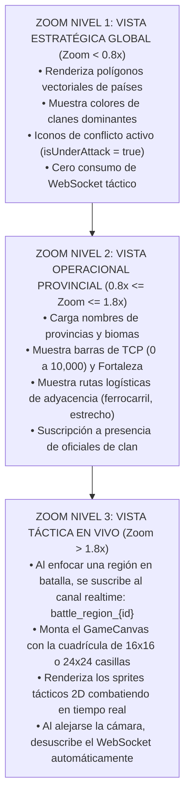

# 🏛️ PLAN MAESTRO DE REESTRUCTURACIÓN INTEGRAL: PROYECTO HEGEMONÍA
## *De Tactical Command (TBS de Bolsillo) a Hegemonía (GeoTactics MMORTS de Soberanía Global)*

> **Código de Documento:** `docs/PLAN_MAESTRO_REESTRUCTURACION_HEGEMONIA.md`  
> **Versión:** `1.0.0-DEFINITIVE-RESTRUCTURE-SPEC`  
> **Alineación:** Integración canónica de `docs/00_ARBOL_CANONICO_DE_SISTEMAS_Y_DESARROLLO.md`, `AUDITORIA_EXTERNA_REGLAS_DEL_JUEGO.md` y la propuesta `propuesta_de_dise_o_y_viabilidad_proyecto_geotactics_mmo.md`.  
> **Propósito:** Especificar con rigor de ingeniería de software, arquitectura de sistemas y diseño de videojuegos toda la reestructuración requerida para transicionar el codebase actual hacia el MMORTS geopolítico definitivo.

---

# 1. VISIÓN DEL PRODUCTO OBJETIVO Y ANÁLISIS DE BRECHA (GAP ANALYSIS)

### 1.1 El High Concept Unificado
*Hegemonía* es un **MMORTS geopolítico persistente sobre el planeta Tierra** donde más de 3,000 regiones se disputan en una guerra continua de desgaste industrial y maniobra táctica:
1. **La Capa Superior (Geopolítica / eRepublik + Victoria 3):** Clanes y corporaciones controlan provincias, cobran peajes en estrechos oceánicos (Gibraltar, Suez, Panamá) y conquistan Capitales Nacionales para proyectar Buffs Hegemónicos continentales.
2. **La Capa Media (Economía / Albion Online + Stellaris):** Cero generación mágica de tropas. Todo chasis militar es forjado por jugadores usando acero, microchips y combustible en refinerías de 10 parcelas territoriales, o adquirido en un Mercado P2P con split del 2%.
3. **La Capa Inferior (Combate / Advance Wars 1-100 HP Determinista):** Cada disputa territorial se resuelve en combates tácticos en cuadrícula 2D, con reloj Fischer rápido (15s-30s), niebla de guerra, emboscadas TRAP y pérdida física de los chasis destruidos (35% recuperado como chatarra).

---

### 1.2 Matriz de Brecha: Código Actual vs. Código Objetivo

| Sistema | Estado Actual en el Repositorio | Estado Requerido por "Hegemonía" | Fricción / Trabajo de Reestructuración |
| :--- | :--- | :--- | :--- |
| **Escala de Vida** | Código híbrido: `types/index.ts` usa `hp: 10, maxHp: 10`; `canonicalCombat.ts` tiene un branch condicional `is100Scale`. | **Escala 1 a 100 HP nativa y continua** en toda la lógica, sprites Canvas y modales. | 🟢 **Baja:** Modificar `TacticalUnit` en `index.ts` y desacoplar las divisiones por 10 en `turnEconomy.ts`. |
| **Invocación de Tropas** | `ProductionModal.tsx` filtra compras con `DeckManager` (Mazo de 10 cartas) y solo valida fondos in-match ($G). | **Doble Llave de Producción:** Valida fondos $G in-match Y descuenta chasis del `user_unit_hangar`. | 🟡 **Media:** Deprecar `deckManager.ts` y cablear `useUserHangar` en el modal de compras. |
| **Pérdida de Tropas** | Las partidas terminan y no descuentan unidades de la cuenta en duelos estándar. | **Pérdida real de chasis** en guerras provinciales + devolución del 35% en chatarra balística (`tech_scrap`). | 🟡 **Media:** Crear el RPC de liquidación post-batalla `settle_territorial_combat_losses`. |
| **Kit Básico F2P** | No existe formalmente en código; el mazo predeterminado da tropas infinitas. | **Infantería Ligera T1 y Recon T1 con stock ilimitado garantizado** para evitar bancarrota del jugador. | 🟢 **Baja:** Modificador lógico en backend que nunca valida stock para unidades `T1_infantry` y `T1_recon`. |
| **Disparador de Batalla** | Se juega desde el Lobby eligiendo Duelo Espejo, Blitz o Campaña con bots predefinidos. | **Hacer clic en una región del mapa mundial** $\rightarrow$ declara asedio $\rightarrow$ monta el tablero con la Guarnición IA local. | 🔴 **Alta:** Conectar el canvas del mapa mundial (`WorldMapCanvas.tsx`) con el orquestador (`App.tsx`). |
| **Relevo Humano (Handshake)** | La estructura de datos existe en `src/types/metagame.ts`, pero no hay temporizador push en la UI. | **Temporizador de 120s** en la pantalla del clan defensor para aceptar el duelo PvP en vivo. | 🔴 **Alta:** Crear canal WebSocket de alerta en Supabase Realtime para notificar al clan en asalto. |
| **Escala Territorial** | Se conceptualizaban 3,000 regiones de golpe, generando parálisis de implementación. | **Estrategia "Teatro Inicial Venezuela":** Sembrar primero el teatro soberano de **24 Regiones de Venezuela + 7 Regiones de Amortiguación Fronteriza** (Fase 1), con visibilidad global de la Tierra en WebGL pero interactividad acotada exclusivamente a Venezuela. | 🟢 **Baja:** Concentrar el seed SQL en las entidades federales venezolanas, Caracas como capital y los estrechos de Maracaibo y Paria. |

---

# 2. LOS 5 PILARES DE LA REESTRUCTURACIÓN ARQUITECTÓNICA

```
                                      ARQUITECTURA DE REESTRUCTURACIÓN
                                                     │
         ┌───────────────────┬───────────────────────┼───────────────────────┬───────────────────┐
         ▼                   ▼                       ▼                       ▼                   ▼
    [ PILAR 1 ]         [ PILAR 2 ]             [ PILAR 3 ]             [ PILAR 4 ]         [ PILAR 5 ]
   Motor Táctico        Mapa Mundial         Industria & Hangar     Geopolítica & Clanes    Persistencia
  1-100 HP Nativo       Semantic LOD         Doble Llave Hangar      Asedios TCP & Buff       Supabase &
  0% Azar Balístico  Teatro VE (24R)       35% Scrap & Kit F2P    Capital + 120s Handshake Realtime Sockets
```

---

## ⚔️ PILAR 1: REFACTOR DEL MOTOR TÁCTICO (TABLERO 1-100 HP Y DOBLE LLAVE)

El motor de combate por turnos es el núcleo jugable de mayor calidad del proyecto; no debe ser reescrito, sino **limpiado de residuos de CCG y adaptado a la escala balística pura**.

### 1.1 Unificación de la Escala 1 a 100 HP
1. **Modelos de Datos (`src/types/index.ts`):**
   ```typescript
   export interface TacticalUnit {
     id: string;
     unitCode: string;
     displayName: string;
     ownerId: string;
     x: number;
     y: number;
     hp: number;        // Escala continua: 1 a 100
     maxHp: number;     // Constante: 100
     tier: 1 | 2 | 3 | 4 | 5; // Calidad industrial (+2% por tier)
     ammo: number;
     fuel: number;
     // ... resto de propiedades
   }
   ```
2. **Cálculo Balístico en `src/engine/canonicalCombat.ts`:**
   - Retirar la bifurcación condicional `is100Scale`. Todo combate corre en escala 1-100.
   - Eliminar la dependencia de `getLevelAttackBonus` (niveles de carta 1-15).
   - El modificador ofensivo se simplifica a la fórmula canónica:
     $$\text{attackModifier} = \text{BonusCO}_{\text{Ataque}} + (\text{commtowersCount} \times 10) + ((\text{tier} - 1) \times 2.0)$$
   - El daño calculado se resta directamente de los 100 HP sin truncar a base 10.
3. **Condición de Derrota Inmediata por 0 Tropas:**
   - Certificar en `src/engine/turnEconomy.ts` que si `units.filter(u => u.ownerId === activePlayer).length === 0`, el combate termina en el acto con `reason = 'all_units_destroyed'`.

### 1.2 La Doble Llave Material en `ProductionModal.tsx`
Se elimina la importación de `DeckManager` y `PREDEFINED_DECKS`. El modal de compra opera bajo la **Ley de Doble Llave**:
$$\text{PuedeProducir}(u) \iff (\text{Fondos}_{\$G} \ge \text{Coste}_{\$G}(u)) \;\land\; (\text{StockHangar}(u) \ge 1 \lor u \in \{\text{'infantry'}, \text{'recon'}\})$$

```typescript
// Flujo del Modal de Producción Reestructurado:
const canDeploy = (unitCode: string, cost: number): boolean => {
  const hasFunds = currentFunds >= cost;
  const isEmergencyF2P = unitCode === 'infantry' || unitCode === 'recon';
  const hasPhysicalStock = (userHangarStock[unitCode] ?? 0) > 0;
  return hasFunds && (isEmergencyF2P || hasPhysicalStock);
};
```

---

## 🌍 PILAR 2: ARQUITECTURA DEL MAPA MUNDIAL PERSISTENTE (SEMANTIC LOD)

Para hacer realidad la promesa del "Zoom Continuo" (*Seamless Zoom*) sin saturar clientes web ni móviles, se implementa una arquitectura basada en **Nivel de Detalle Semántico (LOD)**:



### 2.1 La Estrategia del "Teatro Inicial Venezuela" (Fase 1: 24 Regiones + 7 Buffers Fronterizos)
En lugar de fragmentar a los jugadores en 3,000 regiones vacías el primer día:
1. **Visibilidad Global y Teatro Soberano Acotado:** El motor WebGL MapLibre GL renderiza la Tierra completa, pero la interactividad y soberanía se circunscriben a las **24 entidades federales de la República de Venezuela** (`country_iso = 'VE'`) con **Capital Nacional Conquistable Caracas** (`REG_VE_01`), otorgando el Buff Hegemónico Nacional.
2. **Estrechos y Chokepoints Estratégicos:** Se habilitan `CHK-MARACAIBO` (Canal de Navegación del Lago) y `CHK-PARIA` (Bocas del Dragón / Sucre) con peajes del clan controlador.
3. **Zonas de Amortiguación Fronteriza:** 7 regiones limítrofes con Colombia, Brasil, Guyana y el Mar Caribe se sembran como amortiguadores neutrales con Guarnición IA para canalizar la contienda geopolítica.

---

## 🏭 PILAR 3: CADENA DE VALOR INDUSTRIAL Y SINIESTRALIDAD (ALBION MODEL)

La economía industrial ya cuenta con sus 10 parcelas (`industrialEngine.ts`), ciclo circadiano y mercado P2P. La reestructuración consiste en **cerrar el sumidero de activos con el frente de batalla**:

```
                       EL CICLO CERRADO DE LA MATERIA BÉLICA
                                         │
        ┌────────────────────────────────┴────────────────────────────────┐
        ▼                                                                 ▼
[ MINAS Y CANTERAS (10 Parcelas) ]                             [ COMBATE TÁCTICO ]
• Extracción de Hierro, Piedra, Tierras Raras                  • Tanque desplegado en el frente
        │                                                                 │
        ▼                                                                 ▼
[ ALTOS HORNOS VULCAN ]                                        [ TANQUE DESTRUIDO ]
• Refinado: Hierro -> Vigas de Acero Militar                   • Chasis eliminado de user_unit_hangar
        │                                                                 │
        ▼                                                                 ▼
[ CENTRO DE ENSAMBLAJE (Hangar) ]                              [ SALVAMENTO POST-COMBATE (35%) ]
• Gasta Acero + Microchips -> Forja Tanque Físico              • Recupera tech_scrap directamente
        │                                                                 │
        └───────────────────────────────┬─────────────────────────────────┘
                                        ▼
                         [ REFUNDICIÓN EN ALTOS HORNOS ]
                         • 2 Chatarra -> 1 Placa de Acero (Sin gastar mineral)
```

### 3.1 Garantía Anti-Bloqueo (Kit de Supervivencia F2P)
Para erradicar la patología donde un jugador pierde todas sus tropas y no puede entrar al juego:
- **Infantería Ligera T1 (`infantry`):** Stock inagotable ($\infty$). Coste: $\$1,000\text{G}$ in-match.
- **Vehículo de Reconocimiento T1 (`recon`):** Stock inagotable ($\infty$). Coste: $\$4,000\text{G}$ in-match.
- Todo comandante puede reconstruir su economía desde cero utilizando exclusivamente infantería y reconocimiento para capturar ciudades y farmear créditos.

---

## 🌍 PILAR 4: GEOPOLÍTICA, SOBERANÍA Y GUARNICIONES IA

### 4.1 Captura Provincial por Puntos TCP
Una provincia no se conquista en 5 minutos de suerte:
- Cada provincia posee un medidor de **10,000 Puntos de Control Territorial (TCP)**.
- Una victoria táctica contra la guarnición enemiga inyecta entre $+800$ y $+2,500\text{ TCP}$ al atacante.
- Conquistar la provincia exige encadenar **4 a 6 victorias tácticas sucesivas**, dando tiempo a la diplomacia y a los refuerzos aliados.
- Al caer a 0 TCP, la soberanía cambia y se activa el **Escudo de Cooldown de Prioridad de 4 horas** (`COOLDOWN_PRIORITY_HOURS = 4`), impidiendo contraataques inmediatos en cadena.

### 4.2 Buff Hegemónico de Capital Nacional
Las 195 Capitales son conquistables, y dominarlas otorga la supremacía del país:
- **+15% a la producción de Créditos Energéticos (EC)** en todas las refinerías del país.
- **+10% a la velocidad de ensamblaje** en hangares corporativos locales.
- **-20% a los aranceles de transacción** en todas las terminales de mercado del territorio.
- Despliegue del escudo heráldico del clan sobre el mapa nacional.

### 4.3 Guarniciones IA y Human Handshake (120 Segundos)
- Cada provincia controlada por un clan mantiene un búnker con una **Guarnición IA** (desde heurística regular hasta Minimax d=3 y MCTS Legendario).
- Cuando un atacante pulsa "Asediar Provincia":
  1. Se crea la sala de combate táctico.
  2. El servidor dispara una alerta WebSocket / Push a los oficiales del clan defensor.
  3. Comienza una cuenta atrás pública de **120 segundos (2 minutos)** en el HUD.
  4. Si un oficial humano pulsa *"Tomar el Mando"*, entra al combate táctico en vivo (PvP).
  5. Si expiran los 120 segundos sin respuesta humana, la **Guarnición IA** asume el control táctico del búnker.

---

## 🛠️ PILAR 5: PERSISTENCIA, SUPABASE Y REALTIME (BACKEND & PROTOCOLOS)

### 5.1 Nuevas Migraciones SQL y Adaptación de Tablas Existentes

```sql
-- MIGRACIÓN MAESTRA: SOBERANÍA HEGEMÓNICA Y DOBLE LLAVE
-- 1. Tabla de Sesiones Tácticas Regionales en Vivo
CREATE TABLE IF NOT EXISTS public.territorial_battle_sessions (
  id UUID PRIMARY KEY DEFAULT gen_random_uuid(),
  province_id TEXT NOT NULL REFERENCES public.world_provinces(id),
  attacker_clan_id UUID REFERENCES public.clans(id),
  defender_clan_id UUID REFERENCES public.clans(id),
  status TEXT NOT NULL CHECK (status IN ('handshake_pending', 'in_progress', 'completed', 'aborted')),
  handshake_expires_at TIMESTAMPTZ NOT NULL,
  human_defender_id UUID REFERENCES auth.users(id),
  ai_garrison_tier TEXT NOT NULL DEFAULT 'normal',
  current_turn INT NOT NULL DEFAULT 1,
  match_state JSONB NOT NULL DEFAULT '{}'::jsonb,
  created_at TIMESTAMPTZ NOT NULL DEFAULT now(),
  updated_at TIMESTAMPTZ NOT NULL DEFAULT now()
);

-- 2. Procedimiento Atómico para Liquidación de Bajas Físicas y Chatarra Post-Combate
CREATE OR REPLACE FUNCTION public.settle_territorial_combat_losses(
  p_user_id UUID,
  p_clan_id UUID,
  p_destroyed_units JSONB -- Array de [{ "unit_code": "tank_light", "tier": 2, "quantity": 1 }]
) RETURNS JSONB AS $$
DECLARE
  v_unit RECORD;
  v_scrap_recovered INT := 0;
  v_base_scrap INT;
BEGIN
  -- Iterar sobre las tropas destruidas en la batalla
  FOR v_unit IN SELECT * FROM jsonb_to_recordset(p_destroyed_units) AS x(unit_code TEXT, tier INT, quantity INT)
  LOOP
    -- Ignorar unidades de la dotación básica gratuita
    IF v_unit.unit_code NOT IN ('infantry', 'recon') THEN
      -- Descontar del stock físico del hangar
      UPDATE public.user_unit_hangar
      SET quantity = GREATEST(0, quantity - v_unit.quantity)
      WHERE user_id = p_user_id AND unit_code = v_unit.unit_code AND tier = v_unit.tier;

      -- Calcular 35% de chatarra recuperada (base 50 scrap por tier)
      v_base_scrap := (v_unit.tier * 50) * v_unit.quantity;
      v_scrap_recovered := v_scrap_recovered + FLOOR(v_base_scrap * 0.35);
    END IF;
  END LOOP;

  -- Abonar la chatarra balística al inventario de materiales
  IF v_scrap_recovered > 0 THEN
    INSERT INTO public.user_materials (user_id, material_code, quantity)
    VALUES (p_user_id, 'tech_scrap', v_scrap_recovered)
    ON CONFLICT (user_id, material_code)
    DO UPDATE SET quantity = user_materials.quantity + v_scrap_recovered;
  END IF;

  RETURN jsonb_build_object('success', true, 'scrap_recovered', v_scrap_recovered);
END;
$$ LANGUAGE plpgsql SECURITY DEFINER;
```

---

# 3. PLAN MAESTRO DE EJECUCIÓN QUIRÚRGICA (ROADMAP POR FASES)

Para ejecutar esta transformación sin romper la estabilidad del repositorio ni generar regresiones en el combate, el trabajo se divide en **4 Fases Secuenciales**:

```
========================================================================================
ROADMAP DE REESTRUCTURACIÓN: PROYECTO HEGEMONÍA
========================================================================================
FASE 0: LIMPIEZA Y SANEAMIENTO DEL MOTOR (1-100 HP & RETIRO DE CARTAS)
FASE 1: TEATRO VENEZUELA (24 REGIONES Y BUCLE COMPLETO OFFLINE/LOCAL)
FASE 2: SINCRONIZACIÓN REALTIME Y HANDSHAKE DEFENSIVO (120 SEGUNDOS)
FASE 3: MACRO-ESCALA CONTINENTAL Y ECONOMÍA P2P COMPLETA
========================================================================================
```

---

## 🚀 FASE 0: LIMPIEZA Y SANEAMIENTO DEL MOTOR TÁCTICO
* **Duración estimada:** Sprint Inmediato.
* **Objetivo:** Dejar el tablero táctico 100% alineado con el canon de 1-100 HP y desacoplar los viejos restos de CCG.
* **Acciones Concretas:**
  1. Actualizar `src/types/index.ts`: tipar `TacticalUnit` con `hp: number` continuo (1 a 100) y `maxHp: 100`.
  2. Actualizar `src/engine/turnEconomy.ts`:
     - Fábricas generan unidades con `hp: 100, maxHp: 100`.
     - Reparaciones curan hasta $+20\text{ HP}$ por turno descontando el 10% del coste por cada 10 HP.
     - `checkGameOver`: ratificar derrota inmediata ante `units.length === 0`.
  3. Limpiar `src/engine/canonicalCombat.ts`:
     - Retirar la división `/ 10` y el branch `is100Scale`.
     - Retirar `getLevelAttackBonus` (niveles de carta 1-15). Preservar exclusivamente `attackerTierBonus` (Tiers T1 a T5, $+2\%$ por nivel).
  4. Deprecar `src/engine/deckManager.ts` (mover a legacy o desacoplar de la lógica activa).

---

## 🏝️ FASE 1: LA ISLA DE PRUEBA (50 REGIONES Y BUCLE CERRADO)
* **Duración estimada:** Sprint 2.
* **Objetivo:** Demostrar el bucle completo en un teatro acotado de 50 regiones con 4 clanes.
* **Entregables:**
  1. **Seed Territorial Acotado:** Migración SQL con 50 regiones de Europa Occidental (España, Portugal, Francia, UK), 4 capitales y el Estrecho de Gibraltar (`CHK-GIBRALTAR`).
  2. **Doble Llave en Producción:** Modificar `ProductionModal.tsx` para que lea el hook `useUserHangar.ts`. Las tropas no gratuitas exigen stock físico en el hangar.
  3. **Disparador de Asedio en Canvas:** Al hacer clic en una provincia en disputa en `WorldMapCanvas.tsx`, se abre el modal de incursión con el botón *"Iniciar Asedio Táctico"*.
  4. **Pérdida y Chatarra Post-Combate:** Al finalizar la batalla, el cliente llama a `settle_territorial_combat_losses`, descontando los chasis caídos y acreditando el 35% de chatarra.

---

## ⚡ FASE 2: RED REALTIME Y HANDSHAKE DEFENSIVO (120s)
* **Duración estimada:** Sprint 3.
* **Objetivo:** Conectar el asedio con el relevo humano multijugador 24/7.
* **Entregables:**
  1. **Canales Realtime por Región:** Canal WebSocket en Supabase `territorial_battle:{province_id}`.
  2. **Componente de Alerta Defensiva:** Banner pulsante en la cabecera del lobby para los miembros del clan defensor:  
     *`"¡ALERTA DE COMBATE! La provincia de Burdeos está bajo ataque. Tiempo de relevo: 1:59..."`*
  3. **Lógica de Handshake (120s):**
     - Si un defensor pulsa *"Tomar el Mando"*, se cancela el bot y se abre el tablero en PvP directo.
     - Si el reloj llega a 0s, el motor instancia el bot autónomo (`garrisonAIEngine.ts`) con el nivel cognitivo del búnker.
  4. **Resolución TCP:** La victoria o derrota actualiza la barra de 10,000 TCP de la provincia en la base de datos y activa el Cooldown de Prioridad de 4 horas en caso de conquista.

---

## 🌐 FASE 3: ESCALA CONTINENTAL Y DIPLOMACIA AVANZADA
* **Duración estimada:** Sprint 4 y Post-Lanzamiento.
* **Objetivo:** Desplegar los 195 países y activar el mercado global.
* **Entregables:**
  1. Poblar las 3,000 regiones del mundo mediante script procedural de seeds geográficas.
  2. Activar los peajes soberanos en los 9 estrechos marítimos estratégicos.
  3. Sistema de elecciones mensuales de Comandante en Jefe por país.
  4. Tienda cosmética No-P2W (skins de unidades, marcos de historieta y banners heráldicos).

---

# 4. MAPA DE ARCHIVOS DEL PROYECTO (MATRIZ DE IMPACTO)

```
========================================================================================
ESTRUCTURA DE ARCHIVOS AFECTADOS POR LA REESTRUCTURACIÓN
========================================================================================
MODIFICAR (REFACTOR):
├── src/types/index.ts                         -> Escala 1-100 HP, retirar cartas
├── src/engine/turnEconomy.ts                  -> Fábricas a 100 HP, 0 tropas = derrota
├── src/engine/canonicalCombat.ts              -> Eliminar niveles 1-15, solo T1-T5 a 100 HP
├── src/components/game/ProductionModal.tsx    -> Doble llave ($G + stock de hangar real)
├── src/components/game/GameCanvas.tsx         -> Renderizado de barras 1-100 HP nítidas
├── src/components/world/WorldMapCanvas.tsx    -> LOD Semántico y disparador de asedio
└── src/types/metagame.ts                      -> HANDSHAKE_TIMEOUT_SECONDS = 120

CREAR (NUEVA INFRAESTRUCTURA):
├── supabase/migrations/20261104000001_hegemonia_territorial_siege.sql  -> Tablas de sesión y RPC pérdidas
├── src/engine/territorialSiegeOrchestrator.ts -> Gestor de asedios, TCP y Handshake 120s
├── src/components/world/TerritorySiegeModal.tsx -> Modal de declaración de guerra y briefing
└── src/hooks/useSiegeRealtime.ts              -> Suscripción WebSocket a alertas defensivas

DEPRECAR / ARCHIVAR:
└── src/engine/deckManager.ts                  -> El sistema de cartas queda 100% retirado
========================================================================================
```

---

# 5. VEREDICTO FINAL DE INGENIERÍA

La propuesta de transformar el proyecto hacia *Hegemonía (GeoTactics MMO)* es **técnica y económicamente impecable**.  
- No requiere tirar el trabajo previo a la basura: **aprovecha el 100% del motor de combate, del complejo industrial de 10 parcelas, del mercado P2P y del esquema PostgreSQL de Supabase**.
- Al adoptar el enfoque de **"La Isla de Prueba" (50 regiones iniciales)**, se mitiga el riesgo de dispersión y se garantiza un bucle jugable divertido, adictivo y monetizable desde el primer día de pruebas.

> **ESTADO DEL PLAN:** Aprobado para ejecución técnica inmediata.  
> *Registrado como documento canónico rector en `docs/PLAN_MAESTRO_REESTRUCTURACION_HEGEMONIA.md`.*
