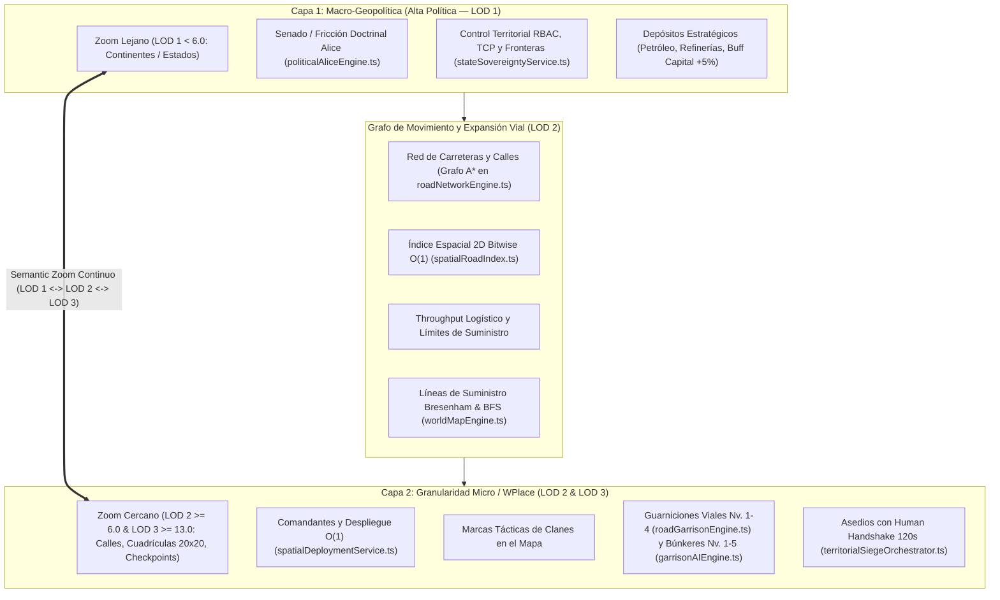
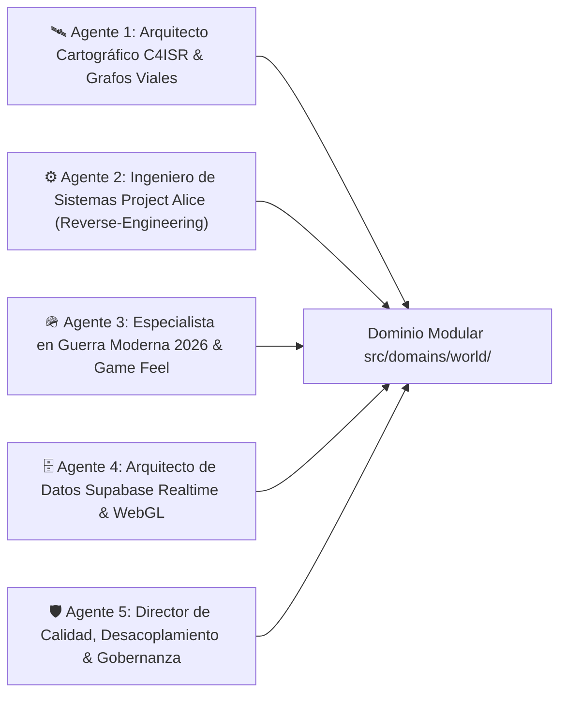
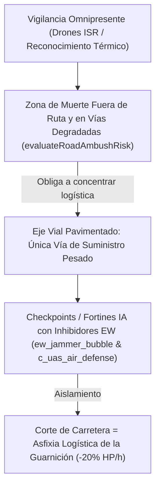
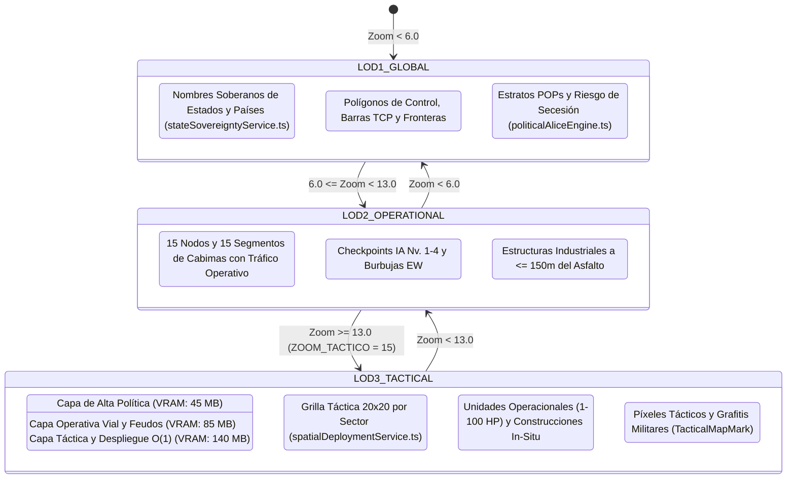
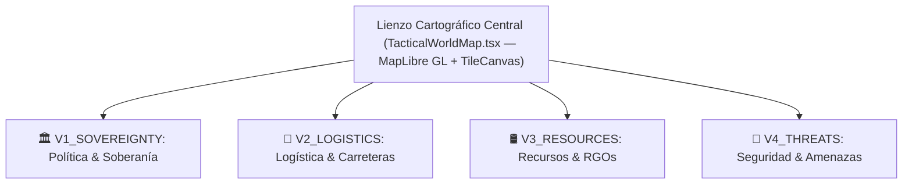
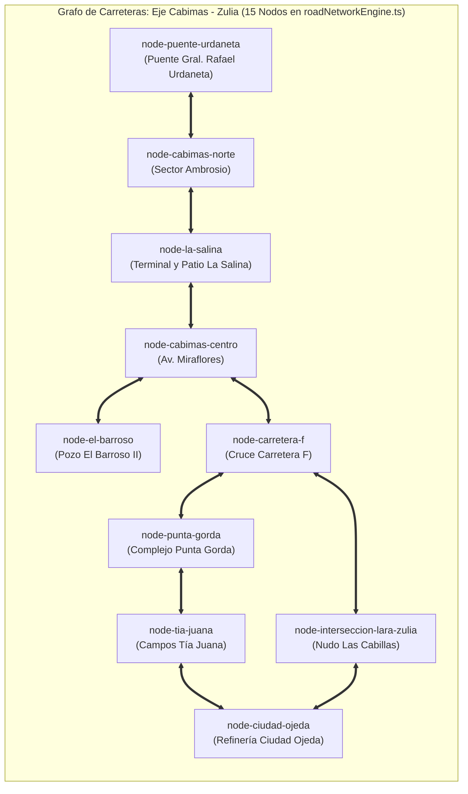
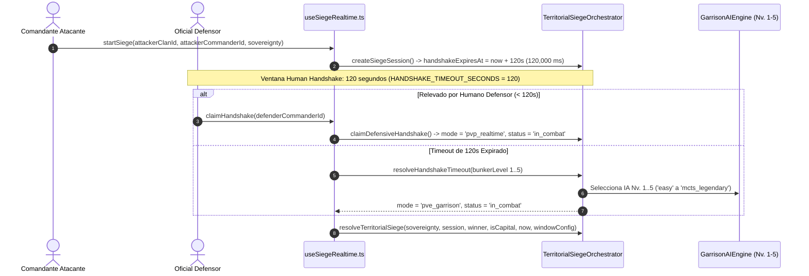
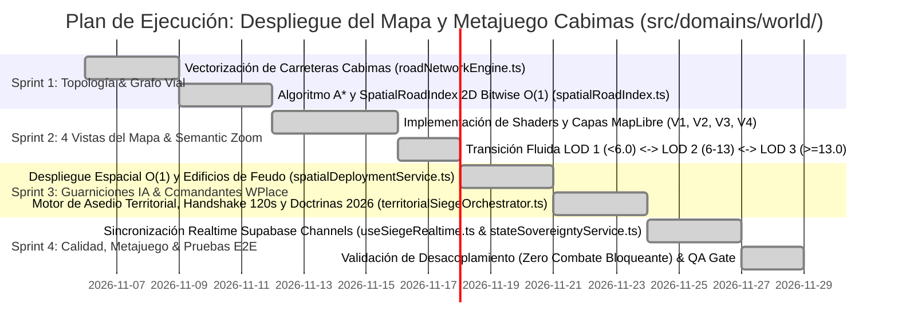

# 🗺️ ESPECIFICACIÓN MAESTRA DE INGENIERÍA: MAPA VECTORIAL, LOGÍSTICA VIAL Y METAPOLÍTICA PROJECT ALICE
## *Mapeo Continental, Expansión desde Cabimas y Simulación de Guerra Moderna 2026*

> **Código Canónico:** `docs/PROPUESTA_INGENIERIA_MAPA_METAPOLITICA_ALICE_CABIMAS.md`  
> **Clasificación:** Arquitectura de Sistemas, Geopolítica C4ISR, Cartografía WebGL y Diseño de Metajuego  
> **Versión:** `v0.2.0-metamap-world-domain`  
> **Repositorio Base de Análisis:** `C:\Users\Morín\Project-Alice-1.3.0` (C++20 Open V2 Engine)  
> **Repositorio de Aplicación:** `c:\Users\Morín\GEOTACTICS-ONLINE` (React 19, TypeScript, MapLibre GL, Supabase, Tailwind CSS)  
> **Dominio Arquitectónico Principal:** `src/domains/world/` (`@domains/world/*`) conectado con `src/domains/tactics/`, `src/domains/economy/`, `src/domains/game-feel/` y `src/shared/`  
> **Epicentro de Despliegue Fase 1:** Región de Cabimas (`REG_VE_02` — Costa Oriental del Lago de Maracaibo, Zulia, Venezuela)

---

## 🧭 TABLA DE CONTENIDOS
1. [Manifiesto Ejecutivo, Los 7 Pilares Canónicos y Premisas de Misión](#1-manifiesto-ejecutivo-los-7-pilares-canónicos-y-premisas-de-misión)
2. [Panel de Agentes Especialistas y Arquitectura Modular (`src/domains/world`)](#2-panel-de-agentes-especialistas-y-arquitectura-modular-srcdomainsworld)
3. [Deconstrucción Forense de Project Alice 1.3.0: Sistemas Rescatables](#3-deconstrucción-forense-de-project-alice-130-sistemas-rescatables)
4. [La Realidad Operativa de la Guerra Moderna 2026: Doctrina de Carreteras, Drones y Desgaste](#4-la-realidad-operativa-de-la-guerra-moderna-2026-doctrina-de-carreteras-drones-y-desgaste)
5. [Arquitectura Cartográfica Dual, Semantic LOD y Mecánica WPlace / OpenPlace](#5-arquitectura-cartográfica-dual-semantic-lod-y-mecánica-wplace--openplace)
6. [Las 4 Vistas Especializadas del Mapa C4ISR](#6-las-4-vistas-especializadas-del-mapa-c4isr)
7. [Vectorización, Topología Operativa A* (`roadNetworkEngine.ts`) e Índice Espacial $O(1)$ (`spatialRoadIndex.ts`): El Teatro Cabimas](#7-vectorización-topología-operativa-a-roadnetworkenginets-e-índice-espacial-o1-spatialroadindexts-el-teatro-cabimas)
8. [Motor de Guarniciones IA (Viales Nv. 1-4 y Territoriales Nv. 1-5), Protocolo de Asedio y Human Handshake (120s)](#8-motor-de-guarniciones-ia-viales-nv-1-4-y-territoriales-nv-1-5-protocolo-de-asedio-y-human-handshake-120s)
9. [Desacoplamiento Estricto, Expansión Territorial, Mercado P2P (2% Split) y Bark Engine](#9-desacoplamiento-estricto-expansión-territorial-mercado-p2p-2-split-y-bark-engine)
10. [Modelo de Datos en Supabase (PostGIS + Realtime Channels)](#10-modelo-de-datos-en-supabase-postgis--realtime-channels)
11. [Hoja de Ruta de Implementación Quirúrgica (Sprint 1 al 4)](#11-hoja-de-ruta-de-implementación-quirúrgica-sprint-1-al-4)

---

## 1. MANIFIESTO EJECUTIVO, LOS 7 PILARES CANÓNICOS Y PREMISAS DE MISIÓN

El objetivo de esta propuesta es materializar la visión de un **teatro de operaciones geopolítico y táctico en tiempo real**, fusionando la escala estratégica de simuladores como *Victoria 2* / *Project Alice* con la interactividad comunitaria y la granularidad espacial de *r/place* (*WPlace* / *OpenPlace*), adaptado a las doctrinas de combate de la **Guerra Moderna 2026**.



### 1.1 Los 7 Pilares Canónicos Inmutables y Regla Financiera SSOT
1. **Pilar 1 — Cero Cartas (NO TCG/CCG):** Almacén físico estricto de **16 tropas máximo por jugador** (`4` slots de despliegue activo + `12` en reserva en [`src/domains/economy/hooks/useUserHangar.ts`](file:///c:/Users/Mor%C3%ADn/GEOTACTICS-ONLINE/src/domains/economy/hooks/useUserHangar.ts)).
2. **Pilar 2 — Escala Balística Continua (1 a 100 HP):** Integridad estructural entera de `1` a `100 HP` (`MASTER_METAGAME_CONSTANTS.CANONICAL_MAX_HP = 100` en [`src/shared/types/metagame.ts`](file:///c:/Users/Mor%C3%ADn/GEOTACTICS-ONLINE/src/shared/types/metagame.ts)).
3. **Pilar 3 — Derrota Inapelable por Aniquilación:** Derrota inmediata al llegar a `0` tropas supervivientes en el tablero táctico.
4. **Pilar 4 — Progresión Horizontal de Tiers (T1 a T5):** Bonificación de `+2%` por tier (`TIER_EFFECTIVENESS_BONUS_PER_LEVEL = 0.02`, máximo `+8%` en T5 sobre T1).
5. **Pilar 5 — Conquista de Capitales con Buff Regional (+5%):** Las capitales son capturables (`CAPITAL_IMMUNITY = false`, `CAPITAL_TCP_THRESHOLD = 15000`) y otorgan un **Buff Regional de +5% en recursos y logística en la región**, complementado por el bono hegemónico de capital nacional (`+15%` extracción energética y `+10%` velocidad de forja en [`src/domains/world/core/territorialExpansionEngine.ts`](file:///c:/Users/Mor%C3%ADn/GEOTACTICS-ONLINE/src/domains/world/core/territorialExpansionEngine.ts) y [`src/domains/economy/core/upkeepEngine.ts`](file:///c:/Users/Mor%C3%ADn/GEOTACTICS-ONLINE/src/domains/economy/core/upkeepEngine.ts)).
6. **Pilar 6 — Pérdida Física Real y 35% de Chatarra Tecnológica (`tech_scrap`):** Toda unidad no-F2P destruida se pierde físicamente del hangar, recuperando el **35%** en chatarra tecnológica (`RECYCLE_SCRAP_RATE = 0.35`, `calculateLossScrapRecovery` en [`src/shared/types/metagame.ts`](file:///c:/Users/Mor%C3%ADn/GEOTACTICS-ONLINE/src/shared/types/metagame.ts) y `settleCombatLossesAndScrap` en [`src/domains/tactics/core/tacticalCombatSeamlessIntegration.ts`](file:///c:/Users/Mor%C3%ADn/GEOTACTICS-ONLINE/src/domains/tactics/core/tacticalCombatSeamlessIntegration.ts)).
7. **Pilar 7 — Human Handshake de 120 Segundos (2 Minutos) e IA de Guarnición (Niveles 1-5):** Todo asedio territorial abre una ventana defensiva de **120 segundos** (`HANDSHAKE_TIMEOUT_SECONDS = 120` / `HUMAN_HANDSHAKE_WINDOW_MS = 120_000`) en [`src/domains/world/core/territorialSiegeOrchestrator.ts`](file:///c:/Users/Mor%C3%ADn/GEOTACTICS-ONLINE/src/domains/world/core/territorialSiegeOrchestrator.ts) y [`src/domains/world/hooks/useSiegeRealtime.ts`](file:///c:/Users/Mor%C3%ADn/GEOTACTICS-ONLINE/src/domains/world/hooks/useSiegeRealtime.ts) antes de que asuma la **IA de Guarnición (Niveles 1 a 5)** ([`src/domains/tactics/core/garrisonAIEngine.ts`](file:///c:/Users/Mor%C3%ADn/GEOTACTICS-ONLINE/src/domains/tactics/core/garrisonAIEngine.ts)).
8. **Regla Financiera Canónica — Mercado P2P (2% Impuesto Total + VWAP Collar ±25%):** Impuesto total del **2%** (`TOTAL_P2P_TAX_RATE = 0.02`: **1% quemado en Sink** `PLATFORM_BURN_RATE = 0.01` + **1% regalía al Clan dueño del Hub regional** `PROVINCE_ROYALTY_RATE = 0.01`) y bandas de precios dinámicas **VWAP Collar ±25%** (`VWAP_COLLAR_PERCENT = 0.25`, `calculateP2PTransactionSplit` en [`src/shared/types/metagame.ts`](file:///c:/Users/Mor%C3%ADn/GEOTACTICS-ONLINE/src/shared/types/metagame.ts)).

### 1.2 Premisas Inviolables del Sistema:
1. **El Mapa como Vector de Expansión por Carreteras:**  
   El desplazamiento de tropas, la proyección de soberanía y la expansión territorial no ocurren en vacío ni por teletransporte. Se transmiten exclusivamente **a lo largo de las carreteras, avenidas y conexiones viarias** ([`src/domains/world/core/roadNetworkEngine.ts`](file:///c:/Users/Mor%C3%ADn/GEOTACTICS-ONLINE/src/domains/world/core/roadNetworkEngine.ts)). Las carreteras son las arterias de la economía, el soporte vital de las guarniciones y los ejes de avance.
2. **Arquitectura Dual de Capas con Semantic Zoom:**  
   * **Capa de Alta Política (Macro-Geopolítica — LOD 1):** Al alejar el zoom (`zoom < 6.0`), el mapa sintetiza las entidades federales, los países, las fronteras consolidadas, los balances parlamentarios y las estadísticas macroeconómicas ([`src/domains/world/core/politicalAliceEngine.ts`](file:///c:/Users/Mor%C3%ADn/GEOTACTICS-ONLINE/src/domains/world/core/politicalAliceEngine.ts) y [`src/domains/world/services/stateSovereigntyService.ts`](file:///c:/Users/Mor%C3%ADn/GEOTACTICS-ONLINE/src/domains/world/services/stateSovereigntyService.ts)).
   * **Capa Operativa / Táctica (Micro-WPlace — LOD 2 y LOD 3):** Al acercar el zoom (`zoom >= 6.0` y `zoom >= 13.0` / `ZOOM_TACTICO = 15`), el mapa renderiza la cuadrícula de calles, los comandantes desplegados, las marcas tácticas del clan, los convoyes en tránsito y las refriegas activas en intersecciones clave ([`src/domains/world/services/spatialDeploymentService.ts`](file:///c:/Users/Mor%C3%ADn/GEOTACTICS-ONLINE/src/domains/world/services/spatialDeploymentService.ts)).
3. **Punto de Partida Canónico: Cabimas (Zulia — `REG_VE_02`):**  
   El despliegue de prueba y expansión inicial toma como epicentro la ciudad de Cabimas y la Costa Oriental del Lago de Maracaibo (Zulia), corazón de la infraestructura petrolera venezolana, conectada por la Avenida Intercomunal, la Carretera Lara-Zulia y el Puente General Rafael Urdaneta hacia Maracaibo.
4. **Desacoplamiento Estricto de Subsistemas:**  
   * **Fase 1:** Foco $100\%$ en el mapa funcional, la red vial, las vistas temáticas, el despliegue en cuadrícula, el movimiento y el metajuego político.
   * **Combate Táctico (`src/domains/tactics/` — Advance Wars 1-100 HP) y Bark Engine (`src/domains/game-feel/` — Mayor Stella):** Operan de forma completamente desacoplada mediante un patrón de arquitectura dirigida por eventos (*Event-Driven Architecture*). Las batallas en el mapa se resuelven o simulan a nivel operacional sin forzar la apertura del tablero por turnos.

---

## 2. PANEL DE AGENTES ESPECIALISTAS Y ARQUITECTURA MODULAR (`src/domains/world`)

Para garantizar rigor analítico y coherencia multidisciplinaria, la presente propuesta ha sido articulada mediante la orquestación de cinco agentes especializados y desplegada en `src/domains/world/`:



* **🛰️ Agente 1 (Cartografía C4ISR & Topología de Redes):** Diseña el sistema de coordenadas Web Mercator, la proyección $O(1)$ entre lat/long y cuadrícula de combate (`spatialDeploymentService.ts`), el índice espacial 2D bitwise (`spatialRoadIndex.ts`) y la estructura de datos del grafo de carreteras (`roadNetworkEngine.ts`).
* **⚙️ Agente 2 (Ingeniería Inversa Project Alice):** Extrae y adapta las fórmulas de suministro de `military.cpp`, los modos de mapa de `map_modes.hpp`, las restricciones de infraestructura de `infrastructure.hpp` y los estratos sociales POPs de `politics.cpp` / `rebels.cpp` (`politicalAliceEngine.ts`).
* **🪖 Agente 3 (Doctrina Militar 2026 & Game Design):** Modela el comportamiento de las guarniciones de IA (`roadGarrisonEngine.ts` y `garrisonAIEngine.ts`), los frentes de combate en carreteras, las zonas de muerte (*kill zones*) por drones, el protocolo de asedio con *Human Handshake* de 120s (`territorialSiegeOrchestrator.ts`) y el avance celular de fronteras (`territorialExpansionEngine.ts`).
* **🗄️ Agente 4 (Infraestructura Realtime & Supabase):** Define las tablas PostGIS, los canales de WebSocket optimizados para sincronización masiva (`useSiegeRealtime.ts`, `useTerritoryMap.ts`, `stateSovereigntyService.ts`) y los shaders de renderizado en MapLibre GL (`TacticalWorldMap.tsx`).
* **🛡️ Agente 5 (Garantía de Calidad & Desacoplamiento):** Asegura que el combate táctico por turnos (`src/domains/tactics/`) y el motor de diálogos (`src/domains/game-feel/`) se mantengan como capas downstream aisladas, garantizando una arquitectura libre de deuda técnica.

---

## 3. DECONSTRUCCIÓN FORENSE DE PROJECT ALICE 1.3.0: SISTEMAS RESCATABLES

El análisis profundo del árbol de fuentes de `C:\Users\Morín\Project-Alice-1.3.0` revela subsistemas de alto valor algorítmico directamente implementados en `src/domains/world/`.

### 3.1 El Grafo de Transporte y Renderizado Vial (`src/map/map.hpp` & `map_borders.cpp`)
En Project Alice, las carreteras y ferrocarriles no son simples polilíneas decorativas:
* Estructuras de datos dedicadas:
  ```cpp
  // Project Alice: src/map/map.hpp
  struct textured_line_vertex {
      glm::vec2 position_;
      glm::vec2 normal_direction_;
      float texture_coordinate_ = 0.f;
      float distance_ = 0.f;
  };
  std::vector<textured_line_vertex> railroad_vertices;
  std::vector<GLint> railroad_starts;
  std::vector<GLsizei> railroad_counts;
  ```
* **Mapeo a GEOTACTICS ([`src/domains/world/core/roadNetworkEngine.ts`](file:///c:/Users/Mor%C3%ADn/GEOTACTICS-ONLINE/src/domains/world/core/roadNetworkEngine.ts)):**  
  En MapLibre GL, esta lógica se traslada a `roadNetworkEngine.toGeoJSON()`, exportando una `FeatureCollection` de `LineString` renderizada como `line` layers con gradientes de color según el ancho de banda logístico (`currentThroughput` / `throughputCapacity`), la calidad de superficie (`surfaceQuality`) y el clan controlador (`controllerClanId`).

### 3.2 Modos de Mapa Especializados (`src/map/modes/`)
Alice cuenta con 22 modos de mapa nativos. Para el sistema de GEOTACTICS rescatamos e hibridamos cuatro módulos críticos (`C4ISRMapViewMode` en [`src/domains/world/types/tacticalRoadTypes.ts`](file:///c:/Users/Mor%C3%ADn/GEOTACTICS-ONLINE/src/domains/world/types/tacticalRoadTypes.ts)):
1. **`infrastructure.hpp` (`V2_LOGISTICS`):**  
   Determina si una conexión vial permite el tránsito militar rápido en función del nivel de desarrollo y las reglas de la doctrina en el poder.
2. **`supply.hpp` (`supply_limit_in_province`):**  
   Calcula la capacidad de carga militar antes de que las unidades sufran atrición (*attrition*):
   $$\text{CapacidadSuministro} = \text{Base} \times (1 + \text{NivelVial}) \times \text{ModificadorClimático}$$
3. **`political.hpp` (`V1_SOVEREIGNTY`):**  
   Renderiza las fronteras de control soberano con paleta heráldica por nación/clan y permite a los líderes de clan y gestores de facción renombrar estados y proclamar lemas soberanos mediante control RBAC (`stateSovereigntyService.canUnlockStateControl` / `updateStateSovereignty`).
4. **`rgo_output.hpp` (`V3_RESOURCES`):**  
   Visualiza la producción de materias primas por provincia (Crudo liviano, crudo pesado, hierro/bauxita, tierras raras, energía eléctrica).

### 3.3 Tiempos de Movimiento e Intercepción (`src/military/military.cpp`)
En Alice (`military.cpp:L4832-L4870`), el tiempo de viaje entre dos nodos conectados se define por:
```cpp
float movement_time_from_to(sys::state& state, dcon::army_id a, dcon::province_id from, dcon::province_id to) {
    float prov_from_mod = province::get_province_modifier(state, controller, from, sys::provincial_mod_offsets::movement_cost);
    float prov_to_mod = province::get_province_modifier(state, controller, to, sys::provincial_mod_offsets::movement_cost);
    float average_modifier = (prov_from_mod + prov_to_mod) * 0.5f;
    return (base_distance / army_speed) * average_modifier;
}
```
Si una tropa enemiga entra en el nodo intermedio, `stop_army_movement` congela la marcha y dispara la fase de combate. En [`src/domains/world/core/roadNetworkEngine.ts`](file:///c:/Users/Mor%C3%ADn/GEOTACTICS-ONLINE/src/domains/world/core/roadNetworkEngine.ts#L387-L503), `calculateSegmentTraversalTimeHours` y `findOptimalRoadRoute` implementan este principio exacto: ningún jugador o convoy puede saltar un nodo vial ocupado por `hostileGarrisonNodeIds` sin antes neutralizar el puesto de control hostil.

---

## 4. LA REALIDAD OPERATIVA DE LA GUERRA MODERNA 2026: DOCTRINA DE CARRETERAS, DRONES Y DESGASTE

El diseño del juego modela la doctrina contemporánea de alta intensidad (2022–2026) en [`src/domains/world/core/roadGarrisonEngine.ts`](file:///c:/Users/Mor%C3%ADn/GEOTACTICS-ONLINE/src/domains/world/core/roadGarrisonEngine.ts):



1. **La Tiranía del Asfalto y Evaluación de Killzones (`evaluateRoadAmbushRisk`):**  
   Fuera de las carreteras consolidadas, las formaciones acorazadas y los convoyes de suministro sufren de terreno intransitable, campos minados densos y vulnerabilidad total a enjambres de drones FPV. `roadGarrisonEngine.evaluateRoadAmbushRisk()` pondera la calidad de superficie (`dirt: 0.45`, `gravel: 0.35`, `paved_asphalt: 0.15`, `reinforced_concrete: 0.05`), la jerarquía de vía (`rural_track: 0.30`, `bridge: 0.25`, `industrial_collector: 0.20`, `urban_artery: 0.15`, `avenue: 0.10`, `highway: 0.05`) y la pérdida de throughput para detectar zonas de muerte (`isKillzone = true`, `riskLevel = 'EXTREME_KILLZONE'`).
2. **Guarniciones Viales de Bloqueo Autónomas (`GARRISON_TIER_SPECS` — Niveles 1 a 4):**  
   Los clanes establecen **Guarniciones Viales de IA** en los nudos carreteros (`src/domains/world/types/tacticalRoadTypes.ts`):
   * *Nivel 1 (`Puesto Ligero / Retén`):* `1,000 HP`, Coste `1,500 EC`, Upkeep `40 EC/h`, Radio EW `0.5 km`.
   * *Nivel 2 (`Puesto Avanzado Fortificado`):* `2,500 HP`, Coste `4,000 EC`, Upkeep `95 EC/h`, Radio EW `1.5 km`, Cobertura anti-dron activa.
   * *Nivel 3 (`Fortín Integrado C4ISR (C-UAS + EW)`):* `6,000 HP`, Coste `9,500 EC`, Upkeep `220 EC/h`, Radio EW `3.5 km`, Cobertura anti-dron activa, Artillería `2.0 km`.
   * *Nivel 4 (`Complejo de Búnker de Asedio Pesado`):* `15,000 HP`, Coste `24,000 EC`, Upkeep `550 EC/h`, Radio EW `7.0 km`, Cobertura anti-dron activa, Artillería `8.5 km`.
3. **Doctrinas Tácticas 2026 (`GarrisonDoctrineType` en `roadGarrisonEngine.ts`):**
   * `standard_infantry`: Control estándar de nudo vial.
   * `anti_armor_ditch`: Reduce el throughput del segmento vial al **25%** y otorga **+50% de daño defensivo** contra unidades de orugas (`treads`).
   * `ew_jammer_bubble`: Ceguera radar C4ISR hasta `7.0 km` (`isAreaJammedByEW`).
   * `c_uas_air_defense`: Intercepción letal inmediata contra drones, UAVs y helicópteros (`interceptAerialThreat`).
   * `artillery_firebase`: Bombardeo indirecto guiado (`+80 daño/tick`) hasta **2 saltos** en el grafo vial (`canProvideArtillerySupport`), condicionado a tener línea de suministro activa.
4. **El Coste de Mantenimiento y Atrición por Aislamiento (`processHourlyUpkeepTick`):**  
   Una guarnición consume **Créditos de Energía (EC)** cada hora. Si la carretera de suministro que conecta con el hub central es cortada (`!hasSupplyRoute`), la guarnición entra en **Inanición Operacional** (`isIsolatedFromSupply = true`), sufriendo una atrición del **20% de su HP máximo por hora** hasta ser destruida. Si el tesoro del clan no cubre `hourlyUpkeepEc`, la guarnición se degrada un nivel por ciclo.

---

## 5. ARQUITECTURA CARTOGRÁFICA DUAL, SEMANTIC LOD Y MECÁNICA WPLACE / OPENPLACE

En [`src/domains/tactics/core/tacticalCombatSeamlessIntegration.ts`](file:///c:/Users/Mor%C3%ADn/GEOTACTICS-ONLINE/src/domains/tactics/core/tacticalCombatSeamlessIntegration.ts) y [`src/domains/world/services/spatialDeploymentService.ts`](file:///c:/Users/Mor%C3%ADn/GEOTACTICS-ONLINE/src/domains/world/services/spatialDeploymentService.ts), la cámara WebGL coordina tres niveles de detalle semántico (`SemanticLODLevel`):

### 5.1 Los Niveles de Representación Espacial (`resolveSemanticLOD`)



### 5.2 El Sistema de Despliegue Espacial $O(1)$ (`spatialDeploymentService.ts`)
* `spatialDeploymentService.getSpatialAssignment(lngLat, gridSize = 20, zoom = ZOOM_TACTICO)` convierte en $O(1)$ cualquier coordenada WGS84 en un sector y celda `SEC [x,y] • CELL [x,y]` (`cell_key = "{sectorX}_{sectorY}_{cellX}_{cellY}"`).
* Permite desplegar unidades (`deployUnitAt` / `deployTacticalUnit` con integridad canónica `100 HP`) y erigir edificios de feudo (`constructBuildingAt` / `constructTacticalBuilding`), sincronizando cambios en tiempo real con Supabase CDC sobre el canal `theatre:{regionId}` (`tactical_spatial_deployments` y `tactical_fief_constructions`).

### 5.3 Gobernanza Estatal RBAC (`stateSovereigntyService.ts`)
* En [`src/domains/world/services/stateSovereigntyService.ts`](file:///c:/Users/Mor%C3%ADn/GEOTACTICS-ONLINE/src/domains/world/services/stateSovereigntyService.ts), `canUnlockStateControl(userContext, stateId)` verifica que el usuario pertenezca a la facción/clan controlador y ostente rango de `leader`, `officer` o `isFactionManager === true`.
* Los líderes autorizados pueden actualizar en vivo el nombre soberano del país (`customCountryName`), el nombre del estado (`customStateName`), el lema (`customMotto`) y la proclamación oficial (`sovereignProclamation`), propagándose por el canal Realtime `state_sovereignty_changes`.

---

## 6. LAS 4 VISTAS ESPECIALIZADAS DEL MAPA C4ISR

En el HUD de la consola de mando se habilitan cuatro filtros de visualización independientes (`C4ISRMapViewMode`):



| ID (`C4ISRMapViewMode`) | Modo de Mapa | Paleta de Color | Elementos Renderizados | Decisión Estratégica Asociada |
|---|---|---|---|---|
| **`V1_SOVEREIGNTY`** | **Política & Soberanía** | Heráldica por Clan (`clan-ferro`: Azul `#3B82F6`, `clan-orinoco`: Ámbar `#F59E0B`, `clan-caribe`: Esmeralda `#10B981`, `clan-andes`: Rojo `#EF4444`) | Polígonos provinciales, fronteras de soberanía De Jure / De Facto, barras TCP (`10,000` / `15,000`), nombres de estados soberanos. | Identificar qué clan domina la región y verificar escudos temporales o ventanas de gracia. |
| **`V2_LOGISTICS`** | **Logística & Vías** | Cian Neón (Vías libres), Amarillo (Cuello de botella / Zanja antitanque 25%), Rojo Pulsante (Carretera cortada/Asediada) | Grafo de carreteras (`roadNetworkEngine.toGeoJSON()`), líneas de suministro Bresenham/BFS, capacidad de throughput, puentes críticos. | Detectar rutas viables para despliegue de refuerzos o planificar emboscadas a líneas de abastecimiento. |
| **`V3_RESOURCES`** | **Recursos & RGOs** | Ámbar Crudo (`#E5A93C`), Azul Eléctrico (Energía), Verde Militar (Munición) | Pozos petroleros, terminales marítimos, refinerías, complejos petroquímicos y **Buff de Capital (+5% regional)**. | Priorizar expansión hacia fuentes de ingresos y asegurar el suministro de combustible pesado. |
| **`V4_THREATS`** | **Seguridad & Amenazas** | Gradiente Térmico FLIR (Verde seguro $\to$ Naranja alerta $\to$ Rojo combate activo) | Guarniciones de IA y su nivel de fortificación, burbujas EW (`ew_jammer_bubble`), riesgo de killzone (`evaluateRoadAmbushRisk`) y alertas Human Handshake (120s). | Identificar frentes desprotegidos o intervenir en refriegas críticas entre guarniciones de IA. |

---

## 7. VECTORIZACIÓN, TOPOLOGÍA OPERATIVA A* (`roadNetworkEngine.ts`) E ÍNDICE ESPACIAL $O(1)$ (`spatialRoadIndex.ts`): EL TEATRO CABIMAS

En [`src/domains/world/core/roadNetworkEngine.ts`](file:///c:/Users/Mor%C3%ADn/GEOTACTICS-ONLINE/src/domains/world/core/roadNetworkEngine.ts) y [`src/domains/world/core/spatialRoadIndex.ts`](file:///c:/Users/Mor%C3%ADn/GEOTACTICS-ONLINE/src/domains/world/core/spatialRoadIndex.ts), la red vial de Cabimas y la Costa Oriental del Lago de Maracaibo (`REG_VE_02`) comprende **15 nodos viales** y **15 segmentos bidireccionales**:



### 7.1 Puntos de Interés (POIs) y Malla Intra-Urbana en Cabimas
1. **Patio de Tanques y Terminal La Salina (`node-la-salina`):**  
   * **Tipo:** `oil_terminal` (`[-71.458, 10.395]`).
   * **Rendimiento:** `15,000 bpd` crudo ligero y `500 EC/h`.
2. **Eje Av. Intercomunal (`seg-intercomunal-ambrosio-salina`, `seg-centro-carretera-f`, `seg-carretera-f-punta-gorda`, `seg-punta-gorda-tia-juana`):**  
   * **Tipo:** Arteria Vial Primaria (`avenue` / `highway`, `paved_asphalt`).
   * **Función de Juego:** Conecta de norte a sur Cabimas Norte, La Salina, Cabimas Centro, Carretera F, Punta Gorda (`400 EC/h`), Tía Juana (`300 EC/h`) y Ciudad Ojeda (`450 EC/h`).
3. **El Barroso II (`node-el-barroso`) y Carretera K (`node-cabimas-carretera-k`):**  
   * **Tipo:** `oil_field` (`[-71.425, 10.370]` y `[-71.430, 10.378]`).
   * **Rendimiento:** `22,000 bpd` crudo pesado + `350 EC/h` en El Barroso II y `5,000 bpd` en Carretera K.
4. **Intersección Lara-Zulia (`node-interseccion-lara-zulia` — Nudo Las Cabillas):**  
   * **Tipo:** `highway_junction` (`[-71.365, 10.375]`), `150 EC/h`.
   * **Función de Juego:** Punto de asedio natural; conecta Carretera F (`8.7 km`) con el corredor disputado hacia Ciudad Ojeda (`seg-lara-zulia-ciudad-ojeda`, `19.4 km`).
5. **Malla Intra-Urbana de Feudos (L2 y L3):**  
   * `node-cabimas-miraflores` (`180 EC/h`), `node-cabimas-universidad` (`200 EC/h`), `node-cabimas-carretera-h`, `node-cabimas-carretera-k` y `node-cabimas-campo-blanco` (`military_base`, `120 EC/h`).

### 7.2 Búsqueda de Camino Óptimo A* e Índice Espacial 2D (`SpatialRoadIndex`)
* `roadNetworkEngine.findOptimalRoadRoute(fromNodeId, toNodeId, playerClanId, hostileGarrisonNodeIds)` ejecuta A* con heurística geodésica euclidiana ($\Delta x \cdot 111.32 \cos(\text{lat}),\; \Delta y \cdot 110.57$), evitando segmentos bloqueados (`segment.isBlocked`) y nodos con guarniciones hostiles intermedias.
* `SpatialRoadIndex` (`src/domains/world/core/spatialRoadIndex.ts`) indexa nodos y bounding boxes de segmentos en celdas de `0.08°` mediante `getCellKey(cx, cy)` bitwise SMI de 32 bits, resolviendo `snapCoordinatesToNearestNode` e `isLocationAdjacentToRoad` (umbral de `150m = 0.15 km`) en tiempo constante $O(1)$.

---

## 8. MOTOR DE GUARNICIONES IA (VIALES NV. 1-4 Y TERRITORIALES NV. 1-5), PROTOCOLO DE ASEDIO Y HUMAN HANDSHAKE (120S)

### 8.1 Protocolo de Asedio Territorial, Barras TCP, Escudos y Ventanas de Vulnerabilidad (`territorialSiegeOrchestrator.ts`)
Implementado en [`src/domains/world/core/territorialSiegeOrchestrator.ts`](file:///c:/Users/Mor%C3%ADn/GEOTACTICS-ONLINE/src/domains/world/core/territorialSiegeOrchestrator.ts) y sincronizado en vivo por [`src/domains/world/hooks/useSiegeRealtime.ts`](file:///c:/Users/Mor%C3%ADn/GEOTACTICS-ONLINE/src/domains/world/hooks/useSiegeRealtime.ts):



1. **Temporizador del Human Handshake de 120 Segundos (`HANDSHAKE_TIMEOUT_SECONDS = 120` / `HUMAN_HANDSHAKE_WINDOW_MS = 120_000`):**  
   Cuando se declara un asedio, el clan defensor dispone de exactamente **120 segundos** para que un oficial humano tome el mando (`claimDefensiveHandshake`). Si el temporizador llega a cero, `resolveHandshakeTimeout` transfiere el mando a la **IA de Guarnición (Niveles 1 a 5)** configurada en [`src/domains/tactics/core/garrisonAIEngine.ts`](file:///c:/Users/Mor%C3%ADn/GEOTACTICS-ONLINE/src/domains/tactics/core/garrisonAIEngine.ts):
   * **Nivel 1 (`Milicia Local` — `'easy'`):** `1-ply Greedy Heuristic`, máx Tier 2, `12` chasis, `0 EC/h`.
   * **Nivel 2 (`División Regular` — `'normal'`):** `2-ply Positional Minimax`, máx Tier 3, `24` chasis, activación `4,500 EC`, upkeep `180 EC/h`.
   * **Nivel 3 (`Guardia Acorazada Veterana` — `'hard'`):** `3-ply Task-Force Tree` (COP activo), máx Tier 4, `40` chasis, activación `18,000 EC`, upkeep `750 EC/h`.
   * **Nivel 4 (`Cuerpo de Estado Mayor` — `'chess'`):** `Alpha-Beta (4-5 ply) + Killer Heuristic` (COP+SCOP), máx Tier 4, `60` chasis, activación `65,000 EC`, upkeep `2,800 EC/h`.
   * **Nivel 5 (`Gran Mariscal "Búnker Implacable"` — `'mcts_legendary'`):** `Híbrido Alpha-Beta + MCTS-UCT + Heatmaps` (CO Zone), máx Tier 5, `85` chasis, activación `220,000 EC`, upkeep `9,500 EC/h`.
2. **Barras de Puntos de Control Territorial (TCP) y Mitigación de Búnker:**  
   * **Provincia Estándar:** `10,000 TCP` (`STANDARD_TCP_THRESHOLD`).
   * **Capital Nacional:** `15,000 TCP` (`CAPITAL_TCP_THRESHOLD`).
   * **Cálculo de Daño (`calculateSiegeTcpDelta`):** Una victoria atacante drena entre `-800` y `-2,500 TCP` (base `1,800 TCP` en provincia estándar y `1,200 TCP` en capital, mitigado hasta un `-40%` en búnker Nivel 5 mediante $\max(0.60,\; 1.0 - (\text{bunkerLevel} - 1) \times 0.10)$). Una victoria defensora restaura `+500 TCP`.
3. **Ventanas de Vulnerabilidad Horaria (`VulnerabilityWindowConfig` & `isWithinVulnerabilityWindow`):**  
   Comprueba si la hora UTC actual cae dentro de `windowStartUtc` – `windowEndUtc`. Fuera de la ventana de vulnerabilidad, se activa `isImmuneOfflineProtection = true` y el drenaje de TCP por victoria atacante es `0`, impidiendo el robo nocturno (*offline raiding*) de estructuras y soberanía.
4. **Soberanía Dual y Escudos Temporales (`occupied_grace` + Escudo de 4h):**  
   * Al caer el TCP a `0`, la provincia pasa a `status: 'occupied_grace'` (`isSovereigntyFlipped = true`).
   * Se activa un **Escudo Temporal de Prioridad de 4 horas** (`COOLDOWN_PRIORITY_HOURS = 4`, `cooldownExpiresAt`) y una **Ventana de Gracia de 24 horas** (`OCCUPIED_GRACE_HOURS_MIN = 24`, `graceExpiresAt`) durante la cual el clan invasor es el controlador *De Facto* (`controllerClanId`) pero el propietario *De Jure* (`ownerClanId`) puede lanzar una contraofensiva de liberación.
   * Si expira la ventana de gracia sin reconquista, `consolidateDeJureOwnership()` consolida la propiedad *De Jure* definitiva (`ownerClanId = controllerClanId`) y restaura el TCP al máximo.

---

## 9. DESACOPLAMIENTO ESTRICTO, EXPANSIÓN TERRITORIAL, MERCADO P2P (2% SPLIT) Y BARK ENGINE

1. **Motor de Expansión Celular y Buff de Capitales ([`src/domains/world/core/territorialExpansionEngine.ts`](file:///c:/Users/Mor%C3%ADn/GEOTACTICS-ONLINE/src/domains/world/core/territorialExpansionEngine.ts)):**  
   * `initializeRegionGrid` genera la malla de micro-celdas territoriales ($10 \times 10$) con estrellas de defensa de terreno (`1★` a `4★`).
   * `executeTerritorialExpansion` avanza la frontera celular en 4 direcciones ortogonales según el presupuesto invertido y captura nodos estratégicos (`StrategicNode`).
   * **Conquista de Capitales (Pilar 5 Canónico):** Controlar la capital regional otorga el **Buff Regional de +5% en recursos y logística**, mientras que el nodo `capital_hq` (`calculateIndustrialYieldWithNodes` en `territorialExpansionEngine.ts` y `evaluateStrategicNodes` en `src/domains/economy/core/strategicAndProductionEngine.ts`) otorga `+15%` de extracción energética nacional y `+10%` de velocidad de ensamblaje en talleres.
2. **Mercado P2P Canónico (2% Impuesto Total + VWAP Collar ±25%):**  
   * En [`src/shared/types/metagame.ts`](file:///c:/Users/Mor%C3%ADn/GEOTACTICS-ONLINE/src/shared/types/metagame.ts#L283-L291) y [`src/domains/economy/index.ts`](file:///c:/Users/Mor%C3%ADn/GEOTACTICS-ONLINE/src/domains/economy/index.ts), el mercado P2P liquida cada transacción con una tasa total del **2%** (`TOTAL_P2P_TAX_RATE = 0.02`):
     * **1% Sink Deflacionario** (`PLATFORM_BURN_RATE = 0.01`): Quemado permanentemente de la economía.
     * **1% Regalía de Hub Regional** (`PROVINCE_ROYALTY_RATE = 0.01`): Transferido a la tesorería del Clan que controla la provincia/terminal comercial.
     * **Bandas Dinámicas VWAP Collar ±25%** (`VWAP_COLLAR_PERCENT = 0.25`): Impide la manipulación de precios y el *real-money trading* (RMT).
3. **Aislamiento del Combate Táctico y del Bark Engine:**  
   * El tablero táctico (`src/domains/tactics/`, escala 1-100 HP, máximo 16 tropas en almacén físico) y el `barkEngine` (`src/domains/game-feel/`, Mayor Stella) operan desacoplados por eventos sin bloquear el bucle geopolítico de la Capa 1.

---

## 10. MODELO DE DATOS EN SUPABASE (POSTGIS + REALTIME CHANNELS)

La base de datos PostgreSQL en Supabase gestiona la red vial, las guarniciones, las sesiones de asedio con *Human Handshake*, los despliegues espaciales $O(1)$ y las marcas tácticas:

```sql
-- 1. EXTENSIÓN ESPACIAL
CREATE EXTENSION IF NOT EXISTS postgis;

-- 2. TABLA DE SEGMENTOS VIALES Y CARRETERAS
CREATE TABLE public.world_roads (
    id UUID PRIMARY KEY DEFAULT gen_random_uuid(),
    theater_iso VARCHAR(8) NOT NULL DEFAULT 'VE',
    name VARCHAR(120) NOT NULL,
    road_class VARCHAR(32) NOT NULL, -- 'highway', 'avenue', 'rural_track', 'bridge', 'urban_artery', 'industrial_collector'
    surface_quality VARCHAR(32) NOT NULL DEFAULT 'paved_asphalt', -- 'reinforced_concrete', 'paved_asphalt', 'gravel', 'dirt'
    geometry GEOMETRY(LineString, 4326) NOT NULL,
    length_km NUMERIC(8,2) NOT NULL,
    controller_clan_id VARCHAR(64),
    logistics_throughput NUMERIC(5,2) DEFAULT 100.0, -- Capacidad de suministro (0 - 100%)
    is_blocked BOOLEAN DEFAULT FALSE,
    created_at TIMESTAMPTZ DEFAULT NOW()
);

CREATE INDEX idx_world_roads_geometry ON public.world_roads USING GIST(geometry);

-- 3. GUARNICIONES DE IA EN NODOS VIALES (NIVELES 1-4 + DOCTRINA 2026)
CREATE TABLE public.road_garrisons (
    id UUID PRIMARY KEY DEFAULT gen_random_uuid(),
    road_id UUID REFERENCES public.world_roads(id) ON DELETE CASCADE,
    node_id VARCHAR(64) NOT NULL,
    location GEOMETRY(Point, 4326) NOT NULL,
    clan_id VARCHAR(64) NOT NULL,
    tier_level INT NOT NULL CHECK (tier_level BETWEEN 1 AND 4),
    doctrine VARCHAR(32) NOT NULL DEFAULT 'standard_infantry',
    current_hp INT NOT NULL DEFAULT 1000,
    max_hp INT NOT NULL DEFAULT 1000,
    hourly_upkeep_ec INT NOT NULL DEFAULT 40,
    is_under_attack BOOLEAN DEFAULT FALSE,
    is_isolated_from_supply BOOLEAN DEFAULT FALSE,
    hours_without_supply INT NOT NULL DEFAULT 0,
    last_upkeep_paid_at TIMESTAMPTZ DEFAULT NOW(),
    created_at TIMESTAMPTZ DEFAULT NOW()
);

CREATE INDEX idx_road_garrisons_location ON public.road_garrisons USING GIST(location);

-- 4. SESIONES DE ASEDIO TERRITORIAL Y HUMAN HANDSHAKE (120S)
CREATE TABLE IF NOT EXISTS public.territorial_battle_sessions (
    id TEXT PRIMARY KEY,
    region_id TEXT NOT NULL,
    attacker_clan_id TEXT NOT NULL,
    defender_clan_id TEXT,
    attacker_commander_id TEXT NOT NULL,
    defender_commander_id TEXT,
    mode TEXT NOT NULL DEFAULT 'pve_garrison' CHECK (mode IN ('pve_garrison', 'pvp_realtime')),
    handshake_expires_at TIMESTAMPTZ NOT NULL, -- 120s window (HANDSHAKE_TIMEOUT_SECONDS = 120)
    status TEXT NOT NULL DEFAULT 'handshake_pending' CHECK (status IN ('handshake_pending', 'in_combat', 'concluded', 'aborted')),
    created_at TIMESTAMPTZ DEFAULT NOW(),
    concluded_at TIMESTAMPTZ
);

-- 5. SOBERANÍA ESTATAL Y PROCLAMACIONES RBAC (stateSovereigntyService.ts)
CREATE TABLE IF NOT EXISTS public.state_sovereignty (
    state_id TEXT PRIMARY KEY,
    custom_country_name TEXT NOT NULL,
    custom_state_name TEXT NOT NULL,
    custom_motto TEXT,
    sovereign_proclamation TEXT,
    controlling_faction_id TEXT NOT NULL,
    controlling_clan_id TEXT NOT NULL,
    tcp_current INT NOT NULL DEFAULT 10000,
    tcp_max INT NOT NULL DEFAULT 10000,
    defense_level INT NOT NULL DEFAULT 1 CHECK (defense_level BETWEEN 1 AND 5),
    updated_by_user_id UUID,
    updated_at TIMESTAMPTZ DEFAULT NOW()
);

-- 6. CANAL REALTIME BROADCAST / CDC
ALTER PUBLICATION supabase_realtime ADD TABLE public.road_garrisons;
ALTER PUBLICATION supabase_realtime ADD TABLE public.territorial_battle_sessions;
ALTER PUBLICATION supabase_realtime ADD TABLE public.state_sovereignty;
```

---

## 11. HOJA DE RUTA DE IMPLEMENTACIÓN QUIRÚRGICA (SPRINT 1 AL 4)



### Hitos de Entrega Consolidados en `src/domains/world/`:
1. **Hito S1 (Grafo Vial Operativo):**  
   Navegación fluida por carreteras entre los 15 nodos de Cabimas, La Salina, El Barroso II, Punta Gorda, Tía Juana, Ciudad Ojeda y el Puente Gral. Rafael Urdaneta (`roadNetworkEngine.ts` + `spatialRoadIndex.ts`).
2. **Hito S2 (Consola C4ISR Multivista):**  
   Selector interactivo en UI (`TacticalWorldMap.tsx`) para alternar instantáneamente entre la vista de Soberanía Política (`V1_SOVEREIGNTY`), Logística Vial (`V2_LOGISTICS`), Recursos Petroleros (`V3_RESOURCES`) y Amenazas Militares (`V4_THREATS`).
3. **Hito S3 (Simulación de Asedio, Human Handshake 120s y Guarniciones IA):**  
   Puestos de control fortificados en intersecciones (`roadGarrisonEngine.ts` Nv. 1–4) y búnkeres provinciales (`garrisonAIEngine.ts` Nv. 1–5) orquestados por `territorialSiegeOrchestrator.ts` con ventana de Handshake de 120 segundos, barras TCP, ventanas de vulnerabilidad y escudos de prioridad de 4 horas.
4. **Hito S4 (Metajuego 100% Funcional):**  
   Integración con Supabase CDC (`spatialDeploymentService.ts`, `stateSovereigntyService.ts`, `useSiegeRealtime.ts`, `useTerritoryMap.ts`), alineado con los 7 Pilares Canónicos y el Mercado P2P (2% split: 1% sink + 1% clan, VWAP Collar ±25%).
