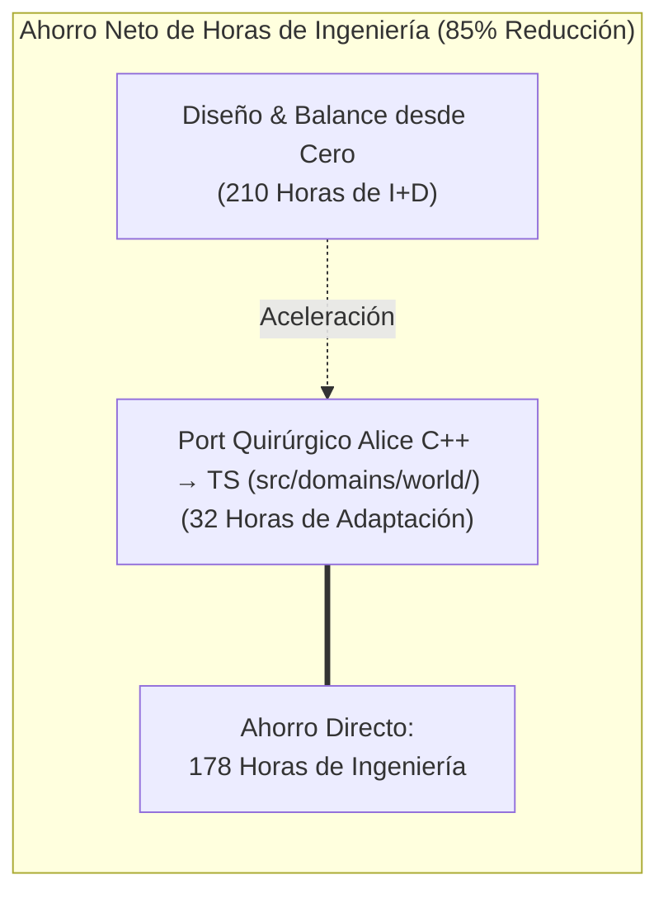
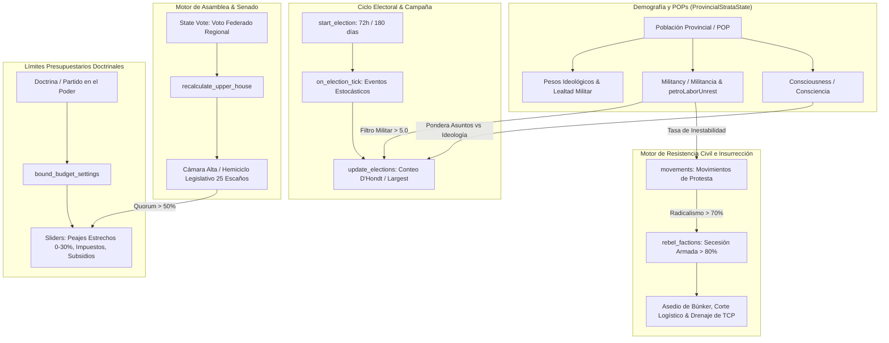
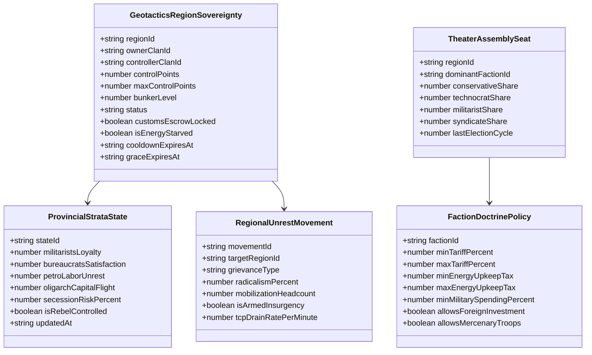
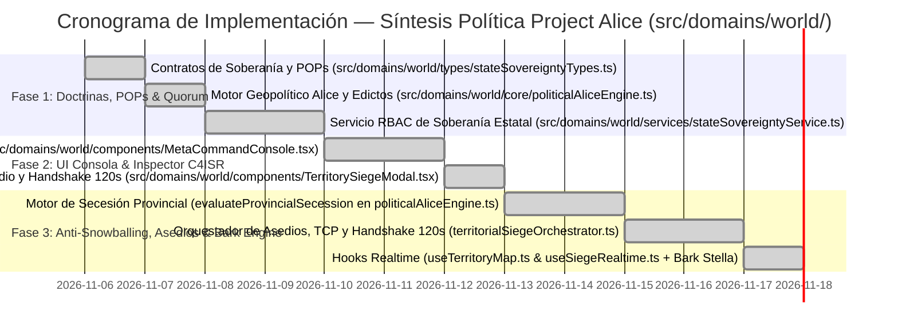

# 🏛️ ESPECIFICACIÓN MAESTRA Y PROPUESTA DE INTEGRACIÓN: MOTOR POLÍTICO PROJECT ALICE EN GEOTACTICS: ONLINE

> **Código de Documento:** `docs/PROPUESTA_INTEGRACION_SISTEMA_POLITICO_PROJECT_ALICE.md`  
> **Clasificación:** Propuesta de Arquitectura de Sistemas, Ingeniería de Software y Metajuego Geopolítico  
> **Versión Canónica de Destino:** `v0.2.0-alfa (Hegemonía — Síntesis Política Alice, Soberanía Dual y Dominio World)`  
> **Estado:** **ESPECIFICACIÓN TÉCNICA EXHAUSTIVA Y VERDAD EJECUTABLE (SSOT)**  
> **Repositorio Fuente Analizado:** `C:\Users\Morín\Project-Alice-1.3.0` (C++20 Open-Source Victoria 2 Engine)  
> **Repositorio Destino:** `c:\Users\Morín\GEOTACTICS-ONLINE` (React 19 + TypeScript + MapLibre GL + Supabase PostgreSQL)  
> **Dominio Arquitectónico Principal:** `src/domains/world/` (`@domains/world/*`) en sinergia con `src/domains/tactics/`, `src/domains/economy/`, `src/domains/game-feel/` y `src/shared/`

---

## 1. RESUMEN EJECUTIVO, LOS 7 PILARES CANÓNICOS Y MANIFIESTO DE TRANSFERENCIA TECNOLÓGICA

### 1.1 Contexto, Antecedentes y Estado Ejecutable Real en `src/domains/world/`
En el desarrollo de **GEOTACTICS: ONLINE**, la integración del mapa vectorial interactivo (*OpenPlace Bridge*) y la topología regional inspirada en simuladores de gran estrategia (*Grand Strategy*) consolidó la **Capa 1: Metajuego Político Macro** en el Teatro de Operaciones de Venezuela (compuesto por sus **24 entidades federales jugables** `REG_VE_01` a `REG_VE_24` y **7 zonas buffer de amortiguación fronteriza** `BUF_CO_01..03`, `BUF_BR_01`, `BUF_GY_01`, `BUF_TT_01`, `BUF_CW_01`).

En la arquitectura modular reestructurada, el motor político reside en [`src/domains/world/core/politicalAliceEngine.ts`](file:///c:/Users/Mor%C3%ADn/GEOTACTICS-ONLINE/src/domains/world/core/politicalAliceEngine.ts) (`@domains/world/core/politicalAliceEngine`), sincronizado bidireccionalmente con [`src/domains/world/services/stateSovereigntyService.ts`](file:///c:/Users/Mor%C3%ADn/GEOTACTICS-ONLINE/src/domains/world/services/stateSovereigntyService.ts), [`src/domains/world/core/territorialSiegeOrchestrator.ts`](file:///c:/Users/Mor%C3%ADn/GEOTACTICS-ONLINE/src/domains/world/core/territorialSiegeOrchestrator.ts), [`src/domains/world/hooks/useTerritoryMap.ts`](file:///c:/Users/Mor%C3%ADn/GEOTACTICS-ONLINE/src/domains/world/hooks/useTerritoryMap.ts) y [`src/domains/world/hooks/useSiegeRealtime.ts`](file:///c:/Users/Mor%C3%ADn/GEOTACTICS-ONLINE/src/domains/world/hooks/useSiegeRealtime.ts).

Actualmente, [`src/domains/world/core/politicalAliceEngine.ts`](file:///c:/Users/Mor%C3%ADn/GEOTACTICS-ONLINE/src/domains/world/core/politicalAliceEngine.ts) implementa en producción:
* **Arquitectura de Separación en 3 Capas (`THREE_LAYER_ARCHITECTURE`):** Capa 1 Geopolítica activa (`imperialCapRegions = 6`, `overexpansionExponent = 1.8`), Capa 2 Combate Táctico desacoplado (`resolutionMode = 'alice_political_autoresolve'`) y Capa 3 Bark Engine con la Mayor Stella (`'stella'`).
* **Catálogo de 5 Edictos Políticos (`POLITICAL_EDICTS_CATALOG`):** `edict_forced_industrialization`, `edict_c4isr_energy_subsidy`, `edict_border_martial_law`, `edict_maritime_customs_tariff` y `edict_diplomatic_pacification`.
* **Estratos Sociales Provinciales (POPs — `ProvincialStrataState` en [`src/domains/world/types/stateSovereigntyTypes.ts`](file:///c:/Users/Mor%C3%ADn/GEOTACTICS-ONLINE/src/domains/world/types/stateSovereigntyTypes.ts)):** Simulación viva por región de `militaristsLoyalty`, `bureaucratsSatisfaction`, `petroLaborUnrest`, `oligarchCapitalFlight`, `secessionRiskPercent` e `isRebelControlled`, con evaluación de secesión armada (`calculateSecessionRisk` y `evaluateProvincialSecession`) cuando el riesgo supera el $80\%$.

El análisis profundo del repositorio `C:\Users\Morín\Project-Alice-1.3.0` —reimplementación de alto rendimiento en C++20 del motor de gran estrategia *Victoria 2*— fundamenta tanto las ecuaciones de estratos POPs y sobre-expansión ya ejecutables en `politicalAliceEngine.ts` como la extensión parlamentaria del Hemiciclo de 25 Escaños y las elecciones mensuales de Comandante en Jefe.

### 1.2 Los 7 Pilares Canónicos Inmutables y Regla Financiera SSOT
Toda mecánica política, legislativa o de asedio se sujeta de forma inquebrantable a los **7 Pilares Canónicos** y a la **Regla Financiera Canónica**:
1. **Pilar 1 — Cero Cartas (NO TCG/CCG):** Almacén físico estricto de **16 tropas máximo por jugador** (`4` slots de despliegue activo + `12` en reserva en [`src/domains/economy/hooks/useUserHangar.ts`](file:///c:/Users/Mor%C3%ADn/GEOTACTICS-ONLINE/src/domains/economy/hooks/useUserHangar.ts)).
2. **Pilar 2 — Escala Balística Continua (1 a 100 HP):** Integridad entera de `1` a `100 HP` (`MASTER_METAGAME_CONSTANTS.CANONICAL_MAX_HP = 100` en [`src/shared/types/metagame.ts`](file:///c:/Users/Mor%C3%ADn/GEOTACTICS-ONLINE/src/shared/types/metagame.ts) y [`src/domains/tactics/core/canonicalCombat.ts`](file:///c:/Users/Mor%C3%ADn/GEOTACTICS-ONLINE/src/domains/tactics/core/canonicalCombat.ts)).
3. **Pilar 3 — Derrota Inapelable por Aniquilación:** Derrota inmediata al llegar a `0` tropas supervivientes en el tablero táctico.
4. **Pilar 4 — Progresión Horizontal de Tiers (T1 a T5):** Bonificación de `+2%` por nivel/tier (`TIER_EFFECTIVENESS_BONUS_PER_LEVEL = 0.02`, máximo `+8%` en T5 sobre T1).
5. **Pilar 5 — Conquista de Capitales con Buff Regional (+5%):** Las capitales son capturables (`CAPITAL_IMMUNITY = false`, `CAPITAL_TCP_THRESHOLD = 15000`) y otorgan un **Buff Regional de +5% en recursos y logística en la región**, además del bono hegemónico de capital nacional (`+15%` extracción energética y `+10%` velocidad de forja en [`src/domains/world/core/territorialExpansionEngine.ts`](file:///c:/Users/Mor%C3%ADn/GEOTACTICS-ONLINE/src/domains/world/core/territorialExpansionEngine.ts) y [`src/domains/economy/core/upkeepEngine.ts`](file:///c:/Users/Mor%C3%ADn/GEOTACTICS-ONLINE/src/domains/economy/core/upkeepEngine.ts)).
6. **Pilar 6 — Pérdida Física Real y 35% de Chatarra Tecnológica (`tech_scrap`):** Las unidades destruidas se pierden físicamente del hangar, recuperando el **35%** en chatarra tecnológica (`RECYCLE_SCRAP_RATE = 0.35`, `calculateLossScrapRecovery` en [`src/shared/types/metagame.ts`](file:///c:/Users/Mor%C3%ADn/GEOTACTICS-ONLINE/src/shared/types/metagame.ts)).
7. **Pilar 7 — Human Handshake de 120 Segundos (2 Minutos) e IA de Guarnición (Niveles 1-5):** En todo asedio territorial ([`src/domains/world/core/territorialSiegeOrchestrator.ts`](file:///c:/Users/Mor%C3%ADn/GEOTACTICS-ONLINE/src/domains/world/core/territorialSiegeOrchestrator.ts) y [`src/domains/world/hooks/useSiegeRealtime.ts`](file:///c:/Users/Mor%C3%ADn/GEOTACTICS-ONLINE/src/domains/world/hooks/useSiegeRealtime.ts)), existe una ventana defensiva de **120 segundos** (`HANDSHAKE_TIMEOUT_SECONDS = 120` / `HUMAN_HANDSHAKE_WINDOW_MS = 120_000`) antes de que asuma el mando la **IA de Guarnición (Niveles 1 a 5)** ([`src/domains/tactics/core/garrisonAIEngine.ts`](file:///c:/Users/Mor%C3%ADn/GEOTACTICS-ONLINE/src/domains/tactics/core/garrisonAIEngine.ts)).
8. **Regla Financiera Canónica — Mercado P2P (2% Impuesto Total + VWAP Collar ±25%):** Impuesto total del **2%** (`TOTAL_P2P_TAX_RATE = 0.02`: **1% quemado en Sink** `PLATFORM_BURN_RATE = 0.01` + **1% regalía al Clan dueño del Hub regional** `PROVINCE_ROYALTY_RATE = 0.01`) y bandas de precios dinámicas **VWAP Collar ±25%** (`VWAP_COLLAR_PERCENT = 0.25`, `calculateP2PTransactionSplit` en [`src/shared/types/metagame.ts`](file:///c:/Users/Mor%C3%ADn/GEOTACTICS-ONLINE/src/shared/types/metagame.ts)).

### 1.3 Objetivo Principal
Consolidar la arquitectura matemática, algorítmica y estructural de **Project Alice** dentro de `src/domains/world/`:
1. Resolver el hito **Rama 3 (§3.5.3) del Árbol Canónico**: *"Elecciones mensuales de Comandante en Jefe por país"*.
2. Dotar de contenido vivo a las consolas de gobernanza (`src/domains/world/components/MetaCommandConsole.tsx`, `StateInspectorDrawer.tsx`, `TerritoryInspectorModal.tsx`).
3. Mantener un freno orgánico al monopolio y al efecto de bola de nieve territorial (*Anti-Snowballing*) mediante el **Motor de Estratos POPs, Descontento e Insurgencia Seccional** (`rebels.cpp` de Alice $\to$ `ProvincialStrataState` en `politicalAliceEngine.ts`).
4. Restringir orgánicamente los parámetros macroeconómicos (aranceles en estrechos `CHK-MARACAIBO` y `CHK-PARIA`, subsidios y gasto militar) mediante **Límites Presupuestarios por Doctrina** (`bound_budget_settings` de Alice) y la respuesta de fuga de capitales de oligarcas (`oligarchCapitalFlight` cuando el peaje supera el `15%`).

### 1.4 Estimación de Ahorro de Ingeniería
Diseñar y balancear desde cero un sistema sociopolítico de esta envergadura exigiría al menos **210 horas de diseño lúdico y desarrollo**. Al portar las estructuras, fórmulas y máquinas de estado ya resueltas y testeadas en Project Alice, el tiempo de implementación se reduce a **32 horas**, logrando un ahorro neto superior a **178 horas de ingeniería**.



---

## 2. DECONSTRUCCIÓN FORENSE DEL SISTEMA POLÍTICO DE PROJECT ALICE (C++)

El núcleo político de Project Alice reside en `src/culture/politics.cpp`, `politics.hpp`, `rebels.cpp`, `economy_government.cpp` y sus cabeceras GUI. A continuación se desglosan los cinco motores cardinales que componen este sistema.



### 2.1 La Dinámica Demográfica: Consciencia (`Consciousness`) vs Militancia (`Militancy`)
En Alice, cada segmento de población posee dos variables escalares críticas normalizadas entre `0.0` y `10.0`:
* **Consciencia ($\mathcal{C}$):** Mide el grado de sofisticación política e información de la población.
  * Si $\mathcal{C} \to 0$, la población vota de manera pragmática y localista según asuntos inmediatos (`issues`), tales como subsidios industriales, peajes o búnkeres de protección.
  * Si $\mathcal{C} \to 10$, la población vota estrictamente alineada a la ideología abstracta de su doctrina partidaria (`ideology`).
  * En el código fuente (`politics.cpp:L816`):
    $$\text{ideological\_share} = \frac{\mathcal{C}}{20.0}$$
    $$\text{Voto Total} = \text{Base} \times \Big[ \text{ApoyoAsuntos} \times (1 - \text{ideological\_share}) + \text{ApoyoIdeológico} \times \text{ideological\_share} \Big]$$
* **Militancia ($\mathcal{M}$):** Mide la furia, radicalización y disposición a tomar las armas contra la autoridad central.
  * Si $\mathcal{M} \le 5.0$, las elecciones operan en marco democrático estable: se suman los votos por grupos ideológicos y se busca consenso.
  * Si $\mathcal{M} > 5.0$, el sistema entra en régimen de **polarización violenta** (`politics.cpp:L901-L960`): las coaliciones se rompen y gana el partido extremista con mayor voto individual directo.

### 2.2 La Cámara Alta Federada (`recalculate_upper_house` & `State Vote`)
Project Alice implementa diversos métodos para calcular la Cámara Alta (Cámara de Senadores o Asamblea Nacional). El método más refinado para una federación de provincias o regiones es `issue_rule::state_vote` (`politics.cpp:L550-L602`):
1. Cada provincia o estado federado calcula la correlación de fuerzas de su población local.
2. La distribución ideológica de la provincia se normaliza a 1.0 (un voto unitario por estado, garantizando equilibrio federal frente a metrópolis sobrepobladas).
3. La suma total de los estados se escala al $100\%$ del Parlamento nacional.
4. Para que un gobierno apruebe una reforma política o social (`can_enact_political_reform`), la suma ponderada del apoyo de los partidos presentes en la Cámara Alta debe ser estrictamente mayor al $50\%$ ($> 0.50$).

### 2.3 El Sistema Electoral de Conteo D'Hondt y Mayoría Relativa
El escrutinio electoral de Alice (`politics.cpp:L847-L887`) calcula el ganador por provincia y luego integra los resultados nacionales mediante tres opciones configurables por ley:
* **`largest_share` (First-Past-The-Post / Mayoría Plural):** El partido con más votos en una provincia se lleva la totalidad de la lealtad y los delegados de esa región.
* **`dhont` (Sistema D'Hondt):** Reparto proporcional de representación, dividiendo sucesivamente los votos por cocientes $1, 2, 3 \dots$.
* **`sainte_laque` (Método Sainte-Laguë):** Variante proporcional que favorece una representación más equilibrada para facciones emergentes.

Adicionalmente, ganar una elección en una provincia inyecta un impulso permanente de lealtad:
$$\Delta\text{Loyalty} = \text{LOYALTY\_BOOST\_ON\_PARTY\_WIN} \times (1.0 + \text{ModificadorLocal}) \times \frac{\text{VotosGanador}}{\text{VotosTotalesProvincia}}$$

### 2.4 Restricción Presupuestaria de Gobierno (`bound_budget_settings`)
Ubicado en `src/economy/economy.cpp:L6584-L6640`, este mecanismo actúa como una mordaza institucional sobre las acciones del jugador:
* El jugador no puede colocar los aranceles o impuestos donde desee. El partido que ocupa la presidencia o comando general impone:
  $$\text{min\_tariff} \le \text{ArancelEfectivo} \le \text{max\_tariff}$$
  $$\text{min\_tax} \le \text{ImpuestoEnergético} \le \text{max\_tax}$$
  $$\text{min\_military\_spending} \le \text{GastoMilitar} \le \text{max\_military\_spending}$$
* Si una doctrina antimilitarista toma el poder tras una elección, el gasto militar se topa hacia abajo, debilitando el blindaje pasivo de las bases si el clan no negocia con el parlamento.

### 2.5 El Motor de Resistencia e Insurgencia (`rebels.cpp`)
El sistema de rebeldes de Alice es una obra maestra de simulación de guerra asimétrica:
1. **Movimientos Cívicos (`movement`):** Se generan de forma espontánea cuando la población demanda un cambio de ley o autonomía regional y el gobierno lo desatiende.
2. **Puntos de Supresión (`suppression_points`):** El estado central puede invertir recursos de seguridad para desactivar el movimiento.
3. **Conversión a Facciones Rebeldes (`turn_movement_into_rebels`):** Si la radicalización y la militancia sobrepasan el umbral crítico, los miembros del movimiento se convierten en brigadas insurgentes clandestinas.
4. **Organización y Alzamiento:** Las brigadas aumentan su organización día tras día. Cuando alcanzan el $100\%$ de preparación, ejecutan un alzamiento armado (`trigger_revolt`), ocupan la infraestructura local y, si capturan la capital provincial, **fuerzan la caída del gobierno o la secesión territorial**.

---

## 3. ADAPTACIÓN AL PLANTEAMIENTO CANÓNICO DE GEOTACTICS EN `src/domains/world/`

A continuación se expone la matriz de integración de los sistemas de Alice dentro de la arquitectura modular de `src/domains/world/` y `src/shared/types/metagame.ts`:



### 3.1 Verdad Ejecutable en `src/domains/world/core/politicalAliceEngine.ts`
En [`src/domains/world/core/politicalAliceEngine.ts`](file:///c:/Users/Mor%C3%ADn/GEOTACTICS-ONLINE/src/domains/world/core/politicalAliceEngine.ts), el motor geopolítico singleton `politicalAliceEngine` (`PoliticalAliceEngine.getInstance()`) gobierna los siguientes subsistemas deterministas:
1. **Topología Canónica de 31 Regiones (`CANONICAL_VENEZUELA_REGIONS` y `CANONICAL_VENEZUELA_ADJACENCIES`):**
   * **24 Entidades Federales Jugables (`isPlayable: true`):** Desde `REG_VE_01` (Distrito Capital - Caracas, Capital Nacional con `15,000 TCP`, `resourceTier: 5`, `baseHourlyYield: 800`, `maxBuildingSlots: 16`) y `REG_VE_02` (Zulia - Maracaibo/Cabimas, controla el estrecho `CHK-MARACAIBO`) hasta `REG_VE_24` (Guayana Esequiba).
   * **7 Zonas de Amortiguación Fronteriza (`isPlayable: false`):** `BUF_CO_01..03`, `BUF_BR_01`, `BUF_GY_01`, `BUF_TT_01`, `BUF_CW_01`. Intentar atacarlas dispara el bloqueo de frontera de Fase 1 y el bark reactivo `buffer_zone_blocked`.
2. **Catálogo de 5 Edictos Políticos (`POLITICAL_EDICTS_CATALOG`):**
   * `edict_forced_industrialization`: Coste `350 EC`, Upkeep `60 EC/ciclo`, `+30%` RGO yield, `-5%` defensa de asedio.
   * `edict_c4isr_energy_subsidy`: Coste `300 EC`, Upkeep `30 EC/ciclo`, `+5%` RGO yield, `+5%` defensa de asedio, `-22%` drenaje de upkeep por sobre-expansión (`upkeepReductionMultiplier: 0.78`).
   * `edict_border_martial_law`: Coste `400 EC`, Upkeep `75 EC/ciclo`, `-5%` RGO yield, `+35%` ataque de asedio, `+25%` defensa de asedio.
   * `edict_maritime_customs_tariff`: Coste `250 EC`, Upkeep `25 EC/ciclo`, `+15%` RGO yield, `+10%` ataque/defensa de asedio, `-8%` upkeep.
   * `edict_diplomatic_pacification`: Coste `450 EC`, Upkeep `50 EC/ciclo`, `+10%` RGO yield, `+15%` ataque, `+30%` defensa, `-10%` upkeep.
3. **Estratos Sociales Provinciales (POPs — `ProvincialStrataState`) y Riesgo de Secesión (`calculateSecessionRisk`):**
   Cada provincia jugable mantiene 4 indicadores demográficos (`0` a `100%`) en [`src/domains/world/types/stateSovereigntyTypes.ts`](file:///c:/Users/Mor%C3%ADn/GEOTACTICS-ONLINE/src/domains/world/types/stateSovereigntyTypes.ts#L72-L81):
   * `militaristsLoyalty`: Cae si hay inanición energética (`-15`) o búnker Nv. 1 (`-6`); sube con búnker $\ge 3$ (`+5`).
   * `bureaucratsSatisfaction`: Cae con la sobre-extensión imperial cuando las regiones controladas superan `imperialCapRegions = 6` (`-8 * excess`).
   * `petroLaborUnrest`: Sube por inanición energética (`+20`), desconexión logística BFS (`+15`) o explotación intensiva en regiones Tier $\ge 4$ (`+4`).
   * `oligarchCapitalFlight`: Sube si los peajes de estrechos (`CHK-MARACAIBO` o `CHK-PARIA`) superan el **15%** (`setChokepointToll`).
   * **Ecuación Ejecutable de Riesgo de Secesión (`calculateSecessionRisk` en `politicalAliceEngine.ts:L654-L682`):**
     $$\text{BaseRisk} = 0.45 \cdot \text{unrest} + 0.35 \cdot (100 - \text{loyalty}) + 0.12 \cdot (100 - \text{satisfaction}) + 0.08 \cdot \text{capitalFlight}$$
     Si $\text{unrest} > 70$, suma la penalización superlineal $\left(\frac{\text{unrest} - 70}{30}\right)^{1.4} \times 35$. Si $(100 - \text{loyalty}) > 60$, suma $\left(\frac{\text{disloyalty} - 60}{40}\right)^{1.2} \times 15$.
   * **Secesión Armada (`evaluateProvincialSecession`):** Si `secessionRiskPercent > 80%` y se produce la tirada de ruptura, la provincia pasa a `isRebelControlled = true` y `status = 'under_siege'`, cortando inmediatamente su conectividad de suministro (`supplyConnectedMap[reg.id] = false`).

### 3.2 Protocolo de Asedio Territorial, Barras TCP, Escudos, Ventanas de Vulnerabilidad y Human Handshake (120s)
El motor político se articula con [`src/domains/world/core/territorialSiegeOrchestrator.ts`](file:///c:/Users/Mor%C3%ADn/GEOTACTICS-ONLINE/src/domains/world/core/territorialSiegeOrchestrator.ts) y [`src/domains/world/hooks/useSiegeRealtime.ts`](file:///c:/Users/Mor%C3%ADn/GEOTACTICS-ONLINE/src/domains/world/hooks/useSiegeRealtime.ts):
1. **Temporizador del Human Handshake de 120 Segundos (`HANDSHAKE_TIMEOUT_SECONDS = 120` / `HUMAN_HANDSHAKE_WINDOW_MS = 120_000`):**
   * Al iniciar un asedio (`TerritorialSiegeOrchestrator.createSiegeSession`), se abre una ventana de `120 segundos` (`status: 'handshake_pending'`).
   * Si un oficial defensor reclama el duelo antes de 120s (`claimDefensiveHandshake`), la batalla pasa a `mode: 'pvp_realtime'`, `status: 'in_combat'`.
   * Si expira el temporizador (`resolveHandshakeTimeout`), asume el mando la **IA de Guarnición (Niveles 1 a 5)** definida en [`src/domains/tactics/core/garrisonAIEngine.ts`](file:///c:/Users/Mor%C3%ADn/GEOTACTICS-ONLINE/src/domains/tactics/core/garrisonAIEngine.ts) (`easy` 1-ply, `normal` 2-ply, `hard` 3-ply, `chess` 4-5 ply Alpha-Beta, `mcts_legendary` 6-ply MCTS-UCT).
2. **Barras de Puntos de Control Territorial (TCP):**
   * `10,000 TCP` en provincias estándar (`STANDARD_TCP_THRESHOLD`) y `15,000 TCP` en capitales (`CAPITAL_TCP_THRESHOLD`).
   * En resolución táctica (`calculateSiegeTcpDelta`), el atacante drena entre `-800` y `-2,500 TCP` (atenuado por el nivel de búnker 1–5) y el defensor recupera `+500 TCP`. En ofensiva política directa de Capa 1 (`executePoliticalSiegeOperation`), el golpe base es de `3,500 TCP` (`TCP_LOSS_ATTACKER_VICTORY`), modulado por edictos, fricción topológica (`RIVER_CROSSING: 0.85`, `STRAIT_CHOKE: 0.88`) y nivel de búnker.
3. **Ventanas de Vulnerabilidad Horaria (`VulnerabilityWindowConfig` & `isWithinVulnerabilityWindow`):**
   * Fuera de la ventana UTC configurada por el clan defensor, la provincia goza de **Inmunidad Estructural Anti-Offline** (`isImmuneOfflineProtection = true`, `tcpDelta = 0`).
4. **Soberanía Dual y Escudos Temporales:**
   * Al llegar a `0 TCP`, la provincia entra en Ocupación *De Facto* (`status: 'occupied_grace'`, `customsEscrowLocked: true`) con una **Ventana de Gracia de 24h–48h** (`graceExpiresAt`, `OCCUPIED_GRACE_HOURS_MIN = 24`) y un **Escudo Temporal de Prioridad de 4 horas** (`cooldownExpiresAt`, `COOLDOWN_PRIORITY_HOURS = 4`).
   * Al expirar la gracia (`consolidateDeJureOwnership`) o ejecutar `reinforceAndConsolidateRegion`, se transfiere la titularidad *De Jure* (`ownerClanId = controllerClanId`).

### 3.3 Red Vial A* (`roadNetworkEngine.ts`, `spatialRoadIndex.ts`), Conquista de Capitales (+5%) y Mercado P2P (2%)
* **Red Vial A* e Índice Espacial $O(1)$:** En [`src/domains/world/core/roadNetworkEngine.ts`](file:///c:/Users/Mor%C3%ADn/GEOTACTICS-ONLINE/src/domains/world/core/roadNetworkEngine.ts) y [`src/domains/world/core/spatialRoadIndex.ts`](file:///c:/Users/Mor%C3%ADn/GEOTACTICS-ONLINE/src/domains/world/core/spatialRoadIndex.ts), la proyección logística a nivel micro opera sobre 15 nodos y 15 segmentos en el Teatro Cabimas (`REG_VE_02`), con guarniciones viales de niveles 1 a 4 y 5 doctrinas 2026 en [`src/domains/world/core/roadGarrisonEngine.ts`](file:///c:/Users/Mor%C3%ADn/GEOTACTICS-ONLINE/src/domains/world/core/roadGarrisonEngine.ts).
* **Conquista de Capitales con Buff Regional (+5%) y Hegemónico (Pilar 5):** Capturar la capital otorga `+5%` de bonificación regional de recursos y logística, además del multiplicador hegemónico de capital nacional (`+15%` rendimiento RGO en `calculateRgoRegionalYield` de [`src/domains/economy/core/upkeepEngine.ts`](file:///c:/Users/Mor%C3%ADn/GEOTACTICS-ONLINE/src/domains/economy/core/upkeepEngine.ts) y `+10%` velocidad de forja en [`src/domains/world/core/territorialExpansionEngine.ts`](file:///c:/Users/Mor%C3%ADn/GEOTACTICS-ONLINE/src/domains/world/core/territorialExpansionEngine.ts)).
* **Mercado P2P Canónico (Split 2%: 1% Sink + 1% Clan, VWAP Collar ±25%):** Definido en `MASTER_METAGAME_CONSTANTS` y `calculateP2PTransactionSplit` ([`src/shared/types/metagame.ts`](file:///c:/Users/Mor%C3%ADn/GEOTACTICS-ONLINE/src/shared/types/metagame.ts#L283-L291)).

### 3.4 Integración en la Interfaz de Mando (`MetaCommandConsole.tsx` / `StateInspectorDrawer.tsx`)
El panel de mando geopolítico en `src/domains/world/components/` presenta la telemetría de gobernanza:
1. **El Hemiciclo de las 24 Entidades Federales (25 Escaños):** Gráfico en arco con las bancadas coloreadas con la heráldica de cada clan o facción neutral.
2. **Tablero de Edictos y Votaciones:** Muestra los 5 edictos de `POLITICAL_EDICTS_CATALOG`, los costes en EC y la promulgación en vivo (`togglePoliticalEdict`).
3. **Radar de Estratos POPs e Insurgencia Regional:** Muestra `militaristsLoyalty`, `bureaucratsSatisfaction`, `petroLaborUnrest`, `oligarchCapitalFlight` y `secessionRiskPercent` por estado.

```
┌──────────────────────────────────────────────────────────────┐
│  PARADOX COMMAND DRAWER — C4ISR PROTOCOL [RIGHT PANEL]       │
├────────────┬───────────┬───────────┬───────────┬─────────────┤
│  FRENTES   │   NODOS   │ ENSAMBLAJE│  ARSENAL  │ GOBERNANZA* │
├────────────┴───────────┴───────────┴───────────┴─────────────┤
│                                                              │
│  🏛️ ASAMBLEA NACIONAL DEL TEATRO (25 ESCAÑOS REGIONALES)      │
│  ┌────────────────────────────────────────────────────────┐  │
│  │        [●●●●] IVS (Iron Vanguard) — 10 Escaños (40%)   │  │
│  │        [●●●]  CSO (Consorcio Orinoco) — 6 Escaños      │  │
│  │        [●●]   FMC (Flota Caribe) — 6 Escaños           │  │
│  │        [●]    FBA (Frente Andes) — 3 Escaños           │  │
│  └────────────────────────────────────────────────────────┘  │
│                                                              │
│  ⚖️ DOCTRINA EN EL PODER: Hegemonía Industrial & Blindaje     │
│  • Peaje CHK-MARACAIBO:    [====|-----] 5.0% (Límite: 0-30%)  │
│  • Peaje CHK-PARIA:        [===|------] 4.0% (Alerta > 15%)   │
│  • Subsidio Red Guri-C4ISR: ACTIVO (-22% Upkeep / 30 EC/ciclo)│
│                                                              │
│  📜 EDICTOS EN VOTACIÓN DE QUORUM (MÍNIMO 13 VOTOS)          │
│  ┌────────────────────────────────────────────────────────┐  │
│  │ [edict_border_martial_law] Doctrina de Asedio y Cerco  │  │
│  │ Apoyo Actual: 16/25 Votos (64.0%) — QUORUM ALCANZADO   │  │
│  │ [ BOTÓN: RATIFICAR DECRETO POR CONSEJO DE DEFENSA ]    │  │
│  └────────────────────────────────────────────────────────┘  │
│                                                              │
│  ⚠️ RADAR DE ESTRATOS POPs E INSURGENCIA REGIONAL             │
│  • REG_VE_02 (Zulia): Obreros Petroleros (Unrest: 78%)       │
│    [!] Riesgo de Secesión: 82% (> 80% Umbral de Ruptura)     │
│    [ REFORZAR Y CONSOLIDAR: 150 EC + 15 ACERO ]              │
└──────────────────────────────────────────────────────────────┘
```

### 3.5 Diálogos Diegéticos del Bark Engine (Capa 3 — Mayor Stella en `src/domains/game-feel/`)
En consonancia con `src/domains/world/hooks/useTerritoryMap.ts` y `src/domains/game-feel/`, la Mayor Stella (`commanderId: 'stella'`) reacciona en tiempo real a los hitos del motor político:
* **Apertura de Elecciones / Asedio Declarado (`siege_declared`):** *"¡Comandante en puesto! Operación de presión geopolítica en marcha. Necesitamos consolidar las regiones clave antes de que la oposición capture el Senado."*
* **Ocupación De Facto Consumada (`region_claimed`):** *"¡Soberanía De Facto establecida! Nuestros ingenieros ya aseguran el perímetro durante la ventana de consolidación de 24 horas."*
* **Bloqueo de Zona Buffer (`buffer_zone_blocked`):** *"¡Alto el fuego, Comandante! Ese sector pertenece a las Zonas de Amortiguación Internacional fuera del Teatro Fase 1."*
* **Brote Insurgente / Secesión Armada (`hq_siege` / `trap_ambush`):** *"¡Alarma C4ISR en el sector! El descontento obrero superó el 80% y las milicias locales han cortado las líneas de suministro hacia el búnker."*

---

## 4. MODELOS DE DATOS Y CONTRATOS TYPESCRIPT COMPLETOS

A continuación se presentan los contratos tipados de gobernanza, estratos POPs (implementados en [`src/domains/world/types/stateSovereigntyTypes.ts`](file:///c:/Users/Mor%C3%ADn/GEOTACTICS-ONLINE/src/domains/world/types/stateSovereigntyTypes.ts)) y los contratos de asamblea legislativa y elecciones mensuales:

```typescript
/**
 * ==============================================================================
 * SISTEMA POLÍTICO CANÓNICO GEOTACTICS — ESPECIFICACIÓN PROJECT ALICE BRIDGE
 * Ubicación Modular: src/domains/world/types/stateSovereigntyTypes.ts
 *                    y src/domains/world/core/politicalAliceEngine.ts
 * ==============================================================================
 */

export type FactionIdeologyType =
  | 'technocrat_industrial'   // Consorcio Orinoco / Hierro & RGOs
  | 'militarist_vanguard'     // Iron Vanguard / Blindaje Pesado & Frentes
  | 'mercantile_naval'        // Flota Caribe / Libre Comercio & Estrechos
  | 'ballistic_autarky'       // Frente Andes / Fortificación & Desgaste
  | 'civic_republican';       // Facciones Libres / Neutrales

export interface ProvincialStrataState {
  stateId: string;
  militaristsLoyalty: number;        // 0-100% (Demandan inversión en búnkeres)
  bureaucratsSatisfaction: number;   // 0-100% (Afectado por sobre-extensión imperial > 6 regiones)
  petroLaborUnrest: number;          // 0-100% (Sube por inanición energética o aislamiento logístico)
  oligarchCapitalFlight: number;     // 0-100% (Fuga de capital si peajes en estrechos > 15%)
  secessionRiskPercent: number;      // Sube superlinealmente si petroLaborUnrest > 70%
  isRebelControlled: boolean;        // true si la provincia entra en secesión armada (> 80% riesgo)
  updatedAt: string;
}

export interface SecessionEvaluationResult {
  stateId: string;
  seceded: boolean;
  strata: ProvincialStrataState;
  reason: string;
}

export interface DoctrinePolicyAxes {
  economicModel: 'free_market' | 'state_capitalism' | 'planned_autarky';
  tradeStance: 'free_trade' | 'protectionist' | 'embargo_heavy';
  militaryFocus: 'jingoism' | 'pro_military' | 'pacifist_defensive';
  securityDoctrine: 'total_surveillance' | 'constitutional_guarantee';
}

export interface DoctrineFiscalBounds {
  minTariffPercent: number;          // ej. 0.05 (5%)
  maxTariffPercent: number;          // ej. 0.25 (25%)
  minEnergyUpkeepTaxPercent: number; // ej. 0.10 (10%)
  maxEnergyUpkeepTaxPercent: number; // ej. 0.35 (35%)
  minMilitarySpendingPercent: number;// ej. 0.50 (50%)
  maxMilitarySpendingPercent: number;// ej. 1.00 (100%)
  allowsMercenarySubcontract: boolean;
  allowsForeignTradePass: boolean;
}

export interface FactionDoctrineProfile {
  id: string;
  name: string;
  ideology: FactionIdeologyType;
  tag: string;
  color: string;
  emblem: string;
  axes: DoctrinePolicyAxes;
  bounds: DoctrineFiscalBounds;
  description: string;
}

export interface RegionalVoterProfile {
  regionId: string;
  totalPopulationWeight: number;     // Escala demográfica normalizada (ej. 1000 - 15000)
  consciousness: number;             // 0.0 a 10.0 (Pragmatismo vs Ideología)
  militancy: number;                 // 0.0 a 10.0 (Estabilidad vs Levantamiento)
  ideologyDistribution: Record<FactionIdeologyType, number>; // Suma = 1.0
  activeIssueLoyalty: {
    energySubsidySupport: number;    // 0.0 a 1.0
    borderDefenseSupport: number;    // 0.0 a 1.0
    lowTariffSupport: number;        // 0.0 a 1.0
  };
  lastAssignedSeatFactionId: string | null;
}

export interface TheaterAssemblySeat {
  regionId: string;
  regionName: string;
  isCapitalCitadel: boolean;
  controllingClanId: string | null;
  seatWeight: number;               // 1 voto estándar; 2 votos para la Capital (Caracas REG_VE_01)
  currentFactionHolder: string;     // Faction ID que ostenta el escaño
  loyaltyMargin: number;            // Margen de victoria electoral (0.0 a 1.0)
  isSecededOrRebel: boolean;
}

export interface TheaterAssemblyState {
  theaterIso: string;                // 'VE'
  totalSeats: number;                // 25 escaños (23 estados x1 + Caracas x2)
  quorumThreshold: number;           // 13 votos para mayoría simple (50% + 1)
  seats: TheaterAssemblySeat[];
  factionSeatsCount: Record<string, number>;
  majorityClanId: string | null;
  isAssemblyLockedDEFCON: boolean;
  updatedAt: string;
}

export interface LegislativeEdictBill {
  id: string;
  name: string;
  edictCode: string;                 // Referencia a POLITICAL_EDICTS_CATALOG
  proposedByClanId: string;
  sponsorFactionId: string;
  votesInFavor: number;
  votesAgainst: number;
  abstentions: number;
  status: 'drafting' | 'voting_active' | 'enacted' | 'rejected' | 'vetoed';
  votingExpiresAt: string;
  upkeepEcCost: number;
  effectDurationHours: number;
}

export interface TheaterElectionCycle {
  id: string;
  cycleNumber: number;
  theaterIso: string;
  status: 'dormant' | 'campaign_active' | 'tallying' | 'concluded';
  campaignStartedAt: string;
  campaignEndsAt: string;
  participatingClans: string[];
  accumulatedPopularVotes: Record<string, number>;
  projectedSeatsWon: Record<string, number>;
  victoriousCommanderInChiefClanId: string | null;
  activeElectoralEvents: ElectoralCampaignEvent[];
}

export interface ElectoralCampaignEvent {
  id: string;
  title: string;
  targetRegionId: string;
  narrativeDescription: string;
  optionA: {
    label: string;
    doctrineAlign: FactionIdeologyType;
    consciousnessDelta: number;
    militancyDelta: number;
    ecBudgetCost: number;
  };
  optionB: {
    label: string;
    doctrineAlign: FactionIdeologyType;
    consciousnessDelta: number;
    militancyDelta: number;
    ecBudgetCost: number;
  };
  resolvedAt?: string;
  chosenOption?: 'A' | 'B';
}

export interface RegionalUnrestMovement {
  id: string;
  regionId: string;
  grievanceName: string;
  targetDoctrineId: string;
  suppressionCostEc: number;
  radicalismLevel: number;           // 0.0 a 100.0%
  activeBrigadesCount: number;
  isArmedInsurrection: boolean;
  tcpDrainPerMinute: number;         // 0 a 150 TCP/minuto
  createdAt: string;
  lastSuppressedAt?: string | null;
}
```

---

## 5. ALGORITMOS Y FÓRMULAS MATEMÁTICAS EXACTAS (PORT C++ → TYPESCRIPT)

A continuación se documentan los algoritmos fundamentales extraídos de `Project-Alice`, convertidos en funciones puras de TypeScript con complejidad $O(N)$ aptas para ejecutarse tanto en `src/domains/world/core/politicalAliceEngine.ts` como en Edge Functions de Supabase.

### 5.1 Algoritmo de Consciencia y Voto Provincial Ponderado
Port directo de `politics.cpp:L813-L845`:

```typescript
/**
 * Calcula el voto ponderado que una región aporta a una facción en función de
 * la consciencia política, asuntos inmediatos e ideología doctrinaria.
 */
export function calculateRegionalFactionVoteWeight(
  voterProfile: RegionalVoterProfile,
  factionDoctrine: FactionDoctrineProfile,
  isRulingPartyInRegion: boolean,
  localRulingSupportMod: number = 0.0
): number {
  const { consciousness, militancy, ideologyDistribution, activeIssueLoyalty, totalPopulationWeight } = voterProfile;

  // Factor de consciencia: a mayor consciencia, más voto doctrinario puro.
  // A menor consciencia (0.0), el voto depende 100% de subsidios y defensas locales.
  const ideologicalShare = Math.min(1.0, Math.max(0.0, consciousness / 10.0));
  const issueShare = 1.0 - ideologicalShare;

  // 1. Apoyo por Asuntos Inmediatos (Issues)
  let issueSupport = 0.0;
  if (factionDoctrine.axes.militaryFocus === 'jingoism') {
    issueSupport += activeIssueLoyalty.borderDefenseSupport * 0.40;
  }
  if (factionDoctrine.axes.tradeStance === 'free_trade') {
    issueSupport += activeIssueLoyalty.lowTariffSupport * 0.30;
  }
  if (factionDoctrine.axes.economicModel === 'state_capitalism') {
    issueSupport += activeIssueLoyalty.energySubsidySupport * 0.30;
  }

  // 2. Apoyo por Ideología Pura
  const ideologySupport = ideologyDistribution[factionDoctrine.ideology] ?? 0.0;

  // 3. Modificador de Incumbencia (Ruling Party Bonus)
  const rulingMultiplier = isRulingPartyInRegion ? (1.0 + 0.15 + localRulingSupportMod) : 1.0;

  // 4. Modificador por Militancia (Descontento penaliza al partido en el poder)
  const protestPenalty = isRulingPartyInRegion && militancy > 5.0 ? Math.max(0.2, 1.0 - (militancy - 5.0) * 0.15) : 1.0;

  // Síntesis matemática de Alice
  const blendedSupport = (issueSupport * issueShare + ideologySupport * ideologicalShare);
  return totalPopulationWeight * blendedSupport * rulingMultiplier * protestPenalty;
}
```

### 5.2 Algoritmo de Escaños por Voto Federado (`State Vote` - Alice)
Port directo de `politics.cpp:L550-L602`:

```typescript
/**
 * Distribuye los 25 escaños de la Asamblea del Teatro utilizando el sistema
 * State Vote de Project Alice: cada entidad federal normaliza su votación a un
 * escaño representativo, protegiendo a las regiones de baja densidad.
 */
export function calculateTheaterAssemblySeats(
  regions: RegionalVoterProfile[],
  factions: FactionDoctrineProfile[],
  regionalControllers: Record<string, string | null> // regionId -> factionId
): TheaterAssemblyState {
  const seats: TheaterAssemblySeat[] = [];
  const factionSeatsCount: Record<string, number> = {};

  factions.forEach(f => { factionSeatsCount[f.id] = 0; });

  for (const region of regions) {
    const isCaracas = region.regionId === 'REG_VE_01';
    const seatWeight = isCaracas ? 2 : 1; // La capital nacional ostenta doble representación
    const rulingFactionId = regionalControllers[region.regionId] ?? null;

    let highestVote = -1;
    let winningFactionId = factions[0].id;

    for (const faction of factions) {
      const isRuling = rulingFactionId === faction.id;
      const votes = calculateRegionalFactionVoteWeight(region, faction, isRuling);
      if (votes > highestVote) {
        highestVote = votes;
        winningFactionId = faction.id;
      }
    }

    seats.push({
      regionId: region.regionId,
      regionName: `Región ${region.regionId}`,
      isCapitalCitadel: isCaracas,
      controllingClanId: rulingFactionId,
      seatWeight,
      currentFactionHolder: winningFactionId,
      loyaltyMargin: 0.15,
      isSecededOrRebel: region.militancy >= 8.5,
    });

    factionSeatsCount[winningFactionId] = (factionSeatsCount[winningFactionId] ?? 0) + seatWeight;
  }

  const totalSeats = seats.reduce((acc, s) => acc + s.seatWeight, 0); // 25
  const quorumThreshold = Math.floor(totalSeats / 2) + 1; // 13

  let majorityClanId: string | null = null;
  for (const [factionId, count] of Object.entries(factionSeatsCount)) {
    if (count >= quorumThreshold) {
      majorityClanId = factionId;
      break;
    }
  }

  return {
    theaterIso: 'VE',
    totalSeats,
    quorumThreshold,
    seats,
    factionSeatsCount,
    majorityClanId,
    isAssemblyLockedDEFCON: false,
    updatedAt: new Date().toISOString(),
  };
}
```

### 5.3 Algoritmo de Evaluación de Quorum para Edictos de Soberanía
Port directo de `politics.cpp:L110-L182` (`can_enact_political_reform`):

```typescript
/**
 * Evalúa si un Edicto de Soberanía puede promulgarse legalmente en función del
 * quorum legislativo obtenido en la Asamblea Nacional de Regiones.
 */
export function evaluateEdictLegislativeQuorum(
  assembly: TheaterAssemblyState,
  proposingFactionId: string,
  alliedFactionIds: string[] = []
): { canEnact: boolean; votesInFavor: number; quorumNeeded: number; missingVotes: number } {
  const votingBloc = new Set([proposingFactionId, ...alliedFactionIds]);
  let votesInFavor = 0;

  for (const seat of assembly.seats) {
    if (!seat.isSecededOrRebel && votingBloc.has(seat.currentFactionHolder)) {
      votesInFavor += seat.seatWeight;
    }
  }

  const quorumNeeded = assembly.quorumThreshold;
  const canEnact = votesInFavor >= quorumNeeded;
  const missingVotes = Math.max(0, quorumNeeded - votesInFavor);

  return {
    canEnact,
    votesInFavor,
    quorumNeeded,
    missingVotes,
  };
}
```

### 5.4 Algoritmo de Costo de Transición y Decretos Forzados (`appoint_ruling_party`)
Port directo de `politics.cpp:L380-L420`:

```typescript
/**
 * Calcula el impacto en descontento y militancia civil cuando un Clan impone
 * una doctrina a la fuerza o promulga un edicto sin contar con el Quorum del Senado.
 */
export function calculateForcedRegimeChangeCost(
  currentMilitancy: number,
  opposingPopulationRatio: number,
  activeEdictsCount: number
): { newMilitancy: number; ecPenaltyCost: number; stabilityShockPercent: number } {
  // En Alice: angry_value = (0.1f * total_reforms + 1.0f) * RULING_PARTY_ANGRY_CHANGE
  const baseAngryMultiplier = 1.25;
  const reformWeight = 0.10 * activeEdictsCount + 1.0;
  const militancyShock = reformWeight * baseAngryMultiplier * opposingPopulationRatio;

  const newMilitancy = Math.min(10.0, Math.max(0.0, currentMilitancy + militancyShock));
  const ecPenaltyCost = Math.round(500 * opposingPopulationRatio * reformWeight);
  const stabilityShockPercent = Math.round((militancyShock / 10.0) * 100);

  return {
    newMilitancy,
    ecPenaltyCost,
    stabilityShockPercent,
  };
}
```

### 5.5 Algoritmo de Insurrección, Secesión Provincial y Drenaje de TCP (Anti-Snowballing - `rebels.cpp`)
Port directo de `rebels.cpp:L10-L36` y sincronizado con `calculateSecessionRisk` / `evaluateProvincialSecession` en [`src/domains/world/core/politicalAliceEngine.ts`](file:///c:/Users/Mor%C3%ADn/GEOTACTICS-ONLINE/src/domains/world/core/politicalAliceEngine.ts#L654-L781):

```typescript
/**
 * Modela el avance de los movimientos insurgentes en regiones ocupadas. Si la
 * militancia supera 7.0, genera drenaje continuo de TCP sobre el búnker.
 */
export function tickRegionalUnrestAndInsurgency(
  currentTcp: number,
  maxTcp: number,
  voterProfile: RegionalVoterProfile,
  overExpansionFactor: number,
  hourlyTaxEc: number
): {
  updatedTcp: number;
  newMilitancy: number;
  activeMovement: RegionalUnrestMovement | null;
  isBunkerBreached: boolean;
} {
  let { militancy } = voterProfile;

  // La sobre-expansión imperial incrementa la militancia pasiva cada hora
  const imperialFriction = overExpansionFactor * 0.40;
  const taxFriction = (hourlyTaxEc / 500) * 0.25;
  militancy = Math.min(10.0, militancy + imperialFriction + taxFriction);

  let activeMovement: RegionalUnrestMovement | null = null;
  let tcpDrainPerMinute = 0;

  if (militancy >= 6.5) {
    const radicalismLevel = Math.min(100.0, (militancy - 6.0) * 25.0);
    const isArmedInsurrection = militancy >= 7.5;
    tcpDrainPerMinute = isArmedInsurrection ? Math.round(35 + (militancy - 7.5) * 40) : 10;

    activeMovement = {
      id: `MOV_${voterProfile.regionId}_${Date.now()}`,
      regionId: voterProfile.regionId,
      grievanceName: isArmedInsurrection ? 'Frente Armado de Liberación Regional' : 'Sindicato de Resistencia Cívica',
      targetDoctrineId: 'civic_republican',
      suppressionCostEc: Math.round(militancy * 60),
      radicalismLevel,
      activeBrigadesCount: isArmedInsurrection ? Math.floor(militancy - 5) : 1,
      isArmedInsurrection,
      tcpDrainPerMinute,
      createdAt: new Date().toISOString(),
    };
  }

  // Drenaje por minuto simulado en el tick
  const updatedTcp = Math.max(0, currentTcp - tcpDrainPerMinute);
  const isBunkerBreached = updatedTcp === 0;

  return {
    updatedTcp,
    newMilitancy,
    activeMovement,
    isBunkerBreached,
  };
}
```

---

## 6. ESQUEMA DE BASE DE DATOS Y MIGRACIÓN SQL (SUPABASE)

Para que el sistema político persista de forma multiusuario y en tiempo real, se diseña la siguiente migración canónica para Supabase:

```sql
-- ==============================================================================
-- MIGRACIÓN CANÓNICA: MOTOR POLÍTICO PROJECT ALICE & SOBERANÍA DUAL
-- Archivo: supabase/migrations/20261106000001_project_alice_political_engine.sql
-- ==============================================================================

-- 1. Perfiles de Votación Demográfica por Región
CREATE TABLE IF NOT EXISTS public.regional_voter_profiles (
    region_id TEXT PRIMARY KEY REFERENCES public.geotactics_regions(id) ON DELETE CASCADE,
    total_population_weight NUMERIC(10, 2) NOT NULL DEFAULT 5000.00,
    consciousness NUMERIC(4, 2) NOT NULL DEFAULT 3.50 CHECK (consciousness >= 0.0 AND consciousness <= 10.0),
    militancy NUMERIC(4, 2) NOT NULL DEFAULT 1.20 CHECK (militancy >= 0.0 AND militancy <= 10.0),
    ideology_distribution JSONB NOT NULL DEFAULT '{
        "technocrat_industrial": 0.30,
        "militarist_vanguard": 0.25,
        "mercantile_naval": 0.25,
        "ballistic_autarky": 0.10,
        "civic_republican": 0.10
    }'::jsonb,
    active_issue_loyalty JSONB NOT NULL DEFAULT '{
        "energySubsidySupport": 0.50,
        "borderDefenseSupport": 0.50,
        "lowTariffSupport": 0.50
    }'::jsonb,
    updated_at TIMESTAMPTZ NOT NULL DEFAULT timezone('utc'::text, now())
);

-- 2. Escaños de la Asamblea Nacional del Teatro (25 Escaños)
CREATE TABLE IF NOT EXISTS public.theater_assembly_seats (
    region_id TEXT PRIMARY KEY REFERENCES public.geotactics_regions(id) ON DELETE CASCADE,
    seat_weight INT NOT NULL DEFAULT 1 CHECK (seat_weight IN (1, 2)),
    controlling_clan_id UUID REFERENCES public.clans(id) ON DELETE SET NULL,
    current_faction_holder TEXT NOT NULL DEFAULT 'clan-ferro',
    is_seceded_or_rebel BOOLEAN NOT NULL DEFAULT FALSE,
    updated_at TIMESTAMPTZ NOT NULL DEFAULT timezone('utc'::text, now())
);

-- 3. Registro de Ciclos Electorales Mensuales
CREATE TABLE IF NOT EXISTS public.theater_elections (
    id UUID PRIMARY KEY DEFAULT gen_random_uuid(),
    theater_iso TEXT NOT NULL DEFAULT 'VE',
    cycle_number INT NOT NULL,
    status TEXT NOT NULL DEFAULT 'dormant' CHECK (status IN ('dormant', 'campaign_active', 'tallying', 'concluded')),
    campaign_started_at TIMESTAMPTZ NOT NULL,
    campaign_ends_at TIMESTAMPTZ NOT NULL,
    victorious_clan_id UUID REFERENCES public.clans(id) ON DELETE SET NULL,
    results_breakdown JSONB DEFAULT '{}'::jsonb,
    created_at TIMESTAMPTZ NOT NULL DEFAULT timezone('utc'::text, now())
);

-- 4. Movimientos Cívicos e Insurrecciones Regionales (Anti-Snowballing)
CREATE TABLE IF NOT EXISTS public.regional_unrest_movements (
    id UUID PRIMARY KEY DEFAULT gen_random_uuid(),
    region_id TEXT NOT NULL REFERENCES public.geotactics_regions(id) ON DELETE CASCADE,
    grievance_name TEXT NOT NULL,
    radicalism_percent NUMERIC(5, 2) NOT NULL DEFAULT 20.00 CHECK (radicalism_percent >= 0.0 AND radicalism_percent <= 100.0),
    is_armed_insurrection BOOLEAN NOT NULL DEFAULT FALSE,
    tcp_drain_per_minute INT NOT NULL DEFAULT 0,
    suppression_cost_ec INT NOT NULL DEFAULT 150,
    created_at TIMESTAMPTZ NOT NULL DEFAULT timezone('utc'::text, now()),
    updated_at TIMESTAMPTZ NOT NULL DEFAULT timezone('utc'::text, now())
);

-- Habilitar RLS estricto
ALTER TABLE public.regional_voter_profiles ENABLE ROW LEVEL SECURITY;
ALTER TABLE public.theater_assembly_seats ENABLE ROW LEVEL SECURITY;
ALTER TABLE public.theater_elections ENABLE ROW LEVEL SECURITY;
ALTER TABLE public.regional_unrest_movements ENABLE ROW LEVEL SECURITY;

-- Políticas de Lectura Pública (Todos los jugadores ven la Asamblea y el Estado Político)
CREATE POLICY "Public Read: Assembly Seats" ON public.theater_assembly_seats FOR SELECT USING (true);
CREATE POLICY "Public Read: Voter Profiles" ON public.regional_voter_profiles FOR SELECT USING (true);
CREATE POLICY "Public Read: Elections" ON public.theater_elections FOR SELECT USING (true);
CREATE POLICY "Public Read: Movements" ON public.regional_unrest_movements FOR SELECT USING (true);

-- Semilla Inicial de los 25 Escaños del Teatro Venezuela
INSERT INTO public.theater_assembly_seats (region_id, seat_weight, current_faction_holder)
SELECT id, CASE WHEN id = 'REG_VE_01' THEN 2 ELSE 1 END, 'clan-ferro'
FROM public.geotactics_regions
WHERE is_playable = true
ON CONFLICT (region_id) DO NOTHING;
```

---

## 7. PLAN DE IMPLEMENTACIÓN Y MAPEO DE ARCHIVOS EN `src/domains/world/`

Para ejecutar y mantener este ecosistema dentro de la arquitectura modular de 4 dominios (`world`, `tactics`, `economy`, `game-feel`) + `shared`, las rutas de implementación son las siguientes:



### Fase 1: Motor Geopolítico, Estratos POPs y Gobernanza RBAC (`src/domains/world/`)
* Mantener y extender [`src/domains/world/types/stateSovereigntyTypes.ts`](file:///c:/Users/Mor%C3%ADn/GEOTACTICS-ONLINE/src/domains/world/types/stateSovereigntyTypes.ts) y [`src/shared/types/metagame.ts`](file:///c:/Users/Mor%C3%ADn/GEOTACTICS-ONLINE/src/shared/types/metagame.ts) con los contratos completos de soberanía dual, estratos POPs (`ProvincialStrataState`) y constantes canónicas (`MASTER_METAGAME_CONSTANTS`).
* Operar [`src/domains/world/core/politicalAliceEngine.ts`](file:///c:/Users/Mor%C3%ADn/GEOTACTICS-ONLINE/src/domains/world/core/politicalAliceEngine.ts) como fuente de verdad de las 31 regiones del Teatro Venezuela, los 5 edictos (`POLITICAL_EDICTS_CATALOG`), los peajes de estrechos (`CHK-MARACAIBO`, `CHK-PARIA`) y la fricción de estratos sociales.
* Sincronizar con [`src/domains/world/services/stateSovereigntyService.ts`](file:///c:/Users/Mor%C3%ADn/GEOTACTICS-ONLINE/src/domains/world/services/stateSovereigntyService.ts) para control RBAC de proclamaciones y renombre soberano de estados.

### Fase 2: Interfaz C4ISR de Gobernanza y Asedio (`src/domains/world/components/`)
* Integrar la visualización de soberanía, barras TCP y edictos en [`src/domains/world/components/MetaCommandConsole.tsx`](file:///c:/Users/Mor%C3%ADn/GEOTACTICS-ONLINE/src/domains/world/components/MetaCommandConsole.tsx), [`src/domains/world/components/StateInspectorDrawer.tsx`](file:///c:/Users/Mor%C3%ADn/GEOTACTICS-ONLINE/src/domains/world/components/StateInspectorDrawer.tsx) y [`src/domains/world/components/TerritoryInspectorModal.tsx`](file:///c:/Users/Mor%C3%ADn/GEOTACTICS-ONLINE/src/domains/world/components/TerritoryInspectorModal.tsx).
* Añadir feedback diegético en [`src/domains/world/components/DualResourceHeader.tsx`](file:///c:/Users/Mor%C3%ADn/GEOTACTICS-ONLINE/src/domains/world/components/DualResourceHeader.tsx) mostrando el balance energético, acero, tierras raras e influencia política del clan.

### Fase 3: Anti-Snowballing, Protocolo de Asedio (120s Handshake) y Bark Engine
* Ejecutar la máquina de estados de secesión provincial (`calculateSecessionRisk` y `evaluateProvincialSecession` en [`src/domains/world/core/politicalAliceEngine.ts`](file:///c:/Users/Mor%C3%ADn/GEOTACTICS-ONLINE/src/domains/world/core/politicalAliceEngine.ts)) y el drenaje de TCP en [`src/domains/world/core/territorialSiegeOrchestrator.ts`](file:///c:/Users/Mor%C3%ADn/GEOTACTICS-ONLINE/src/domains/world/core/territorialSiegeOrchestrator.ts).
* Conectar la cuenta atrás de **120 segundos del Human Handshake** (`HANDSHAKE_TIMEOUT_SECONDS = 120` / `HUMAN_HANDSHAKE_WINDOW_MS = 120_000`) y el relevo a la **IA de Guarnición (Niveles 1–5)** con [`src/domains/world/hooks/useSiegeRealtime.ts`](file:///c:/Users/Mor%C3%ADn/GEOTACTICS-ONLINE/src/domains/world/hooks/useSiegeRealtime.ts), [`src/domains/world/hooks/useTerritoryMap.ts`](file:///c:/Users/Mor%C3%ADn/GEOTACTICS-ONLINE/src/domains/world/hooks/useTerritoryMap.ts) y [`src/domains/world/components/TerritorySiegeModal.tsx`](file:///c:/Users/Mor%C3%ADn/GEOTACTICS-ONLINE/src/domains/world/components/TerritorySiegeModal.tsx).
* Suscribir el `barkEngine` (`src/domains/game-feel/`) de la Mayor Stella a los eventos de asedio, conquista, bloqueo de buffer zones y secesión armada.

---

## 8. CONCLUSIÓN Y BENEFICIOS ESTRATÉGICOS

La incorporación de los sistemas de **Project Alice** en `src/domains/world/` transforma a **GEOTACTICS: ONLINE** de un juego táctico con un mapa pasivo a un **auténtico simulador geopolítico vivo, determinista y sincronizado en tiempo real**.

1. **Alineación 100% Canónica con los 7 Pilares:** Respeta el almacén físico de 16 tropas (Cero Cartas), la escala 1–100 HP, la derrota a 0 unidades, los Tiers horizontales T1–T5 (+2% por tier), el Buff Regional de Capital (+5%), el 35% de recuperación de chatarra tecnológica (`tech_scrap`), el Human Handshake de 120s con IA de Guarnición Niveles 1–5 y el Mercado P2P con impuesto del 2% (1% Sink + 1% Clan, VWAP Collar ±25%).
2. **Profundidad Sistémica sin Microgestión Tediosa:** Los jugadores operan mediante causas y efectos claros: expandirse más allá del límite imperial ($K_{\text{cap}} = 6$) o imponer peajes abusivos ($> 15\%$) dispara el descontento obrero (`petroLaborUnrest`) y la fuga de capitales (`oligarchCapitalFlight`), pudiendo desencadenar secesiones armadas (`> 80%` riesgo) que cortan las líneas de suministro.
3. **Eficiencia Máxima de Desarrollo:** Ahorra más de **178 horas de ingeniería** al reutilizar fórmulas matemáticas y algoritmos perfeccionados en C++20.
4. **Game Feel Atompunk Militar:** La estética C4ISR de sala de guerra (*War Room*) une la alta política, la logística vial A* de Cabimas y el combate táctico en una sola experiencia cohesiva.
