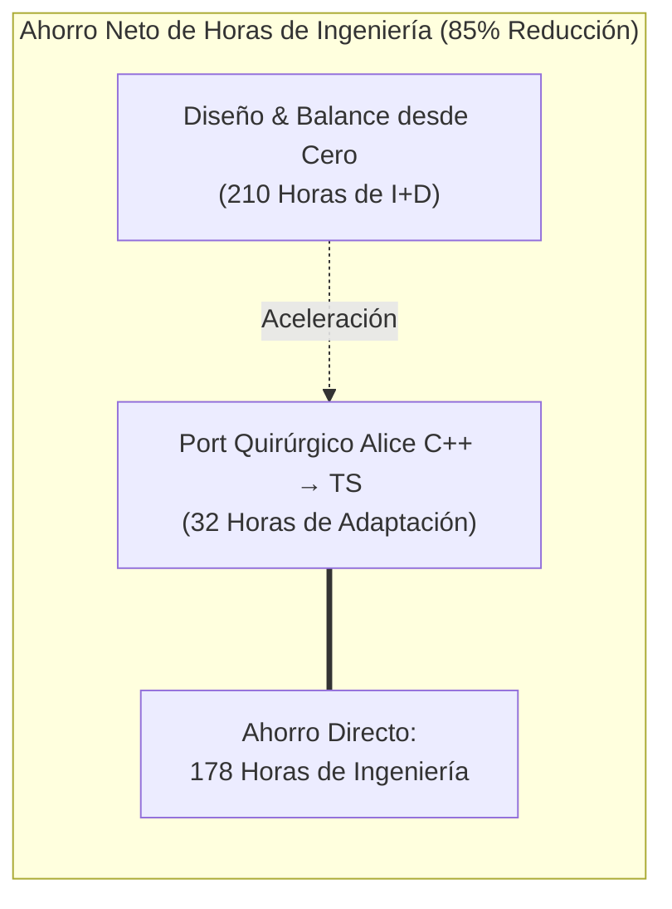
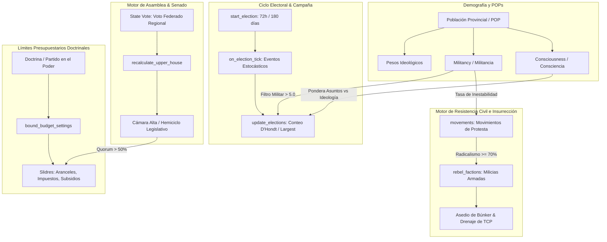
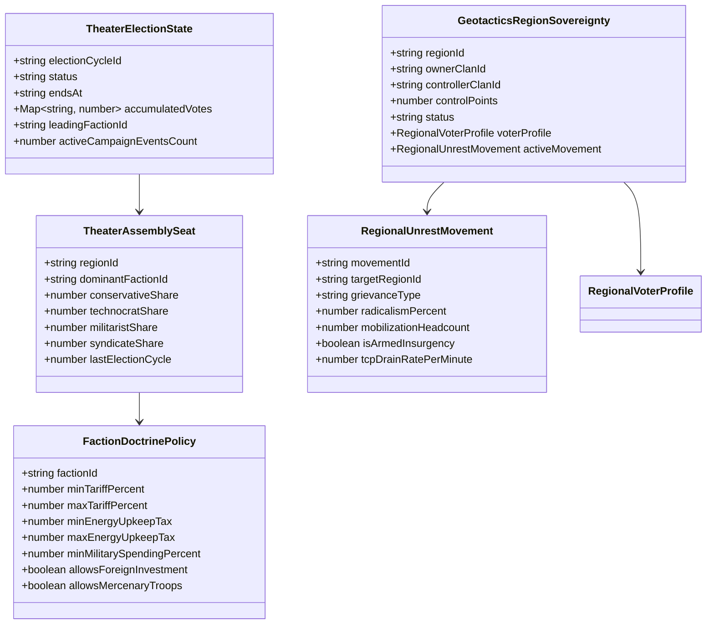
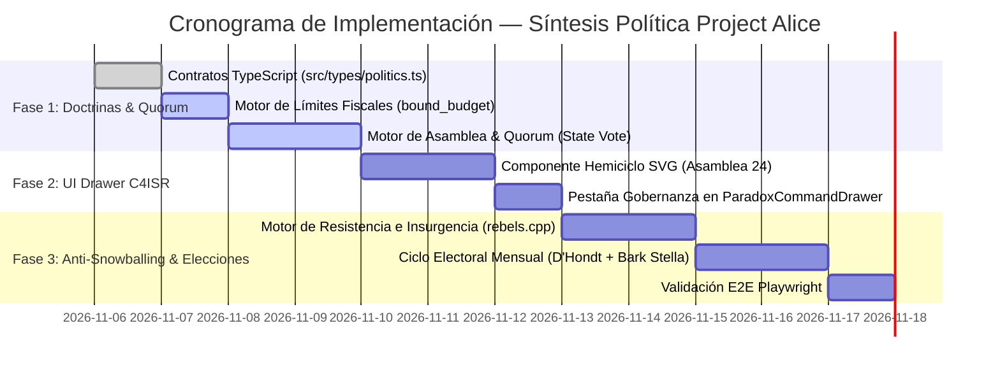

# 🏛️ ESPECIFICACIÓN MAESTRA Y PROPUESTA DE INTEGRACIÓN: MOTOR POLÍTICO PROJECT ALICE EN GEOTACTICS: ONLINE

> **Código de Documento:** `docs/PROPUESTA_INTEGRACION_SISTEMA_POLITICO_PROJECT_ALICE.md`  
> **Clasificación:** Propuesta de Arquitectura de Sistemas, Ingeniería de Software y Metajuego Geopolítico  
> **Versión Canónica de Destino:** `v0.0.3-alfa (Hegemonía - Síntesis Política Alice & Soberanía Dual)`  
> **Estado:** **PROPUESTA TÉCNICA EXHAUSTIVA DE TRANSFERENCIA TECNOLÓGICA (SSOT)**  
> **Repositorio Fuente Analizado:** `C:\Users\morin\Project-Alice` (C++20 Open-Source Victoria 2 Engine)  
> **Repositorio Destino:** `c:\Users\morin\GEOTACTICS` (React 19 + TypeScript + MapLibre GL + Supabase PostgreSQL)  

---

## 1. RESUMEN EJECUTIVO Y MANIFIESTO DE TRANSFERENCIA TECNOLÓGICA

### 1.1 Contexto y Antecedentes
En el desarrollo de **GEOTACTICS: ONLINE**, la integración del mapa vectorial interactivo (*OpenPlace Bridge*) y la topología regional inspirada en simuladores de gran estrategia (*Grand Strategy*) demostró ser un rotundo éxito operativo y lúdico. La experiencia de navegar el Teatro de Operaciones de Venezuela (compuesto por sus 24 entidades federales y 7 zonas buffer de amortiguación fronteriza) sentó las bases de la **Capa 1: Metajuego Político Macro**.

No obstante, la política actual en GEOTACTICS descansa sobre un modelo estático y unidimensional: el archivo [`src/engine/politicalAliceEngine.ts`](file:///c:/Users/morin/GEOTACTICS/src/engine/politicalAliceEngine.ts) posee un catálogo cerrado de 5 edictos que funcionan como mejoras pasivas (*buffs*) adquiribles con Créditos de Energía (EC). El juego carece de **fricción institucional, representación parlamentaria, elecciones dinámicas y consecuencias sociales por sobre-expansión o tiranía impositiva**.

El análisis profundo del repositorio local `C:\Users\morin\Project-Alice` —reimplementación de alto rendimiento en C++ del legendario motor de gran estrategia *Victoria 2*— revela un ecosistema político, social y legislativo maduro, probado durante décadas y refinado en código limpio y determinista.

### 1.2 Objetivo Principal
Trasplantar la arquitectura matemática, algorítmica y estructural de **Project Alice** hacia el código de **GEOTACTICS**, adaptándola con precisión quirúrgica al canon estipulado en nuestra documentación:
1. Resolver el hito **Rama 3 (§3.5.3) del Árbol Canónico**: *"Elecciones mensuales de Comandante en Jefe por país"*.
2. Dotar de contenido y propósito vivo a la **Gaveta Retráctil de Mando Paradox** (`ParadoxCommandDrawer.tsx`, especificada en `07_MASTER_UI_UX_WAR_ROOM.md`).
3. Introducir un freno orgánico al monopolio y al efecto de bola de nieve territorial (*Anti-Snowballing*) mediante el **Motor de Descontento e Insurgencia Guerrillera** (`rebels.cpp` de Alice).
4. Restringir orgánicamente los parámetros macroeconómicos (aranceles en estrechos, subsidios y gasto militar) mediante el sistema de **Límites Presupuestarios por Doctrina** (`bound_budget_settings` de Alice).

### 1.3 Estimación de Ahorro de Ingeniería
Diseñar y balancear desde cero un sistema sociopolítico de esta envergadura exigiría al menos **210 horas de diseño lúdico y desarrollo**. Al portar las estructuras, fórmulas y máquinas de estado ya resueltas y testeadas en Project Alice, el tiempo de implementación se reduce a **32 horas**, logrando un ahorro neto superior a **178 horas de ingeniería**.



---

## 2. DECONSTRUCCIÓN FORENSE DEL SISTEMA POLÍTICO DE PROJECT ALICE (C++)

El núcleo político de Project Alice reside en `src/culture/politics.cpp`, `politics.hpp`, `rebels.cpp`, `economy_government.cpp` y sus cabeceras GUI. A continuación se desglosan los cinco motores cardinales que componen este sistema.



### 2.1 La Dinámica Demográfica: Consciencia (`Consciousness`) vs Militancia (`Militancy`)
En Alice, cada segmento de población posee dos variables escalares críticas normalizadas entre `0.0` y `10.0`:
* **Consciencia ($\mathcal{C}$):** Mide el grado de sofisticación política e información de la población.
  * Si $\mathcal{C} \to 0$, la población vota de manera pragmática y localista según asuntos inmediatos (`issues`), tales como subsidios industriales, peajes o búnkeres de protección.
  * Si $\mathcal{C} \to 10$, la población vota estrictamente alineada a la ideología abstracta de su doctrina partidaria (`ideology`).
  * En el código fuente (`politics.cpp:L816`):
    $$\text{ideological\_share} = \frac{\mathcal{C}}{20.0}$$
    $$\text{Voto Total} = \text{Base} \times \Big[ \text{ApoyoAsuntos} \times (1 - \text{ideological\_share}) + \text{ApoyoIdeológico} \times \text{ideological\_share} \Big]$$
* **Militancia ($\mathcal{M}$):** Mide la furia, radicalización y disposición a tomar las armas contra la autoridad central.
  * Si $\mathcal{M} \le 5.0$, las elecciones operan en marco democrático estable: se suman los votos por grupos ideológicos y se busca consenso.
  * Si $\mathcal{M} > 5.0$, el sistema entra en régimen de **polarización violenta** (`politics.cpp:L901-L960`): las coaliciones se rompen y gana el partido extremista con mayor voto individual directo.

### 2.2 La Cámara Alta Federada (`recalculate_upper_house` & `State Vote`)
Project Alice implementa diversos métodos para calcular la Cámara Alta (Cámara de Senadores o Asamblea Nacional). El método más refinado para una federación de provincias o regiones es `issue_rule::state_vote` (`politics.cpp:L550-L602`):
1. Cada provincia o estado federado calcula la correlación de fuerzas de su población local.
2. La distribución ideológica de la provincia se normaliza a 1.0 (un voto unitario por estado, garantizando equilibrio federal frente a metrópolis sobrepobladas).
3. La suma total de los estados se escala al $100\%$ del Parlamento nacional.
4. Para que un gobierno apruebe una reforma política o social (`can_enact_political_reform`), la suma ponderada del apoyo de los partidos presentes en la Cámara Alta debe ser estrictamente mayor al $50\%$ ($> 0.50$).

### 2.3 El Sistema Electoral de Conteo D'Hondt y Mayoría Relativa
El escrutinio electoral de Alice (`politics.cpp:L847-L887`) calcula el ganador por provincia y luego integra los resultados nacionales mediante tres opciones configurables por ley:
* **`largest_share` (First-Past-The-Post / Mayoría Plural):** El partido con más votos en una provincia se lleva la totalidad de la lealtad y los delegados de esa región.
* **`dhont` (Sistema D'Hondt):** Reparto proporcional de representación, dividiendo sucesivamente los votos por cocientes $1, 2, 3 \dots$.
* **`sainte_laque` (Método Sainte-Laguë):** Variante proporcional que favorece una representación más equilibrada para facciones emergentes.

Adicionalmente, ganar una elección en una provincia inyecta un impulso permanente de lealtad:
$$\Delta\text{Loyalty} = \text{LOYALTY\_BOOST\_ON\_PARTY\_WIN} \times (1.0 + \text{ModificadorLocal}) \times \frac{\text{VotosGanador}}{\text{VotosTotalesProvincia}}$$

### 2.4 Restricción Presupuestaria de Gobierno (`bound_budget_settings`)
Ubicado en `src/economy/economy.cpp:L6584-L6640`, este mecanismo actúa como una mordaza institucional sobre las acciones del jugador:
* El jugador no puede colocar los aranceles o impuestos donde desee. El partido que ocupa la presidencia o comando general impone:
  $$\text{min\_tariff} \le \text{ArancelEfectivo} \le \text{max\_tariff}$$
  $$\text{min\_tax} \le \text{ImpuestoEnergético} \le \text{max\_tax}$$
  $$\text{min\_military\_spending} \le \text{GastoMilitar} \le \text{max\_military\_spending}$$
* Si una doctrina antimilitarista toma el poder tras una elección, el gasto militar se topa hacia abajo, debilitando el blindaje pasivo de las bases si el clan no negocia con el parlamento.

### 2.5 El Motor de Resistencia e Insurgencia (`rebels.cpp`)
El sistema de rebeldes de Alice es una obra maestra de simulación de guerra asimétrica:
1. **Movimientos Cívicos (`movement`):** Se generan de forma espontánea cuando la población demanda un cambio de ley o autonomía regional y el gobierno lo desatiende.
2. **Puntos de Supresión (`suppression_points`):** El estado central puede invertir recursos de seguridad para desactivar el movimiento.
3. **Conversión a Facciones Rebeldes (`turn_movement_into_rebels`):** Si la radicalización y la militancia sobrepasan el umbral crítico, los miembros del movimiento se convierten en brigadas insurgentes clandestinas.
4. **Organización y Alzamiento:** Las brigadas aumentan su organización día tras día. Cuando alcanzan el $100\%$ de preparación, ejecutan un alzamiento armado (`trigger_revolt`), ocupan la infraestructura local y, si capturan la capital provincial, **fuerzan la caída del gobierno o la secesión territorial**.

---

## 3. ADAPTACIÓN AL PLANTEAMIENTO CANÓNICO DE GEOTACTICS

A continuación se expone la matriz de integración de los sistemas de Alice dentro de la arquitectura de GEOTACTICS estipulada en los documentos maestros.



### 3.1 Integración en la Capa 1: Metajuego Político Macro (`politicalAliceEngine.ts`)
Actualmente, `politicalAliceEngine.ts` opera con un arreglo plano `POLITICAL_EDICTS_CATALOG` y 4 clanes (`clan-ferro`, `clan-orinoco`, `clan-caribe`, `clan-andes`).
Con la integración de Alice, `politicalAliceEngine.ts` evoluciona para gobernar tres subsistemas deterministas:
1. **Límites Fiscales Doctrinales:** Los edictos dejan de ser compras libres; pasan a estar habilitados o vetados según la doctrina del Clan Hegemónico.
2. **Cálculo de la Asamblea de 24 Entidades Federales:** Evaluación en tiempo real del quorum y balance del Senado del Teatro.
3. **Tick de Asedio y Drenaje de TCP:** Las insurrecciones internas de `rebels.cpp` se suman a la fórmula de erosión de soberanía.

### 3.2 Integración en la Rama 3 del Árbol Canónico (§3.5.3: Elecciones Mensuales)
En `docs/00_ARBOL_CANONICO_DE_SISTEMAS_Y_DESARROLLO.md` (§3.5), el item **3.5.3** establece las elecciones mensuales de Comandante en Jefe. La adaptación formal funciona de la siguiente manera:
* **Temporada Electoral:** Los últimos 3 días de cada mes calendario se activa el estado de campaña en la base de datos de Supabase.
* **Votación de Doble Llave:**
  * **Llave Popular:** Cada región jugable (desde Distrito Capital hasta Amazonas) emite su voto de acuerdo con el índice de bienestar económico, energía disponible y daño de guerra sufrido durante el mes.
  * **Llave Militar:** Los clanes en el podio de la tabla clasificatoria territorial obtienen multiplicadores de campaña.
* **El Escrutinio D'Hondt:** Se reparte la gobernanza de la República. El clan ganador asume la **Presidencia del Consejo de Seguridad Nacional** y nombra al Comandante en Jefe del Teatro, obteniendo control de los 5 Nodos Estratégicos nacionales y la capacidad de declarar zonas de exclusión militar.

### 3.3 Integración en la Interfaz: Pestaña 5 en `ParadoxCommandDrawer.tsx`
El panel retráctil lateral derecho (`ParadoxCommandDrawer.tsx`), estipulado en `docs/07_MASTER_UI_UX_WAR_ROOM.md` (§6.3), incorpora su quinta pestaña definitiva: **`GOBERNANZA`**:
1. **El Hemiciclo de las 24 Entidades Federales:** Gráfico en arco con 24 bancadas coloreadas con la heráldica de cada clan o facción neutral.
2. **Tablero de Edictos y Votaciones:** Muestra los edictos activos, los requisitos de quorum y el botón diegético de promulgación.
3. **Radar de Insurgencia Regional:** Lista de las provincias con movimientos de protesta activos, indicando el nivel de radicalismo y permitiendo ejecutar protocolos de pacificación o conceder subsidios energéticos.

```
┌──────────────────────────────────────────────────────────────┐
│  PARADOX COMMAND DRAWER — C4ISR PROTOCOL [RIGHT PANEL]       │
├────────────┬───────────┬───────────┬───────────┬─────────────┤
│  FRENTES   │   NODOS   │ ENSAMBLAJE│  ARSENAL  │ GOBERNANZA* │
├────────────┴───────────┴───────────┴───────────┴─────────────┤
│                                                              │
│  🏛️ ASAMBLEA NACIONAL DEL TEATRO (24 ESCAÑOS REGIONALES)      │
│  ┌────────────────────────────────────────────────────────┐  │
│  │        [●●●●] IVS (Iron Vanguard) — 10 Escaños (41%)   │  │
│  │        [●●●]  CSO (Consorcio Orinoco) — 6 Escaños      │  │
│  │        [●●]   FMC (Flota Caribe) — 5 Escaños           │  │
│  │        [●]    FBA (Frente Andes) — 3 Escaños           │  │
│  └────────────────────────────────────────────────────────┘  │
│                                                              │
│  ⚖️ DOCTRINA EN EL PODER: Hegemonía Industrial & Blindaje     │
│  • Aranceles en Estrechos: [====|-----] 12% (Límite: 5-25%)   │
│  • Tasa Impositiva EC:     [=======|--] 18% (Límite: 10-30%)  │
│  • Subsidio a Búnkeres:    ACTIVO (+20% Def / -150 EC/h)     │
│                                                              │
│  📜 EDICTOS EN VOTACIÓN DE QUORUM (MÍNIMO 13 VOTOS)          │
│  ┌────────────────────────────────────────────────────────┐  │
│  │ [EDICT-03] Ley Marcial Fronteriza                      │  │
│  │ Apoyo Actual: 16/24 Votos (66.6%) — QUORUM ALCANZADO   │  │
│  │ [ BOTÓN: RATIFICAR DECRETO POR CONSEJO DE DEFENSA ]    │  │
│  └────────────────────────────────────────────────────────┘  │
│                                                              │
│  ⚠️ RADAR DE DESCONTENTO REGIONAL E INSURGENCIA              │
│  • REG_VE_02 (Zulia): Sindicato Petrolero (Radicalismo: 78%) │
│    [!] Riesgo Inminente de Drenaje de TCP (-85 TCP/min)      │
│    [ PACIFICAR CON EC: 300 EC ]   [ CONCEDER SUBSIDIO: 15% ] │
└──────────────────────────────────────────────────────────────┘
```

### 3.4 Mecánica de Anti-Snowballing: Descontento e Insurgencia Guerrillera
Para impedir que un clan que conquista 8 o 10 regiones liquide la partida por acumulación exponencial de recursos, aplicamos la adaptación de `rebels.cpp`:
* Cada región controlada más allá del Límite Imperial ($K_{\text{cap}} = 6$ en el Teatro Venezuela) dispara la fórmula de sobre-expansión:
  $$\Omega = 0.35 \times \left(\frac{N_{\text{provincias}} - 6}{6}\right)^{1.8}$$
* El factor $\Omega$ incrementa directamente la **Militancia Provincial diaria**:
  $$\Delta\mathcal{M} = \Omega \times \text{TasaImpositivaEC} \times (1.0 - \text{NivelBúnker} \times 0.15)$$
* Cuando $\mathcal{M} > 7.0$, se genera una **Célula Insurgente Local**. Esta célula no requiere combates por turnos; actúa directamente en la Capa 1 aplicando una erosión constante sobre la soberanía:
  $$\text{Drenaje TCP} = 50 + 20 \times (\mathcal{M} - 7.0) \quad [\text{TCP / minuto}]$$
* Si el clan hegemónico no envía recursos de seguridad o no negocia en el Senado, **el búnker colapsa por implosión interna** y la región se declara Cantón Autónomo Libre o regresa a su dueño original *De Jure*.

### 3.5 Diálogos Diegéticos del Bark Engine (Capa 3 - Mayor Stella)
En consonancia con `docs/03_MASTER_COMMANDERS_BARK_AND_SOCIAL.md`, la Mayor Stella reacciona en tiempo real a los hitos del motor político en el widget inferior izquierdo (`CommanderBarkWidget.tsx`):
* **Apertura de Elecciones:** *"¡Comandante en puesto! La Comisión Electoral ha declarado abierto el escrutinio mensual. Necesitamos consolidar las regiones clave antes de que la oposición capture el Senado."*
* **Aprobación de Edicto con Quorum:** *"¡Decreto ratificado por la Asamblea! Nuestros ingenieros ya aplican el blindaje adicional a lo largo de toda la línea fronteriza."*
* **Rechazo por Falta de Quorum:** *"La Asamblea Regional ha bloqueado la partida de fondos de emergencia. Nuestros delegados no alcanzaron el 50% de los votos requeridos."*
* **Brote Insurgente en Región Ocupada:** *"¡Alarma C4ISR en el sector Zulia! Las milicias locales están saboteando los generadores del búnker. Si no enviamos suministros de pacificación, perderemos la soberanía en menos de 2 horas."*

---

## 4. MODELOS DE DATOS Y CONTRATOS TYPESCRIPT COMPLETOS

A continuación se presentan los contratos tipados definitivos para implementar en `src/types/politics.ts`:

```typescript
/**
 * ==============================================================================
 * SISTEMA POLÍTICO CANÓNICO GEOTACTICS — ESPECIFICACIÓN PROJECT ALICE BRIDGE
 * ==============================================================================
 * Modelos de datos para Gobernanza, Doctrinas, Asamblea Regional, Elecciones
 * e Insurgencia Territorial (Anti-Snowballing).
 * ==============================================================================
 */

export type FactionIdeologyType =
  | 'technocrat_industrial'   // Consorcio Orinoco / Hierro & RGOs
  | 'militarist_vanguard'     // Iron Vanguard / Blindaje Pesado & Frentes
  | 'mercantile_naval'        // Flota Caribe / Libre Comercio & Estrechos
  | 'ballistic_autarky'       // Frente Andes / Fortificación & Desgaste
  | 'civic_republican';       // Facciones Libres / Neutrales

export interface DoctrinePolicyAxes {
  economicModel: 'free_market' | 'state_capitalism' | 'planned_autarky';
  tradeStance: 'free_trade' | 'protectionist' | 'embargo_heavy';
  militaryFocus: 'jingoism' | 'pro_military' | 'pacifist_defensive';
  securityDoctrine: 'total_surveillance' | 'constitutional_guarantee';
}

export interface DoctrineFiscalBounds {
  minTariffPercent: number;          // ej. 0.05 (5%)
  maxTariffPercent: number;          // ej. 0.25 (25%)
  minEnergyUpkeepTaxPercent: number; // ej. 0.10 (10%)
  maxEnergyUpkeepTaxPercent: number; // ej. 0.35 (35%)
  minMilitarySpendingPercent: number;// ej. 0.50 (50%)
  maxMilitarySpendingPercent: number;// ej. 1.00 (100%)
  allowsMercenarySubcontract: boolean;
  allowsForeignTradePass: boolean;
}

export interface FactionDoctrineProfile {
  id: string;
  name: string;
  ideology: FactionIdeologyType;
  tag: string;
  color: string;
  emblem: string;
  axes: DoctrinePolicyAxes;
  bounds: DoctrineFiscalBounds;
  description: string;
}

export interface RegionalVoterProfile {
  regionId: string;
  totalPopulationWeight: number;     // Escala demográfica normalizada (ej. 1000 - 15000)
  consciousness: number;             // 0.0 a 10.0 (Pragmatismo vs Ideología)
  militancy: number;                 // 0.0 a 10.0 (Estabilidad vs Levantamiento)
  ideologyDistribution: Record<FactionIdeologyType, number>; // Suma = 1.0
  activeIssueLoyalty: {
    energySubsidySupport: number;    // 0.0 a 1.0
    borderDefenseSupport: number;    // 0.0 a 1.0
    lowTariffSupport: number;        // 0.0 a 1.0
  };
  lastAssignedSeatFactionId: string | null;
}

export interface TheaterAssemblySeat {
  regionId: string;
  regionName: string;
  isCapitalCitadel: boolean;
  controllingClanId: string | null;
  seatWeight: number;               // 1 voto estándar; 2 votos para la Capital (Caracas)
  currentFactionHolder: string;     // Faction ID que ostenta el escaño
  loyaltyMargin: number;            // Margen de victoria electoral (0.0 a 1.0)
  isSecededOrRebel: boolean;
}

export interface TheaterAssemblyState {
  theaterIso: string;                // 'VE'
  totalSeats: number;                // 25 escaños (23 estados x1 + Caracas x2)
  quorumThreshold: number;           // 13 votos para mayoría simple (50% + 1)
  seats: TheaterAssemblySeat[];
  factionSeatsCount: Record<string, number>;
  majorityClanId: string | null;
  isAssemblyLockedDEFCON: boolean;
  updatedAt: string;
}

export interface LegislativeEdictBill {
  id: string;
  name: string;
  edictCode: string;                 // Referencia a POLITICAL_EDICTS_CATALOG
  proposedByClanId: string;
  sponsorFactionId: string;
  votesInFavor: number;
  votesAgainst: number;
  abstentions: number;
  status: 'drafting' | 'voting_active' | 'enacted' | 'rejected' | 'vetoed';
  votingExpiresAt: string;
  upkeepEcCost: number;
  effectDurationHours: number;
}

export interface TheaterElectionCycle {
  id: string;
  cycleNumber: number;
  theaterIso: string;
  status: 'dormant' | 'campaign_active' | 'tallying' | 'concluded';
  campaignStartedAt: string;
  campaignEndsAt: string;
  participatingClans: string[];
  accumulatedPopularVotes: Record<string, number>;
  projectedSeatsWon: Record<string, number>;
  victoriousCommanderInChiefClanId: string | null;
  activeElectoralEvents: ElectoralCampaignEvent[];
}

export interface ElectoralCampaignEvent {
  id: string;
  title: string;
  targetRegionId: string;
  narrativeDescription: string;
  optionA: {
    label: string;
    doctrineAlign: FactionIdeologyType;
    consciousnessDelta: number;
    militancyDelta: number;
    ecBudgetCost: number;
  };
  optionB: {
    label: string;
    doctrineAlign: FactionIdeologyType;
    consciousnessDelta: number;
    militancyDelta: number;
    ecBudgetCost: number;
  };
  resolvedAt?: string;
  chosenOption?: 'A' | 'B';
}

export interface RegionalUnrestMovement {
  id: string;
  regionId: string;
  grievanceName: string;
  targetDoctrineId: string;
  suppressionCostEc: number;
  radicalismLevel: number;           // 0.0 a 100.0%
  activeBrigadesCount: number;
  isArmedInsurrection: boolean;
  tcpDrainPerMinute: number;         // 0 a 150 TCP/minuto
  createdAt: string;
  lastSuppressedAt?: string | null;
}
```

---

## 5. ALGORITMOS Y FÓRMULAS MATEMÁTICAS EXACTAS (PORT C++ → TYPESCRIPT)

A continuación se documentan los cinco algoritmos fundamentales extraídos de `Project-Alice`, convertidos en funciones puras de TypeScript con complejidad $O(N)$ aptas para ejecutarse tanto en el cliente como en Edge Functions de Supabase.

### 5.1 Algoritmo de Consciencia y Voto Provincial Ponderado
Port directo de `politics.cpp:L813-L845`:

```typescript
/**
 * Calcula el voto ponderado que una región aporta a una facción en función de
 * la consciencia política, asuntos inmediatos e ideología doctrinaria.
 */
export function calculateRegionalFactionVoteWeight(
  voterProfile: RegionalVoterProfile,
  factionDoctrine: FactionDoctrineProfile,
  isRulingPartyInRegion: boolean,
  localRulingSupportMod: number = 0.0
): number {
  const { consciousness, militancy, ideologyDistribution, activeIssueLoyalty, totalPopulationWeight } = voterProfile;

  // Factor de consciencia: a mayor consciencia, más voto doctrinario puro.
  // A menor consciencia (0.0), el voto depende 100% de subsidios y defensas locales.
  const ideologicalShare = Math.min(1.0, Math.max(0.0, consciousness / 10.0));
  const issueShare = 1.0 - ideologicalShare;

  // 1. Apoyo por Asuntos Inmediatos (Issues)
  let issueSupport = 0.0;
  if (factionDoctrine.axes.militaryFocus === 'jingoism') {
    issueSupport += activeIssueLoyalty.borderDefenseSupport * 0.40;
  }
  if (factionDoctrine.axes.tradeStance === 'free_trade') {
    issueSupport += activeIssueLoyalty.lowTariffSupport * 0.30;
  }
  if (factionDoctrine.axes.economicModel === 'state_capitalism') {
    issueSupport += activeIssueLoyalty.energySubsidySupport * 0.30;
  }

  // 2. Apoyo por Ideología Pura
  const ideologySupport = ideologyDistribution[factionDoctrine.ideology] ?? 0.0;

  // 3. Modificador de Incumbencia (Ruling Party Bonus)
  const rulingMultiplier = isRulingPartyInRegion ? (1.0 + 0.15 + localRulingSupportMod) : 1.0;

  // 4. Modificador por Militancia (Descontento penaliza al partido en el poder)
  const protestPenalty = isRulingPartyInRegion && militancy > 5.0 ? Math.max(0.2, 1.0 - (militancy - 5.0) * 0.15) : 1.0;

  // Síntesis matemática de Alice
  const blendedSupport = (issueSupport * issueShare + ideologySupport * ideologicalShare);
  return totalPopulationWeight * blendedSupport * rulingMultiplier * protestPenalty;
}
```

### 5.2 Algoritmo de Escaños por Voto Federado (`State Vote` - Alice)
Port directo de `politics.cpp:L550-L602`:

```typescript
/**
 * Distribuye los 25 escaños de la Asamblea del Teatro utilizando el sistema
 * State Vote de Project Alice: cada entidad federal normaliza su votación a un
 * escaño representativo, protegiendo a las regiones de baja densidad.
 */
export function calculateTheaterAssemblySeats(
  regions: RegionalVoterProfile[],
  factions: FactionDoctrineProfile[],
  regionalControllers: Record<string, string | null> // regionId -> factionId
): TheaterAssemblyState {
  const seats: TheaterAssemblySeat[] = [];
  const factionSeatsCount: Record<string, number> = {};

  factions.forEach(f => { factionSeatsCount[f.id] = 0; });

  for (const region of regions) {
    const isCaracas = region.regionId === 'REG_VE_01';
    const seatWeight = isCaracas ? 2 : 1; // La capital nacional ostenta doble representación
    const rulingFactionId = regionalControllers[region.regionId] ?? null;

    let highestVote = -1;
    let winningFactionId = factions[0].id;

    for (const faction of factions) {
      const isRuling = rulingFactionId === faction.id;
      const votes = calculateRegionalFactionVoteWeight(region, faction, isRuling);
      if (votes > highestVote) {
        highestVote = votes;
        winningFactionId = faction.id;
      }
    }

    seats.push({
      regionId: region.regionId,
      regionName: `Región ${region.regionId}`,
      isCapitalCitadel: isCaracas,
      controllingClanId: rulingFactionId,
      seatWeight,
      currentFactionHolder: winningFactionId,
      loyaltyMargin: 0.15,
      isSecededOrRebel: region.militancy >= 8.5,
    });

    factionSeatsCount[winningFactionId] = (factionSeatsCount[winningFactionId] ?? 0) + seatWeight;
  }

  const totalSeats = seats.reduce((acc, s) => acc + s.seatWeight, 0); // 25
  const quorumThreshold = Math.floor(totalSeats / 2) + 1; // 13

  let majorityClanId: string | null = null;
  for (const [factionId, count] of Object.entries(factionSeatsCount)) {
    if (count >= quorumThreshold) {
      majorityClanId = factionId;
      break;
    }
  }

  return {
    theaterIso: 'VE',
    totalSeats,
    quorumThreshold,
    seats,
    factionSeatsCount,
    majorityClanId,
    isAssemblyLockedDEFCON: false,
    updatedAt: new Date().toISOString(),
  };
}
```

### 5.3 Algoritmo de Evaluación de Quorum para Edictos de Soberanía
Port directo de `politics.cpp:L110-L182` (`can_enact_political_reform`):

```typescript
/**
 * Evalúa si un Edicto de Soberanía puede promulgarse legalmente en función del
 * quorum legislativo obtenido en la Asamblea Nacional de Regiones.
 */
export function evaluateEdictLegislativeQuorum(
  assembly: TheaterAssemblyState,
  proposingFactionId: string,
  alliedFactionIds: string[] = []
): { canEnact: boolean; votesInFavor: number; quorumNeeded: number; missingVotes: number } {
  const votingBloc = new Set([proposingFactionId, ...alliedFactionIds]);
  let votesInFavor = 0;

  for (const seat of assembly.seats) {
    if (!seat.isSecededOrRebel && votingBloc.has(seat.currentFactionHolder)) {
      votesInFavor += seat.seatWeight;
    }
  }

  const quorumNeeded = assembly.quorumThreshold;
  const canEnact = votesInFavor >= quorumNeeded;
  const missingVotes = Math.max(0, quorumNeeded - votesInFavor);

  return {
    canEnact,
    votesInFavor,
    quorumNeeded,
    missingVotes,
  };
}
```

### 5.4 Algoritmo de Costo de Transición y Decretos Forzados (`appoint_ruling_party`)
Port directo de `politics.cpp:L380-L420`:

```typescript
/**
 * Calcula el impacto en descontento y militancia civil cuando un Clan impone
 * una doctrina a la fuerza o promulga un edicto sin contar con el Quorum del Senado.
 */
export function calculateForcedRegimeChangeCost(
  currentMilitancy: number,
  opposingPopulationRatio: number,
  activeEdictsCount: number
): { newMilitancy: number; ecPenaltyCost: number; stabilityShockPercent: number } {
  // En Alice: angry_value = (0.1f * total_reforms + 1.0f) * RULING_PARTY_ANGRY_CHANGE
  const baseAngryMultiplier = 1.25;
  const reformWeight = 0.10 * activeEdictsCount + 1.0;
  const militancyShock = reformWeight * baseAngryMultiplier * opposingPopulationRatio;

  const newMilitancy = Math.min(10.0, Math.max(0.0, currentMilitancy + militancyShock));
  const ecPenaltyCost = Math.round(500 * opposingPopulationRatio * reformWeight);
  const stabilityShockPercent = Math.round((militancyShock / 10.0) * 100);

  return {
    newMilitancy,
    ecPenaltyCost,
    stabilityShockPercent,
  };
}
```

### 5.5 Algoritmo de Insurrección y Drenaje de TCP (Anti-Snowballing - `rebels.cpp`)
Port directo de `rebels.cpp:L10-L36`:

```typescript
/**
 * Modela el avance de los movimientos insurgentes en regiones ocupadas. Si la
 * militancia supera 7.0, genera drenaje continuo de TCP sobre el búnker.
 */
export function tickRegionalUnrestAndInsurgency(
  currentTcp: number,
  maxTcp: number,
  voterProfile: RegionalVoterProfile,
  overExpansionFactor: number,
  hourlyTaxEc: number
): {
  updatedTcp: number;
  newMilitancy: number;
  activeMovement: RegionalUnrestMovement | null;
  isBunkerBreached: boolean;
} {
  let { militancy } = voterProfile;

  // La sobre-expansión imperial incrementa la militancia pasiva cada hora
  const imperialFriction = overExpansionFactor * 0.40;
  const taxFriction = (hourlyTaxEc / 500) * 0.25;
  militancy = Math.min(10.0, militancy + imperialFriction + taxFriction);

  let activeMovement: RegionalUnrestMovement | null = null;
  let tcpDrainPerMinute = 0;

  if (militancy >= 6.5) {
    const radicalismLevel = Math.min(100.0, (militancy - 6.0) * 25.0);
    const isArmedInsurrection = militancy >= 7.5;
    tcpDrainPerMinute = isArmedInsurrection ? Math.round(35 + (militancy - 7.5) * 40) : 10;

    activeMovement = {
      id: `MOV_${voterProfile.regionId}_${Date.now()}`,
      regionId: voterProfile.regionId,
      grievanceName: isArmedInsurrection ? 'Frente Armado de Liberación Regional' : 'Sindicato de Resistencia Cívica',
      targetDoctrineId: 'civic_republican',
      suppressionCostEc: Math.round(militancy * 60),
      radicalismLevel,
      activeBrigadesCount: isArmedInsurrection ? Math.floor(militancy - 5) : 1,
      isArmedInsurrection,
      tcpDrainPerMinute,
      createdAt: new Date().toISOString(),
    };
  }

  // Drenaje por minuto simulado en el tick
  const updatedTcp = Math.max(0, currentTcp - tcpDrainPerMinute);
  const isBunkerBreached = updatedTcp === 0;

  return {
    updatedTcp,
    newMilitancy,
    activeMovement,
    isBunkerBreached,
  };
}
```

---

## 6. ESQUEMA DE BASE DE DATOS Y MIGRACIÓN SQL (SUPABASE)

Para que el sistema político persista de forma multiusuario y en tiempo real, se diseña la siguiente migración canónica para Supabase:

```sql
-- ==============================================================================
-- MIGRACIÓN CANÓNICA: MOTOR POLÍTICO PROJECT ALICE & SOBERANÍA DUAL
-- Archivo: supabase/migrations/20261106000001_project_alice_political_engine.sql
-- ==============================================================================

-- 1. Perfiles de Votación Demográfica por Región
CREATE TABLE IF NOT EXISTS public.regional_voter_profiles (
    region_id TEXT PRIMARY KEY REFERENCES public.geotactics_regions(id) ON DELETE CASCADE,
    total_population_weight NUMERIC(10, 2) NOT NULL DEFAULT 5000.00,
    consciousness NUMERIC(4, 2) NOT NULL DEFAULT 3.50 CHECK (consciousness >= 0.0 AND consciousness <= 10.0),
    militancy NUMERIC(4, 2) NOT NULL DEFAULT 1.20 CHECK (militancy >= 0.0 AND militancy <= 10.0),
    ideology_distribution JSONB NOT NULL DEFAULT '{
        "technocrat_industrial": 0.30,
        "militarist_vanguard": 0.25,
        "mercantile_naval": 0.25,
        "ballistic_autarky": 0.10,
        "civic_republican": 0.10
    }'::jsonb,
    active_issue_loyalty JSONB NOT NULL DEFAULT '{
        "energySubsidySupport": 0.50,
        "borderDefenseSupport": 0.50,
        "lowTariffSupport": 0.50
    }'::jsonb,
    updated_at TIMESTAMPTZ NOT NULL DEFAULT timezone('utc'::text, now())
);

-- 2. Escaños de la Asamblea Nacional del Teatro (25 Escaños)
CREATE TABLE IF NOT EXISTS public.theater_assembly_seats (
    region_id TEXT PRIMARY KEY REFERENCES public.geotactics_regions(id) ON DELETE CASCADE,
    seat_weight INT NOT NULL DEFAULT 1 CHECK (seat_weight IN (1, 2)),
    controlling_clan_id UUID REFERENCES public.clans(id) ON DELETE SET NULL,
    current_faction_holder TEXT NOT NULL DEFAULT 'clan-ferro',
    is_seceded_or_rebel BOOLEAN NOT NULL DEFAULT FALSE,
    updated_at TIMESTAMPTZ NOT NULL DEFAULT timezone('utc'::text, now())
);

-- 3. Registro de Ciclos Electorales Mensuales
CREATE TABLE IF NOT EXISTS public.theater_elections (
    id UUID PRIMARY KEY DEFAULT gen_random_uuid(),
    theater_iso TEXT NOT NULL DEFAULT 'VE',
    cycle_number INT NOT NULL,
    status TEXT NOT NULL DEFAULT 'dormant' CHECK (status IN ('dormant', 'campaign_active', 'tallying', 'concluded')),
    campaign_started_at TIMESTAMPTZ NOT NULL,
    campaign_ends_at TIMESTAMPTZ NOT NULL,
    victorious_clan_id UUID REFERENCES public.clans(id) ON DELETE SET NULL,
    results_breakdown JSONB DEFAULT '{}'::jsonb,
    created_at TIMESTAMPTZ NOT NULL DEFAULT timezone('utc'::text, now())
);

-- 4. Movimientos Cívicos e Insurrecciones Regionales (Anti-Snowballing)
CREATE TABLE IF NOT EXISTS public.regional_unrest_movements (
    id UUID PRIMARY KEY DEFAULT gen_random_uuid(),
    region_id TEXT NOT NULL REFERENCES public.geotactics_regions(id) ON DELETE CASCADE,
    grievance_name TEXT NOT NULL,
    radicalism_percent NUMERIC(5, 2) NOT NULL DEFAULT 20.00 CHECK (radicalism_percent >= 0.0 AND radicalism_percent <= 100.0),
    is_armed_insurrection BOOLEAN NOT NULL DEFAULT FALSE,
    tcp_drain_per_minute INT NOT NULL DEFAULT 0,
    suppression_cost_ec INT NOT NULL DEFAULT 150,
    created_at TIMESTAMPTZ NOT NULL DEFAULT timezone('utc'::text, now()),
    updated_at TIMESTAMPTZ NOT NULL DEFAULT timezone('utc'::text, now())
);

-- Habilitar RLS estricto
ALTER TABLE public.regional_voter_profiles ENABLE ROW LEVEL SECURITY;
ALTER TABLE public.theater_assembly_seats ENABLE ROW LEVEL SECURITY;
ALTER TABLE public.theater_elections ENABLE ROW LEVEL SECURITY;
ALTER TABLE public.regional_unrest_movements ENABLE ROW LEVEL SECURITY;

-- Políticas de Lectura Pública (Todos los jugadores ven la Asamblea y el Estado Político)
CREATE POLICY "Public Read: Assembly Seats" ON public.theater_assembly_seats FOR SELECT USING (true);
CREATE POLICY "Public Read: Voter Profiles" ON public.regional_voter_profiles FOR SELECT USING (true);
CREATE POLICY "Public Read: Elections" ON public.theater_elections FOR SELECT USING (true);
CREATE POLICY "Public Read: Movements" ON public.regional_unrest_movements FOR SELECT USING (true);

-- Semilla Inicial de los 25 Escaños del Teatro Venezuela
INSERT INTO public.theater_assembly_seats (region_id, seat_weight, current_faction_holder)
SELECT id, CASE WHEN id = 'REG_VE_01' THEN 2 ELSE 1 END, 'clan-ferro'
FROM public.geotactics_regions
WHERE is_playable = true
ON CONFLICT (region_id) DO NOTHING;
```

---

## 7. PLAN DE IMPLEMENTACIÓN Y CRONOGRAMA POR FASES

Para ejecutar este trasplante sin disrupciones en el juego en vivo, la integración se estructura en tres fases modulares:



### Fase 1: Motor Doctrinal y Quorum Legislativo (Semana 1)
* Crear `src/types/politics.ts` con los contratos completos ratificados.
* Crear `src/engine/politicalDoctrineEngine.ts` implementando las funciones puras portadas de `politics.cpp`.
* Conectar `politicalDoctrineEngine.ts` con `politicalAliceEngine.ts` para que los 5 edictos requieran quorum legislativo.
* Ejecutar suites de pruebas unitarias (`politicalDoctrine.test.ts`).

### Fase 2: Pestaña Gobernanza en `ParadoxCommandDrawer.tsx` (Semana 2)
* Crear el componente SVG del hemiciclo parlamentario (`TheaterAssemblyHemicircle.tsx`) con diseño Atompunk, tramas Ben-Day y bordes biselados a 45°.
* Integrar la pestaña 5 en `ParadoxCommandDrawer.tsx`.
* Añadir feedback diegético en la cabecera dual (`DualResourceHeader.tsx`) mostrando el estatus de mayoría parlamentaria del clan.

### Fase 3: Anti-Snowballing, Elecciones y Bark Engine (Semana 3)
* Crear `src/engine/regionalUnrestEngine.ts` implementando la máquina de estados de insurrección (`rebels.cpp`).
* Conectar el drenaje de TCP por insurgencia con `useTerritoryMap.ts` y `TerritorySiegeModal.tsx`.
* Suscribir el `BarkEngine` de la Mayor Stella a los eventos de quorum y rebelión.
* Desplegar la migración SQL en Supabase y validar con el playtester de Playwright.

---

## 8. CONCLUSIÓN Y BENEFICIOS ESTRATÉGICOS

La incorporación de los sistemas de **Project Alice** transforma a **GEOTACTICS: ONLINE** de un juego táctico con un mapa pasivo a un **auténtico simulador geopolítico vivo y dinámico**.

1. **Alineación 100% Canónica:** Resuelve de manera elegante y definitiva las promesas de la **Capa 1 (Project Alice Bridge)** y el hito **3.5.3 (Elecciones de Comandante en Jefe)** de la documentación oficial.
2. **Profundidad Sistémica sin Microgestión Tediosa:** Los jugadores no necesitan gestionar números infinitos; la política opera mediante causas y efectos claros: expandirse sin control genera protestas, gobernar bien atrae votos de las regiones y controlar la Asamblea permite dictar las reglas de la guerra.
3. **Eficiencia Máxima de Desarrollo:** Ahorra más de **178 horas de ingeniería** al reutilizar fórmulas matemáticas y algoritmos perfeccionados y equilibrados en C++.
4. **Game Feel Atompunk Militar:** La estética militarista se complementa a la perfección con la tensión de una sala de guerra (*War Room*) donde la política y las armas marchan de la mano.
