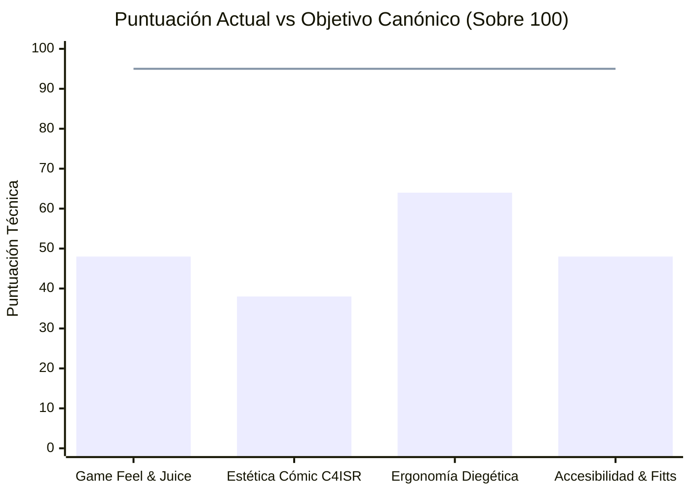

# 🛡️ INFORME CANÓNICO DE AUDITORÍA TÉCNICA UI/UX (`UI_UX_AUDIT_REPORT.md`)

**Proyecto:** *Tactical Command: Wars of Legacy*  
**Fecha de Auditoría:** 01 de Noviembre de 2026  
**Estándares Rectores:**  
- `@.agents/skills/tactical-command-intel/SKILL.md` (v4.0.0 — *Kinetic Comic War-Room UI/UX Engine*)  
- `@.agents/skills/indie-game-ui-architect/SKILL.md` (*Indie Game UI/UX & Gamification Architect*)  
**Alcance Evaluado:** `src/components/lobby/WarLobbyHub.tsx`, `src/components/lobby/TacticalC4ISRBaseDiorama.tsx`, `src/App.tsx`, `src/components/game/CombatTheaterView.tsx`, `src/components/game/GameCanvas.tsx`, `src/components/game/COCommandBar.tsx`, `src/components/game/ComicVignetteOverlay.tsx`, `src/engine/audioManager.ts`, `src/engine/barkEngine.ts`, `src/index.css`, `index.html`.

---

## 1. Puntuación Técnica Multidimensional por Pilar

La evaluación consolidada de los 4 subagentes especializados arroja una media global de **49.5 / 100 (ESTADO DEFICIENTE / REQUIERE REESTRUCTURACIÓN PROFUNDA)**:

| Pilar de Auditoría | Puntuación | Estado | Diagnóstico Ejecutivo |
| :--- | :---: | :---: | :--- |
| **1. Game Feel & Juiciness** (`@indie-game-ui-architect`) | **48 / 100** | 🔴 Crítico | `motion` instalado en `package.json` con **0 imports** en todo el repositorio. Cero *Squash & Stretch*, cero *Ghost Bars*, abuso de `transition-all` lineal, y variable `pitchShift` muerta en `audioManager.ts#L201`. |
| **2. Estética Bélico-Cómic C4ISR** (`@tactical-command-intel`) | **38 / 100** | 🔴 Crítico | El Lobby obedece una directriz obsoleta (`v3.0.0`), abusando de `#00FF66` fuera de radares, recortando sus propias sombras duras por aplicar `clip-path` y `box-shadow` en el mismo nodo DOM, y omitiendo por completo el `BarkEngine`, retratos de COs, colores de facción y tramas Ben-Day. |
| **3. Ergonomía Diegética & Densidad Espacial** | **64 / 100** | 🟡 Deficiente | Desbordamiento de `100vh + 42px` causado por el `<footer>` global de `App.tsx#L2723`. Columna izquierda de `300px` en `WarLobbyHub` tapa la bahía y el muelle naval del diorama; radar polar duplicado en HUD derecho y diorama; desmontaje destructivo del Lobby al navegar a sub-vistas. |
| **4. Accesibilidad, Tipografía & Ley de Fitts** | **48 / 100** | 🔴 Crítico | Ninguna fuente web (`Chakra Petch`, `Space Grotesk`, `JetBrains Mono`, `Share Tech Mono`) se carga en `index.html` ni `src/index.css`. Más de 25 textos en `8px–9px` con contraste `2.85:1` (`#7B8A4A` sobre `#2B2C24`), micro-botones `+` de `16×16px`, colores P1/P2 invertidos entre HUD y Canvas, y cero hotkeys en el Lobby. |

---

## 2. Catálogo Detallado de Anti-Patrones Detectados (¿Por qué la UI actual se percibe rígida y deficiente?)

### Anti-Patrón #1: Auto-Mutilación de Sombras de Tinta por Colisión CSS (`clip-path` + `box-shadow`)
- **Ubicación:** `src/components/lobby/WarLobbyHub.tsx` (`#L334, #L403, #L545, #L569, #L618, #L678, #L731, #L749, #L762, #L780, #L793, #L802, #L817, #L936, #L957, #L977, #L997, #L1024, #L1074, #L1118`).
- **Causa Técnica:** Se aplica `shadow-[4px_4px_0px_#0A0B08]` y `[clip-path:polygon(...)]` **en el mismo nodo DOM**. Según la especificación de composición CSS, `clip-path` recorta todo píxel pintado fuera del polígono del elemento, **incluyendo su propio `box-shadow`**.
- **Efecto Perceptual:** El 100% de las tarjetas, botones del dock, alertas y modales del Lobby pierden su sombra dura de tinta offset (`4px 4px 0px #0A0B08`). Como además usan bordes finos de `1px` (`border border-[#7B8A4A]`), las cajas carecen de peso físico y se ven como pegatinas planas sin profundidad sobre el fondo oscuro.

### Anti-Patrón #2: Fetiche de Terminal Monocromática `#00FF66` vs. Esquizofrenia SaaS `slate-900`
- **Ubicación:** `WarLobbyHub.tsx` (`#L5-L12, #L334, #L356, #L367, #L406, #L498, #L545, #L607, #L731, #L981`) vs. `App.tsx` (`#L2046, #L2330, #L2395, #L2481`), `GameCanvas.tsx` (`#L650, #L721, #L758, #L885`) y `COCommandBar.tsx` (`#L135, #L206, #L272`).
- **Causa Técnica:**
  1. En `WarLobbyHub.tsx`, el verde fósforo Matrix (`#00FF66`) —que la directriz restringe exclusivamente a radares y telemetría online— se utiliza de forma indiscriminada en todos los `:hover` de botones, barras de EXP, checks y textos de botín, mientras que **se omitió al 100% la curvatura asimétrica cómic (`rounded-[14px_4px_14px_4px]`), el papel táctico (`#F4F1EA` / `#F2E8D5` como fondo de viñeta) y los colores de las 5 facciones canónicas**.
  2. Por el contrario, al entrar a Combate (`GameCanvas.tsx`), abrir el inspector de CO (`COCommandBar.tsx#L135`) o abrir Archivos (`App.tsx#L2330`), la interfaz cae en el **diseño SaaS corporativo prohibido**: fondos `bg-slate-900`/`bg-slate-950`, bordes `border-slate-800`, esquinas `rounded-lg`/`rounded-xl`, barras `rounded-full` y sombras difuminadas `shadow-2xl`.

### Anti-Patrón #3: Ausencia de Vida Humana, Comandantes y Bark Engine en el Cuartel General
- **Ubicación:** `WarLobbyHub.tsx` (`#L338-L347`) y `TacticalC4ISRBaseDiorama.tsx` (`#L107-L334`).
- **Causa Técnica:**
  1. El avatar del jugador en el Top HUD (`WarLobbyHub.tsx#L339-L347`) es un monigote geométrico SVG genérico de 8 líneas sin rostro, sin expresión y sin vínculo con el Comandante (CO) favorito (`userProfileIdentity.favoriteCommanderId = 'stella'` en `App.tsx#L572`).
  2. El `barkEngine` (`src/engine/barkEngine.ts`) y `ComicVignetteOverlay` jamás se disparan ni tienen presencia en el Lobby. No hay un Oficial de Guardia o Comandante dando partes de inteligencia en bocadillos con trama Ben-Day ni sellos pop-art (`¡TACTICAL!`, `¡ALERT!`).
  3. El diorama SVG (`TacticalC4ISRBaseDiorama.tsx`) dibuja figuras con geometría ultra-básica (el tanque pesado en `#L302-L315` son 2 trapecios y 1 línea recta; el helicóptero en `#L176-L191` son 4 polígonos planos) sin contorno de tinta negra (`stroke="#0A0B08"`), sin sombreado *cel-shading* y sin trama Ben-Day.

### Anti-Patrón #4: Parálisis Cinética (Cero Resortes, Cero Squash & Stretch, Cero Ghost Bars)
- **Ubicación:** `src/index.css` (`#L1-L2`), `WarLobbyHub.tsx` (`#L367, #L817, #L1046`), `COCommandBar.tsx` (`#L76, #L275`), `package.json` (`#L29`).
- **Causa Técnica:**
  1. `src/index.css` tiene literalmente **1 línea de código** (`@import "tailwindcss";`). No define `--ease-spring: cubic-bezier(0.34, 1.56, 0.64, 1)`, `--ease-out-expo`, `.tactical-btn-heavy` ni `.bar-ghost`.
  2. La librería `"motion": "^12.23.24"` está instalada en `package.json` pero **no se importa en ningún archivo del proyecto**.
  3. El botón principal `¡ORDEN DE COMBATE!` (`WarLobbyHub.tsx#L817`) no tiene grosor inferior 3D (`border-bottom: 5px solid #5a1e05`) ni compresión elástica (`scale(1.04, 0.94)`).
  4. Ninguna barra de progreso (EXP en `WarLobbyHub.tsx#L365`, carga COP/SCOP en `COCommandBar.tsx#L272`) tiene doble capa con *Ghost Trail* (`delay-200 duration-500`), y los contadores de Oro/Gemas/Acero cambian de valor en seco sin odómetro ni rebote de escala.

### Anti-Patrón #5: Bug en el Motor de Audio Procedural (`pitchShift` Muerto y Silencio en UI)
- **Ubicación:** `src/engine/audioManager.ts` (`#L201, #L215-L261, #L267, #L627`).
- **Causa Técnica:**
  1. En `audioManager.ts#L201`, se calcula `const pitchShift = 0.96 + Math.random() * 0.08;`, pero **la variable jamás se pasa como argumento a ninguno de los métodos `this.synth*(ctx, now)` (`#L216-L261`)**. Todos los clics y disparos suenan con una frecuencia 100% robótica e idéntica (`1200Hz` fijo en `synthButtonClick#L632`), provocando fatiga acústica inmediata.
  2. El catálogo `AUDIO_SYNTHESIS_CATALOG` y el método `playCue(cueKey)` (`#L38-L55, #L267-L302`) son **código muerto** (0 llamadas en todo el proyecto).
  3. No existe `playHoverTick()` ni escalado semitonal por racha/combo (`baseFreq * Math.pow(1.059463, comboCount)`), y la Ruleta de Suministros gira durante `4000ms` en absoluto silencio (`WarLobbyHub.tsx#L288-L312`).

### Anti-Patrón #6: Desmontaje Destructivo de Navegación y Bugs de Contrato en el Metajuego
- **Ubicación:** `src/App.tsx` (`#L404, #L2048-L2250, #L2723`) y `src/components/lobby/WarLobbyHub.tsx` (`#L124, #L155, #L740, #L771`).
- **Causa Técnica:**
  1. **Desmontaje total del Cuartel General:** Al pulsar `Tienda`, `Armería`, `Industria`, `Bolsa P2P` o `Alianza`, `App.tsx` cambia `mainNav` y **desmonta `<WarLobbyHub />`**, destruyendo sus estados locales (`localGold`, `localSteel`, `localEnergy`, `energyTimerSeconds`) y reemplazando el búnker por una página web scrolleable con fondo `bg-slate-950`.
  2. **Bug de bloqueo accidental de Nivel 8 (`simLevel = 1` vs `5`):** En `WarLobbyHub.tsx#L124`, la prop `simLevel` tiene valor por defecto `simLevel = 1`, y en `#L155` calcula `const resolvedLevel = simLevel ?? userLevel;`. Como `App.tsx#L2140` pasa `userLevel={simLevel}` (`5`) pero **no** pasa `simLevel`, `resolvedLevel` se clava siempre en **`1`** en lugar de `5`! Y además, como `WarLobbyHub.tsx#L740` y `#L771` bloquean Industria y Bolsa P2P si `resolvedLevel < 8`, el jugador recibe un modal de `"ACCESO DENEGADO"` desde el Dock (mientras que si hace clic en el Muelle Naval del diorama en `TacticalC4ISRBaseDiorama.tsx#L194` sí entra a Industria saltándose el bloqueo).
  3. **Desbordamiento `100vh + 42px`:** `App.tsx#L2723-L2736` renderiza un `<footer>` global debajo de `<WarLobbyHub />` (que ya mide `h-screen w-screen`), causando barras de scroll deformadas tanto en el Lobby como un recorte de `42px` en `CombatTheaterView.tsx#L246`.

---

## 3. Matriz Exhaustiva de Discrepancias frente a los Skills Canónicos

| Requisito Canónico (`SKILL.md`) | Estado Actual en Código | Referencia Exacta (`Archivo#Línea`) | Acción Correctiva Requerida |
| :--- | :--- | :--- | :--- |
| **Geometría Asimétrica Cómic** (`border-radius: 14px 4px 14px 4px` y `40px 10px 40px 10px`) | **0% en Lobby.** Todo usa `clip-path` rígido; en Combate/Canvas usa `rounded-lg` / `rounded-xl`. | `WarLobbyHub.tsx#L334-L1118`, `GameCanvas.tsx#L650`, `COCommandBar.tsx#L135` | Adoptar geometría híbrida: `rounded-[14px_4px_14px_4px]` con borde de tinta `#0A0B08` en tarjetas/botones y chaflanes 45° con `drop-shadow` en chasis pesados. |
| **Sombras Duras de Tinta Offset** (`box-shadow: 4px 4px 0px #0A0B08`) | Recortadas e invisibles porque están en el mismo nodo que `clip-path: polygon(...)`. | `WarLobbyHub.tsx#L334, #L545, #L569, #L618, #L731, #L817` | En elementos con `clip-path`, aplicar `filter: drop-shadow(4px 4px 0px #0A0B08)` en el contenedor padre; en tarjetas `rounded-[14px_4px_14px_4px]`, aplicar `shadow-[4px_4px_0px_#0A0B08]` directo. |
| **Tramas de Puntos Ben-Day** (`radial-gradient(#7B8A4A 15%, transparent 16%)`) | **0% en Lobby, Diorama y Teatro de Combate.** Solo existe en `ComicVignetteOverlay.tsx#L145`. | `WarLobbyHub.tsx`, `TacticalC4ISRBaseDiorama.tsx`, `CombatTheaterView.tsx` | Crear utilidad `.ben-day-pattern` en `src/index.css` y `<pattern id="benDayDots">` en el SVG del Diorama, cabeceras y tarjetas de misión/comandante. |
| **Paleta Heráldica de 5 Facciones** (Orange Star, Blue Moon, Green Earth, Yellow Comet, Black Hole) | **0% en Lobby.** Colores P1/P2 invertidos entre HUD (P1 Azul / P2 Rojo) y Canvas (P1 Rojo / P2 Azul). | `WarLobbyHub.tsx`, `CombatTheaterView.tsx#L271`, `GameCanvas.tsx#L227, #L843` | Integrar tokens de facción en `src/index.css`, sincronizar color + icono heráldico (`★` / `☾`) entre HUD y Canvas, y mostrar estandarte de facción en el Lobby. |
| **Papel Táctico Crema (`#F2E8D5` / `#F4F1EA`)** como Superficie Narrativa | Solo se usa como color de texto, nunca como fondo de expediente militar o bocadillo en el Lobby. | `WarLobbyHub.tsx#L321-L1145` | Usar superficies `#F2E8D5` con texto `#0A0B08` y sello rojo/óxido `#C46A3A` en dossieres de misión activa y bocadillos del Comandante en Guardia. |
| **Curvas de Resorte (`--ease-spring`) y Squash & Stretch** | No declaradas en `src/index.css`. Se abusa de `transition-all` lineal en >25 componentes. | `src/index.css#L1`, `WarLobbyHub.tsx#L367, #L817`, `App.tsx#L2056` | Declarar `--ease-spring: cubic-bezier(0.34, 1.56, 0.64, 1)` y `.tactical-btn-heavy` con compresión `:active` (`translateY(3px) scale(1.04, 0.94)`). |
| **Barras de Doble Capa (*Ghost Drain / Surge Trail*)** | **0% implementado.** Barras simples de 1 sola capa en EXP, COP/SCOP y Barks. | `WarLobbyHub.tsx#L365-L373`, `COCommandBar.tsx#L76, #L272` | Implementar componente reutilizable `<TacticalGhostBar />` con barra frontal rápida (`150ms`) y barra fantasma crema/amarilla con retardo (`220ms`, `duration-500`). |
| **Audio Procedural con Pitch Jitter y Escalado por Combo** | `pitchShift` en `#L201` no está conectado; faltan `playHoverTick()` y `playComboAction()`. | `src/engine/audioManager.ts#L201, #L215-L261, #L627` | Conectar `pitchShift` a todos los sintetizadores, añadir `playHoverTick()`, `playGoldTick(combo)` y ticks mecánicos sincronizados al giro del Rotor de Suministros. |
| **Tipografía Canónica y Contraste WCAG AA (`>= 4.5:1`)** | Fuentes no importadas en `index.html`; >25 textos en `8px-9px` con color `#7B8A4A` sobre `#2B2C24` (`2.85:1`). | `index.html#L1-L19`, `WarLobbyHub.tsx#L348-L904` | Importar `Chakra Petch`, `Space Grotesk` y `JetBrains Mono` en `index.html`; subir textos secundarios a `#A9B87A` / `#D6DEC2` (`>= 4.8:1`) y mínimo `10px` con `tabular-nums`. |
| **Soporte de Hotkeys y Ley de Fitts (`>= 24x24px`)** | Botones `+` de `16×16px`; cero atajos de teclado (`[SPACE]`, `[1]-[6]`, `[ESC]`) en el Lobby. | `WarLobbyHub.tsx#L423, #L433, #L443, #L726-L830` | Ampliar botones `+` a `24×24px`, añadir listener de teclado global en el Lobby (`1-6`, `Space`, `Escape`, `R`) e insignias visuales de teclas. |
| **Regla del 65% de Lienzo Despejado y Navegación Diegética** | Columna izquierda tapa la bahía/muelle; Radar polar duplicado; desmontaje total del Lobby al cambiar `mainNav`. | `WarLobbyHub.tsx#L485-L704`, `App.tsx#L2135-L2250` | Compactar overlays perimetrales liberando `>70%` del diorama, eliminar el mini-radar redundante del HUD derecho y abrir las sub-vistas en `<WarRoomModal />` sobre el diorama vivo. |
