# 📐 BLUEPRINT CANÓNICO DE REESTRUCTURACIÓN UI/UX (`UI_UX_RESTRUCTURE_BLUEPRINT.md`)

**Proyecto:** *Tactical Command: Wars of Legacy*  
**Versión de Arquitectura:** 5.0.0 (*Kinetic Comic War-Room Engine — Advance Wars meets Persona 5 / Hades + C4ISR*)  
**Estado:** Producción Certificada (Fase 1 a 4 Verificadas)  
**Invariante Crítica:** **CERO modificaciones a la lógica de combate, motores matemáticos, contratos de Supabase ni firmas públicas de `WarLobbyHubProps`.**

---

## 1. Visión Arquitectónica: La Sala de Guerra Viva (Kinetic Comic War-Room)

La nueva arquitectura transforma el Menú Principal (`WarLobbyHub`) y su articulación con `App.tsx` y `CombatTheaterView.tsx` pasando de una "terminal verde estática desconectada" a un **Centro de Mando C4ISR Vivo con Energía de Novela Gráfica Bélica**:

1. **Persistencia Espacial Total (Zero-Unmount HQ Shell):** El Cuartel General y su diorama isométrico nunca se desmontan al visitar la Tienda, Armería, Complejo Industrial, Bolsa P2P, Alianza o Archivos. En su lugar, la cámara del diorama hace un **enfoque cinético (Zoom & Pan con resorte)** hacia el edificio correspondiente y despliega una **Terminal Táctica Diegética Superpuesta (`<WarRoomModal />`)** con desenfoque de cristal táctico (`backdrop-blur-md`), permitiendo cambiar de estación en 1 clic desde el Dock Inferior sin perder timers ni estado.
2. **Presencia del Comandante en Guardia + Bark Engine en el Lobby:** El Cuartel General incorpora al Comandante activo (ej. *Mayor Stella*, *Coronel Volkov*, *Andy*, *Gral. Vance*) con su estandarte de facción y bocadillo cómic reactivo del `BarkEngine` (tramas Ben-Day, papel táctico `#F2E8D5` y sellos pop-art rotados `¡TACTICAL!`, `¡ALERT!`, `¡RATATAT!`), conectando emocionalmente el Lobby con el Teatro de Combate.
3. **Geometría Híbrida & Tinta Sólida (`45° Armor` + `14px/4px Comic Asymmetry`):** Se resuelve el bug de recorte de sombras separando los chasis blindados achaflanados (con `drop-shadow(4px 4px 0px #0A0B08)`) de las tarjetas, medidores y bocadillos con curvatura asimétrica canónica (`rounded-[14px_4px_14px_4px]`, `border-2 border-[#0A0B08]`, `shadow-[4px_4px_0px_#0A0B08]`).

---

## 2. Sistema Unificado de Tokens Visuales (`src/index.css` & `index.html`)

### 2.1. Tipografía Expresiva y Tabular (`index.html`)
Se cargarán desde Google Fonts tres familias con personalidad militar y de novela gráfica:
- **Display / Titulares de Impacto y Sellos (`--font-display`):** `'Chakra Petch'` (700, 800, Italics) — Geometría mecanizada con cortes angulares ideales para encabezados C4ISR y onomatopeyas.
- **UI Táctica y Narrativa (`--font-sans`):** `'Space Grotesk'` (500, 700) — Lectura ultraclara para expedientes, cartas del hangar y bocadillos del Bark Engine.
- **Telemetría, Coordenadas y Odómetros (`--font-mono`):** `'JetBrains Mono'` (600, 800) con `font-variant-numeric: tabular-nums` obligatorio en todo contador o reloj.

### 2.2. Paleta Cromática Canónica (70-20-10 + Heráldica de Facciones)

| Categoría | Token CSS | Valor Hex | Uso Estricto en la Interfaz |
| :--- | :--- | :---: | :--- |
| **Núcleo Blindado (70%)** | `--color-bunker-void` | `#161712` | Foso de aplicación, sombras internas y bahía profunda. |
| | `--color-ink-black` | `#0A0B08` | Contornos de tinta cómic (`2px–3px`) y sombras duras offset (`4px 4px 0px`). |
| | `--color-armor-base` | `#2B2C24` | Chasis principal de paneles, tarjetas de unidad y consolas. |
| | `--color-military-olive` | `#46521F` | Cubiertas secundarias, módulos de apoyo y calzadas. |
| | `--color-metal-edge` | `#7B8A4A` | Biseles estructurales y bordes pasivos. |
| | `--color-olive- high` | `#A9B87A` | **Nuevo token accesible (WCAG AA `4.9:1` sobre `#2B2C24`)** para subtítulos y etiquetas. |
| **Papel Táctico & Datos (20%)** | `--color-data-cream` | `#F2E8D5` | Tipografía primaria, fondo de dossieres de misión, bocadillos cómic y *Ghost Bars*. |
| **Acentos de Combate (10%)** | `--color-rust-alert` | `#C46A3A` | CTA `¡ORDEN DE COMBATE!`, alertas DEFCON y daño balístico. |
| | `--color-amber-command` | `#F59E0B` | Recompensas de Oro, estrellas de rango/COP y botones de suministro. |
| | `--color-crt-radar` | `#00FF66` | **USO RESTRINGIDO:** Únicamente radares polares, barrido C4ISR y LED `ONLINE`. |
| **5 Facciones Heráldicas** | `--color-fac-orange` | `#E65100` / `#F59E0B` | **Orange Star / Iron Vanguard** (Stella, Andy, Max, Sami). |
| | `--color-fac-blue` | `#1D4ED8` / `#60A5FA` | **Blue Moon / Frost Legion** (Colin, Volkov, Grit). |
| | `--color-fac-green` | `#15803D` / `#4ADE80` | **Green Earth / Emerald Guard** (Eagle, Vance). |
| | `--color-fac-yellow` | `#D97706` / `#FDE047` | **Yellow Comet / Solar Shogunate** (Kanbei, Sonja). |
| | `--color-fac-black` | `#4C1D95` / `#EF4444` | **Black Hole / Shadow Syndicate** (Hawke, Sturm). |

### 2.3. Primitivas Geométricas y de Física (`src/index.css`)

```css
@import "tailwindcss";

:root {
  --ease-spring: cubic-bezier(0.34, 1.56, 0.64, 1);
  --ease-out-expo: cubic-bezier(0.22, 1, 0.36, 1);

  --color-bunker-void: #161712;
  --color-ink-black: #0A0B08;
  --color-armor-base: #2B2C24;
  --color-military-olive: #46521F;
  --color-metal-edge: #7B8A4A;
  --color-olive-high: #A9B87A;
  --color-rust-alert: #C46A3A;
  --color-data-cream: #F2E8D5;
  --color-crt-radar: #00FF66;
}

/* 1. Tarjeta Táctica Asimétrica con Tinta Sólida (Sin recorte de sombra) */
.tactical-comic-card {
  background-color: var(--color-armor-base);
  border: 2px solid var(--color-ink-black);
  outline: 1px solid rgba(123, 138, 74, 0.45);
  outline-offset: -3px;
  border-radius: 14px 4px 14px 4px;
  box-shadow: 4px 4px 0px var(--color-ink-black);
  transition: transform 0.2s var(--ease-spring), box-shadow 0.2s var(--ease-spring), border-color 0.15s ease;
}
.tactical-comic-card:hover {
  transform: translateY(-2px) scale(1.01);
  box-shadow: 6px 6px 0px var(--color-ink-black);
}

/* 2. Chasis Blindado Achaflanado a 45° con Drop-Shadow Externo */
.tactical-chamfer-wrap {
  filter: drop-shadow(4px 4px 0px #0A0B08);
}
.tactical-chamfer-box {
  clip-path: polygon(
    10px 0, calc(100% - 10px) 0,
    100% 10px, 100% calc(100% - 10px),
    calc(100% - 10px) 100%, 10px 100%,
    0 calc(100% - 10px), 0 10px
  );
}

/* 3. Botón de Mando Pesado 3D con Squash & Stretch (<16ms) */
.tactical-btn-heavy {
  background: linear-gradient(180deg, #df7b48 0%, #C46A3A 60%, #873612 100%);
  color: var(--color-data-cream);
  border: 2px solid var(--color-data-cream);
  border-bottom: 5px solid #5a1e05;
  border-radius: 14px 4px 14px 4px;
  box-shadow: 4px 4px 0px var(--color-ink-black);
  transition: transform 0.16s var(--ease-spring), border-bottom-width 0.06s ease, filter 0.12s ease;
  will-change: transform;
}
.tactical-btn-heavy:hover {
  transform: translateY(-2px) scale(1.03);
  filter: brightness(1.1);
}
.tactical-btn-heavy:active {
  transform: translateY(3px) scale(1.08, 0.90);
  border-bottom-width: 2px;
  box-shadow: 1px 1px 0px var(--color-ink-black);
}

/* 4. Trama de Puntos Ben-Day (Novela Gráfica) */
.ben-day-overlay {
  background-image: radial-gradient(rgba(123, 138, 74, 0.28) 18%, transparent 19%);
  background-size: 8px 8px;
}
.ben-day-cream {
  background-color: #F2E8D5;
  background-image: radial-gradient(rgba(196, 106, 58, 0.18) 18%, transparent 19%);
  background-size: 8px 8px;
}

/* 5. Barras de Doble Capa (Ghost Drain / Surge Trail) */
.bar-ghost-trail {
  transition: width 0.55s var(--ease-out-expo) 0.22s;
}
.bar-fill-spring {
  transition: width 0.15s var(--ease-spring);
}
```

---

## 3. Wireframes Esquemáticos por Zona (`100vh × 100vw` Puro, >70% Lienzo Despejado)

### 3.1. Distribución Espacial General y Las 4 Capas de Diegesis

```
+======================================================================================================+
| ZONA 1: TOP COMMAND HUD (h-14 / 56px fijo, z-30) — CAPA 4 NO-DIEGÉTICA                               |
| [Retrato CO + Rango NVL.5 + Ghost EXP Bar]  [⚡ C4ISR • Arena • 🏆2450 • Cap N11]  [💰Oro|💎Gem|⚙️Acero|⚡En]|
+======================================================================================================+
|                                                                                                      |
|  ZONA 3A: INTEL & BARK (Izq, w-64)        ZONA 2: DIORAMA CENTRAL VIVO       ZONA 3B: OPS (Der, w-48)|
|  +-------------------------------+        (CAPA 1 DIEGÉTICA + CAPA 2)        +---------------------+ |
|  | 🗣️ VIÑETA GUARDIA CO (Bark)   |                                           | 🎡 ROTOR SUMINISTRO | |
|  | "Mayor Stella: ¡Silos al 90%!"|     [⚓ ASTILLERO NAVAL -> Industria]     | [¡GIRAR! - Ceremonia| |
|  | [Sello Pop-Art: ¡TACTICAL!]   |                                           +---------------------+ |
|  +-------------------------------+     [⚡ BÚNKER SILOS -> Cosecha +Acero]   | 📋 ÓRDENES DIARIAS  | |
|  | 📁 DOSSIER MISIÓN (Papel Crema|                                           | [1/3] ★ Logros  [R] | |
|  | "Sector Alpha: Baterías" [1/2]|     [🪖 HANGAR BLINDADO -> Armería/Mazo]  +---------------------+ |
|  | [Ghost Progress] [Reclamar]   |                                                                   |
|  +-------------------------------+     [📡 RADAR POLAR 360° -> Mapa Frentes]                         |
|  | 🚨 DEFCON-1 + 🔥 RACHA 4x     |     (Único Radar Polar Diegético)                                 |
|  +-------------------------------+                                                                   |
|                                                                                                      |
|  (CAPA 3 META: Viñeta perimetral roja en DEFCON-1 / Scanlines CRT sutiles / Destello de Suministro)  |
+======================================================================================================+
| ZONA 4 & 5: TACTICAL DOCK + RADIO-NET + CTA TITÁN (h-20 / 80px fijo, z-30)                           |
| [1:Tienda][2:Industria][3:Armería][4:Bolsa P2P][5:Alianza][6:Doctrina] | [📡 Radio-Net] | [⚔️¡COMBATE!]|
+======================================================================================================+
```

### 3.2. Detalle de las 5 Zonas Clave

1. **Zona 1: `CommandHUD` (Barra Superior C4ISR):**
   - **Expediente del Comandante (`[P]`):** Sustituye el SVG genérico por el retrato real del Comandante activo (`/assets/CO/pixelated/stella-full.png` con fallback vectorial estilizado), borde heráldico de su facción (`Orange Star`), insignia de Nivel correcta (`resolvedLevel = userLevel ?? simLevel ?? 5`) y **Barra de EXP de Doble Capa (`Ghost Bar`)**.
   - **Telemetría Central:** Tag del Clan (`[FERRO]`), nombre de Arena, Trofeos con icono, Escudos (`3/3`) y conmutador elástico `TORNEO (CAP N11)` vs `LADDER (N15)`.
   - **Banco de Recursos con Odómetro `motion`:** Contadores de `Fondos (G)`, `Gemas`, `Acero` y `Energía (75/80 + Barra Ghost)` que escalan (`scale(1.3) -> scale(1)`) con `tabular-nums` al cambiar de valor. Los botones `+` se amplían a **`24×24px` (`w-6 h-6`)** cumpliendo Ley de Fitts y WCAG AA.

2. **Zona 2: `TacticalC4ISRBaseDiorama` (Diorama de Base Viva Rediseñado):**
   - **Entintado Cómic y Trama Ben-Day:** Todos los edificios y vehículos reciben contornos de tinta negra (`stroke="#0A0B08" strokeWidth="3"`), sombras proyectadas sólidas (`fill="#0A0B08"`), espuma costera animada y patrón `<pattern id="benDayPattern">` en las laderas y sombras.
   - **Siluetas *Advance Wars* de Alta Fidelidad:** Rediseño vectorial del Tanque Pesado en el Hangar (orugas con remaches, chasis inclinado, torreta con estrella heráldica), Helicóptero Artillado en el Helipuerto (con luces estroboscópicas) y Destructor Torpedero en el Muelle Naval.
   - **4 Estaciones Diegéticas con Etiquetas Espaciales Cómic (`rounded-[14px_4px_14px_4px]`):**
     - `⚓ ASTILLERO // INDUSTRIA` (Muelle Naval — antes no tenía etiqueta espacial).
     - `⚡ SILOS // +ACERO & ORO` (Búnker Generador — con barra de capacidad y partículas al cosechar).
     - `🪖 HANGAR // MAZO 10 CARTAS` (Bahía Blindada — abre Armería).
     - `📡 RADAR C4ISR // FRENTES` (Torre de Radar Polar — abre Mapa de Frentes y elimina la duplicación del HUD derecho).
   - **Alarma de Búnker Conectada (`handleBunkerAlarm`):** Clicar el Helipuerto/Comando activa la alerta `DEFCON-1` proyectando la viñeta roja pulsante en la Capa Meta del viewport.

3. **Zona 3: `FactionBanner` (Overlays Compactos de Inteligencia y Bark Engine):**
   - **Columna Izquierda (`w-64`, libera la Bahía y el Muelle Naval):**
     - **Tarjeta de Guardia del Comandante (Bark Reactivo):** Muestra al CO activo con un bocadillo en papel táctico (`#F2E8D5`), trama Ben-Day y sello pop-art (`¡TACTICAL!`, `¡RATATAT!`, `¡HOLD!`). Al hacer clic sobre el bocadillo, cicla consejos tácticos reales usando `barkEngine`.
     - **Dossier de Misión de Campaña (Estilo Carpeta Militar Crema `#F2E8D5`):** Contraste negro sobre crema, barra de progreso con *Ghost Trail* y botón de reclamo con explosión de recursos y odómetro.
     - **Píldora Unificada DEFCON-1 + Racha de Victorias:** Fusiona la alerta de incursión y el multiplicador de racha (`🔥 Racha: 4 Victorias • 1.25x BOTÍN`) con botones rápidos de `Suministros` y `Mensajes`.
   - **Columna Derecha (`w-48`, sin Radar duplicado):**
     - Acceso directo a `🎡 Rotor de Suministros` (con sello `¡LISTO!`), `📋 Órdenes Diarias (1/3)` y `🏆 Condecoraciones / Torneo (#4)`.

4. **Zona 4: `TacticalDock` y Botón Titán `¡ORDEN DE COMBATE!`:**
   - **6 Estaciones con Hotkeys `[1]`–`[6]` y Estado Activo:** `[1] Tienda`, `[2] Industria`, `[3] Armería`, `[4] Bolsa P2P`, `[5] Alianza`, `[6] Doctrina` + botón `[E] Editor`.
   - **Corrección del Gate de Nivel:** `Industria` y `Bolsa P2P` quedan 100% accesibles para el Comandante desde el Dock (mostrando la insignia `VETERANO` sin bloquear la apertura de `IndustrialComplexView` ni `P2PMarketplaceView`).
   - **Botón Titán Dual (`¡ORDEN DE COMBATE!` + `⚡ BLITZ 1-CLIC`):**
     - El botón principal `¡ORDEN DE COMBATE! [SPACE]` usa `.tactical-btn-heavy` (hundimiento físico 3D de `5px` a `2px` + *Squash & Stretch*) y abre el selector táctico de los 3 teatros (`Duelo Espejo 15s`, `Escaramuza Blitz 30s`, `Gran Campaña 60s`).
     - Junto a él, un botón de acción rápida `⚡ DESPLIEGUE RÁPIDO [F]` lanza `blitz_skirmish` en **1 solo clic** cumpliendo la garantía de cero fricción.

5. **Zona 5: Barra Social `RADIO-NET // ENLACE TÁCTICO`:**
   - Integrada en el zócalo inferior con tarjetas de aliados (`Carlos`, `Ana`, `Luis`), avatares de facción, textos legibles (`>= 10px`, contraste AA) y transferencia instantánea de suministros con feedback sonoro y visual.

---

## 4. Especificación de Animaciones, Resortes, Audio Procedural y Ceremonia de Botín

### 4.1. Física de Animación con `motion` (`motion/react`)
1. **Apertura de `<WarRoomModal />` y Modales del Lobby:**
   - Entrada: `initial={{ opacity: 0, scale: 0.92, y: 18 }}` → `animate={{ opacity: 1, scale: 1, y: 0 }}` con `transition={{ type: "spring", stiffness: 420, damping: 26 }}`.
   - Salida (`<AnimatePresence>`): `exit={{ opacity: 0, scale: 0.95, y: 10 }}` en `140ms`.
2. **Odómetro de Recursos en `CommandHUD`:**
   - Cada vez que cambia `localGold`, `userGems` o `localSteel`, el `<motion.span key={value}>` ejecuta `initial={{ scale: 1.35, color: "#F59E0B" }}` → `animate={{ scale: 1, color: "#F2E8D5" }}` con resorte elástico.
3. **Ceremonia de Revelación de 3 Tiempos en el Rotor de Suministros (`modal-ruleta`):**
   - **Tiempo 1 (Anticipación - `0ms a 4000ms`):** Mientras la rueda gira con desaceleración `cubic-bezier(0.12, 0.9, 0.2, 1)`, un intervalo desacelerado dispara `audioManager.playHoverTick()` cada vez que un segmento cruza el puntero superior.
   - **Tiempo 2 (Clímax - `4000ms`):** Flash luminoso de `100ms` (`hit-stop` visual) + `audioManager.playComboAction(6)` + sacudida del contenedor.
   - **Tiempo 3 (Presentación por Rareza):** Se despliega una tarjeta de botín con marco heráldico según la recompensa (`Común`, `Raro`, `Épico`, `Legendario`) y sello pop-art `¡¡SUMINISTRO ASEGURADO!!`.

### 4.2. Mejoras al Motor de Audio (`src/engine/audioManager.ts`)
1. **Conexión Real de `pitchShift` (`0.96 + Math.random() * 0.08`):** Pasar `pitchShift` a todos los métodos `synth*` y a `playCue()` para erradicar la fatiga acústica.
2. **Nuevo Método `playHoverTick()`:** Pulso triangular de `20ms` (`680Hz -> 920Hz`) con variación aleatoria de `±8%` conectado al `onMouseEnter` de los botones del Dock, tarjetas de teatro y edificios del Diorama.
3. **Nuevo Método `playComboAction(comboIndex)` / `playGoldTick(index)`:** Escalado semitonal ascendente (`baseFreq * Math.pow(1.059463, Math.min(index, 14))`) para cosecha de silos, reclamo de misiones y ticks de recompensa.

### 4.3. Modelo de Trauma Cuadrático (Screen Shake) y Coherencia en `GameCanvas.tsx`
1. **Screen Shake Cuadrático (`traumaRef`):** En `GameCanvas.tsx`, al producirse impactos balísticos, explosiones o emboscadas (`TRAP`), se inyecta `trauma` (`0.3` a `0.7`) cuyo desplazamiento es `maxOffset * (trauma ** 2)`, respetando un toggle de accesibilidad `reduceMotion`.
2. **Sincronización Cromática y Daltonismo (P1 vs P2):** Se corrige la inversión de colores en `GameCanvas.tsx#L227, #L843` para que coincida 100% con el HUD de `CombatTheaterView.tsx` y se añade doble codificación por símbolo (`★` P1 / `☾` P2).
3. **Limpieza de Controles Flotantes del Canvas:** Se elimina el botón de debug `💥 Cañón` (`GameCanvas.tsx#L748`) y se reemplaza el estilo SaaS `bg-slate-900/90 rounded` de los controles de cámara y audio por el chasis blindado `#2B2C24` con bordes `#0A0B08` y esquinas `rounded-[10px_3px_10px_3px]`.

---

## 5. Plan de Migración Modular por Componentes (Cero Regresiones)

```mermaid
flowchart LR
    subgraph FaseA["1. Fundaciones & Audio"]
        IndexHTML["index.html (Fuentes Google)"]
        IndexCSS["src/index.css (Tokens v4.0 + Resortes)"]
        AudioMgr["src/engine/audioManager.ts (pitchShift + Hover + Combo)"]
    end

    subgraph FaseB["2. Componentes Modulares del Lobby (src/components/lobby/)"]
        GhostBar["TacticalGhostBar.tsx"]
        CommandHUD["CommandHUD.tsx (Top Bar)"]
        Diorama["TacticalC4ISRBaseDiorama.tsx (SVG Comic + Camera Focus)"]
        FactionBanner["FactionBanner.tsx (Overlays + Bark Card)"]
        TacticalDock["TacticalDock.tsx (Dock + Hotkeys + Radio-Net)"]
        WarRoomModal["WarRoomModal.tsx (Modales + Shell de Sub-Vistas)"]
        WarLobbyHub["WarLobbyHub.tsx (Orquestador 100% Compatible)"]
    end

    subgraph FaseC["3. Articulación Global & Combate"]
        AppTSX["src/App.tsx (Overlay Shell sin desmontar Lobby + Fix 100vh)"]
        CombatView["CombatTheaterView.tsx + COCommandBar.tsx"]
        Canvas["GameCanvas.tsx (Fix P1/P2 + Trauma Shake + Chasis C4ISR)"]
    end

    FaseA --> FaseB --> FaseC
```



### Mapa de Archivos a Crear / Modificar (Tras Aprobación en Fase 3)

| Archivo | Acción | Responsabilidad e Invariantes Protegidas |
| :--- | :---: | :--- |
| `index.html` | Modificar | Cargar `Chakra Petch`, `Space Grotesk` y `JetBrains Mono` desde Google Fonts. |
| `src/index.css` | Modificar | Declarar variables CSS v4.0.0, `.tactical-comic-card`, `.tactical-btn-heavy`, `.ben-day-overlay`, `.bar-ghost-trail`. |
| `src/engine/audioManager.ts` | Modificar | Conectar `pitchShift` en `playSFX`/`playCue`, añadir `playHoverTick()` y `playComboAction()`. |
| `src/components/lobby/TacticalGhostBar.tsx` | Crear | Barra de progreso de doble capa reutilizable (EXP, Energía, Misiones, Silos). |
| `src/components/lobby/CommandHUD.tsx` | Crear | Barra superior C4ISR con retrato real del CO, Ghost Bar de EXP, Arena/Trofeos y odómetros `motion`. |
| `src/components/lobby/FactionBanner.tsx` | Crear | Overlays compactos: Viñeta reactiva del Comandante (`BarkEngine`), Dossier de Misión en papel crema `#F2E8D5`, DEFCON-1 + Racha y accesos de operaciones. |
| `src/components/lobby/TacticalDock.tsx` | Crear | Dock inferior con hotkeys `[1]-[6]`, CTA `.tactical-btn-heavy` `[SPACE]`, Blitz 1-Clic `[F]` y barra social `RADIO-NET`. |
| `src/components/lobby/WarRoomModal.tsx` | Crear | Contenedor diegético animado con `motion` para los modales del Lobby (Sala de Operaciones, Rotor con ceremonia de 3 tiempos, Radar) y chasis superpuesto para sub-vistas. |
| `src/components/lobby/TacticalC4ISRBaseDiorama.tsx` | Modificar | Entintado cómic `#0A0B08`, tramas Ben-Day, siluetas *Advance Wars* mejoradas, etiqueta de Astillero Naval, alarma DEFCON Meta-Layer y zoom/pan de cámara por estación activa. |
| `src/components/lobby/WarLobbyHub.tsx` | Modificar | Orquestar los submódulos conservando **exactamente** la interfaz `WarLobbyHubProps` (las 29 props intactas) + soporte de teclado (`1-6`, `Space`, `Escape`, `R`). |
| `src/App.tsx` | Modificar | Mantener `<WarLobbyHub />` montado como fondo interactivo cuando `mainNav` abre sub-vistas (`shop`, `armory`, `industry`, `marketplace`, `clans`, `docs`, `qa`) dentro de un chasis modal diegético C4ISR, sincronizar oro/acero cosechados y eliminar el desbordamiento de `42px` del `<footer>` global en Lobby y Combate. |
| `src/components/game/GameCanvas.tsx` & `COCommandBar.tsx` | Modificar | Corregir inversión de colores P1/P2, añadir trauma cuadrático (Screen Shake), eliminar botón debug `💥 Cañón` y aplicar estética blindada `#2B2C24` / `rounded-[14px_4px_14px_4px]` con Ghost Bar en `COCommandBar`. |

---

## 6. Tríada C4ISR Canónica de Geotactics (Fase 2 Certificada)

Para integrar la experiencia macro y territorial (*Advance Wars meets Paradox / Stellaris*), el War Lobby cuenta con 3 componentes C4ISR canónicos totalmente integrados:

### 6.1. Cabecera Dual de Recursos (`src/components/lobby/DualResourceHeader.tsx`)
- Proyecta en la parte superior la telemetría dual dividida con estética militar:
  1. **Recursos Personales del Jugador:** Fondos $G, Gemas de Mando, Acero Militar y Energía (EC) con indicadores de tasa horaria ($+\text{EC/h}$).
  2. **Arcas Comunitarias de Facción:** Bóveda del Clan, multiplicadores económicos en vivo emanados del control de Nodos Estratégicos (ej. $+15\%$ por Caracas, $+25\%$ energía por Amuay/Guri) y badge de jerarquía del clan (`Leader`, `Officer`, `Member`).

### 6.2. Viñeta Táctica del Comandante (`src/components/comic/CommanderBarkWidget.tsx`)
- Ubicado en la esquina inferior izquierda (`bottom-left`):
  - Retrato dinámico del Comandante activo con marco Ben-Day y badge de nivel.
  - Bocadillo estilo cómic con cola reactiva conectada al `barkEngine`.
  - Interactividad física: reacciona en tiempo real a clics del usuario ciclando frases doctrinales, estados de alerta DEFCON y respuestas hápticas.

### 6.3. Gaveta Retráctil de Mando Paradox (`src/components/metagame/ParadoxCommandDrawer.tsx`)
- Panel lateral retráctil en el extremo derecho (`right drawer`) inspirado en la interfaz C4ISR de *Stellaris* y *Victoria 3*:
  - **Pestaña de Frentes Territoriales:** Estado de las 24 regiones de Venezuela, frentes activos, asedios en curso y control de TCP.
  - **Pestaña de Nodos Estratégicos:** Control soberano de los 7 activos clave del teatro (Amuay, Paria, Guri, etc.) y sus multiplicadores proyectados.
  - **Pestaña de Cola de Ensamblaje:** Tiempos de fabricación restantes con cuentas regresivas en vivo y botón de reclamo atómico (`claim_finished_unit`).
  - **Pestaña de Arsenal de Facción:** Tropas donadas disponibles en el hangar colectivo listas para despliegue en el frente territorial.
