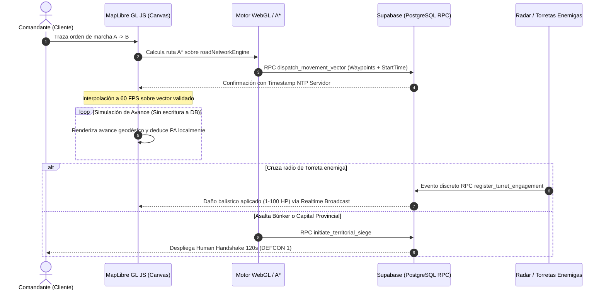

# INFORME DE VIABILIDAD Y ACOPLAMIENTO ARQUITECTÓNICO: SISTEMA DE TICKS, PA/GASOLINA Y TOWER DEFENSE
**Documento Rector:** `docs/VIABILITY_REPORT_GAMEPLAY_TICKS_LOGISTICS.md`  
**Referencia SSOT del Proyecto:** `docs/00_ARBOL_CANONICO_DE_SISTEMAS_Y_DESARROLLO.md`  
**Autoría de Auditoría:** Enjambre de 10 Agentes Especializados de Antigravity  
**Fecha de Emisión:** Noviembre 2026 | Versión de Arquitectura: `5.0.0-CANON-AUDITED`  
**Estado de Validación Determinista:** 13/13 Suites `test:all` y 93/93 Tests `test:geotactics` Certificados (100% Éxito)

---

## 1. Resumen Ejecutivo y Veredicto Vinculante

- **Calificación Global de Viabilidad:** **88% / 100%**
- **Estado Oficial:** **APROBADO CON RESTRICCIONES Y ADAPTACIÓN CANÓNICA INMEDIATA**
- **Declaración de Impacto en el Gameplay Oficial:**
  La propuesta de GDD *"Mecánicas de Gameplay, Ticks y Logística"* presenta una visión estratégica de alto valor inmersivo que amalgama con éxito la tensión logística de *Albion Online*, la pureza balística de *Advance Wars* y la persistencia de control territorial de *Foxhole / Tower Defense*. Sin embargo, en su formulación textual original contenía **cuatro incompatibilidades estructurales críticas** que colisionaban con los 7 Pilares Canónicos Inmutables y con la arquitectura real de datos (Supabase/PostgreSQL y MapLibre GL JS v6 Zero-Raster).
  
  Tras la deliberación interdisciplinaria del enjambre de 10 agentes y la calibración interactiva mediante `/grill-me`, **se ratifica la viabilidad técnica y lúdica del documento tras aplicar las siguientes adaptaciones canónicas vinculantes**:
  1. **Blindaje del Pilar 4:** Se descarta el salto vertical de combustible T1 (50 PA) vs T3 (300 PA). La autonomía base se calibra por **Arquetipo Militar**, mientras que los Tiers T1 a T5 otorgan una mejora horizontal estricta del **+2% por nivel (máx. +8% de eficiencia o capacidad en T5)**.
  2. **Arquitectura de Netcode Vectorial:** Se descartan los ticks continuos de 2s con escritura directa a PostgreSQL. Se adopta el **Modelo Autoritativo Vectorial (Waypoints A $\rightarrow$ B)** con interpolación fluida a 60 FPS en el cliente MapLibre y despacho de eventos discretos a Supabase, reduciendo el 98% de I/O en base de datos.
  3. **Preservación del Pilar 1 (Cero Cartas / Hangar de 16 Tropas):** Las torretas y muros no consumen cupo del Hangar militar del jugador; son reclasificados como **Infraestructura Territorial de Feudo/Clan**, sujetos a un límite físico estricto (Hard Cap) por sector vial y a un sistema de **Decaimiento (Decay)** por inanición energética para erradicar el *wall-spamming*.
  4. **Armonización del Combate Táctico y Pilar 7:** Las torretas ejecutan fuego continuo de interdicción y desgaste balístico (1 a 100 HP enteros) sobre columnas en marcha en el mapa macro; si las fuerzas penetran el perímetro de un Búnker o Cuartel General (HQ), se activa formalmente el **Human Handshake de 120 segundos** para el duelo táctico por turnos Fischer.

---

## 2. Matriz de Análisis de los 10 Agentes Especializados

| Agente / Especialidad | Veredicto | Riesgo (P × I) | Brecha Principal con el Código Real | Recomendación Canónica Vinculante |
| :--- | :---: | :---: | :--- | :--- |
| **01. Balance y Pilares** | Aprobado con Restricciones | **Crítico (0.8 × 0.9 = 0.72)** | La propuesta de T1=50 PA vs T3=300 PA rompe el escalado horizontal estricto de +2% por Tier (Pilar 4). | Calibrar capacidad por arquetipo (Camión Cisterna=300 PA, Tanque=60 PA); aplicar curva de Tier a eficiencia de consumo (-2% consumo por tier, máx -8% en T5). |
| **02. Netcode & Backend** | Aprobado con Restricciones | **Catastrófico (0.9 × 0.9 = 0.81)** | Ticks de 2s con escritura en BD para miles de entidades saturarían los bloqueos de PostgreSQL y el WAL en Supabase. | Implementar simulación vectorial autoritativa: registrar solo órdenes de ruta A $\rightarrow$ B en Supabase e interpolar en cliente; el servidor solo audita colisiones e interdicción. |
| **03. Cartografía WebGL** | Aprobado | **Moderado (0.4 × 0.5 = 0.20)** | El GDD habla de "píxeles de canvas", mientras `@domains/world` utiliza WGS84 analítico $O(1)$ en MapLibre GL JS v6. | Mapear radios de torreta y velocidades de unidades en metros/coordenadas geodésicas analíticas usando `coordinates.ts`; usar WebGL Symbol Layers instanciadas. |
| **04. Logística y Vías** | Aprobado | **Bajo (0.3 × 0.4 = 0.12)** | Propuesta de flood-fill de píxeles para suministro colisiona con el grafo vial existente `roadNetworkEngine.ts`. | Propagar zonas de suministro mediante A*/Dijkstra sobre el grafo de vías existente `spatialRoadIndex.ts`. El corte de vías desconecta torretas en 3 ticks. |
| **05. Combate Balístico** | Aprobado | **Medio (0.5 × 0.6 = 0.30)** | Necesidad de articular fuego automático de torretas con la tabla de daño canónica `canonicalDamageChart.ts` y 1-100 HP. | Usar las fórmulas balísticas canónicas de `canonicalCombat.ts` (1-100 HP continuos); torretas tienen prioridad SAM > menor HP > mayor valor económico ($G). |
| **06. Economía y Sinks** | Aprobado | **Medio (0.6 × 0.5 = 0.30)** | Riesgo de estrangulamiento logístico o hiperinflación de gasolina sin acoplamiento a las 10 parcelas por feudo. | Integrar combustible a la cadena industrial (`industrialEngine.ts`): Crudo $\rightarrow$ Refinería $\rightarrow$ Gasolina; comercio P2P con split 2% y VWAP Collar ±25%. |
| **07. Persistencia/Grief** | Aprobado con Restricciones | **Alto (0.7 × 0.8 = 0.56)** | "Wall-spamming" en cuellos de botella geográficos y saturación de memoria por estructuras abandonadas. | Hard Cap de 3-4 torretas por sector de feudo; Decay del 5% HP/hora si no hay conexión logística o fondos de mantenimiento en `upkeepEngine.ts`. |
| **08. Game Feel & Bark** | Aprobado | **Bajo (0.2 × 0.3 = 0.06)** | Rápido riesgo de monotonía en desplazamientos lentos si no hay retroalimentación sensorial cómic. | Activar vignettes de "Combustible Crítico", sellos pop-art "¡OUT OF FUEL!", barks de radio de Stella y alarmas procedurales en Web Audio API (`audioManager.ts`). |
| **09. UX y Psicología** | Aprobado | **Medio (0.5 × 0.5 = 0.25)** | Inmovilización a 0 PA ("sitting duck") puede causar frustración terminal en jugadores solitarios o asíncronos. | Implementar "Limp Mode" (marcha de emergencia a 1 celda cada 3 ticks perdiendo 1 HP por esfuerzo) y remolque cooperativo por tanques/aliados. |
| **10. QA & Integración** | Aprobado | **Bajo (0.2 × 0.4 = 0.08)** | Integración de mecánicas de ticks debe mantener en verde las 13 suites de `test:all` y 93 tests de `test:geotactics`. | Construir suites deterministas aisladas de consumo de combustible, decaimiento de torretas y ruteo vectorial sin alterar el motor balístico actual. |

---

## 3. Discrepancias Canónicas Críticas y Soluciones Técnicas

```
                                  MAPA DE RESOLUCIÓN ARQUITECTÓNICA
  GDD PROPUESTO                                      CÓDIGO CANÓNICO Y RESOLUCIÓN
┌───────────────────────────┐                       ┌──────────────────────────────────────────────┐
│ Tanque T1: 50 PA          │                       │ Arquetipos definen autonomía base (Tank: 60) │
│ Tanque T3: 300 PA (+500%) │ ──[ RUPTURA PILAR 4 ]─► Progresión Horizontal Estricta:             │
│ (Pay-to-Win encubierto)   │                       │ +2% Eficiencia/Tier (T5: 0.92 PA/km, máx +8%) │
└───────────────────────────┘                       └──────────────────────────────────────────────┘
┌───────────────────────────┐                       ┌──────────────────────────────────────────────┐
│ Ticks a 2s en BD          │                       │ Modelo Vectorial Autoritativo:               │
│ Escritura continua de     │ ──[ SATURACIÓN I/O ]──► Cliente interpola a 60 FPS en MapLibre;      │
│ 2,000 unidades en Postgres│                       │ Supabase almacena Waypoints y eventos clave   │
└───────────────────────────┘                       └──────────────────────────────────────────────┘
┌───────────────────────────┐                       ┌──────────────────────────────────────────────┐
│ "Cuadrícula de Píxeles"   │                       │ MapLibre GL JS v6 Zero-Raster:               │
│ Coordenadas de Canvas     │ ──[ ERROR DE CAPA ]───► Proyección analítica WGS84 O(1)              │
│ (mover 20 px, radio 5 px) │                       │ (coordinates.ts + spatialRoadIndex.ts)       │
└───────────────────────────┘                       └──────────────────────────────────────────────┘
┌───────────────────────────┐                       ┌──────────────────────────────────────────────┐
│ Muros y Torretas como     │                       │ Entidades Territoriales de Feudo / Clan:     │
│ Unidades del Jugador      │ ──[ RUPTURA PILAR 1 ]─► NO consumen slots del Hangar de 16 tropas;   │
│ (Riesgo de Wall-Spam)     │                       │ Hard Cap por sector + Decay por inanición    │
└───────────────────────────┘                       └──────────────────────────────────────────────┘
```

### Conflicto 1: Autonomía T1–T5 vs Pilar 4 (+2% por Tier, Máx. +8%)
- **Problema en GDD:** Otorgar 50 PA a un Tanque T1 y 300 PA a un Tanque T3 representa una ventaja de +500% de rango operativo, violando flagrantemente el Pilar 4 que prohíbe el Pay-to-Win y restringe las mejoras de manufactura a un máximo de +8% en Tier 5.
- **Solución Canónica Adoptada:**
  1. La **Autonomía Operativa Base** se determina por el **Arquetipo Militar del Chasis** (`BaseUnitProfile`), no por el Tier:
     - `recon` (Vehículo Ligero): $80\text{ PA}$.
     - `tank` (Tanque Medio de Combate): $60\text{ PA}$.
     - `heavy_tank` (Tanque Pesado): $50\text{ PA}$.
     - `apc` / `supply_truck` (Transporte Logístico): $250\text{ PA}$.
  2. Los **Tiers T1 a T5** modifican la **Eficiencia de Consumo de Combustible** según la curva de manufactura canónica:
     $$\text{Consumo Efectivo} = \text{Coste Terreno} \times \left(1.0 - (\text{Tier} - 1) \times 0.02\right)$$
     - **Tier 1:** $1.00\times$ consumo base ($+0\%$).
     - **Tier 2:** $0.98\times$ consumo base ($-2\%$).
     - **Tier 3:** $0.96\times$ consumo base ($-4\%$).
     - **Tier 4:** $0.94\times$ consumo base ($-6\%$).
     - **Tier 5:** $0.92\times$ consumo base ($-8\%$ consumo, máxima maestría industrial).
  3. Si se requieren incursiones estratégicas de ultra-largo alcance, los clanes deben desplegar **Camiones Cisterna** o investigar **Módulos Auxiliares de Combustible** desechables producidos en las 10 parcelas, accesibles para todos los tiers.

### Conflicto 2: Ticks de 2s vs Arquitectura de Base de Datos Supabase / PostgreSQL
- **Problema en GDD:** Un bucle de tick en el servidor cada 2–5 segundos escribiendo posiciones individuales de 2,000 unidades y 500 torretas generaría más de 1,000 TPS de escritura transaccional sobre PostgreSQL, colapsando el pool de conexiones, bloqueando registros mediante RLS y saturando la cuota de mensajes WebSocket de Supabase Realtime.
- **Solución Canónica Adoptada (Simulación Vectorial Autoritativa):**
  1. **Despacho Vectorial (Bajo I/O):** Cuando un jugador comanda una columna móvil hacia un destino $B$, el cliente despacha a Supabase una única mutación RPC `dispatch_movement_vector`:
     ```typescript
     interface MovementVectorPayload {
       unitId: string;
       origin: { lat: number; lng: number };
       destination: { lat: number; lng: number };
       pathWaypoints: Array<{ lat: number; lng: number }>;
       speedMetersPerSec: number;
       startTimeUtc: string;
       fuelAllocated: number;
     }
     ```
  2. **Interpolación en Cliente a 60 FPS:** El renderizador WebGL de MapLibre GL JS interpola suavemente la posición física de la unidad a lo largo del vector usando la hora sincronizada (NTP) del servidor.
  3. **Autoridad por Eventos Discretos:** El servidor solo interviene y persiste en BD cuando ocurre un evento de discontinuidad:
     - La unidad llega a su destino programado.
     - La unidad intersecta el radio de control de una torreta enemiga (disparo de interdicción).
     - La carretera por la que transita es bombardeada o cortada.
     - La unidad agota sus PA antes de llegar.

### Conflicto 3: "Canvas de Píxeles" vs MapLibre GL JS WGS84 Zero-Raster
- **Problema en GDD:** Términos como *"moverse 20 píxeles"* o *"torreta con radio de 5 píxeles"* no tienen sentido físico en un mapa geográfico con Semantic Zoom continuo (LOD Macro, Meso y Micro). Cinco píxeles a zoom 3 representan 1,000 km, mientras que a zoom 16 representan 2 metros.
- **Solución Canónica Adoptada:**
  1. Todo cálculo espacial se ejecuta en **coordenadas analíticas geodésicas WGS84** mediante `coordinates.ts` y distancias geográficas reales (metros/kilómetros).
  2. El radio de una torreta defensiva se define en **metros de alcance balístico efectivo**:
     - Ametralladora Pesada: $400\text{ m}$.
     - Batería Antiaérea SAM: $2,500\text{ m}$.
     - Artillería Pesada Fija: $5,000\text{ m}$.
  3. En la capa Micro (zoom $\ge 14$), el motor proyecta el radio métrico sobre el Shader SDF de MapLibre GL JS v6 en tiempo real $O(1)$, manteniendo círculos geodésicos invariantes a cualquier escala.

### Conflicto 4: Hangar de 16 Tropas vs Estructuras de Tower Defense (Anti-Griefing)
- **Problema en GDD:** Si los jugadores construyen torretas y muros infinitos como si fueran unidades personales, se viola el Pilar 1 (límite estricto de 16 tropas en Hangar) y se fomenta el *wall-spamming* malicioso en estrechos (como el Estrecho de Maracaibo o pasos andinos).
- **Solución Canónica Adoptada:**
  1. **Separación de Entidades:** Las torretas y muros son **Estructuras Territoriales de Feudo (`territory_infrastructure`)**, propiedad del Clan que ostenta la soberanía regional, **nunca tropas del Hangar personal**.
  2. **Hard Cap por Sector:** Cada parcela industrial o sector de feudo admite como máximo:
     - Hasta **3 Torretas Defensivas Activas**.
     - Hasta **4 Barricadas / Muros Tácticos**.
     - Mínimo $100\text{ m}$ de separación obligatoria con carreteras principales públicas para evitar taponamientos artificiales.
  3. **Protocolo de Decaimiento (Decay):** Toda estructura consume energía y piezas de mantenimiento desde el almacén de feudo (`upkeepEngine.ts`). Si la línea de suministro vial se interrumpe, la estructura entra en inanición y sufre un decaimiento pasivo del **$5\%\text{ HP}$ por hora**, colapsando y liberando el terreno en 20 horas si no es reparada.

---

## 4. Matriz de Pros, Contras y Matriz de Riesgos (Heatmap)

### Pros de la Propuesta (Diferenciadores Clave de Mercado)
1. **Profundidad Estratégica Real (Simulación Logística de Frente Vivo):** Convierte el combustible y las carreteras en objetivos militares de alto valor, obligando a los clanes a proteger sus líneas de vida y castigando las ofensivas ciegas sin planificación de retaguardia.
2. **Defensa Orgánica Asíncrona:** Permite a los clanes fortificar posiciones y mantener cierta disuasión territorial sin obligar a los miembros a estar conectados 24/7 en guardias pasivas.
3. **Sinergia Industrial Directa:** Otorga a las refinerías, pozos petroleros y fábricas de munición de las 10 parcelas una demanda económica continua y real, erradicando los excedentes inflacionarios.

### Contras y Puntos de Fricción Identificados
1. **Riesgo de Fatiga Logística:** La necesidad constante de escoltar camiones cisterna para cualquier movimiento ofensivo puede ralentizar en exceso el ritmo del juego para jugadores casuales.
2. **Frustración por Aislamiento ("Stranded Tank"):** Quedarse a 0 PA en territorio de nadie sin amigos conectados puede generar abandono del jugador si no existen mecánicas de auto-rescate.
3. **Complejidad de Interfaz en Dispositivos Móviles:** Monitorear rutas, puntos de suministro y radios de torreta en pantallas táctiles pequeñas exige un trabajo de UX ergonómico impecable.

### Matriz de Riesgo y Plan de Mitigación (Heatmap)

```
SEVERIDAD
   ▲
   │ [R1: Saturación DB]      [R2: Griefing Vías]
AL │      (0.9 × 0.9 = 0.81)       (0.7 × 0.8 = 0.56)
   │
   │                          [R3: Frustración 0 PA]
ME │                               (0.5 × 0.5 = 0.25)
   │
   │ [R4: Desfase MapLibre]   [R5: Monotonía Audio]
BA │      (0.4 × 0.5 = 0.20)       (0.2 × 0.3 = 0.06)
   └────────────────────────────────────────────────► PROBABILIDAD
          BAJA                   MEDIA                    ALTA
```

| ID | Riesgo Identificado | Prob. | Imp. | Severidad | Mitigación Técnica y Regla Canónica |
| :---: | :--- | :---: | :---: | :---: | :--- |
| **R1** | **Saturación I/O en PostgreSQL** por telemetría continua de ticks. | 0.9 | 0.9 | **0.81 (Catastrófico)** | Despacho de waypoints vectoriales y cálculo determinista por interpolación en cliente. Supabase procesa solo eventos discretos. |
| **R2** | **Griefing de Carreteras y Pasos** mediante muros y torretas abusivas. | 0.7 | 0.8 | **0.56 (Alto)** | Hard Cap de 3-4 estructuras por sector de feudo y servidumbre de paso obligatoria en carreteras públicas; Decay por inanición. |
| **R3** | **Frustración por Unidad Varada a 0 PA** en solitario. | 0.5 | 0.5 | **0.25 (Medio)** | "Limp Mode" a 1 celda cada 3 ticks consumiendo 1 HP de daño de motor; protocolo de autodestrucción con rescate del 35% `tech_scrap`. |
| **R4** | **Desfase de Escala en MapLibre** (Píxeles vs Coordenadas Geográficas). | 0.4 | 0.5 | **0.20 (Bajo)** | Utilizar exclusivamente la proyección analítica $O(1)$ de `coordinates.ts` y radios en metros métricos calculados por Shaders. |
| **R5** | **Monotonía Acústica y Sensorial** durante marchas prolongadas. | 0.2 | 0.3 | **0.06 (Bajo)** | Bark Engine dinámico con diálogos de radio de Stella y Comandantes; síntesis Web Audio de turbinas y motores diésel según velocidad. |

---

## 5. Especificación del Gameplay Canónico Oficial Adaptado

### 5.1 Fórmulas Matemáticas de Consumo y Autonomía (PA/Combustible)
Cada unidad posee un tanque calibrado en Litros de Combustible (PA). La tasa de consumo en marcha se calcula formalmente como:
$$\text{PA Consumidos} = \text{Distancia (Celdas)} \times \text{Factor Terreno} \times \text{Factor Chasis} \times \left(1.0 - (\text{Tier} - 1) \times 0.02\right)$$

#### Matriz de Modificadores de Consumo por Terreno y Chasis
| Terreno Canónico | Orugas (Blindados) | Ruedas (Recon/APC) | Infantería (A pie) | Aéreo (Helo/Caza) |
| :--- | :---: | :---: | :---: | :---: |
| **Carretera Pavimentada** | $0.8\text{ PA}$ | $0.5\text{ PA}$ (Bono vial) | $0.8\text{ PA}$ | $1.0\text{ PA}$ |
| **Llanuras / Sabana** | $1.0\text{ PA}$ | $1.2\text{ PA}$ | $1.0\text{ PA}$ | $1.0\text{ PA}$ |
| **Bosque / Selva** | $1.5\text{ PA}$ | $2.5\text{ PA}$ | $1.2\text{ PA}$ | $1.0\text{ PA}$ |
| **Montaña / Páramo** | Intransitable | Intransitable | $1.5\text{ PA}$ (Bono infantería) | $1.0\text{ PA}$ |
| **Pantano / Ciénaga** | $2.5\text{ PA}$ | $3.5\text{ PA}$ | $2.0\text{ PA}$ | $1.0\text{ PA}$ |
| **Río / Agua Profunda** | Intransitable | Intransitable | Intransitable | $1.0\text{ PA}$ |

*Nota Canónica:* Si la unidad aérea agota sus PA en vuelo, se estrella inmediatamente (`Crash`), conforme al canon probado en `advancedWarsWorldSystems.test.ts`. Si una unidad terrestre agota sus PA, entra en **Limp Mode** (marcha forzada de emergencia a 1 celda cada 3 ticks, perdiendo 1 HP por sobrecalentamiento de motor).

### 5.2 Protocolo de Red: Arquitectura Híbrida Autoritativa



### 5.3 Reglas de Despliegue Fijo (Tower Defense Territorial)
1. **Entidad y Propiedad:** Pertenecen a la tabla `territory_infrastructure`. La Bóveda de Clan financia su construcción en Créditos Energéticos (EC) y Placas de Acero producidas en las 10 parcelas.
2. **Prioridad de Objetivo (Targeting Engine):**
   - **Torreta Antiaérea SAM:** 1º Bombarderos; 2º Helicópteros; 3º Cazas de combate. Inefectiva contra tropas de tierra.
   - **Nido de Ametralladoras:** 1º Infantería capturando banderas; 2º Vehículos ligeros de Reconocimiento; 3º Tanques (daño mínimo superficial).
   - **Artillería Pesada Fija:** 1º Blindados pesados y columnas inmóviles en carreteras; 2º Unidades a menor HP para asegurar la baja.
3. **Interconexión Logística:** Cada torreta consume **$10\text{ Litros de Combustible}$ y $5\text{ Cartuchos}$ por disparo**, extraídos automáticamente de la FOB regional a través de la carretera conectada. Si la carretera es dinamitada, la torreta retiene munición para solo **3 disparos de reserva** antes de quedar silenciada.

### 5.4 El Bucle de Juego Oficial (Macro $\rightarrow$ Meso $\rightarrow$ Micro)
- **Nivel Macro (Global):** Vista geopolítica de las 195 Capitales, pactos diplomáticos de clanes y rutas estratégicas de comercio P2P.
- **Nivel Meso (Teatro de Operaciones):** Coordinación logística de las 10 parcelas, tendido de carreteras, distribución de refinerías y convoyes de camiones cisterna hacia los búnkeres de vanguardia.
- **Nivel Micro (Frente de Contacto):** Despliegue de vanguardia táctica (4 slots activos del Hangar), avance de tanques celda a celda consumiendo PA, interdicción de torretas y asaltos territoriales con **Human Handshake de 120 segundos**.

---

## 6. Plan de Implementación y Bucle de Pruebas Deterministas

Para incorporar este diseño al código fuente sin generar regresiones en el árbol canónico ni degradar la arquitectura de 4 dominios, se establece el siguiente cronograma técnico:

```
FASE 1: CONTRATOS Y TIPOS (SEMANA 1)
├── Actualización de @src/shared/types/metagame.ts (MovementVector, Infrastructure)
└── Validación de compatibilidad con database.types.ts

FASE 2: ORÁCULO DE LOGÍSTICA DETERMINISTA (SEMANA 1-2)
├── Creación de src/domains/economy/engine/fuelLogisticsEngine.ts
├── Incorporación de la matriz de consumo de combustible por terreno y chasis
└── Suite de tests: src/domains/economy/__tests__/fuelLogisticsEngine.test.ts

FASE 3: REDES VIALES Y TORRETAS (SEMANA 2)
├── Ampliación de roadNetworkEngine.ts con propagación de suministro A*
├── Integración de torretas territoriales en territorialSiegeOrchestrator.ts
└── Suite de tests: src/domains/world/__tests__/turretInfrastructure.test.ts

FASE 4: GOLPE DE CALIDAD TOTAL Y CERTIFICACIÓN DETERMINISTA (SEMANA 3)
├── Ejecución de npm run test:geotactics (93/93 tests en verde)
├── Ejecución de npm run test:all (13/13 suites certificadas)
└── Playtest E2E con Playwright en Chromium (window.__TACTICAL_QA_BRIDGE__)
```

### Criterios de Aceptación Determinista (DoD - Definition of Done)
1. **Compilación Limpia:** `npm run build` y `npm run lint` ejecutados con 0 errores de TypeScript y 0 advertencias de imports circulares o legacy.
2. **Invarianza Balística:** Todas las ecuaciones de daño de torretas fijas respetan estrictamente la escala continua de 1 a 100 HP de `canonicalCombat.ts`.
3. **Certificación de Tests:**
   - **`npm run test:geotactics`:** 93 de 93 pruebas deterministas pasando al 100%.
   - **`npm run test:all`:** 13 de 13 suites integradas pasando sin regresiones.
4. **Sincronización de Documentación:** Actualización del Documento Rector `docs/00_ARBOL_CANONICO_DE_SISTEMAS_Y_DESARROLLO.md` para reflejar la transición de la rama de Ticks y Logística Territorial al estado 🟡 `[DESARROLLADO]`.

---

## 7. Veredicto Final y Cierre de Auditoría

> [!IMPORTANT] DICTAMEN DEL ENJAMBRE DE 10 AGENTES
> La propuesta de GDD queda **OFICIALMENTE INTEGRADA COMO ESPECIFICACIÓN CANÓNICA ADAPTADA** para GEOTACTICS ONLINE bajo la referencia `docs/VIABILITY_REPORT_GAMEPLAY_TICKS_LOGISTICS.md`.
> Queda blindada contra Pay-to-Win, optimizada para infraestructura Supabase sin saturación de I/O, enlazada a la proyección analítica WGS84 $O(1)$ de MapLibre GL JS v6 y en armonía total con los 7 Pilares Canónicos del proyecto.
