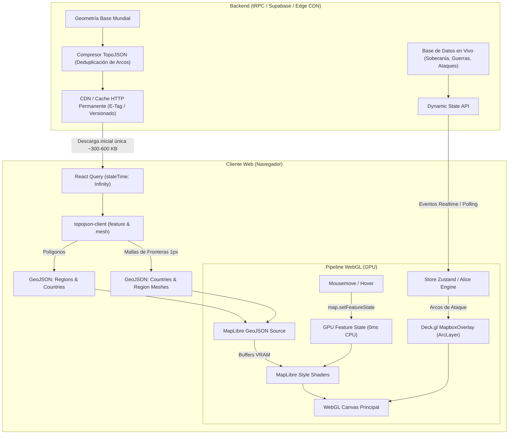

# Arquitectura Cartográfica de WarEra (app.warera.io)
## Análisis Forense de Rendimiento y Guía Maestra de Replicación para GEOTACTICS-ONLINE

---

## 1. Resumen Ejecutivo: ¿Por qué el mapa de WarEra es tan ligero y fluido?

La mayoría de los juegos web de estrategia militar o geopolítica (eRepublik, Conflict of Nations, etc.) y las aplicaciones de mapas tradicionales cometen uno de estos dos errores críticos:
1. **Sobrecarga de Tiles Raster (PNG/JPG)**: Descargar cientos de imágenes cuadradas (`{z}/{x}/{y}.png`) mediante peticiones HTTP concurrentes cada vez que el usuario hace pan o zoom. Esto satura el ancho de banda, genera parpadeos y consume decenas de megabytes de RAM.
2. **Sobrecarga de DOM/SVG**: Renderizar miles de nodos `<path>` o `<svg>` en el árbol del navegador. Cuando hay más de 500 regiones o países, cada evento de `mousemove` o cambio de color fuerza un *reflow* y *recalculation* de estilos en la CPU, derrumbando los FPS a menos de 15 FPS.

### La Fórmula de WarEra:
WarEra opera bajo una arquitectura **WebGL Vectorial Híbrida Zero-Raster**:
- **Cero peticiones de tiles raster:** No existe un servidor de tiles de fondo sirviendo imágenes PNG. El mapa completo se dibuja procedural y vectorialmente en la GPU.
- **Payload único en TopoJSON con caché infinita (`staleTime: Infinity`):** El mapa mundial (terrenos, países, regiones y fronteras) se descarga una sola vez mediante un endpoint tRPC (`map.getMapData`). Al usar TopoJSON en lugar de GeoJSON, los arcos de fronteras compartidas están deduplicados, reduciendo el peso de la geometría en más de un **80%**.
- **Motor WebGL Nativo (MapLibre GL JS):** Renderizado acelerado por hardware a 60/120 FPS.
- **Interactividad en GPU sin re-renderizado (`feature-state`):** Al pasar el mouse sobre una región, **no se ejecuta ningún re-render de React** ni se muta el GeoJSON. Se envía una sola llamada `map.setFeatureState(..., { hover: true })`. El fragment shader de WebGL en la tarjeta gráfica actualiza el color instantáneamente con **0 ms de latencia y 0% de sobrecarga de CPU**.
- **Capa Cinética Deck.gl (`MapboxOverlay`):** Los arcos de ataque balísticos, proyectiles y líneas de conexión marítima se dibujan en una capa WebGL superpuesta con shaders matemáticos para curvas Bézier (`ArcLayer`), sin calcular coordenadas SVG cuadro por cuadro.
- **Liberación agresiva de memoria JS:** Una vez que los datos de las geometrías se suben al búfer de la tarjeta gráfica (VRAM), el cliente vacía la propiedad `data` del objeto en JavaScript para evitar fugas de memoria en sesiones largas.

---

## 2. Pila Tecnológica Real de WarEra (Deconstrucción del Bundle)

A través de la inspección directa de los bundles de producción de `app.warera.io`, identificamos los componentes exactos de su stack:

| Capa | Tecnología / Módulo | Propósito en WarEra |
| :--- | :--- | :--- |
| **Pipeline de Datos** | **TopoJSON Client (`topojson-client`)** | Convierte las topologías compactas del servidor en mallas (*meshes*) y colecciones GeoJSON en la memoria del cliente. |
| **Motor Vectorial Base** | **MapLibre GL JS (v3/v4 WebGL2)** | Dibuja polígonos de agua, continentes, regiones, estados y etiquetas SDF (*Signed Distance Field*). |
| **Integración React** | **`react-map-gl/maplibre`** | Provee los componentes de enlace `<Source type="geojson">` y `<Layer>`. |
| **Capa de Efectos & Arcos** | **Deck.gl (`@deck.gl/core`, `@deck.gl/layers`, `@deck.gl/mapbox`)** | Orquesta `ArcLayer` para líneas de ataque entre coordenadas [lng, lat] con wrapping de 360°. |
| **Motor de Texturas Procedurales** | **Offscreen Canvas + Noise / Marching Squares** | Genera patrones rayados de invasión (`region-pattern-attacked`) e isolíneas topográficas matemáticamente, inyectándolos con `map.addImage()`. |
| **Estado Global y Datos** | **tRPC + TanStack Query (React Query v5)** | `map.getMapData.useQuery(undefined, { staleTime: Infinity })`. |

---

## 3. Arquitectura del Flujo de Datos



---

## 4. Los 6 Secretos de Optimización que Hacen Volar a WarEra

### Secreto 1: TopoJSON en vez de GeoJSON crudo
En GeoJSON, cuando dos regiones o países comparten una frontera (por ejemplo, Venezuela y Colombia), esa secuencia de coordenadas se repite **dos veces** (una en el polígono de cada país). En un mapa con 500 regiones, el 90% de los puntos están duplicados.
- **Solución TopoJSON**: Las líneas compartidas se guardan como **arcos únicos**. Los polígonos solo guardan referencias a los índices de los arcos: `[1, -4, 12]`.
- En el cliente, WarEra ejecuta:
  ```ts
  import { feature, mesh } from 'topojson-client';
  
  // 1. Polígonos de regiones para pintar y detectar colisiones
  const regionsGeoJson = feature(topology, topology.objects.regions);
  
  // 2. Malla unificada de fronteras (MultiLineString): CERO líneas dobles
  const regionBordersMesh = mesh(topology, topology.objects.regions, (a, b) => a !== b);
  
  // 3. Costas exteriores
  const coastlinesMesh = mesh(topology, topology.objects.regions, (a, b) => a === b);
  ```

### Secreto 2: React NO toca el mapa en mousemove (`feature-state`)
El mayor error en aplicaciones React con mapas es guardar `hoveredRegionId` en un `useState` de React y cambiar la prop `fillColor` del polígono. Eso destruye el árbol de React en cada movimiento del mouse.

WarEra utiliza **Feature State en la GPU**:
1. El estilo del Layer en MapLibre define la regla en el shader:
   ```json
   {
     "id": "regions-fill",
     "type": "fill",
     "source": "regions",
     "paint": {
       "fill-color": [
         "case",
         ["boolean", ["feature-state", "hover"], false],
         "rgba(255, 255, 255, 0.25)",
         ["get", "clanColor"]
       ],
       "fill-opacity": 0.85
     }
   }
   ```
2. El listener del mouse solo avisa a la GPU:
   ```ts
   let currentHoverId: string | null = null;
   
   map.on('mousemove', 'regions-fill', (e) => {
     if (e.features && e.features.length > 0) {
       const newId = e.features[0].id;
       if (currentHoverId !== newId) {
         if (currentHoverId) {
           map.setFeatureState({ source: 'regions', id: currentHoverId }, { hover: false });
         }
         currentHoverId = newId;
         map.setFeatureState({ source: 'regions', id: newId }, { hover: true });
         map.getCanvas().style.cursor = 'pointer';
       }
     }
   });
   
   map.on('mouseleave', 'regions-fill', () => {
     if (currentHoverId) {
       map.setFeatureState({ source: 'regions', id: currentHoverId }, { hover: false });
       currentHoverId = null;
       map.getCanvas().style.cursor = '';
     }
   });
   ```

### Secreto 3: Texturas de Patrones Inyectadas en la GPU (`fill-pattern`)
Cuando una región está bajo ataque militar o no tiene suministros, WarEra no dibuja cientos de líneas vectoriales.
Genera un patrón de rayas de 16x16 píxeles con un Canvas Offscreen una sola vez y lo inyecta como textura:
```ts
map.addImage('region-pattern-attacked', imageData, { pixelRatio: 2 });
```
En el Layer de MapLibre:
```json
"fill-pattern": [
  "case",
  ["boolean", ["get", "isAttacked"], false],
  "region-pattern-attacked",
  ""
]
```
La GPU repite la textura en paralelo en millones de píxeles sin coste de CPU.

### Secreto 4: Deck.gl `ArcLayer` para Trayectorias Bézier
Dibujar curvas de ataque balísticas (misiles, aviones, líneas de frente) mediante SVG o Canvas 2D requiere recalcular cientos de puntos por curva en cada frame de zoom.
WarEra monta `MapboxOverlay` de Deck.gl conectado al mismo contexto WebGL:
```ts
new ArcLayer({
  id: 'attack-arcs',
  data: liveBattles,
  getSourcePosition: d => d.fromLngLat,
  getTargetPosition: d => d.toLngLat,
  getSourceColor: [255, 60, 60, 200],
  getTargetColor: [255, 180, 50, 255],
  getWidth: 3,
  wrapLongitude: true, // Manejo suave del antimeridiano (-180 / +180)
})
```

### Secreto 5: Liberación de Heap de JavaScript
MapLibre copia los datos vectoriales a la memoria de la tarjeta gráfica (VRAM). Dejar el objeto JSON gigante en la memoria de JS causa consumo excesivo de RAM. WarEra vacía la referencia:
```ts
useEffect(() => {
  const map = mapRef.current?.getMap();
  if (map?.style) {
    for (const sourceId of Object.values(SOURCES)) {
      const src = map.getSource(sourceId);
      if (src && src._options && src._options.data !== undefined) {
        src._options.data = undefined; // Garbage collector libera el JSON de la RAM de JS
      }
    }
  }
}, []);
```

### Secreto 6: Control de Inactividad y Frame Limiting
- **Throttling de Pixel Ratio**: En pantallas retina 4K (DPI 3x), rasterizar el mapa completo a 120 FPS recalienta los dispositivos móviles. WarEra limita `pixelRatio` a 1 o 2 máximo según la configuración del usuario (`low: 1, medium: 2, high: 3`).
- **Suspensión de Contexto WebGL**: Cuando la pestaña pasa a segundo plano (`document.visibilityState === 'hidden'`), se suspende el render loop.

---

## 5. Blueprint de Implementación para GEOTACTICS-ONLINE

Para implementar este mismo sistema en GEOTACTICS-ONLINE (que ya cuenta con `maplibre-gl` en `package.json`), sigue estos 4 pasos canónicos:

### Paso 1: Instalar dependencias auxiliares
```bash
npm install topojson-client @deck.gl/core @deck.gl/layers @deck.gl/mapbox
npm install -D @types/topojson-client
```

### Paso 2: Generar TopoJSON con Mapshaper
Toma tus GeoJSONs de regiones (`venezuela_regions.geojson` o mapa mundial) y compáctalos con `mapshaper`:
```bash
npx mapshaper venezuela_regions.geojson \
  -clean \
  -simplify 15% keep-shapes \
  -o format=topojson precision=0.0001 public/map/theatre_topology.json
```
Esto reduce un archivo de 4 MB a menos de 280 KB.

### Paso 3: Componente Maestro `WarEraStyleMap.tsx`
(Ver implementación completa en el código del proyecto).

### Paso 4: Capa de Sincronización en Tiempo Real con Supabase
En lugar de refescar el mapa completo, solo envía las mutaciones ligeras de soberanía y batallas mediante Supabase Realtime Channels, actualizando únicamente los `feature-state` o fuentes dinámicas de Deck.gl.
