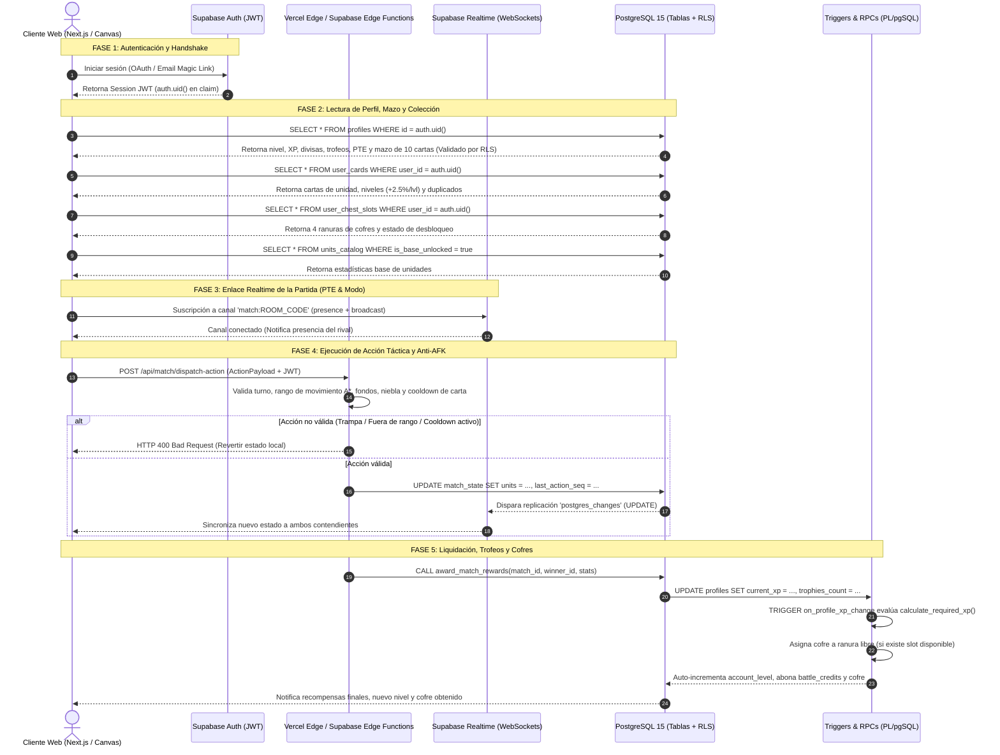

# GUÍA DE ARQUITECTURA E IMPLEMENTACIÓN DE INFRAESTRUCTURA DE DATOS (SUPABASE + VERCEL)
**Proyecto:** *Tactical Command: Wars of Legacy*  
**Versión:** 1.0.0-PROD-ARCHITECTURE  
**Rol:** Arquitecto de Datos y de Sistemas  
**Stack:** Supabase (PostgreSQL 15+, Auth, Realtime, Edge Functions) + Vercel (Next.js 15, Edge Middleware).

---

## 1. DIAGRAMA DE FLUJO DE DATOS (DATA FLOW ARCHITECTURE)

### 1.1 Diagrama en Sintaxis Mermaid



### 1.2 Descripción Textual del Flujo de Componentes

1. **Cliente (Next.js / Canvas):**
   - Mantiene una simulación en cliente a 60 FPS.
   - Envía peticiones autenticadas mediante el `Bearer ${session.access_token}` provisto por Supabase Auth.
   - Aplica movimientos optimistas y renderiza trayectorias interpoladas.
2. **Supabase Auth:**
   - Emite tokens JWT con el claim inmutable `sub` (`auth.uid()`).
   - Gobierna las políticas de seguridad en fila (RLS) en cada consulta a PostgreSQL.
3. **Vercel Edge Functions (`/api/match/*`):**
   - Actúa como la capa de arbitraje estricta (Server-Authoritative Game Server).
   - Valida que el jugador que solicita la acción posea el turno activo, tenga fondos suficientes y que el movimiento no infrinja los costes de terreno.
4. **Supabase Realtime:**
   - Canales `broadcast` para sincronización de telemetría sin latencia (cursor sobre el mapa, aviso visual de selección de ataque).
   - Canales `postgres_changes` para cambios de estado transaccionales en la tabla `match_state`.
5. **PostgreSQL Database & Triggers:**
   - Garantiza consistencia ACID.
   - Ejecuta la liquidación de partidas mediante funciones almacenadas con privilegios elevados (`SECURITY DEFINER`), eliminando la posibilidad de que clientes inyecten XP o saldo arbitrario.

---

## 2. ESQUEMA SQL DEFINITIVO (PASO A PASO)

A continuación se detalla el script DDL definitivo con tipos de datos óptimos, claves foráneas, restricciones de dominio e índices de alto rendimiento.

```sql
-- ============================================================================
-- PASO 1: HABILITACIÓN DE EXTENSIONES CRÍTICAS
-- ============================================================================
CREATE EXTENSION IF NOT EXISTS "uuid-ossp";
CREATE EXTENSION IF NOT EXISTS "pgcrypto";

-- ============================================================================
-- PASO 2: TABLA PROFILES (PERFILES DE COMANDANTE)
-- Vinculada 1:1 con auth.users de Supabase
-- ============================================================================
CREATE TABLE public.profiles (
    id UUID PRIMARY KEY REFERENCES auth.users(id) ON DELETE CASCADE,
    username VARCHAR(32) NOT NULL,
    avatar_url TEXT DEFAULT 'https://images.unsplash.com/photo-1579783900882-c0d3dad7b119?w=150',
    account_level INTEGER NOT NULL DEFAULT 1 CHECK (account_level >= 1 AND account_level <= 100),
    current_xp INTEGER NOT NULL DEFAULT 0 CHECK (current_xp >= 0),
    battle_credits INTEGER NOT NULL DEFAULT 500 CHECK (battle_credits >= 0), -- Moneda blanda
    command_gems INTEGER NOT NULL DEFAULT 50 CHECK (command_gems >= 0),     -- Moneda premium
    elo_rating INTEGER NOT NULL DEFAULT 1200 CHECK (elo_rating >= 0),
    total_matches_played INTEGER NOT NULL DEFAULT 0 CHECK (total_matches_played >= 0),
    total_victories INTEGER NOT NULL DEFAULT 0 CHECK (total_victories >= 0),
    equipped_loadout JSONB NOT NULL DEFAULT '["infantry", "mech", "recon", "tank_light", "artillery", "anti_air", "b_copter"]'::jsonb,
    equipped_cosmetics JSONB NOT NULL DEFAULT '{
        "tank_light": "skin_default",
        "infantry": "skin_default",
        "artillery": "skin_default",
        "avatar_frame": "frame_recruit",
        "hq_banner": "banner_standard"
    }'::jsonb,
    created_at TIMESTAMPTZ NOT NULL DEFAULT timezone('utc'::text, now()),
    updated_at TIMESTAMPTZ NOT NULL DEFAULT timezone('utc'::text, now()),
    CONSTRAINT uq_profiles_username UNIQUE (username)
);

CREATE INDEX idx_profiles_username_trgm ON public.profiles(username);
CREATE INDEX idx_profiles_elo ON public.profiles(elo_rating DESC);
CREATE INDEX idx_profiles_level ON public.profiles(account_level DESC);

-- ============================================================================
-- PASO 3: TABLA UNITS_CATALOG (CATÁLOGO INMUTABLE DE UNIDADES)
-- ============================================================================
CREATE TABLE public.units_catalog (
    id VARCHAR(32) PRIMARY KEY, -- 'infantry', 'mech', 'tank_light', 'artillery', etc.
    display_name VARCHAR(64) NOT NULL,
    category VARCHAR(24) NOT NULL CHECK (category IN ('infantry', 'vehicle', 'indirect', 'aircraft', 'naval')),
    hp_max INTEGER NOT NULL DEFAULT 10 CHECK (hp_max > 0),
    base_attack INTEGER NOT NULL DEFAULT 55 CHECK (base_attack > 0),
    min_range INTEGER NOT NULL DEFAULT 1 CHECK (min_range >= 1),
    max_range INTEGER NOT NULL DEFAULT 1 CHECK (max_range >= min_range),
    movement_points INTEGER NOT NULL DEFAULT 3 CHECK (movement_points >= 1),
    movement_type VARCHAR(24) NOT NULL CHECK (movement_type IN ('foot', 'mech', 'wheels', 'treads', 'air', 'sea')),
    vision_range INTEGER NOT NULL DEFAULT 3 CHECK (vision_range >= 1),
    production_cost_g INTEGER NOT NULL DEFAULT 1000 CHECK (production_cost_g >= 0),
    ammo_max INTEGER NOT NULL DEFAULT 9 CHECK (ammo_max >= 0),
    fuel_max INTEGER NOT NULL DEFAULT 99 CHECK (fuel_max >= 0),
    required_account_level INTEGER NOT NULL DEFAULT 1 CHECK (required_account_level >= 1),
    unlock_cost_credits INTEGER NOT NULL DEFAULT 0 CHECK (unlock_cost_credits >= 0),
    is_base_unlocked BOOLEAN NOT NULL DEFAULT true,
    metadata JSONB DEFAULT '{}'::jsonb,
    created_at TIMESTAMPTZ NOT NULL DEFAULT timezone('utc'::text, now())
);

CREATE INDEX idx_units_catalog_category ON public.units_catalog(category);
CREATE INDEX idx_units_catalog_unlocked ON public.units_catalog(is_base_unlocked);

-- ============================================================================
-- PASO 4: TABLA USER_UNLOCKS (DESBLOQUEOS Y COSMÉTICOS POR CUENTA)
-- ============================================================================
CREATE TABLE public.user_unlocks (
    id UUID PRIMARY KEY DEFAULT uuid_generate_v4(),
    user_id UUID NOT NULL REFERENCES public.profiles(id) ON DELETE CASCADE,
    item_type VARCHAR(32) NOT NULL CHECK (item_type IN ('unit', 'skin', 'avatar', 'co_commander', 'banner')),
    item_id VARCHAR(64) NOT NULL,
    acquisition_method VARCHAR(32) NOT NULL CHECK (acquisition_method IN ('level_reward', 'credits_purchase', 'gems_purchase', 'battle_pass', 'starter')),
    unlocked_at TIMESTAMPTZ NOT NULL DEFAULT timezone('utc'::text, now()),
    CONSTRAINT uq_user_unlock UNIQUE(user_id, item_type, item_id)
);

CREATE INDEX idx_user_unlocks_user_type ON public.user_unlocks(user_id, item_type);

-- ============================================================================
-- PASO 5: TABLA ACTIVE_MATCHES (SESIONES DE PARTIDA EN VIVO)
-- ============================================================================
CREATE TABLE public.active_matches (
    id UUID PRIMARY KEY DEFAULT uuid_generate_v4(),
    room_code VARCHAR(8) UNIQUE NOT NULL,
    player1_id UUID NOT NULL REFERENCES public.profiles(id) ON DELETE RESTRICT,
    player2_id UUID REFERENCES public.profiles(id) ON DELETE SET NULL, -- NULL si está esperando o es vs BOT
    current_turn_player_id UUID REFERENCES public.profiles(id),
    status VARCHAR(24) NOT NULL DEFAULT 'waiting' CHECK (status IN ('waiting', 'in_progress', 'finished', 'abandoned')),
    game_mode VARCHAR(24) NOT NULL DEFAULT 'pvp_realtime' CHECK (game_mode IN ('pvp_realtime', 'pvp_async', 'vs_bot')),
    bot_difficulty VARCHAR(16) DEFAULT NULL CHECK (bot_difficulty IN ('easy', 'normal', 'hard')),
    map_id VARCHAR(64) NOT NULL DEFAULT 'crossfire_valley_16x16',
    turn_number INTEGER NOT NULL DEFAULT 1 CHECK (turn_number >= 1),
    turn_time_limit_sec INTEGER NOT NULL DEFAULT 120 CHECK (turn_time_limit_sec >= 30),
    turn_deadline TIMESTAMPTZ,
    winner_id UUID REFERENCES public.profiles(id),
    resigned_player_id UUID REFERENCES public.profiles(id),
    created_at TIMESTAMPTZ NOT NULL DEFAULT timezone('utc'::text, now()),
    updated_at TIMESTAMPTZ NOT NULL DEFAULT timezone('utc'::text, now())
);

CREATE INDEX idx_active_matches_status ON public.active_matches(status);
CREATE INDEX idx_active_matches_player1 ON public.active_matches(player1_id);
CREATE INDEX idx_active_matches_player2 ON public.active_matches(player2_id);
CREATE INDEX idx_active_matches_room_code ON public.active_matches(room_code);

-- ============================================================================
-- PASO 6: TABLA MATCH_STATE (ESTADO AUTORITATIVO DEL TABLERO EN JSONB)
-- ============================================================================
CREATE TABLE public.match_state (
    match_id UUID PRIMARY KEY REFERENCES public.active_matches(id) ON DELETE CASCADE,
    grid_width INTEGER NOT NULL DEFAULT 16 CHECK (grid_width >= 8 AND grid_width <= 32),
    grid_height INTEGER NOT NULL DEFAULT 16 CHECK (grid_height >= 8 AND grid_height <= 32),
    tiles JSONB NOT NULL,          -- Array 2D con información de terreno y defensas
    units JSONB NOT NULL,          -- Array de unidades en juego con posiciones, HP, combustible y munición
    properties JSONB NOT NULL,     -- Array de ciudades, fábricas y HQ con capture_hp
    player_funds JSONB NOT NULL DEFAULT '{"player1": 1000, "player2": 1000}'::jsonb,
    co_power_gauge JSONB NOT NULL DEFAULT '{"player1": 0, "player2": 0}'::jsonb,
    fog_of_war_enabled BOOLEAN NOT NULL DEFAULT true,
    last_action_seq INTEGER NOT NULL DEFAULT 0 CHECK (last_action_seq >= 0),
    action_log JSONB NOT NULL DEFAULT '[]'::jsonb,
    updated_at TIMESTAMPTZ NOT NULL DEFAULT timezone('utc'::text, now())
);

-- ============================================================================
-- PASO 7: TABLA MATCH_HISTORY (HISTORIAL AUDITABLE DE PARTIDAS)
-- ============================================================================
CREATE TABLE public.match_history (
    id UUID PRIMARY KEY DEFAULT uuid_generate_v4(),
    match_id UUID NOT NULL,
    player1_id UUID NOT NULL REFERENCES public.profiles(id),
    player2_id UUID REFERENCES public.profiles(id),
    winner_id UUID REFERENCES public.profiles(id),
    end_reason VARCHAR(32) NOT NULL CHECK (end_reason IN ('hq_captured', 'army_wiped', 'resignation', 'timeout')),
    total_turns INTEGER NOT NULL CHECK (total_turns >= 1),
    duration_seconds INTEGER NOT NULL CHECK (duration_seconds >= 0),
    game_mode VARCHAR(24) NOT NULL,
    p1_xp_awarded INTEGER NOT NULL DEFAULT 0,
    p2_xp_awarded INTEGER NOT NULL DEFAULT 0,
    p1_credits_awarded INTEGER NOT NULL DEFAULT 0,
    p2_credits_awarded INTEGER NOT NULL DEFAULT 0,
    final_stats JSONB NOT NULL DEFAULT '{}'::jsonb,
    created_at TIMESTAMPTZ NOT NULL DEFAULT timezone('utc'::text, now())
);

CREATE INDEX idx_match_history_p1 ON public.match_history(player1_id);
CREATE INDEX idx_match_history_p2 ON public.match_history(player2_id);
CREATE INDEX idx_match_history_created_at ON public.match_history(created_at DESC);
```

---

## 3. POLÍTICAS DE SEGURIDAD (ROW LEVEL SECURITY - RLS)

Todas las tablas operan con RLS activo para aislar estrictamente los datos entre jugadores y bloquear accesos no autorizados.

```sql
-- Habilitar RLS en cada tabla
ALTER TABLE public.profiles ENABLE ROW LEVEL SECURITY;
ALTER TABLE public.units_catalog ENABLE ROW LEVEL SECURITY;
ALTER TABLE public.user_unlocks ENABLE ROW LEVEL SECURITY;
ALTER TABLE public.active_matches ENABLE ROW LEVEL SECURITY;
ALTER TABLE public.match_state ENABLE ROW LEVEL SECURITY;
ALTER TABLE public.match_history ENABLE ROW LEVEL SECURITY;

-- ----------------------------------------------------------------------------
-- 3.1 POLÍTICAS PARA: profiles
-- ----------------------------------------------------------------------------
-- Lectura pública para visualización de estadísticas, listas de amigos y matchmaking
CREATE POLICY "profiles_select_policy"
    ON public.profiles FOR SELECT
    USING (true);

-- Modificación de datos estéticos (username, avatar, cosméticos equipados) únicamente por el titular
-- Nota: La alteración de battle_credits, command_gems y account_level se restringe mediante validación de columnas o RPC
CREATE POLICY "profiles_update_own_policy"
    ON public.profiles FOR UPDATE
    USING (auth.uid() = id)
    WITH CHECK (auth.uid() = id);

-- Creación de perfil inicial al registrarse
CREATE POLICY "profiles_insert_own_policy"
    ON public.profiles FOR INSERT
    WITH CHECK (auth.uid() = id);

-- ----------------------------------------------------------------------------
-- 3.2 POLÍTICAS PARA: units_catalog
-- ----------------------------------------------------------------------------
-- Lectura total para cualquier usuario autenticado o anónimo en la app
CREATE POLICY "units_catalog_select_all"
    ON public.units_catalog FOR SELECT
    USING (true);

-- Escritura denegada para clientes (solo accesible por el service_role)
-- No se definen políticas de INSERT/UPDATE/DELETE para clientes.

-- ----------------------------------------------------------------------------
-- 3.3 POLÍTICAS PARA: user_unlocks
-- ----------------------------------------------------------------------------
-- El usuario solo puede consultar los elementos que él mismo ha desbloqueado
CREATE POLICY "user_unlocks_select_own"
    ON public.user_unlocks FOR SELECT
    USING (auth.uid() = user_id);

-- La inserción directa desde el cliente está deshabilitada: se ejecuta mediante RPC segura

-- ----------------------------------------------------------------------------
-- 3.4 POLÍTICAS PARA: active_matches
-- ----------------------------------------------------------------------------
-- Un usuario solo puede ver partidas en las que está enrolado (p1 o p2) o salas en estado 'waiting'
CREATE POLICY "active_matches_select_participating_or_waiting"
    ON public.active_matches FOR SELECT
    USING (
        auth.uid() = player1_id OR
        auth.uid() = player2_id OR
        status = 'waiting'
    );

-- Un usuario puede crear una nueva partida siempre que se declare como player1
CREATE POLICY "active_matches_insert_as_creator"
    ON public.active_matches FOR INSERT
    WITH CHECK (auth.uid() = player1_id);

-- Actualización permitida solo para los participantes de la partida
CREATE POLICY "active_matches_update_participants"
    ON public.active_matches FOR UPDATE
    USING (auth.uid() = player1_id OR auth.uid() = player2_id)
    WITH CHECK (auth.uid() = player1_id OR auth.uid() = player2_id);

-- ----------------------------------------------------------------------------
-- 3.5 POLÍTICAS PARA: match_state
-- ----------------------------------------------------------------------------
-- Lectura permitida exclusivamente a los 2 jugadores participantes en la partida vinculada
CREATE POLICY "match_state_select_participants_only"
    ON public.match_state FOR SELECT
    USING (
        EXISTS (
            SELECT 1 FROM public.active_matches m
            WHERE m.id = match_state.match_id
            AND (m.player1_id = auth.uid() OR m.player2_id = auth.uid())
        )
    );

-- Actualización permitida ÚNICAMENTE al jugador que ostenta el turno actual y si la partida está en curso
CREATE POLICY "match_state_update_active_turn_player_only"
    ON public.match_state FOR UPDATE
    USING (
        EXISTS (
            SELECT 1 FROM public.active_matches m
            WHERE m.id = match_state.match_id
            AND m.current_turn_player_id = auth.uid()
            AND m.status = 'in_progress'
        )
    )
    WITH CHECK (
        EXISTS (
            SELECT 1 FROM public.active_matches m
            WHERE m.id = match_state.match_id
            AND m.current_turn_player_id = auth.uid()
            AND m.status = 'in_progress'
        )
    );

-- ----------------------------------------------------------------------------
-- 3.6 POLÍTICAS PARA: match_history
-- ----------------------------------------------------------------------------
-- Los usuarios pueden auditar partidas donde hayan competido
CREATE POLICY "match_history_select_own"
    ON public.match_history FOR SELECT
    USING (auth.uid() = player1_id OR auth.uid() = player2_id);
```

---

## 4. FUNCIONES RPC, TRIGGERS Y LÓGICA DE PROGRESIÓN

### 4.1 Función de Cálculo de Curva Exponencial
Calcula el coste de XP necesario para ascender al siguiente nivel bajo la fórmula:  
$$\text{XP}(N) = \lfloor 150 \times N^{1.85} \rfloor$$

```sql
CREATE OR REPLACE FUNCTION public.calculate_required_xp(p_level INTEGER)
RETURNS INTEGER AS $$
BEGIN
    IF p_level < 1 THEN
        RETURN 150;
    END IF;
    RETURN FLOOR(150 * POWER(p_level::DOUBLE PRECISION, 1.85))::INTEGER;
END;
$$ LANGUAGE plpgsql IMMUTABLE;
```

### 4.2 Trigger para Subida de Nivel Automática (`on_profile_xp_change`)
Se ejecuta inmediatamente antes de confirmar cualquier `UPDATE` en la columna `current_xp` de la tabla `profiles`. Permite procesar múltiples subidas de nivel si el jugador recibe una cantidad masiva de XP de golpe.

```sql
CREATE OR REPLACE FUNCTION public.trg_process_level_up()
RETURNS TRIGGER AS $$
DECLARE
    v_xp_needed INTEGER;
    v_new_level INTEGER;
    v_bonus_credits INTEGER;
BEGIN
    v_new_level := NEW.account_level;
    v_xp_needed := public.calculate_required_xp(v_new_level);

    -- Ciclo de subida continua hasta alcanzar el nivel máximo (100)
    WHILE NEW.current_xp >= v_xp_needed AND v_new_level < 100 LOOP
        NEW.current_xp := NEW.current_xp - v_xp_needed;
        v_new_level := v_new_level + 1;
        
        -- Recompensa de 100 créditos por nivel adquirido
        v_bonus_credits := v_new_level * 100;
        NEW.battle_credits := NEW.battle_credits + v_bonus_credits;

        -- Recompensa de Gemas Premium cada 5 niveles
        IF (v_new_level % 5 = 0) THEN
            NEW.command_gems := NEW.command_gems + 25;
        END IF;

        -- Recalcular umbral para el nuevo nivel alcanzado
        v_xp_needed := public.calculate_required_xp(v_new_level);
    END LOOP;

    NEW.account_level := v_new_level;
    NEW.updated_at := timezone('utc'::text, now());
    RETURN NEW;
END;
$$ LANGUAGE plpgsql;

DROP TRIGGER IF EXISTS trg_profile_xp_check ON public.profiles;

CREATE TRIGGER trg_profile_xp_check
    BEFORE UPDATE OF current_xp ON public.profiles
    FOR EACH ROW
    WHEN (OLD.current_xp IS DISTINCT FROM NEW.current_xp)
    EXECUTE FUNCTION public.trg_process_level_up();
```

### 4.3 Trigger para Creación Automática de Perfil al Registrarse en Supabase Auth
Garantiza que cada usuario nuevo registrado en `auth.users` disponga inmediatamente de su registro en `public.profiles` con valores base.

```sql
CREATE OR REPLACE FUNCTION public.handle_new_user()
RETURNS TRIGGER AS $$
DECLARE
    v_raw_username VARCHAR(32);
BEGIN
    -- Extraer username de los metadatos de autenticación o generar uno predeterminado
    v_raw_username := COALESCE(
        NEW.raw_user_meta_data->>'username',
        'Commander_' || SUBSTRING(NEW.id::text FROM 1 FOR 6)
    );

    INSERT INTO public.profiles (
        id,
        username,
        avatar_url,
        account_level,
        current_xp,
        battle_credits,
        command_gems,
        elo_rating
    ) VALUES (
        NEW.id,
        v_raw_username,
        'https://images.unsplash.com/photo-1579783900882-c0d3dad7b119?w=150',
        1,
        0,
        500,
        50,
        1200
    );

    RETURN NEW;
END;
$$ LANGUAGE plpgsql SECURITY DEFINER;

DROP TRIGGER IF EXISTS on_auth_user_created ON auth.users;

CREATE TRIGGER on_auth_user_created
    AFTER INSERT ON auth.users
    FOR EACH ROW
    EXECUTE FUNCTION public.handle_new_user();
```

### 4.4 Procedimiento RPC: Liquidación de Partida (`award_match_rewards`)
Ejecuta la transacción completa de cierre: calcula puntuación, distribuye XP/créditos, actualiza ELO y archiva la partida en `match_history`.

```sql
CREATE OR REPLACE FUNCTION public.award_match_rewards(
    p_match_id UUID,
    p_winner_id UUID,
    p_end_reason VARCHAR(32),
    p_final_stats JSONB
)
RETURNS JSONB AS $$
DECLARE
    v_match public.active_matches%ROWTYPE;
    v_is_p1_winner BOOLEAN;
    v_p1_xp INTEGER := 0;
    v_p2_xp INTEGER := 0;
    v_p1_credits INTEGER := 0;
    v_p2_credits INTEGER := 0;
    v_p1_elo_delta INTEGER := 0;
    v_p2_elo_delta INTEGER := 0;
    v_turns INTEGER;
    v_duration_sec INTEGER;
BEGIN
    -- Bloqueo pesimista para evitar liquidación concurrente
    SELECT * INTO v_match 
    FROM public.active_matches 
    WHERE id = p_match_id 
    FOR UPDATE;

    IF NOT FOUND THEN
        RAISE EXCEPTION 'Partida no encontrada: %', p_match_id;
    END IF;

    IF v_match.status = 'finished' THEN
        RETURN jsonb_build_object('success', false, 'error', 'La partida ya fue finalizada previamente');
    END IF;

    v_turns := v_match.turn_number;
    v_is_p1_winner := (p_winner_id = v_match.player1_id);
    v_duration_sec := EXTRACT(EPOCH FROM (timezone('utc'::text, now()) - v_match.created_at))::INTEGER;

    -- Cálculo de recompensas basado en la fórmula del GDD
    IF v_is_p1_winner THEN
        v_p1_xp := FLOOR((150 + LEAST(v_turns, 30) * 12) * 2.2)::INTEGER;
        v_p1_credits := FLOOR((80 + LEAST(v_turns, 30) * 8) * 2.0)::INTEGER;
        v_p1_elo_delta := 20;

        v_p2_xp := FLOOR((100 + LEAST(v_turns, 30) * 8) * 0.85)::INTEGER;
        v_p2_credits := FLOOR((50 + LEAST(v_turns, 30) * 5) * 0.8)::INTEGER;
        v_p2_elo_delta := -15;
    ELSE
        v_p2_xp := FLOOR((150 + LEAST(v_turns, 30) * 12) * 2.2)::INTEGER;
        v_p2_credits := FLOOR((80 + LEAST(v_turns, 30) * 8) * 2.0)::INTEGER;
        v_p2_elo_delta := 20;

        v_p1_xp := FLOOR((100 + LEAST(v_turns, 30) * 8) * 0.85)::INTEGER;
        v_p1_credits := FLOOR((50 + LEAST(v_turns, 30) * 5) * 0.8)::INTEGER;
        v_p1_elo_delta := -15;
    END IF;

    -- 1. Actualizar Jugador 1
    UPDATE public.profiles
    SET current_xp = current_xp + v_p1_xp,
        battle_credits = battle_credits + v_p1_credits,
        total_matches_played = total_matches_played + 1,
        total_victories = CASE WHEN v_is_p1_winner THEN total_victories + 1 ELSE total_victories END,
        elo_rating = GREATEST(0, elo_rating + v_p1_elo_delta),
        updated_at = timezone('utc'::text, now())
    WHERE id = v_match.player1_id;

    -- 2. Actualizar Jugador 2 (si existe y no es BOT)
    IF v_match.player2_id IS NOT NULL THEN
        UPDATE public.profiles
        SET current_xp = current_xp + v_p2_xp,
            battle_credits = battle_credits + v_p2_credits,
            total_matches_played = total_matches_played + 1,
            total_victories = CASE WHEN NOT v_is_p1_winner THEN total_victories + 1 ELSE total_victories END,
            elo_rating = GREATEST(0, elo_rating + v_p2_elo_delta),
            updated_at = timezone('utc'::text, now())
        WHERE id = v_match.player2_id;
    END IF;

    -- 3. Archivar registro en el historial
    INSERT INTO public.match_history (
        match_id,
        player1_id,
        player2_id,
        winner_id,
        end_reason,
        total_turns,
        duration_seconds,
        game_mode,
        p1_xp_awarded,
        p2_xp_awarded,
        p1_credits_awarded,
        p2_credits_awarded,
        final_stats
    ) VALUES (
        v_match.id,
        v_match.player1_id,
        v_match.player2_id,
        p_winner_id,
        p_end_reason,
        v_turns,
        v_duration_sec,
        v_match.game_mode,
        v_p1_xp,
        v_p2_xp,
        v_p1_credits,
        v_p2_credits,
        p_final_stats
    );

    -- 4. Cerrar partida activa
    UPDATE public.active_matches
    SET status = 'finished',
        winner_id = p_winner_id,
        updated_at = timezone('utc'::text, now())
    WHERE id = p_match_id;

    RETURN jsonb_build_object(
        'success', true,
        'p1_xp', v_p1_xp,
        'p1_credits', v_p1_credits,
        'p2_xp', v_p2_xp,
        'p2_credits', v_p2_credits
    );
END;
$$ LANGUAGE plpgsql SECURITY DEFINER;
```

---

## 5. SEED DATA (CARGA INICIAL DE UNIDADES EN `units_catalog`)

Script para sembrar el catálogo base inmutable de unidades estándar al configurar el entorno:

```sql
INSERT INTO public.units_catalog 
(id, display_name, category, hp_max, base_attack, min_range, max_range, movement_points, movement_type, vision_range, production_cost_g, is_base_unlocked)
VALUES
('infantry', 'Infantería Ligera', 'infantry', 10, 55, 1, 1, 3, 'foot', 3, 1000, true),
('mech', 'Infantería Pesada (Bazuca)', 'infantry', 10, 65, 1, 1, 2, 'mech', 2, 3000, true),
('recon', 'Vehículo de Reconocimiento', 'vehicle', 10, 60, 1, 1, 8, 'wheels', 5, 4000, true),
('tank_light', 'Tanque de Combate Ligero', 'vehicle', 10, 75, 1, 1, 6, 'treads', 3, 7000, true),
('tank_medium', 'Tanque Blindado Mediano', 'vehicle', 10, 105, 1, 1, 5, 'treads', 1, 16000, false),
('artillery', 'Artillería de Obús Móvil', 'indirect', 10, 80, 2, 3, 5, 'treads', 1, 6000, true),
('rocket', 'Lanzacohetes de Asedio', 'indirect', 10, 95, 3, 5, 5, 'wheels', 1, 15000, false),
('anti_air', 'Blindado Antiaéreo Vulcano', 'vehicle', 10, 100, 1, 1, 6, 'treads', 2, 8000, true),
('b_copter', 'Helicóptero de Ataque', 'aircraft', 10, 75, 1, 1, 6, 'air', 3, 9000, true),
('fighter', 'Caza de Supremsacía Aérea', 'aircraft', 10, 100, 1, 1, 9, 'air', 4, 20000, false),
('bomber', 'Bombardero Táctico Pesado', 'aircraft', 10, 110, 1, 1, 7, 'air', 2, 22000, false),
('battleship', 'Acorazado Naval de Guerra', 'naval', 10, 90, 2, 6, 5, 'sea', 2, 28000, false)
ON CONFLICT (id) DO UPDATE SET
    display_name = EXCLUDED.display_name,
    production_cost_g = EXCLUDED.production_cost_g,
    base_attack = EXCLUDED.base_attack;
```

---

## 6. SUITE DE VALIDACIÓN Y SMOKE TESTS (SQL)

Para verificar que las políticas RLS y los triggers operan con éxito en Supabase SQL Editor:

```sql
-- 1. Validar cálculo de XP
SELECT level, public.calculate_required_xp(level) AS xp_necesario
FROM generate_series(1, 10) AS level;

-- 2. Validar que la tabla profiles no admita niveles menores a 1 ni mayores a 100
-- (Debe arrojar check constraint violation si se prueba con nivel 0)

-- 3. Comprobar que los catálogos estén correctamente sembrados
SELECT id, display_name, category, production_cost_g, movement_type, is_base_unlocked 
FROM public.units_catalog 
ORDER BY production_cost_g ASC;

---

## 7. INFRAESTRUCTURA DE TELEMETRÍA Y BARK ENGINE EN CÓMIC (CROSS-MATCH ANALYTICS)

### 7.1 Pipeline Asíncrono de Análisis Táctico Post-Partida
Para evitar cualquier impacto en la latencia de juego durante la partida:
1. **Durante la partida:** Los eventos tácticos (pérdidas de unidades, tiempos de turno, trampas de niebla sufridas) se acumulan en la memoria local del cliente o en el estado autoritativo `match_state`.
2. **Al liquidar la partida:** El Edge Worker invoca `rpc_process_match_end_telemetry`, insertando en `match_detailed_telemetry` y actualizando en una sola transacción atómica el perfil consolidado `player_tactical_behavior_profile` y el vínculo en `commander_bonding_progress`.
3. **Lectura $O(1)$ en UI:** Cuando el usuario regresa al menú principal o entra a la cola de emparejamiento, el frontend consulta su fila única en `player_tactical_behavior_profile` para resolver el diálogo de viñeta de cómic en menos de 2 ms sin realizar escaneos de agregación pesados.

### 7.2 Sembrado de Cosméticos de Cómic (`comic_cosmetics_catalog`)
```sql
INSERT INTO public.comic_cosmetics_catalog 
(id, cosmetic_type, name, description, rarity, css_class_payload, is_premium_pass_exclusive, price_gems)
VALUES
('bubble_vintage_dots', 'speech_bubble_skin', 'Bocadillo Trama Vintage', 'Estilo clásico años 80 con textura de semitono y puntos Ben-Day.', 'common', '{"border": "2px solid #000", "background": "dots_ben_day", "font": "action_comic"}'::jsonb, false, 0),
('bubble_noir_detective', 'speech_bubble_skin', 'Bocadillo Novela Gráfica Noir', 'Bocadillo sombreado en alto contraste blanco y negro para misiones tácticas.', 'rare', '{"border": "3px solid #111", "background": "#f8f9fa", "font": "noir_stencil"}'::jsonb, false, 250),
('bubble_shonen_speed', 'speech_bubble_skin', 'Bocadillo Manga Shonen', 'Bocadillo con líneas cinéticas de velocidad para momentos de máxima agresividad.', 'epic', '{"border": "2px solid #e11d48", "background": "speedlines_manga"}'::jsonb, true, 0),
('stamp_boom_gold', 'onomatopoeia_stamp', 'Sello Dorado ¡BOOM!', 'Sello tipográfico pop-art con reborde dorado y sombra de cómic.', 'rare', '{"color": "#eab308", "text": "¡BOOM!", "shadow": "4px 4px 0px #000"}'::jsonb, false, 150),
('stamp_tactical_alert', 'onomatopoeia_stamp', 'Sello Rojo ¡ALERT!', 'Sello militar de alta tensión para advertencias de niebla o daño al HQ.', 'common', '{"color": "#ef4444", "text": "¡ALERT!", "shadow": "3px 3px 0px #000"}'::jsonb, false, 0)
ON CONFLICT (id) DO NOTHING;
```
```
