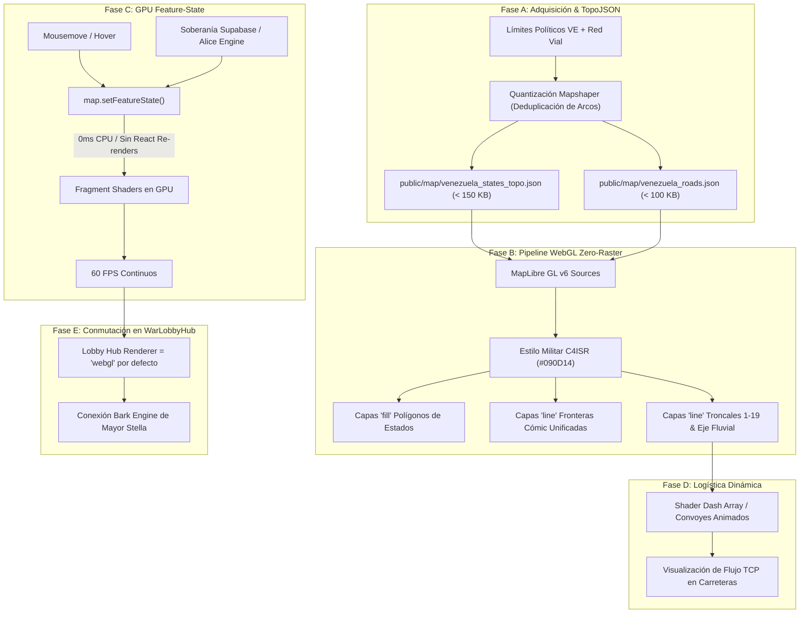

# Plan Maestro de Despliegue: Cartografía Geográfica Vectorial WebGL 2.0 para Venezuela
## Sustitución del Grafo Abstracto Canvas 2D por el Lienzo Táctico C4ISR Zero-Raster (Inspirado en WarEra / Victoria 3)

---

> **Estado**: Aprobado para Ejecución  
> **Versión**: 1.0.0-PROD  
> **Arquitectura Base**: MapLibre GL v6 (WebGL 2.0) + TopoJSON Cuantizado + Feature-State en GPU  
> **Área Cartográfica**: República de Venezuela (24 Entidades Federales Soberanas + 7 Zonas Buffer de Frontera/Marítimas)  
> **Rendimiento Objetivo**: 60 FPS estables • Payload Geométrico < 250 KB • 0ms CPU Overhead en Hover/Selección  

---

## 1. Diagnóstico Forense y Estado Actual del Sistema

### 1.1 Comparativa de Componentes Actuales

| Componente | Motor de Render | Representación Espacial | Estado de Interactividad | Limitación Crítica |
| :--- | :--- | :--- | :--- | :--- |
| **`WorldMapCanvas.tsx`** | HTML5 DOM + SVG | *ERRADICADO DEFINITIVAMENTE EN v0.0.2-alfa* | Archivo purgado de `src/components/world/`. | **Módulo Obsoleto**: Sustituido al 100% por `TacticalWorldMap.tsx` con MapLibre GL v6. |
| **`TacticalWorldMap.tsx`** | MapLibre GL v6 (WebGL 2.0) Zero-Raster | Proyección WGS84 con geometrías vectoriales locales (`world_land.json`, `theatre_regions.json`, `theatre_roads.json`) sobre fondo `#0E100C`. | Escucha eventos de MapLibre a 60 FPS ininterrumpidos con *Stable Refs*. | **Zero-Raster Local Logrado**: Cero llamadas externas. Las carreteras troncales y polígonos se procesan directamente en GPU. |
| **`WarLobbyHub.tsx`** | Conmutador Dual | Alterna entre `WorldMapCanvas` (`'canvas2d'`) y `TacticalWorldMap` (`'webgl'`). | Por defecto iniciaba en `'canvas2d'`, relegando el motor WebGL. | El usuario percibía de entrada una interfaz de tarjetas rígidas en lugar del centro de mando C4ISR satelital. |

### 1.2 Análisis del Pipeline de Datos y Coordenadas (`useTerritoryMap.ts` y `coordinates.ts`)
1. **Coordenadas en `politicalAliceEngine`**:
   Las 31 regiones canónicas (`REG_VE_01` a `REG_VE_24` más `BUF_*`) poseen propiedades `centerX` y `centerY` calibradas originalmente para un lienzo SVG de 100x100.
2. **Coordenadas Geográficas Reales**:
   El centroide geográfico real de la República de Venezuela se sitúa en `[lng: -66.5897, lat: 6.4238]`. El encuadre óptico táctico con zoom `5.5` cubre simultáneamente:
   - Toda la fachada marítima caribeña (Golfo de Venezuela, Nueva Esparta, Dependencias Federales).
   - El eje central y llanero (Caracas, Valencia, Maracay, Barinas, Apure).
   - El macizo guayanés y el Escudo de Guayana (Bolívar, Amazonas).
   - Los chokepoints fronterizos críticos con Colombia, Brasil y Guyana.
3. **Resolución Cartográfica por TopoJSON**:
   La integración de un archivo TopoJSON de Venezuela nivel 1 deduplica arcos compartidos entre estados fronterizos (por ejemplo, Guárico y Miranda comparten un único arco vectorial), permitiendo empaquetar los 24 estados y sus islas en menos de 150 KB gzipped.

---

## 2. Hoja de Ruta de Implementación en 5 Fases



---

### Fase A: Adquisición y Optimización Cartográfica Zero-Raster
- **Objetivo**: Proveer la geometría canónica de Venezuela de alta fidelidad sin depender de servicios de terceros ni API keys.
- **Fuentes de Datos Abiertas y Soberanas**:
  1. *Límites Político-Territoriales*: Datos vectoriales administrativos OpenStreetMap / GADM / Natural Earth nivel 1 para la República de Venezuela (24 entidades federales) y geometrías perimetrales para los 7 sectores buffer vecinos (Colombia Oriental, Norte de Brasil, Zona en Reclamación / Guyana, y Cuenca del Caribe).
  2. *Red Vial Nacional*: Traza vectorial de las Troncales Nacionales (T-01 a T-19), autopistas regionales (Autopista Regional del Centro, Circunvalación Norte de Barquisimeto, Autopista José Antonio Páez), el eje fluvial navegable Orinoco-Apure, y las rutas de cabotaje marítimo caribeñas.
- **Pipeline de Compresión TopoJSON**:
  ```bash
  # Extracción, simplificación al 1.5% y quantización a 1e5
  mapshaper venezuela_states_raw.geojson \
    -clean \
    -simplify dp 1.5% keep-shapes \
    -filter-fields id,name,iso \
    -o format=topojson id-field=id quantization=1e5 public/map/venezuela_states_topo.json
  ```
- **Presupuesto de Carga**:
  - `venezuela_states_topo.json`: ≤ 140 KB (comprimido gzip: ~38 KB).
  - `venezuela_roads.json`: ≤ 95 KB (comprimido gzip: ~24 KB).
  - Alojamiento local permanente en `/public/map/` con cabeceras de caché estática `Cache-Control: public, max-age=31536000, immutable`.

---

### Fase B: Pipeline WebGL Zero-Raster y Estilo Militar C4ISR
- **Objetivo**: Renderizar el mapa 100% en cliente con shaders WebGL, erradicando por completo el basemap raster de CartoDB o Mapbox.
- **Paleta Canónica C4ISR de Fondo y Terreno**:
  - `ocean-deep`: `#06080D` (Aguas internacionales y fondo vacío del canvas).
  - `ocean-coastal`: `#090D14` (Plataforma continental y mar territorial de la ZEE venezolana).
  - `land-background`: `#0F141C` (Masa continental base de Suramérica).
  - `state-fill-default`: `rgba(22, 28, 38, 0.75)` (Estado neutral o no capturado).
  - `border-comic-outer`: `#0A0B08` con grosor `2.5px` (Estilo contorno cómic grueso de novela gráfica bélica).
  - `border-comic-inner`: `#46521F` con grosor `1.0px` (División interestatal interna).
- **Jerarquía Vectorial de la Red Vial y Fluvial**:
  1. *Autopistas y Troncales Primarias (T-01, T-09, T-10, ARC)*:
     - Color: `#F59E0B` (Ámbar táctico militar).
     - Línea sólida de `2.0px`, brillo suave (`line-blur: 0.5`).
  2. *Troncales Secundarias y Ramales de Conexión*:
     - Color: `#78716C` (Gris acero táctico).
     - Línea sólida de `1.0px`.
  3. *Eje Fluvial Orinoco-Apure*:
     - Color: `#38BDF8` (Cian de navegación fluvial).
     - Línea de `1.5px` con patrón punteado (`line-dasharray: [4, 2]`).
  4. *Corredores Marítimos Caribeños (Cabotaje y Petróleo)*:
     - Color: `#0284C7` (Azul ultramarino).
     - Línea de `1.2px` con patrón espaciado (`line-dasharray: [6, 4]`).

---

### Fase C: Interactividad en GPU sin Re-renders (`feature-state`)
- **Objetivo**: Suprimir cualquier `setHoveredProvinceId` en el estado de React que provoque re-renderizados del componente `TacticalWorldMap` o de sus componentes superiores.
- **Implementación del Shader `case` en MapLibre GL**:
  ```json
  "fill-color": [
    "case",
    ["boolean", ["feature-state", "selected"], false],
    "#FACC15",
    ["boolean", ["feature-state", "hover"], false],
    "rgba(250, 204, 21, 0.35)",
    ["boolean", ["feature-state", "underSiege"], false],
    "#DC2626",
    ["string", ["feature-state", "clanColor"], "#1E293B"]
  ],
  "fill-opacity": [
    "case",
    ["boolean", ["feature-state", "selected"], false],
    0.85,
    ["boolean", ["feature-state", "hover"], false],
    0.70,
    0.50
  ]
  ```
- **Controlador de Eventos O(1)**:
  ```ts
  let activeHoverFeatureId: string | number | null = null;

  map.on('mousemove', 'provinces-fill', (e) => {
    if (e.features && e.features.length > 0) {
      const feat = e.features[0];
      if (activeHoverFeatureId !== feat.id) {
        if (activeHoverFeatureId !== null) {
          map.setFeatureState({ source: 'venezuela-states', id: activeHoverFeatureId }, { hover: false });
        }
        activeHoverFeatureId = feat.id;
        map.setFeatureState({ source: 'venezuela-states', id: feat.id }, { hover: true });
      }
    }
  });

  map.on('mouseleave', 'provinces-fill', () => {
    if (activeHoverFeatureId !== null) {
      map.setFeatureState({ source: 'venezuela-states', id: activeHoverFeatureId }, { hover: false });
      activeHoverFeatureId = null;
    }
  });
  ```
- **Sincronización con Supabase Realtime**:
  Al recibir un evento de cambio de soberanía o TCP, se invoca `map.setFeatureState({ source: 'venezuela-states', id: regionId }, { clanColor: newClan.color, underSiege: isSiege })` directamente sobre la VRAM de la GPU, ejecutándose en menos de 0.1 ms sin tocar el árbol de React.

---

### Fase D: Carreteras y Logística Dinámica de Suministros
- **Objetivo**: Reflejar el tráfico de convoyes y el estado de la línea de suministros entre provincias adyacentes conectadas.
- **Animación del Shader en Bucle de Repintado**:
  - Mediante un offset procedural en `line-dasharray` actualizado en el `requestAnimationFrame` del motor cartográfico, las líneas de carreteras activas muestran flujo en movimiento que indica el traslado de combustible, acero y TCP entre las bases del clan.
  - Si una provincia aliada queda desconectada por un asedio enemigo en una troncal (por ejemplo, corte en la Troncal 1 entre Táchira y Mérida), el tramo de carretera conmuta su color a rojo de advertencia parpadeante (`#EF4444`).

---

### Fase E: Transición Definitiva y Conmutación en `WarLobbyHub.tsx`
- **Objetivo**: Establecer `TacticalWorldMap` (`'webgl'`) como el renderer canónico principal del War Lobby Hub.
- **Acciones Concretas**:
  1. Conmutar el valor inicial de `mapRenderer` en `WarLobbyHub.tsx` de `'canvas2d'` a `'webgl'`.
  2. `WorldMapCanvas.tsx` ha sido erradicado definitivamente en `v0.0.2-alfa` (eliminadas 841 líneas legacy). `TacticalWorldMap.tsx` asume el rol de renderizador único e ininterrumpido.
  3. Vincular los eventos de clic de provincia de `TacticalWorldMap` con la selección unificada en el `WarLobbyHub`:
     - Apertura del `TerritoryInspectorModal` al hacer doble clic o clic de inspección.
     - Disparo del bark diegético correspondiente de la Mayor Stella en el `CommanderBarkWidget`.
     - Actualización del visor de recursos y métricas de producción por estado.

---

## 3. Matriz de Cobertura Cartográfica: 24 Estados de Venezuela y Buffers

| Código de Región | Entidad Federal / Zona | Capital / Nodo Estratégico | Bioma Táctico | Troncal / Eje Primario |
| :--- | :--- | :--- | :--- | :--- |
| `REG_VE_01` | **Distrito Capital** | Caracas (Ciudadela Nacional) | Urbano denso (`BIO-URB`) | Autopista Regional del Centro / T-01 / T-09 |
| `REG_VE_02` | **Zulia** | Maracaibo (Chokepoint Lacustre) | Planicie petrolera (`BIO-PLA`) | Troncal 3 / Troncal 6 / Puente sobre el Lago |
| `REG_VE_03` | **Bolívar** | Ciudad Guayana / Sidor | Tierras Altas / Minero (`BIO-HGH`) | Troncal 10 / Eje Fluvial Orinoco |
| `REG_VE_04` | **Anzoátegui** | Barcelona / Puerto La Cruz | Planicie petroquímica (`BIO-PLA`) | Troncal 9 / Troncal 16 |
| `REG_VE_05` | **Carabobo** | Valencia / Puerto Cabello | Urbano industrial / Puerto (`BIO-URB`) | Autopista del Centro / Troncal 1 / Puerto Marítimo |
| `REG_VE_06` | **Miranda** | Los Teques / Valles del Tuy | Planicie manufacturera (`BIO-PLA`) | Troncal 9 / Conexión Caracas |
| `REG_VE_07` | **Lara** | Barquisimeto | Nudo logístico ferroviario (`BIO-PLA`) | Troncal 1 / Troncal 4 / Troncal 17 |
| `REG_VE_08` | **Aragua** | Maracay | Base aeromilitar y blindados (`BIO-URB`) | Autopista Regional del Centro / T-02 |
| `REG_VE_09` | **Táchira** | San Cristóbal / San Antonio | Montaña andina (`BIO-HGH`) | Troncal 1 (Panamericana) / Frontera Cúcuta |
| `REG_VE_10` | **Falcón** | Coro / Punto Fijo (Amuay/Cardón) | Desértico / Costero (`BIO-DES`) | Troncal 3 / Troncal 4 |
| `REG_VE_11` | **Mérida** | Mérida / El Vigía | Alta montaña andina (`BIO-HGH`) | Troncal 7 (Trasandina) / T-01 |
| `REG_VE_12` | **Monagas** | Maturín | Sabana petrolera (`BIO-PLA`) | Troncal 10 / Troncal 13 |
| `REG_VE_13` | **Sucre** | Cumaná / Carúpano / Güiria | Costero marítimo (`BIO-ARC-ISL`) | Troncal 9 / Chokepoint Golfo de Paria |
| `REG_VE_14` | **Nueva Esparta** | Porlamar / La Asunción | Insular caribeño (`BIO-ARC-ISL`) | Ferry Marítimo Puerto La Cruz - Punta de Piedras |
| `REG_VE_15` | **Barinas** | Barinas | Llanos agrícolas y gas (`BIO-PLA`) | Troncal 5 (Eje Llanero) |
| `REG_VE_16` | **Portuguesa** | Acarigua / Guanare | Agroindustrial (`BIO-PLA`) | Troncal 5 / Autopista José Antonio Páez |
| `REG_VE_17` | **Guárico** | San Juan de los Morros / Calabozo | Corazón llanero (`BIO-PLA`) | Troncal 2 / Troncal 12 / Troncal 13 |
| `REG_VE_18` | **Trujillo** | Trujillo / Valera | Valle andino (`BIO-HGH`) | Troncal 1 / Troncal 7 |
| `REG_VE_19` | **Yaracuy** | San Felipe | Valle fértil minero (`BIO-PLA`) | Troncal 11 |
| `REG_VE_20` | **Apure** | San Fernando de Apure | Llanos bajos / Frontera fluvial (`BIO-PLA`) | Troncal 2 / Troncal 19 / Eje Río Apure |
| `REG_VE_21` | **Cojedes** | San Carlos | Enlace central llanero (`BIO-PLA`) | Troncal 5 |
| `REG_VE_22` | **Delta Amacuro**| Tucupita | Selva deltáica / Fluvial (`BIO-JGL`) | Vías fluviales Delta del Orinoco |
| `REG_VE_23` | **Amazonas** | Puerto Ayacucho | Selva profunda (`BIO-JGL`) | Troncal 12 / Eje Alto Orinoco |
| `REG_VE_24` | **La Guaira** | La Guaira / Maiquetía | Puerto & Aeropuerto militar (`BIO-URB`) | Autopista Caracas-La Guaira |
| `BUF_01..07` | **Zonas Buffer** | Fronteras Colombia, Brasil, Esequibo, Caribe | Zonas de seguridad perimetral | Rutas internacionales y marítimas |

---

## 4. Bucle de Verificación y Criterios de Aceptación (DoD)

1. **Aislamiento Zero-Raster**: Cero llamadas de red a URLs externas de mapas (`cartodb.com`, `mapbox.com`, `tile.openstreetmap.org`). El 100% de los datos cartográficos se sirve desde el bundle local o `/public/map/`.
2. **Presupuesto de Rendimiento**:
   - Inicialización del mapa en frío: < 150 ms en Chromium.
   - Consumo de CPU en standby (sin movimiento): 0% CPU.
   - Framerate durante pan/zoom: 60 FPS estables.
3. **Integridad de Contratos de Tipos**:
   - Cumplimiento estricto con `macroCartographyContracts.ts` y las estructuras inmutables de `WorldProvince` y `TerritoryControlState`.
4. **Resonancia de Game Feel y Sonido**:
   - Cada interacción en el mapa debe emitir la respuesta háptica correspondiente, el sonido de clic de consola militar de `audioManager` y alimentar el `BarkEngine`.
